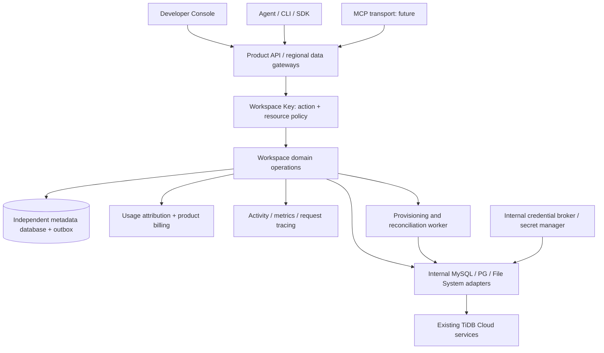

# TiDB Workspace: product and service architecture

Design baseline: 2026-10-27. This is the proposed architecture for an independent developer
and agent product. The repository currently implements a loopback-only interactive prototype
with demo databases and an opt-in real Singapore Drive9 anonymous File System. Anonymous Zero MySQL and native DuckDB with private dedicated storage are implemented; db9 PostgreSQL is available through explicit opt-in. Persistent TiDB Cloud Starter/PG support below remains proposed; see [ADR 0006](decisions/0006-zero-sql-gateway.md). See [ADR 0004](decisions/0004-drive9-anonymous-provider.md) for the implemented provider boundary. See [ADR 0001](decisions/0001-unified-workspace-key.md) for the
accepted single-key authorization model.

The [intent driven development system](standards/intent-driven-development.md) records the
API-first and agent-experience direction, specification contributions, and proposed delivery
harness. It complements this product architecture; it does not imply new runtime capabilities
or deployment authority.

The [db9 adapter](decisions/0011-db9-postgres.md) implements an independent PostgreSQL-compatible
resource. Its credentials stay private and customer SQL uses a non-superuser role; see
[compatibility and recovery](db9-postgres.md).

## Product model

A Workspace is the persistent context for one application, experiment, or agent workflow.
The proposed full product lets developers add MySQL-compatible Starter databases, PostgreSQL-compatible Starter databases,
and File Systems as needed. Resources have their own capabilities, regions, lifecycle, and
internal provider bindings. MySQL and PG are separate instances; changing a connection string
does not change an instance's protocol. Files can be used without creating a database.

The product owns its customer accounts, authorization, support experience, and billing view.
Customers do not need a TiDB Cloud account or provider management key. Upstream cloud tenants,
projects, credentials, and consumption ledgers are implementation details of internal services.

```text
Product account / customer tenant / billing account
  ├─ Workspace A
  │   ├─ MySQL resource → internal provider resource binding
  │   ├─ PG resource → internal provider resource binding
  │   ├─ File System → internal provider resource binding
  │   ├─ Workspace Keys → action + resource grants
  │   └─ Activity, usage, and budget attribution
  └─ Workspace B
```

Workspace ownership is an authorization boundary; actual data isolation also relies on the
provider's instance, database user, filesystem, and internal credential policies. Internal
cloud organization limits may be shared across many customer workspaces. Capacity allocation
must respect those upstream limits instead of promising a fresh provider free tier to each
customer.

The first-run path is: create/open a Workspace, add one resource, create a scoped Workspace
Key, complete a useful request from an agent, then inspect the resulting data and usage.
A new workspace should not require provisioning all three resource types. The prototype preseeds a MySQL demo and local File System; real resources are explicitly created. PG is not currently offered.

Supabase's project-level grouping is a useful product reference; TiDB Workspace groups an
optional mix of three distinct resource types. [Supabase Platform](https://supabase.com/docs/guides/platform)

## Console information architecture

| Page             | Primary task                                  | Important states and interactions                                                                                                                    |
| ---------------- | --------------------------------------------- | ---------------------------------------------------------------------------------------------------------------------------------------------------- |
| Overview         | Understand resources and the next useful step | Resource health, create resource, connect agent, allowance summary, recent activity, empty-workspace onboarding                                      |
| Databases        | Create and use MySQL or PG resources          | Resource list, per-database SQL editor and connection actions, protocol, region, lifecycle, supported capabilities; future native client integration |
| File System      | Manage agent context and output               | Directory navigation, filtering, preview/edit/upload/download, scoped access; future streaming and checkpoints                                       |
| Connect an agent | Complete the first authenticated request      | Workspace Key, environment setup, OpenAPI, project instructions, REST examples, future MCP integration                                               |
| API keys         | Grant access to a workflow                    | Allowed resources, allowed actions, explicit future-resource permission, expiry, last use, rotation and revocation                                   |
| API explorer     | Try the actual public API                     | Endpoint/scope selection, request and response examples, error codes, request ID, contract download                                                  |
| Monitoring       | Understand behavior and performance           | Resource health, actual activity, query/file metrics, actor/resource filters, measurement freshness                                                  |
| Usage & billing  | Understand allowances and charges             | Per-resource usage, customer allocation, upstream allowance attribution, estimated/settled spend, limits                                             |
| Settings         | Manage the personal workspace                 | Names, profile and account/session status; future account claim, security, export and deletion                                                       |

SQL Editor belongs inside Databases, scoped to a selected MySQL, PostgreSQL or DuckDB resource;
it is not a peer of Databases in the workspace navigation. The implemented route is
`#databases/<resource-id>/sql`. Database names, row actions, and connection dialogs must
open that exact resource, with Databases remaining active in the sidebar. Reload and
browser back/forward preserve the resource; switching databases clears previous query
results/errors. An unavailable or non-database resource must never silently select another
database. Legacy `#sql` links open the database list for explicit selection. Keep the query
target, displayed database, and URL consistent when adding future database tools.

Resource collection entry points are explicit: `#databases` lists databases and `#files`
lists public File Systems, including the zero- and single-resource cases. The Console does
not auto-select a live/first resource. `#files?resourceId=<id>` opens one File System; existing
`path`/`view` query links still open the selected file directly. Resource names and connection
dialogs retain that ID, closing a file stays in the resource, and All file systems returns to
the collection with the unsaved-draft guard. Unknown/non-File-System IDs cannot fall back to
another resource. The list does not mount the file browser or fetch a directory before
selection. See [verification](filesystem-list-verification.md).

Database and File System workspaces share the same hierarchy (owner correction, 2026-10-28):
one compact resource selector/status/actions toolbar, then a browser
beside the working panel. The database selector is above both Tables and SQL Editor; it must
not live inside the editor it controls. File System uses the same layout even before selecting
a file, with an explicit unselected-file panel on desktop. Tables and Files share item chrome,
browser width and collapse behavior. DuckDB uses tidbfs native database mode and the same
Tables/SQL experience; its workspace has no custom file-source picker. Optional snapshot
queries remain a separate API capability, with File System Analyze for Console file analysis.
Table rows expand column names, types and available key/null/default properties in place.
Clicking a table keeps SQL Editor and Query results primary; full Table details remains an
explicit secondary choice. Query table prepares SQL with the edited-draft guard and never
runs it automatically. See [inline column verification](database-workspace-verification.md#inline-table-columns).

Database SQL and File System analysis share their execution toolbar, editor sizing, samples,
limits, expansion and result presentation. Both browsers have the same mobile disclosure;
file preview keeps its explicit return and unsaved-change protections. Following GH-56,
the editor uses a quiet language/context strip with one Run action and an Editor tools menu,
without a repeated large tool heading or a second footer toolbar. Context remains visible.
File analysis remains
read-only and cancelable, while database SQL preserves its live-write boundary.
Existing resource/table/file URLs and busy/draft protections remain authoritative. See
[resource workspace verification](resource-workspace-verification.md).

File System analysis is implemented as bounded server-side snapshot workers: CSV supports
DuckDB SQL over parsed rows and Just Bash over raw UTF-8 text; Parquet uses SQL, while recognized
logs and text use Just Bash. [ADR 0014](decisions/0014-file-analysis-engine-options.md) separates
format, default engine and individual capability availability. Analysis requires `files:read`, `files:analyze`
and the resource grant. [ADR 0015](decisions/0015-bash-workspace-paths.md) preserves the selected
Workspace path inside the Bash snapshot, with discovered input metadata and compatible aliases.
Provider credentials never enter workers. This is a read-only local
prototype; public compute isolation and larger remote scans remain future work. See
[ADR 0010](decisions/0010-read-only-file-analysis.md).

File System opens a unified non-modal file workspace beside the desktop browser. Preview is
primary; SQL/Bash expands in place and preview/results share the content area without losing
in-memory drafts or outputs. Markdown renders by default; text source editing is an explicit
secondary action with save/discard guards. The local JSON API accepts UTF-8 up to 256 KiB;
live resources also support bounded binary transfers. Text previews retain their separate
128 KiB and complexity limits. CSV/Parquet use a fixed server-generated sample of at most
20 rows/50 columns/128 KiB, with the existing 16 MiB whole-snapshot and 15-second budgets.
CSV types are inferred and total count unknown; Parquet reports metadata row count. Fixed
preview needs read access, while custom SQL/Bash still needs read plus analyze. Versioned
results warn when compared to another saved preview. Download/navigation remain available
on unsupported, invalid or over-budget input. Image/PDF/media rendering and large remote
scans remain future work. See [ADR 0017](decisions/0017-preview-first-file-workspace.md),
[verification](file-workspace-verification.md) and the
[file reading standard](standards/tiui-design-system.md#theme-responsive-behavior-and-interaction).

Preview's content header has one Export entry for the saved original, including download in
its labeled dialog; execution headers
export only their completed SQL result or Bash stdout/stderr. All share computer, public File
System and new database table destinations. Original/Bash database imports use explicit fixed
parsing and reviewed fields/types before confirmation, with bounded five-minute, principal-bound
server snapshots and saved-original version checks. Copy/download preserves raw bytes; export
never reruns execution. See [ADR 0018](decisions/0018-contextual-file-exports.md) and
[contract, permissions and verification](contextual-file-export-verification.md).

File System creation and fresh demo workspaces default to AWS Singapore (`aws-ap-southeast-1`),
with Oregon retained as another configured region. Persisted resources keep their existing
regions and contents. Region availability, free-tier allowances, and Drive9 Anonymous versus
TiDBCloud mode are separate provider properties; see [ADR 0003](decisions/0003-filesystem-regions-and-modes.md)
for the verified configuration sources and integration boundaries.

Use real TiUI components, its semantic palette and theme provider, with the Workspace's
larger typography and spacing requirements. The [TiUI standard](standards/tiui-design-system.md)
defines verified defaults, component selection, light/dark/system behavior, responsive
interaction, and migration evidence. [ADR 0002](decisions/0002-tiui-design-system.md) records
the accepted foundation. Preview status, limits, and the three resource types need text labels.

The prototype now uses TiUI components and a single provider-controlled theme. Shared
readability, modal, navigation, code, and SQL adapters live under `src/ui/` and `src/features/`.
Build repeated domain compositions such as ResourceCard, QuotaMeter,
ConnectionPanel, PermissionEditor, and ActivityTable from verified TiUI primitives/business
components. Organize new features into focused modules with shared API/domain types. Register
navigation and capabilities for future services instead of adding global conditionals
throughout the app.

## Backend boundaries

Implemented DuckDB file queries use explicit query-scoped CSV/JSON/Parquet sources, authorized
with database query access plus read/analyze access to every public File System. The backend
loads bounded private snapshots and materializes an in-memory catalog before disabling external
access; source queries attach the native database read-only and admit only SELECT. Source tokens,
snapshots and database backing storage stay internal. See [ADR 0009](decisions/0009-duckdb-file-sources.md)
and [the source contract](duckdb-databases.md#workspace-file-sources).

Implemented delivery: the Console and API have independent builds, processes, and artifacts in
one repository. The API serves only HTTP API/schema endpoints; the static Console uses runtime
API-origin configuration and an OpenAPI-generated typed client. The existing backend remains
Node ESM. See [ADR 0005](decisions/0005-independent-console-and-api.md) and the
[operating guide](independent-delivery.md). Production identity and hosting remain proposed.

The proposed production service starts with one modular Workspace service and a
provisioning/reconciliation worker. A future language migration needs its own scoped decision;
the current implementation retains Node ESM and existing provider clients. Separate deployment
into microservices only when independent scaling or ownership justifies it.



The Console and agents use the same domain commands and authorization. Console-specific
read aggregation can reduce round trips; it must not create a separate authorization model.
MCP maps tool calls onto the same operations.

Separate resource management from bounded SQL/file data operations. Both public paths accept
the customer's Workspace Key. Internally, regional gateways can pool SQL connections and
stream files so large payloads do not overwhelm the central control service. Upstream data
credentials remain internal. Native MySQL/PG clients and filesystem mounts require a deliberate
protocol gateway or bounded delegated product session; they are not automatically supported
by placing a Bearer key in a provider connection string.

Provider adapters should expose capability discovery, create/describe/delete, internal
connection resolution, credential binding, usage retrieval, and available data operations.
Capabilities include region, preview status, limits, supported operations, credential version,
and feature version. A Workspace default region is a preference, not a claim that every
component is available there.

TiDB Cloud documents management APIs, but this repository has not verified every required
PG and Files management/credential/metering operation. Confirm public or internal integration
contracts before implementing adapters; do not invent provider endpoints or scrape browser
credentials. [TiDB API overview](https://docs.pingcap.com/api/)

### TiDB Cloud integration policy

**Accepted project rule, 2026-10-28:** the owner requires direct official API or database
protocol integration by default, without Ti CLI as a product dependency. This applies to
all contributors and coding agents adding or changing TiDB Cloud resource adapters.

Use the documented service API for resource management and file operations, and a compatible
driver for native database protocols. An SDK may wrap the official API if its contract and
credential handling are verified. Keep these calls in backend provider adapters, with customer
Workspace Key checks before provider access and upstream credentials managed internally.

Do not shell out to Ti CLI, parse its output, or depend on its installation, login session,
or local configuration for product operations, builds, CI, or deployment. Optional manual
diagnostics may use the CLI when useful; they must not become a prerequisite for the product.
If a required API or protocol capability is unverified, record the gap and verify the official
contract rather than assuming CLI availability establishes a supported integration.

Current implementation: Zero provisioning uses its HTTP API, SQL uses the mysql2 driver, and
Drive9 file operations use its service API; see [ADR 0006](decisions/0006-zero-sql-gateway.md)
and [ADR 0004](decisions/0004-drive9-anonymous-provider.md). This records implementation evidence,
not a claim that every future TiDB Cloud feature has a verified API.

Review adapter calls, dependency manifests, build/release scripts, and setup documentation for
CLI prerequisites. Run the shared quality gate without requiring Ti CLI; current checks do not
automatically prove every integration follows this rule. Revisit it only when the owner changes
the integration requirement, documenting any accepted exception and its scope.

DuckDB uses a dedicated hidden backing File System and native worker runtime. Only its database resource is public; read [ADR 0008](decisions/0008-duckdb-private-storage.md) and [runtime operations](duckdb-databases.md).

## Customer identity and single-key access

Production customers sign in to this product. Human, agent, and service-account principals
share one authorization model. The local prototype uses a guest owner; a later identity
service should allow a guest workspace to be claimed without moving its resources.

A public key combines workspace ownership, allowed actions, allowed resource IDs, and expiry.
For example, a key can query PG and read/write Files while being denied access to MySQL.
Resource discovery, usage, and activity also respect this boundary. Resource-level checks
must occur in the service before returning data or making provider calls.

The prototype supports `resourceIds: ["db_vectors", "fs_shared"]` or an explicit `["*"]`.
Exact selections never expand to newly created resources. Resource creation needs the explicit
wildcard plus `resources:write`. A key cannot create/administer other keys; the local owner
session manages credentials. More granular per-resource actions and filesystem path rules
can extend this model later.

Internally retain distinct secrets: cloud management credentials, native SQL users/passwords,
and filesystem owner/scoped tokens. Store production secrets in a secret manager and keep
only references in metadata. The customer neither supplies nor rotates these credentials.
Internal rotation should not force a public Workspace Key change.

Upstream File System credentials have distinct management/data roles, and revoking an owner
token does not automatically revoke scoped tokens it issued. Track those internal bindings
when implementing rotation or cleanup. Public key revocation first blocks product requests;
long-lived sessions and delegated access must also implement bounded lifetime/revocation.
[File System authorization](https://docs.pingcap.com/tidbcloud-filesystem/filesystem-authorization/)

## Resource lifecycle, metadata, and API contract

Real provisioning uses persistent operation state:
`requested → provisioning → active / failed → deleting → deleted`.
Creation accepts `Idempotency-Key` and returns `202 + operation_id`. Workers retain provider
request IDs, retry safely, reconcile observed state, and recover partial failures. Commit
metadata and outbox records atomically. Never solve an uncertain upstream outcome by blindly
creating another potentially billable resource.

Core metadata includes product accounts/tenants, principals, workspaces, resource/provider
bindings, key digests/grants, secret references, operations, idempotency records, outbox events,
audit records, usage events, quota allocations, and product billing attribution. Keep it in
an independent database, outside customer-deletable application instances. Real file contents
belong in the File System provider rather than the control-plane metadata database.

Proposed production resources:

```text
GET/POST   /v1/workspaces
GET/PATCH  /v1/workspaces/{workspace_id}
GET/POST   /v1/workspaces/{workspace_id}/resources
GET/DELETE /v1/workspaces/{workspace_id}/resources/{resource_id}
GET        /v1/workspaces/{workspace_id}/capabilities
GET/POST   /v1/workspaces/{workspace_id}/keys
DELETE     /v1/workspaces/{workspace_id}/keys/{key_id}
POST       /v1/workspaces/{workspace_id}/queries
GET/PUT    /v1/workspaces/{workspace_id}/files
GET        /v1/workspaces/{workspace_id}/usage
GET        /v1/workspaces/{workspace_id}/events
GET        /v1/operations/{operation_id}
```

This is a proposed surface. The exact implemented contract is `public/openapi.json`;
`server/generate-openapi.mjs` is its source. The prototype has one workspace, synchronous
simulated provisioning, bounded UTF-8 file operations, supported demo SELECT patterns, keys,
usage, activity, and settings. Production needs pagination, streaming, conditional writes,
query timeout/cancellation, and stable typed errors with request IDs/retryability. Generate
SDK/CLI types from the public contract and keep changes backward compatible where required.

## Usage, billing, and monitoring

The independent product owns customer plans, budget policy, payment experience, invoices,
and support. An internal ledger attributes/reconciles upstream provider cost to customer
workspaces. A customer invoice is not a requirement to open a TiDB Cloud billing account.
Avoid double charging and do not expose internal organization-wide credits as a separate
customer allowance for every workspace.

For the validation release, keep spending at $0 and show measured usage, allocated allowance,
capacity limits, freshness, and what happens at a limit. No payment data is collected. Fetch
real limits from provider configuration when integrating; do not permanently hard-code a
pricing assumption into the UI. PG and Files are preview offerings with distinct capabilities
and regional availability. [Starter plans](https://docs.pingcap.com/tidbcloud/select-cluster-tier/),
[PG FAQ](https://docs.pingcap.com/tidbcloud/pg-faq/), and
[Filesystem limits](https://docs.pingcap.com/tidbcloud-filesystem/manage-filesystem-limits/)

Meter upstream data activity, including any native/delegated access, with immutable deduplicated
events and versioned prices. Distinguish estimates from settled spend and account for lag.
A budget alert is different from an enforced cap; promise hard limits only when all data
paths and existing sessions obey them.

User observability covers resource status, queries, file activity, usage and agent attribution.
Platform observability covers provisioning latency, upstream failures, retries, quota exhaustion,
orphaned resources and ledger reconciliation. Production audit includes denied and failed
requests with redacted sensitive payloads. The prototype retains only the latest 200 successful
mutation events and displays clearly labeled illustrative charts; it is not cloud telemetry.

## Delivery stages and acceptance

| Stage                            | Scope                                                                                                                             | Acceptance                                                                                                                                                                        |
| -------------------------------- | --------------------------------------------------------------------------------------------------------------------------------- | --------------------------------------------------------------------------------------------------------------------------------------------------------------------------------- |
| Current prototype                | Guest owner, three demo resource types, persistent local files, single-key action/resource policy, OpenAPI and all Console routes | Local quality gate, API regression tests, browser inspection; no real cloud resources                                                                                             |
| V0 real free-resource validation | Controlled internal tenant, real MySQL/PG/Files adapters, internal credentials, allocated free capacity                           | One customer key queries both databases and writes/reads Files across sessions; forbidden component access fails; revocation affects every component; usage matches provider data |
| V1 developer beta                | Product sign-in/guest claim, multiple workspaces, real metrics, SDK/CLI/MCP, finer policies                                       | Successful first agent read/write is measurable; cross-workspace isolation; retry-safe operations; no customer provider-key requirement                                           |
| V2 commercial/collaborative use  | Payments/invoices, budgets, account security, sharing/team capabilities, provider-specific features                               | Accurate customer/upstream ledger reconciliation, tested revocation, export/delete and safe migration/rollback                                                                    |

The term "$0 version" is interpreted as free allowances / a zero-spending-limit evaluation,
not an API version. First verify upstream management/credential/metering contracts and internal
resource allocation. Anonymous public provisioning needs separate abuse controls, capacity
reservation, expiration, reclamation, and account claim. The local guest owner server is not
that implementation and must not be made public by simply changing its bind address.

Measure time to first useful request, agent onboarding success, second-session context reuse,
permission-denial reasons, revocation behavior, allowance accuracy, and safe retry outcomes.

### Database browsing

Each database has one SQL workspace: a persistent table navigator beside the editor, with
query results, columns, indexes and a bounded 100-row preview below. Selecting a table preserves
the SQL draft; explicitly generating a table query protects edited SQL before replacement. The Console and agents use the same resource-scoped reads with `queries:execute`
and resource grants. Discovery-only keys do not gain data access. Table selection is encoded
in the URL and Query table opens an editable SELECT without running it. See
[ADR 0007](decisions/0007-database-browser.md) for limits and the additive API contract.
