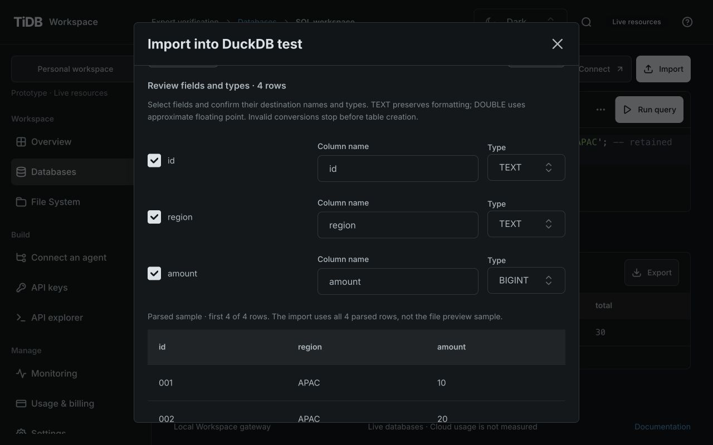
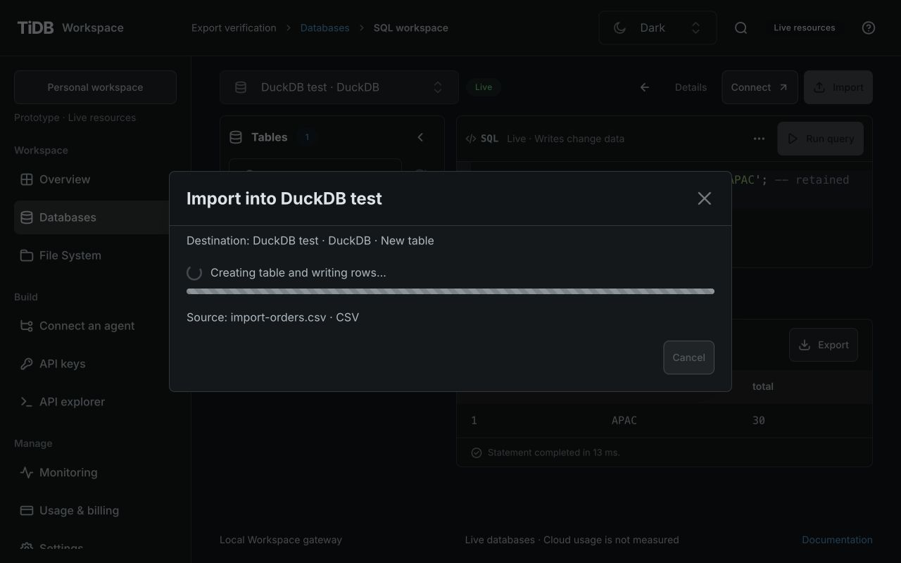
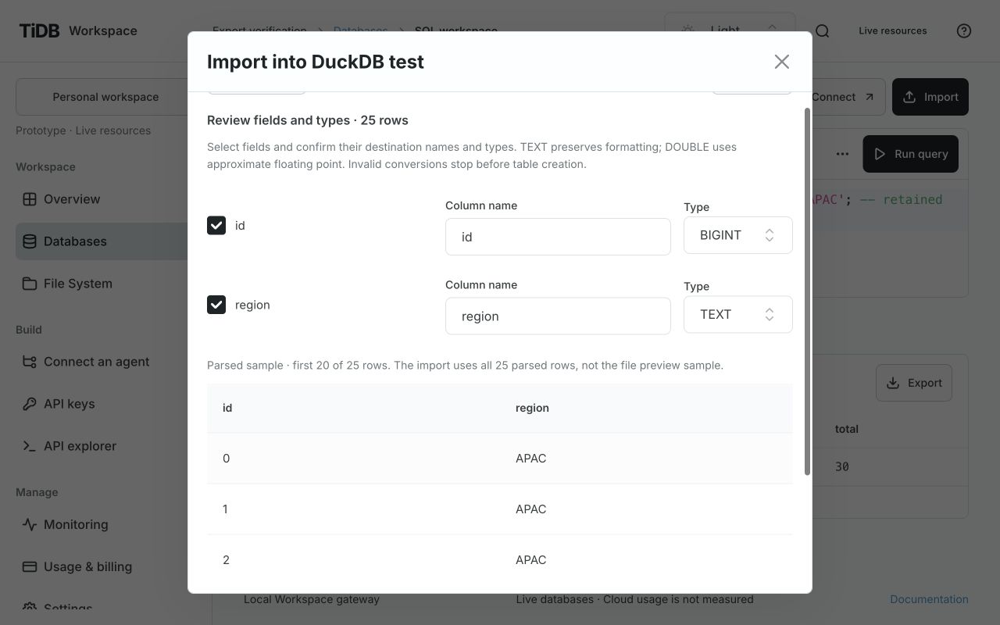
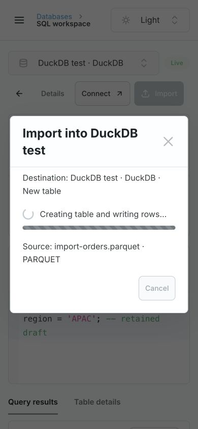
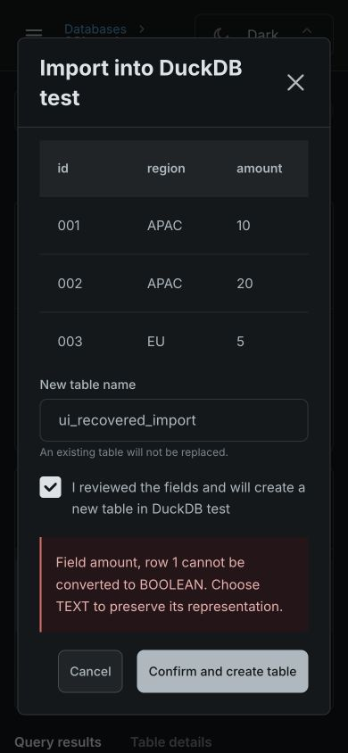

# Database Import: implementation and verification

GH-103 adds Import beside Connect in each supported live MySQL, db9 PostgreSQL and DuckDB
workspace. The accepted contract is [PR #104's frozen specification](https://github.com/siddontang/tidb.ai/blob/69b3adfc770e346047205638475d6966a5442961/specs/gh-103/spec.md);
[ADR 0023](decisions/0023-database-import-workspace.md) owns the boundary.

## Experience and implementation

Choose a local CSV/Parquet or a public Workspace File System file. Confirm CSV header and
separator, parse, then review sample rows, selected fields, names and types. Confirm a new
table name explicitly. Existing tables are never overwritten or appended. The local upload
is not saved into File System and requires no File System resource. All destinations use the
same review component as contextual exports.

The TiUI 2.9.1 Modal/Button/NativeSelect/Checkbox/Alert/Progress components and shared theme
adapters retain large type, spacious layout and light/dark modes. Progress distinguishes
uploading bytes from parsing, writing and acknowledged success. Parsing/writing are
indeterminate. The source form collapses after parsing; errors retain review and editable
inputs. Source/format changes invalidate review. Dismissal/submission are locked while busy.
Refresh failure after acknowledged success asks for a browser refresh, not a second import.
Open table preserves the SQL draft and completed results and never executes editor SQL.

Sources: `src/features/imports/`, database workspace/header, `src/api/client.ts`,
`backend/product/src/imports.rs`, shared Rust `exports.rs`, and transitional Node
`server/database-import-contract.mjs` / `file-exports.mjs`. No dependencies, persistent schema,
provider configuration, hidden public staging resource or billing behavior changed.

## API and budgets

The generated OpenAPI/client types describe these routes under
`/api/v1/workspaces/{workspaceId}`:

| Operation                               | Request                                                                                               | Purpose                        |
| --------------------------------------- | ----------------------------------------------------------------------------------------------------- | ------------------------------ |
| `POST /database-imports/prepare-upload` | Raw octet-stream; query `resourceId`, `filename`, `format`; CSV also `header=true/false`, `delimiter` | Parse ephemeral local bytes    |
| `POST /database-imports/prepare`        | `{resourceId, source:{resourceId,path}, parsing}`                                                     | Parse an authorized saved file |
| `POST /database-imports`                | `{resourceId, preparationId, confirmed:true, table, fields}`                                          | Create a reviewed new table    |

Example saved-file preparation:

```json
{
  "resourceId": "db_example",
  "source": { "resourceId": "fs_example", "path": "/orders.csv" },
  "parsing": { "format": "csv", "header": true, "delimiter": "," }
}
```

Parquet parsing is `{ "format": "parquet" }`. Commit uses the returned preparation ID and
reviewed field entries `{source,name,type}`; callers cannot replace server-held rows.
Local uploads require `queries:execute` and the destination resource grant. Saved sources
also require `files:read`, `files:analyze` and their source resource grant. Owner sessions use
the same domain checks. Provider/native credentials stay private.

Local bytes: 1 MiB; saved snapshot: 16 MiB. Both paths reject data above 1,000 rows, 100 columns
or 1 MiB parsed output. The sample is at most 20 rows and is never substituted for the full
dataset. Parsing uses two bounded disposable slots and a 15-second deadline. Complete converted
CREATE/INSERT plans must fit existing 64 KiB statement budgets. Preparations are process-only,
principal/target-bound, expire after five minutes and retain at most eight entries. Restart or
eviction requires preparing again. Changed saved bytes reject before writes.

Every commit path enforces target binding, including legacy file-export routes. Reauthorize
before provider writes and atomically consume before CREATE. A definitive table conflict can
retain review for a different name. Partial/uncertain outcomes require inspecting the target;
there is no automatic retry or compensating DROP. Rollback code does not undo imported data.

## Acceptance evidence

| Requirement | Evidence                                                                                                                                            |
| ----------- | --------------------------------------------------------------------------------------------------------------------------------------------------- |
| IMP-01      | `server/database-imports.test.mjs`: exact local CSV integers/leading zeros, native DuckDB readback and Parquet rows beyond the sample               |
| IMP-02      | Three-dialect SQL plans and source/destination I/O ordering; Rust/Node shared product scenarios                                                     |
| IMP-03      | Destination-only local Key, missing actions/grants, foreign source, expired/revoked/cross-Workspace requests before effects                         |
| IMP-04      | Principal/target binding, legacy-route bypass, changed source, restart/expiry/eviction, forged confirmation and concurrent commit rejection         |
| IMP-05      | Malformed query/body, bytes/rows/type/field/statement budgets; existing parser/snapshot worker tests                                                |
| IMP-06      | Collision/review reuse, failed INSERT and revoked authorization after CREATE produce incomplete outcomes; no retries or DROP                        |
| IMP-07      | Generated contract success cases; packaged Node API boot; raw CSV/Parquet and target-bound routes through Rust/Node with remote/in-process metadata |
| IMP-08      | Browser flows and screenshots below; retained drafts/results, local/FS switching, error recovery, progress/focus and success navigation             |

The feature was checked with the full Node quality/build gate and native Rust/S3 parity gate.
CI uses isolated provider fixtures, not cloud credentials. Fixture checks prove provider plans
and gateway behavior; live cloud write evidence and evaluated candidate SHAs are recorded in
the implementation PR, separately from fixture coverage.

Browser verification at 1280×800 and 390×844, both themes: local CSV created four rows;
Parquet showed 20 of 25 sample rows and SQL readback counted all 25; a Workspace CSV created
four rows. Leading-zero IDs remain text. Source switching invalidated review and auto-selected
CSV from its path. A rejected BOOLEAN conversion retained inputs; Parse again retained a renamed
field. A table conflict retained review for a new name. Escape was blocked during writing and
returned focus to Import after normal dismissal. No horizontal document overflow at 390px.
Header entry points were inspected for all three live providers; labeled demo Import is disabled.
Post-success refresh failure follows the explicit success branch; that particular browser
network failure was not injected in this verification.







## Delivery boundary

Console and Rust API must both be updated: a new Console against an old API cannot import.
Package reviewed clean source with its SHA/checksums, reuse the configured private API and
remote metadata authority, health-check, and retain the old binary/config for rollback.
Never replace the live metadata service or introduce demo metadata to make a preview pass.
Preserve active customer resources. See [Rust runtime](rust-backend.md) and
[independent delivery](independent-delivery.md). Larger imports, append/upsert, durable jobs,
resumable transfers and production compute isolation remain outside this iteration.
