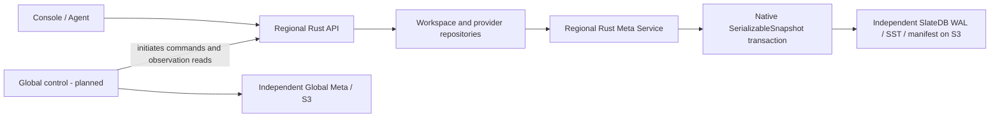

# ADR 0024: Fresh record metadata and retirement of the document bridge

> Node-source/test references below are historical. The owner retired that implementation and its dedicated regression tests in GH-34; current native coverage and tooling boundaries are recorded in [native retirement verification](../native-backend-retirement.md).

- Status: Accepted owner direction; implementation under [GH-105](https://github.com/siddontang/tidb.ai/issues/105).
- Date: 2026-10-29.
- Baseline: `cd4e9a88ab0837cf93616f2a5d184e9f92e45d49`.
- Supersedes the legacy document/import and Node handoff profile in ADRs 0019, 0020 and 0022. Their authority separation, native transaction and object-durability requirements remain.

## Decision and reset authority

The owner explicitly authorized discarding the current local test metadata and credentials instead of preserving the five-file prototype. This is permission to reset that local deployment, not permission to delete cloud db9, Zero or Drive9 instances. Cloud deletion was explicitly excluded. Future destructive resets need their own authorization; do not treat this local reset as an automatic upgrade strategy for customer deployments.

Use the selected SlateDB directly through the Rust Meta Service. Global and each Region retain separate processes, engines, identities, encryption roots and S3 roots. The same executable can compose real metadata and API roles in one process or run one role per process. Node supplies optional development orchestration, the Console build and isolated regression oracles; it is not a serving or rollback business backend.

Fresh installation format **2** uses the record wire capability `recordsV1`. It rejects installation format 1 rather than reading old document chunks or silently starting with empty state. There is no JSON import/export, verified-import marker, document codec, provider vault document, or Node/Rust writer handoff in the new runtime.

## Record contract and layout

A Scope binds authority, owner kind/ID, family and partition. Its hash prefixes `records/v2/<scope-hash>/`; logical record names are hex encoded under `data/`, retaining byte ordering for bounded prefix scans. Values are individually AES-GCM encrypted and bound to installation plus complete record path. Receipts remain outside the listable data namespace.

| Logical key                                            | Stored value                                                                    |
| ------------------------------------------------------ | ------------------------------------------------------------------------------- |
| `state/workspace`, `state/profile`                     | Workspace and local owner profile                                               |
| `state/resources/<id>`                                 | One resource, with stable presentation order                                    |
| `state/keys/<id>`                                      | One Workspace Key, digest, grants and real expiry/revocation                    |
| `indexes/key-digest/<sha256>`                          | Reference to the canonical Key record                                           |
| `state/files/<id>`                                     | One local file entry; cloud file data stays with its provider                   |
| `state/events/<id>`                                    | One bounded activity entry, without rewriting older entries to insert a new one |
| `state/idempotency/<hash>`                             | One resource-creation receipt; original logical key is encrypted in the value   |
| `state/resourceQueryCounts/<hash>`, `state/queryCount` | Separate counters rather than a canonical authorization document                |
| `bindings/<provider>/<id>`                             | Provider lifecycle metadata and an internal credential reference                |
| `credentials/<provider>/<id>`                          | Private connection, role passwords, tokens and recovery material                |
| `credentials/accounts/<provider>`                      | Private provider account state                                                  |
| `system/writer`                                        | Current single active API writer for this Workspace                             |

Every record has an opaque version. `get` returns selected records in one native snapshot. `list` performs a prefix scan with an exclusive logical cursor, at most 512 rows and 18 MiB per page. Each page is coherent; separate pages form a live listing, not a retained multi-request snapshot. `commit` conditions each changed record on `expectedVersion`, atomically writes up to 4096 changes/18 MiB plus its receipt, and awaits object durability. Null is a valid record value. `resolve` reconciles an uncertain mutation ID. Native conflicts do not replay a callback or provider effect.

Read transactions still pin a native sequence and wait for its durable frontier. Later memory commits cannot mix old and new values inside that read. A read can wait behind pending writes, with the existing 30-second bound. Unknown commit outcomes fail serving closed. Startup ownership/fresh-read fencing and graceful drain remain independent of transaction conflicts.

## Repositories and authorization

Workspace Key authentication uses the digest index and canonical Key record, checking expiry, revocation, actions and resource grants. It does not load local file contents or a complete Workspace to authorize a data request. Last-used updates touch only that Key and are coalesced to one per minute on the data path. An indexed reference never authorizes access by itself. Resource authorization reads its independent resource record before provider I/O.

Existing domain operations retain an in-memory aggregate for bounded Console/bootstrap and multi-field edits. Reconstruct it from paged records and persist only changed records. It is a domain projection, not a stored JSON document or migration adapter. Views reject more than 4096 rows/24 MiB rather than silently truncating. Resource/Key/file collections preserve order without rewriting unchanged records.

The API retains a single active Workspace writer while provider workflows use process-local coordination. Every storage operation checks the writer in the native transaction; a displaced API cannot serve cached authorization or publish changes. Normal restart releases it; crash recovery names the exact stopped writer. This is not distributed provider claiming or automatic HA. Independent Workspaces can share a regional Meta without sharing records, Keys or writers.

## Bootstrap, delivery and limits

An explicit `initializeWorkspace` creates an empty Workspace only when its core record is absent. Normal serving defaults false and rejects missing metadata. Local init generates fresh private configs/keys and independently scoped Meta installations. Successful bootstrap persists initialization state and disables creation for later starts. No sample resources, provider accounts, cloud instances or credentials are created automatically.

Only the Rust executable is packaged as the API. Console assets remain a separate artifact. Node sources under `server/` remain isolated behavior oracles and build/test tools, with no JSON-to-Meta adapter or serving command. The local operator starts the common Rust binary in independent roles.

This change does not implement production identity, Global policy distribution, public collection pagination, sharding or million-resource capacity. The bounded aggregate Console API and single Workspace writer remain explicit limitations. The underlying record API avoids whole-group snapshot limits and permits bounded point reads and scans; those primitives are not a capacity benchmark.

Evidence must cover fresh initialization, versioned record conflicts, pagination beyond one old snapshot group, duplicate receipts, S3 durability/crash recovery, mTLS, writer/workspace/authority isolation, remote/in-process product contracts, and packaged native execution without Node. Local rollout must verify the empty Portal and new source identity. Historical cloud instances remain untouched by the authorized local reset.
