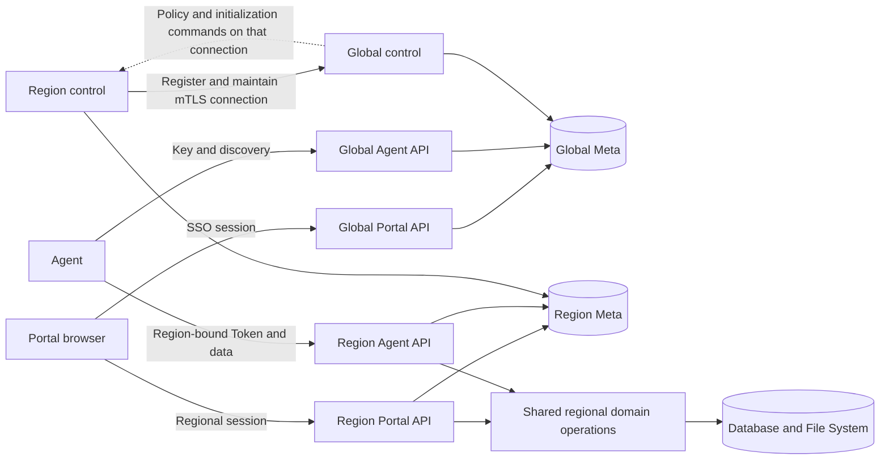

# ADR 0043: Portal, Agent and Region control boundaries

- Status: accepted direction; implementation in progress.
- Date: 2026-11-01.
- Supersedes the Region-connection direction in ADRs 0019 and 0040. Their data-path
  autonomy, credential and single Agent entry invariants remain in force.

## Boundaries

Portal API is a browser-facing session-authenticated product interface. It checks the user,
Workspace, action and resource, CSRF/origin and session lifecycle; it does not require an
Agent Key. Agent OpenAPI is the documented Key/Token interface. Internal service interfaces
authenticate service identity and, when acting on behalf of a user, separately authorize the
user and target. All three invoke the same domain operations. A browser-facing Portal API is
not made private merely by calling it internal. A Key cannot authenticate a Portal session,
and a Portal session does not grant a Key additional permissions.

Global owns identities, organizations, Workspace ownership/default Region, Keys and Region
directory. Region owns resources, data operations and local authorization state. A single
binary can compose these modules directly; separate processes use authenticated transports.
The public API and internal protocol are independent contracts. Capabilities advertised to
Agents remain documented and enforce their own privileges.

The arrows describe logical modules. In the bundled profile they run in one process, share an
external origin and use separate paths. In the distributed profile the same modules run in
separate processes, with independent Meta roots and separately configured network addresses.
The Portal remains a separately built static application.

| Boundary        | Representative paths                                               | Authentication and purpose                                                                                      |
| --------------- | ------------------------------------------------------------------ | --------------------------------------------------------------------------------------------------------------- |
| Global Portal   | `/api/portal/v1/workspaces/{id}/keys`, `/regional-session-tickets` | Browser session; authorize the user and Workspace before administering Keys or issuing a Region session ticket. |
| Region Portal   | `/api/portal/v1/workspaces/{id}/resources`, `/queries`, `/files`   | Regional browser session; enforce the same domain permissions and data operations.                              |
| Global Agent    | `/api/v1/token-issuances`, `/api/v1/workspaces/{id}/regions`       | Workspace Key or scoped Global Token; establish identity and return a registered Region route.                  |
| Region Agent    | `/api/v1/workspaces/{id}/resources`, `/queries`, `/files`          | Region-bound Token and scoped grants; database and file data flow directly to Region.                           |
| Service control | Region-initiated mTLS stream                                       | Service identities and Region binding; policy and Workspace initialization only.                                |

The table lists paths relative to each configured API base. For example, a single-origin
deployment may mount Global below `/studio/api/global` and Region below `/studio`. Portal
session and Agent Token authentication are mutually exclusive; neither kind of credential is
silently accepted by the other route family. Agent customers configure only the Global
endpoint and Key. The SDK discovers and validates the Region route and manages proof-bound
Region credentials; it never follows an arbitrary credential-bearing redirect.

## Region registration and control

Region initiates a long-lived, mutually authenticated encrypted control connection to Global.
The registration binds the authenticated Region service identity to its configured Region ID,
public API origin/path and instance ID. Global accepts only explicitly authorized identities,
Region IDs and public endpoint values; an arbitrary Region cannot change another's endpoint.
In development, plaintext or test identities are permitted only under an explicit loopback
profile. Production requires TLS and explicit trust material, with bounded rotation overlap.
Certificates authenticate services, not end users. Never send browser cookies, Agent Keys,
provider credentials, database rows, files or arbitrary shell commands on this connection.

Global publishes policy/desired-state updates over the connection and Region acknowledges only
after the local durable security transition and request fence complete. Messages have bounded
sizes, IDs, Region identity and version, deadlines and deterministic replay; errors after send
have an unknown outcome. Global records pending Key-policy reconciliation in its Meta before
changing an existing Key. Once Region reconnects, an in-process bounded reconciler reads those
records and resends the current signed policy; this needs no separate task service or external
queue. Stale/future/conflicting policy transitions are rejected. Connection liveness is not
proof that the data API is unavailable.
Do not mistake transport delivery for durable application.

Registration identifies the Region ID, advertised public origin and path, and a fresh instance
ID. Global compares the client certificate and descriptor against its operator-approved Region
configuration before publishing the live descriptor. Frames are size bounded and correlated;
the in-process channel is bounded. Reconnect replaces the active connection by generation,
and stale connections cannot acknowledge work for the replacement. Key changes are recorded
as pending in Global Meta and replayed on reconnect until the matching signed policy has been
durably installed. A response lost after sending is an unknown outcome and must not be treated
as proof that the command failed. Workspace initialization is idempotent and scoped to the
verified Global identity; the transport does not execute arbitrary shell commands.

The signed policy, Key generation, grant, expiry and local token/refresh checks remain the
existing independent security boundary. A Region never synchronously depends on Global for
data access or local renewal. During disconnection it enforces locally installed permissions,
revocations and expiry; new Global revocations reach it only on reconciliation. Renewal cannot
extend past the locally installed authorized expiry. A fresh Agent requires Global for initial
discovery; a previously enrolled Agent with retained credentials and a validated cached route
can continue during a Global outage. A single combined process shares its failure domain.

## Agent entry and deployment

An Agent configures one Global endpoint and a Workspace Key. It authenticates there, validates
authenticated Region discovery, and sends SQL/file requests directly to Region using a
Region-bound Token. The Key is never sent to Region or an unvalidated redirect. In a bundled
profile Global and Region can share one origin and differ by path. Distributed deployments
can use different Region origins internally without requiring a second user configuration.
Global never proxies SQL or file contents. The Portal serves independently from backend assets.

## Validation and delivery

Acceptance covers Portal session vs Agent Key separation; Global and Region authorization,
cross-Workspace and cross-Region denial; mTLS/untrusted identity and registration endpoint
rejection; command replay, stale generations, disconnect and reconnect; Portal and Agent domain
effects; single-process and separate-process deployments; Region read/write and local renewal
while Global is stopped. Use isolated local metadata/providers and targeted suites. Cloud is
authorized for a fresh deployment without preserving prior development data; do not claim a
deployment or security property until the actual implementation and checks establish it.

## Implemented authentication and deployment profiles

Portal requests use session-only paths and share regional domain operations. Agent paths
require Agent credentials, and the generated Agent contracts exclude Portal-only session and
Key administration operations. The standalone Global verifies the user's SSO login and uses
the Region-initiated connection to initialize the user's personal Workspace. To establish a
browser session, Global issues a signed, 60-second, single-use ticket bound to the user,
Workspace, Region and environment. The registered Region verifies the ticket, atomically
records its use in its own Meta, checks its local user policy and issues its own session cookie.
The TLS service identity alone cannot create or impersonate an end-user session. A Global
session revocation can take up to the ticket lifetime to prevent an already issued exchange;
the independent Region session follows the existing regional session revocation policy.

In a separate-process deployment, serve the Console `config.json` with the Global origin and
path prefix and `"portalMode":"distributed"`. The Portal obtains the Region address from
authenticated Global discovery and validates it before sending the one-use ticket. Both
services must explicitly allow the Console origin. Browser cookies use `SameSite=Strict`, so
the Console, Global and Region hosts must be same-site; cross-site Portal deployments require
a separate cookie and CSRF design and are not supported. A URL Workspace hint is untrusted:
Global authorization and the regional ticket both bind it before resource access. The Key is
not involved in Portal login.

The existing combined deployment keeps its existing SSO callback, with no extra user login or
callback registration for Key creation. A separately hosted Global login needs its own SSO
callback registration because it terminates Portal sign-in. The combined local profile supports
Guest; distributed Guest onboarding is not implemented and its Portal sign-in is disabled.
The implemented connection, onboarding and exchange have isolated local tests; they do not by
themselves establish that a particular cloud deployment has been configured or validated.

The one-use ticket ledger currently retains redeemed ticket records without automatic expiry
cleanup. Long-running installations need bounded garbage collection before this can be treated
as a solution for very large traffic. Control trust and certificate rotation are configuration
operations; automatic certificate issuance and rotation are not implemented. Fresh installations
can keep the security clock, policy floor and renewal witnesses in authority-local Meta without a
security volume. Existing file-backed installations still need migration or an explicit reset;
see ADR 0040 for time-reservation behavior and its failure boundary.
