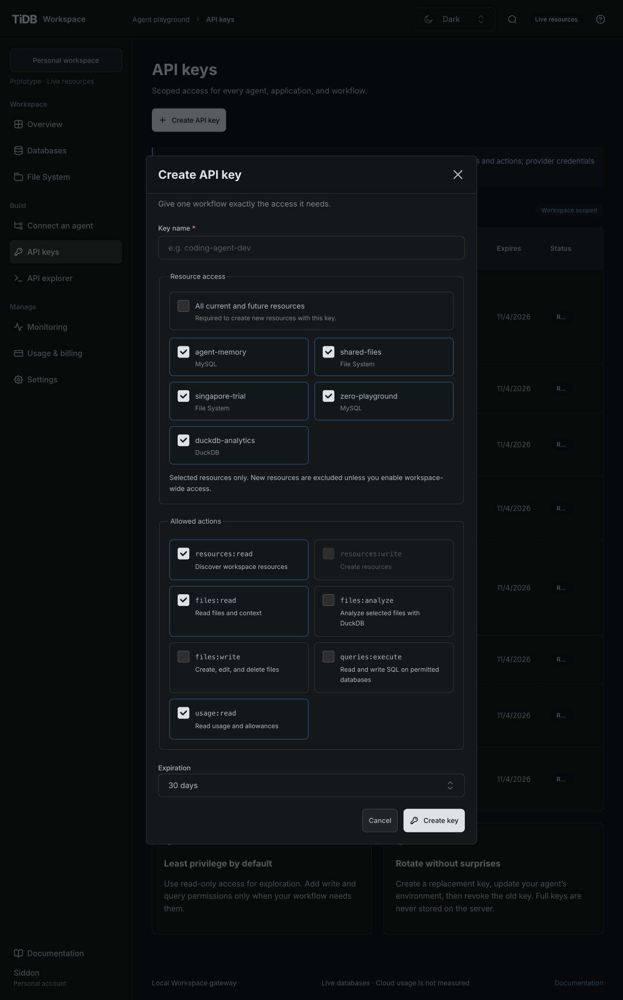
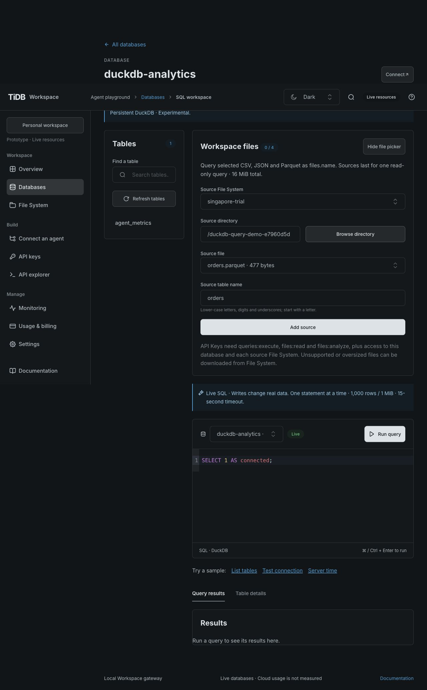
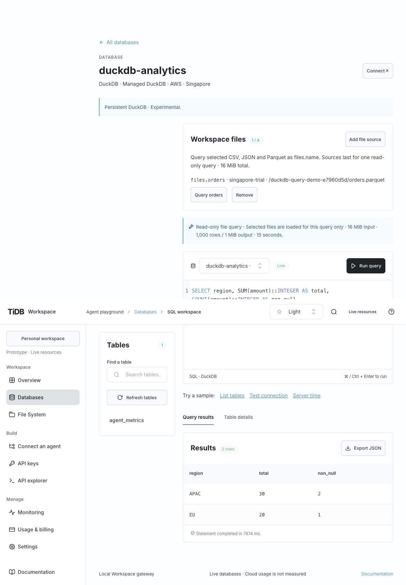
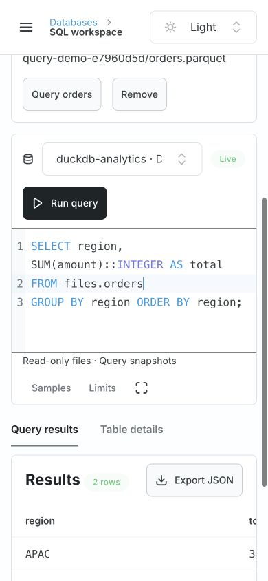
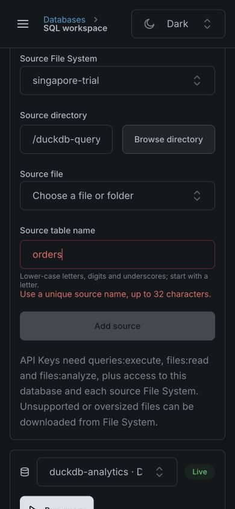

# DuckDB Workspace file source verification

> Historical report: the standalone DuckDB database is retired and its manual verification
> script has been removed. File System analysis remains supported; see
> [ADR 0048](../decisions/0048-postgresql-only-databases.md).

Historical Console evidence: [GH-50](https://github.com/siddontang/tidb.ai/issues/50) removes
the custom database picker/counter in favor of the native database workspace. At the time,
the API and its snapshot/authorization verification applied; earlier Console picker screenshots
below describe the GH-34 baseline. See the [ADR amendment](decisions/0009-duckdb-file-sources.md#console-presentation-amendment).

Date: 2026-10-28. Baseline: [GH-34 revision 1](../../specs/gh-34/spec.md), accepted at
`8fcab93ef90843fc3b80cba4743f4ee963871c00`. Uses the existing pinned DuckDB 2.0.0 native
runtime, Node API 2.0.0-r.1, TiUI 2.9.1 and SQL Editor 0.0.6. No new dependency or CI-policy change in this feature; synchronized with the existing analysis runtime and compact database workspace on main.

Status: implementation acceptance complete. The shared gate passed 99 tests, including native
formats/authorization/cleanup and the extracted API file-query check, plus repository/runtime
policy, formatting, lint, generated contract/client, strict types and both production builds.
Existing TiUI transitive eval and bundle-size warnings remain; checks were not weakened.

## Acceptance evidence

| ID       | Evidence                                                    | Observed result                                                                                                                                                                                                                                               |
| -------- | ----------------------------------------------------------- | ------------------------------------------------------------------------------------------------------------------------------------------------------------------------------------------------------------------------------------------------------------- |
| DFILE-01 | Native fixture/API tests and explicit real Singapore script | CSV, JSON, NDJSON and Parquet aggregates/NULLs; exact BIGINT in fixtures; multi-source/native-table joins. Live APAC=30, EU=20 and three-format join=4.                                                                                                       |
| DFILE-02 | API I/O spies plus real scoped Key denials                  | Query/read/analyze actions and every resource required; hidden/wrong-workspace/expired/revoked access denied. Revocation during load discards data before native execution.                                                                                   |
| DFILE-03 | Native SDK/child process tests and live host/write denials  | Native SELECT type and read-only database attach; no source writes, host/network reads, attach/COPY/security changes or multi-statements. Source tokens remain in parent adapter.                                                                             |
| DFILE-04 | Snapshot/native tests                                       | Input growth/combined bounds, metadata changes, malformed/empty files, result limits, stalled-stream disconnect, same-database admission and actual 15-second loading timeout; private snapshot cleanup. Existing native worker tests cover hard termination. |
| DFILE-05 | Native/API tests                                            | Ephemeral catalog absent next request; ordinary database writes still work; source bytes unchanged. Public resources/Key targets preserve hidden storage boundary.                                                                                            |
| DFILE-06 | Generated contract, full gate and extracted artifact        | Additive sources/permission schema and client match; extracted backend stages CSV and runs native file-source SQL independently. No cloud credentials in CI.                                                                                                  |
| DFILE-07 | Browser, screenshots below                                  | Real Parquet picker, prepared SQL, keyboard aggregate, result invalidation, duplicate-name validation and both themes/sizes. Dynamic editability, cancellation and recovery checked on the rebuilt Console.                                                   |

## Live service

`scripts/verify-duckdb-sources.mjs` used the existing task-owned DuckDB and public Singapore
File System, through Workspace APIs only. It created `/duckdb-query-demo-e7960d5d/` containing
synthetic `orders.csv`, `orders.json`, `orders.ndjson` and `orders.parquet` for inspection.
No tenant/database was provisioned and no native credentials were read by the script.

Observed individual real queries took about 6–8 seconds; the CSV/JSON/Parquet join took
10–11 seconds within the shared 15-second ceiling. The initial run encountered one native
storage read failure in the output-limit case. There was no automatic retry. A bounded manual
read-only probe returned the expected `RESULT_TOO_LARGE`; explicit resume against the same
existing sample directory then passed the full script without repeating any upload.

The resumed run verified all formats, NULL handling, join, missing analyze action and either
resource grant, read-only/host-access denial, output overflow, unchanged downloaded Parquet
bytes and revocation. All verification Keys were revoked in cleanup. Examples remain on the
real File System. Anonymous native storage remains experimental; this is loopback verification,
not public untrusted-SQL isolation or large-file scan/performance acceptance.

After synchronization with main `779072054e2188c61ea98a7bc29663097e46025e`, a fresh backend and
a scoped Workspace Key repeated the real three-format join successfully (4 matches, 11,408 ms),
including canonical ETag/If-Match reads. The final compact Console also repeated the real
Parquet aggregate (7,719 ms). The integrated shared gate passed all 99 tests.

## Browser and integration findings

Production-built independent Console on 5174, source API on 4319 with real providers. Checked
1280×800/900 and 390×844, Light/Dark. Computed SQL text remained 16px; the narrow document width and scroll width were both 390px. The source picker exposes only public Files, exact paths and
table names. It never executes SQL automatically; source selection/removal retains the draft
while invalidating results. Removing and re-adding the same source did not revive old results; edited SQL retained the
replace/keep confirmation. Cancel query returned a clear canceled state, restored editing, and
a subsequent real Parquet query succeeded in 7,950 ms after restarting the final backend.
The editor contenteditable attribute was false while running and true after cancel/completion.
The Key dialog displayed files:analyze unchecked by default and only public resources.

SQL Editor 0.0.6 reads `extraExts` when creating its cached instance, not on prop updates.
Dynamic editability therefore uses a CodeMirror Compartment/view dispatch. The shared TiUI
standard captures this verified package behavior. Native safe errors must survive the worker
boundary with their structured codes; do not wrap an already sanitized result-limit/parser
error into an unrelated 502.

Drive9 source `018389c81ac037c83e9311a6608ffd6cd35aa57d`, `pkg/server/server.go`, reports
`X-Dat9-Revision` and `X-Dat9-Resource-ID` on HEAD. Snapshot checks compare both where supplied,
so same-size replacement with a reset revision can still be detected. Preserve the provider
adapter’s revision field as the canonical ETag for existing analysis If-Match reads; the
additional data revision and identity fields supplement source checks. No multi-file transaction
or atomic snapshot is claimed when upstream metadata cannot establish one.

The integrated Console preserves main’s compact database header, editor sizing, Samples and
Limits controls. File-source controls use a compact summary with an explicit picker; source
budgets are in Limits and the footer keeps read-only status visible.

## Delivery

The implementation PR and intent record the exact candidate, latest-head CI, merged source
and local preview outcome. Close #34 only after its merged preview is verified. The separate File System/Just Bash experience from GH-26 is preserved from main (#36); this change does not replace it. Rollback disables source queries without changing
source files or private DuckDB storage. No paid account, public deployment or community submission.
