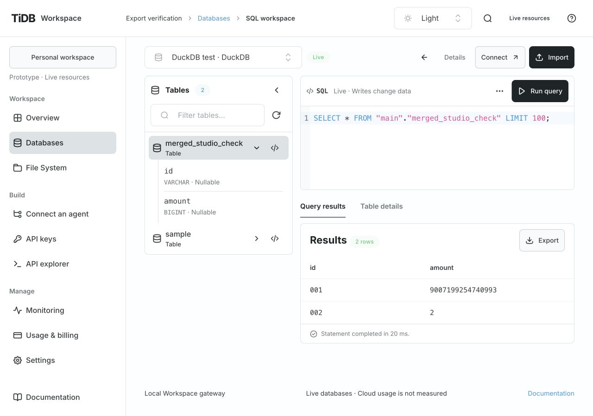
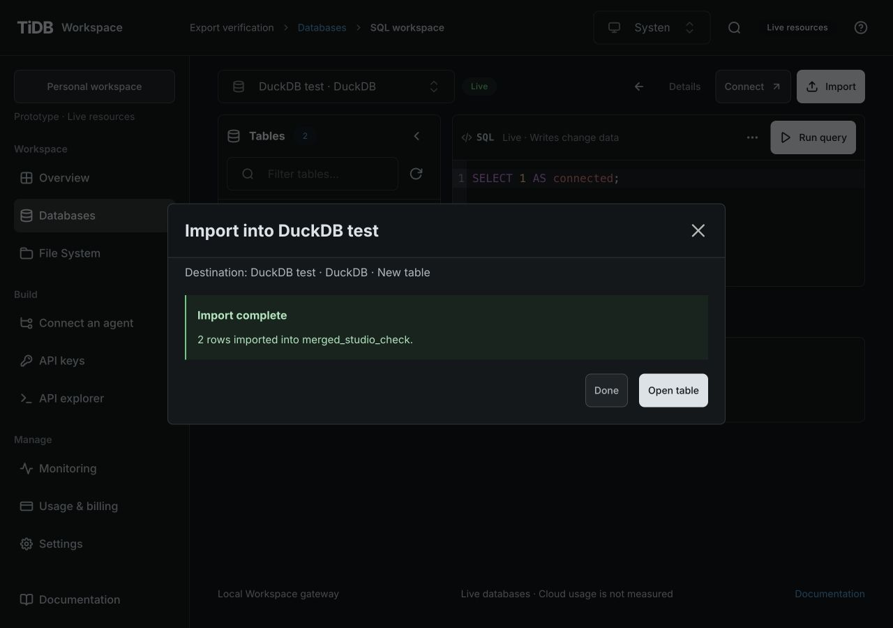
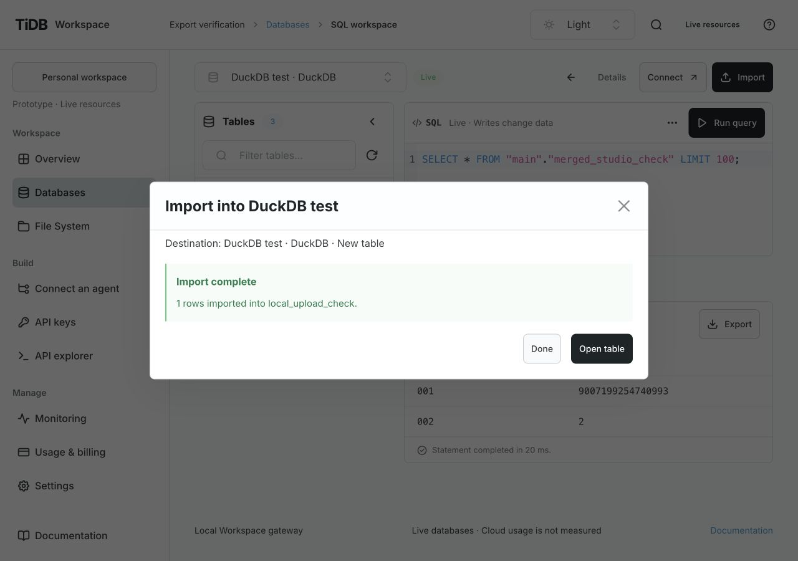
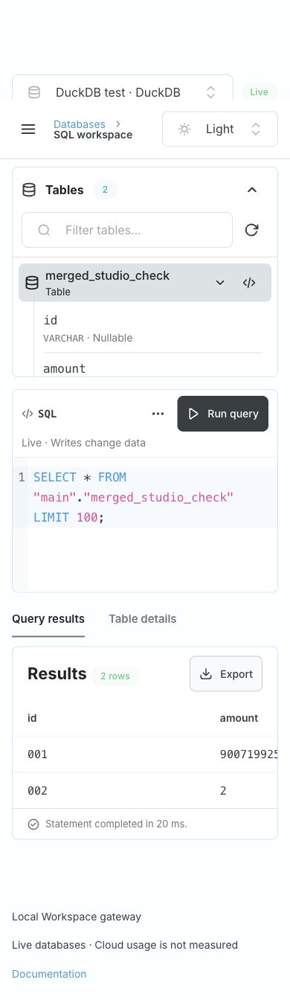
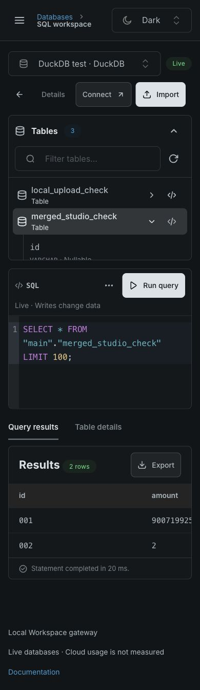
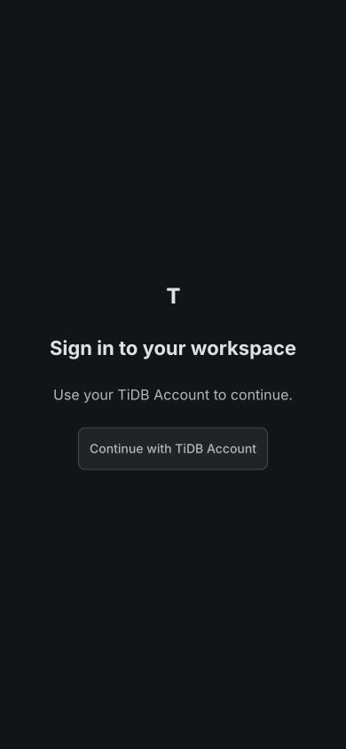

# Repository history integration verification

> **Historical report.** This verifies the retired mixed Node/Rust release. See [native backend verification](../native-backend-retirement.md) for current coverage.

- Date: 2026-10-30.
- Tracking: [MRG-01–06 / Issue 11](https://github.com/mem9-ai/tidb.ai/issues/11), [PR 12](https://github.com/mem9-ai/tidb.ai/pull/12).
- Runtime candidate: `899ef88af65bc2f4efe853a23b44d6caa4d3c23f`.
- Inputs: hosted `713d63547d24883cc2376542600cc9e8de21448b`; refreshed source `141652e501c942128ccae617d088a2cdccf9f780`.

Both input heads are direct parents of the integration commit. The native crates, root Cargo
manifest/lock and Meta Service are identical to the refreshed source. Hosted Dockerfile,
dev CD, Console publication, SSO implementation, public HTTP trust policy and `.env.example`
are identical to the hosted baseline. Native caches and private local state are additionally
excluded from Docker build context. [ADR 0025](decisions/0025-consolidated-runtime-profiles.md)
records the selected runtime/storage boundary.

## Local checks

`npm run check` passed: runtime/repository/format/lint/generated-contract checks, 271 passing
Node/Console cases, types, static Console build and hosted Node runtime closure build. Sixteen
native cases are explicitly gated in that command; they are not claimed as passed there.
`npm run backend:check` passed all phases: formatting, build, Clippy, 14 Rust unit tests,
and 17 native/RustFS/S3 integration cases with zero failures or skips. Installed RustFS 1.0.4
was reused with isolated temporary data, credentials and ports.

The new hosted-package test boots the runtime closure independently, preserves pre-existing
JSON state and rejects anonymous sessions and unauthenticated imports when SSO is configured.
The new signed fake-provider SSO/import regression exercises raw CSV upload, exact string and
integer retention, review/session binding, and expiry between CREATE and INSERT. Removing
the expiry fix changes the last response from the expected partial-write failure to success;
the negative control therefore fails. The existing partial-write contract remains unchanged.
No real account, cloud resource or provider secret is used by these tests.

## Browser checks

Used the production Console build with `/studio/` asset base and same-origin
`apiPathPrefix: /studio`, behind an isolated loopback gateway. Data and provider responses
came from the repository's local DuckDB/export fixture; no cloud provisioning occurred.

- Existing File System CSV: select, parse, review, confirm, create a table, open it and query it.
  Read-back retained `001` and `9007199254740993` exactly.
- Local CSV: browser file chooser, raw upload through the `/studio` API prefix, parse,
  review and confirmed import completed. Previous SQL and query results remained visible.
- TiDB Account sign-in entry remained visible against an isolated SSO-configured API.
  No real TiDB Account login was performed.
- Light and Dark at 1280×900 and 390×844. Narrow layout retained page-width 390 pixels;
  wide result tables scroll within their own region. Modal confirmation and Done/Open table
  actions remained usable. No claim is made for other viewport sizes.

Remote checks and delivery are recorded on the PR's actual head. A green local run does not
claim hosted rollout, real SSO account login, Rust public identity or JSON-to-SlateDB migration.
