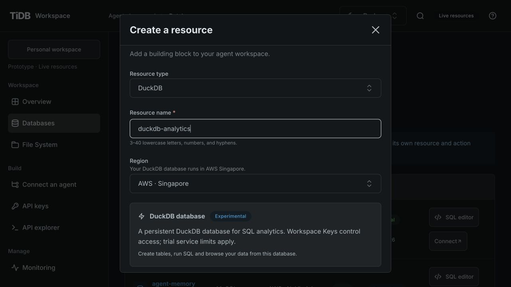
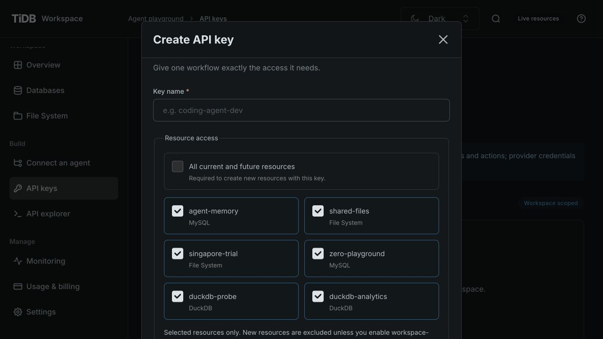
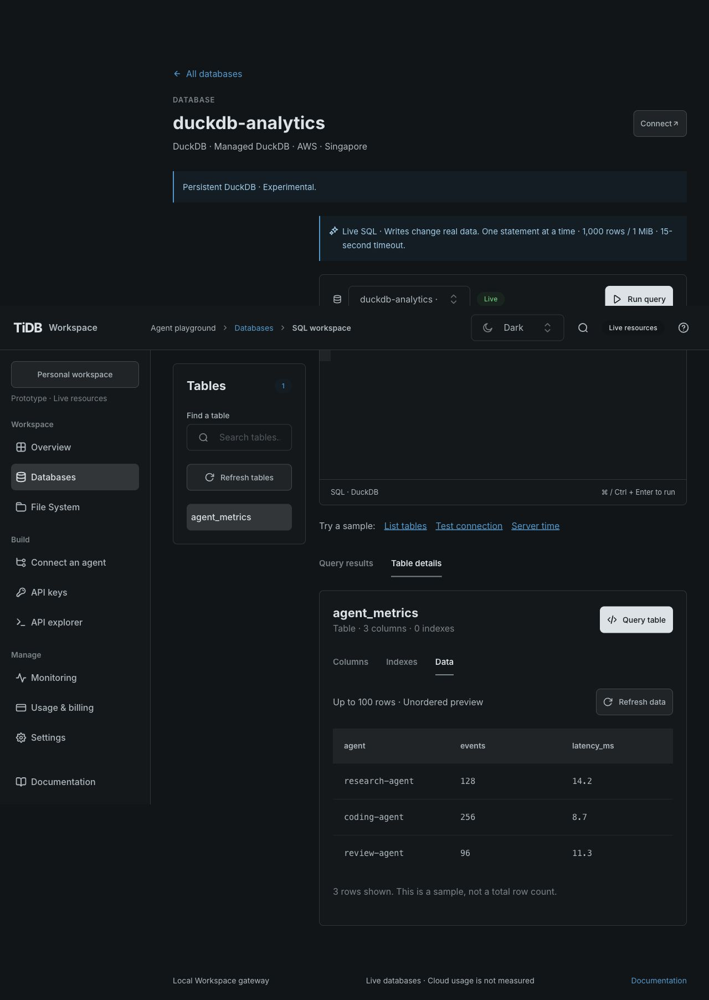
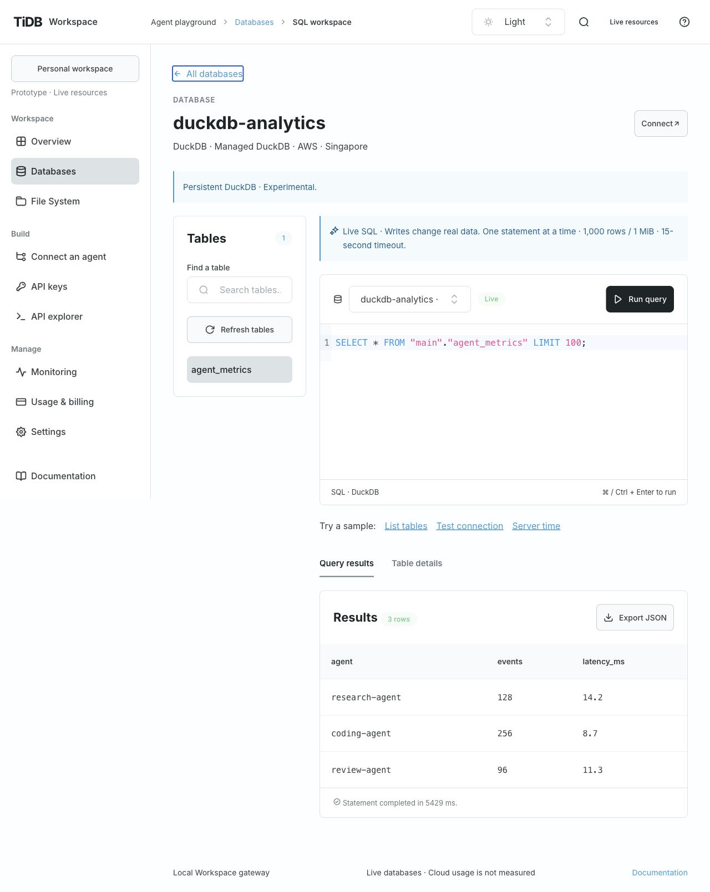
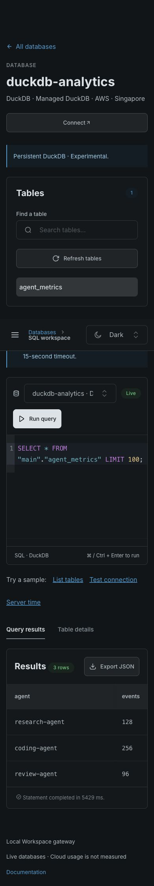
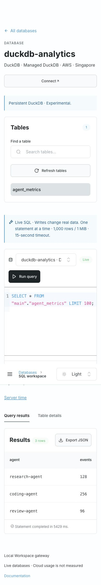

# DuckDB verification

Date: 2026-10-28. Acceptance baseline: [GH-28 revision 1](../specs/gh-28/spec.md), accepted
at source `47c59cd7c0b34e05b7a285f8f20b6d6877dfe567`. Runtime: DuckDB 2.0.0 via
`@duckdb/node-api@2.0.0-r.1`, native tidbfs from drive9-ai/duckdb revision
`797d2c6250592d2b84716ebf43198b39bdfd3241`. The operator-supplied macOS arm64 artifact
used SHA-256 `6b1737dd598ea07a875a6ddb75ad22be3ddc4a02bd601066bd1fbaaca97a8e68`.

## Requirement evidence

| Requirement | Evidence                                                                                                                                                                                              | Outcome                                                                                        |
| ----------- | ----------------------------------------------------------------------------------------------------------------------------------------------------------------------------------------------------- | ---------------------------------------------------------------------------------------------- |
| DUCK-01     | Console created `duckdb-analytics`; API/provider tests cover dedicated private provisioning                                                                                                           | One public database, active on real Singapore storage                                          |
| DUCK-02     | `server/duckdb.test.mjs` checks bootstrap/resources/usage/events/keys plus owner/wildcard file access and guessed backing IDs                                                                         | Hidden/denied; public File System selector retained only the two existing standalone resources |
| DUCK-03     | Native-backed API tests cover resource/scope/workspace/expired/revoked denials; explicit live script used one key across DuckDB/MySQL/Files                                                           | Passed, all verification keys revoked                                                          |
| DUCK-04     | Concurrent/repeated Idempotency-Key, API restart, native reopen, partial setup, uncertain provider response and changed artifact tests                                                                | Same binding reused; no blind duplicate; unavailable runtime has no cloud effects              |
| DUCK-05     | Live script DDL/CRUD and table APIs; each SQL request opens/closes a fresh process and reopens native storage                                                                                         | Exact large integer retained; columns/primary key/data verified; unique test table removed     |
| DUCK-06     | Native SDK/worker tests cover host reads, network sources, settings, secrets, load/attach/COPY, multi-statements, result bounds and deadline termination; live script repeats key restrictions/bounds | Safe errors and no unauthorized operation                                                      |
| DUCK-07     | Full shared gate; extracted API archive loads native DuckDB and executes SELECT independently                                                                                                         | Native dependency closure included; no cloud credentials in CI or secrets/artifacts in Git     |
| DUCK-08     | TiUI 2.9.1, SQL Editor 0.0.6, generated client; creation/Key choices/database SQL and tables checked against real service                                                                             | Light/Dark desktop 1280×900 and narrow 390×844 evidence below                                  |

`npm ci` completed with no audit vulnerabilities. `npm run check` passed with 83 tests,
repository/runtime checks, formatting, lint, generated OpenAPI/client verification, strict
TypeScript and both independent production builds. Existing UIKit transitive eval and bundle
size warnings remain; checks were not weakened. The runtime packaging test caught a missing
native platform package: the dependency copier now handles packages with no JS root entry and
the extracted artifact executes a native SELECT, rather than just importing a JS wrapper.

## Live acceptance

`scripts/verify-duckdb.mjs` ran explicitly against loopback API port 4319, the Console-created
DuckDB, the existing real Zero MySQL and Singapore Files. It loaded no native credentials.
It created a unique table, inserted an exact 64-bit integer, selected, updated, browsed columns /
primary key / data, deleted and dropped the table. Unsupported host/secret/config operations,
multiple statements, >1,000 rows and >1 MiB output were rejected. Missing/wrong action/resource
and revoked Keys were rejected. The same key queried real MySQL and wrote/read a unique
Markdown file on the separately public Singapore File System. Verification keys were revoked;
the Markdown remains available for inspection.

The initial native probe used its own anonymous filesystem; final Console creation allocated
a second dedicated backing store. The user preview adopts only `duckdb-analytics`, preserving
its sample `agent_metrics` table. No filesystem was exposed or shared with a public file resource.
No paid account, public deployment, community submission, or monitoring was performed.

## Browser evidence

Production-built Console on port 5174, independent API on 4319, real provider responses.
Creation required only database type, name and region. The Key dialog listed DuckDB databases
and standalone Files, with no private backing resource. The unified database workspace keeps table navigation beside SQL, with results and table
details below it, preserving the exact route and SQL dialect. Catalog loading pauses DuckDB
query execution because the native database admits one operation at a time. The retained example
contains three synthetic agent metric rows; no customer data or credentials appear in evidence.

Native remote storage remains experimental. The loopback API's SQL hardening is not a public
multi-tenant OS sandbox. Cloud storage/billing are unmeasured; remote lock cleanup after a hard
termination follows the existing provider session lifetime. See [operations/recovery](duckdb-databases.md).

## Native database workspace correction

Owner correction: [GH-50](https://github.com/siddontang/tidb.ai/issues/50), source base
`8fb9ed400261fc4565f1af08899228cbb7595950`. The database already used tidbfs native database
mode; this change removes the custom snapshot-source picker/counter and its editor state.
The Console sends only the database ID and SQL. The existing selected-file query API is
unchanged and File System Analyze remains available. No storage migration or new cloud
resource was required. The earlier GH-34 picker acceptance is superseded in ADR 0009.

Against the existing real Singapore-backed `duckdb-analytics`, Workspace API requests created
one unique task-owned table, inserted `(50, 'native persisted')`, and read that exact row in a
fresh worker. After `CHECKPOINT`, another fresh worker returned the same row. Native create /
insert / reopen / checkpoint / reopen / drop took 9,531 / 9,525 / 5,495 / 5,403 / 5,348 / 9,225
ms respectively. The task table was dropped; the existing `agent_metrics` table was untouched.
These are individual observations, not a latency guarantee. Each SQL request uses the existing
disposable-worker path and reopens the same remote DuckDB file.

Browser verification used the independent live Console/API at 1280×800 and 390×844, Light and
Dark. `SELECT 50 AS native_database;` returned 50 in 11,495 ms; the outer database selector was
disabled while running. Table selection and Query table → Keep my query retained both the
edited SQL and completed result. Keyboard collapse/expand and desktop/mobile reflow retained
them as well. Switching to PostgreSQL reset the editor/result and selected the correct URL.
The File sources row and editor-level resource selector were absent. Document width matched
both viewports, SQL remained 16px, and browser error logs were empty. No configuration error
appeared. The shared TiUI 2.9.1 adapters and SQL Editor 0.0.6 remain unchanged.

`npm run check` passed all 118 tests, runtime/repository policy, formatting, lint, API/client
alignment, strict types and both independent production builds. The existing transitive
`google-libphonenumber` eval warnings remain non-failing. No new backend behavior needed a new
test; existing native persistence, authorization and snapshot API tests passed unchanged.

- [Native database, 1280×800 Dark](screenshots/duckdb-native/desktop-dark.jpg)
- [Native database, 1280×800 Light](screenshots/duckdb-native/desktop-light.jpg)
- [Native database, 390×844 Dark](screenshots/duckdb-native/mobile-dark.jpg)
- [Native database, 390×844 Light](screenshots/duckdb-native/mobile-light.jpg)
