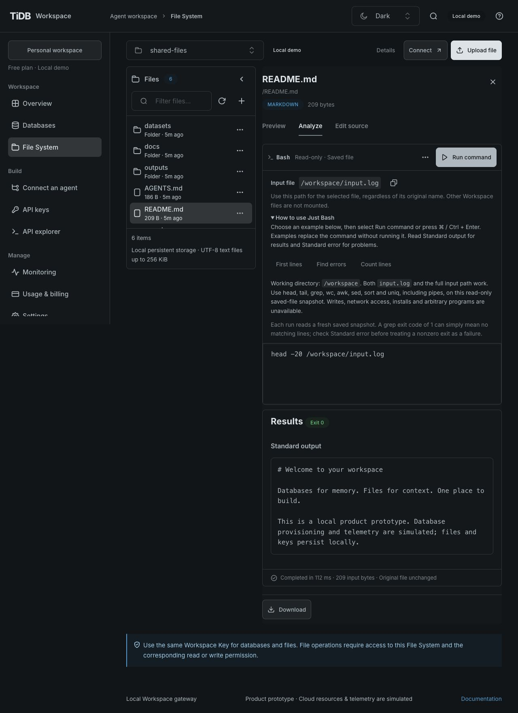
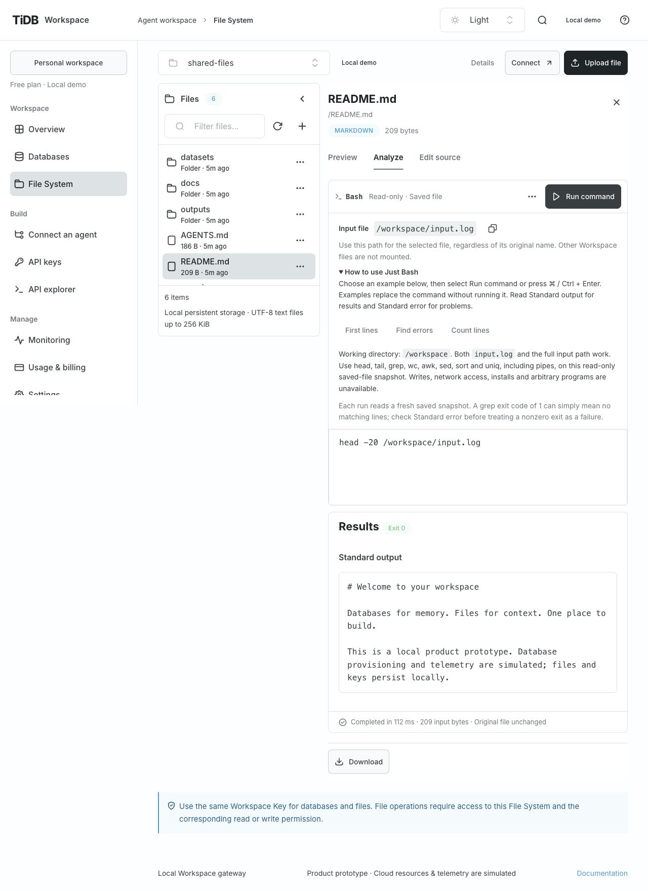
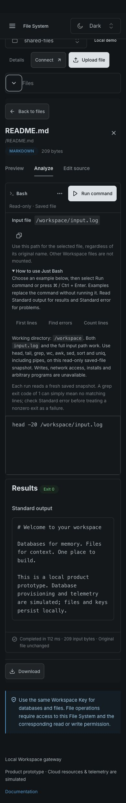
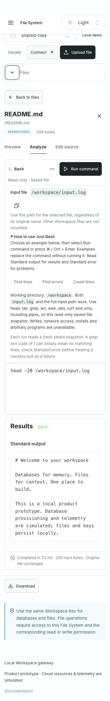

# Read-only File System analysis verification

Current Console controls follow [GH-52's shared interaction audit](resource-workspace-verification.md#shared-interaction-audit):
SQL uses Run query and Bash uses Run command in the same top-right toolbar as database SQL,
with Samples, Limits, expansion and shared result panels. Earlier screenshots below describe
the original GH-26 controls. The read-only/API boundary remains unchanged.

- Date: 2026-10-28. Implementation against the owner-approved
  [GH-26 baseline at b76e1d](https://github.com/siddontang/tidb.ai/blob/b76e1dde2a02355552fcba50cb8299ec625ebeff/specs/gh-26/spec.md),
  source base `8fcab93` (including DuckDB databases, the unified database UI and local-agent workflow).
- Boundary: [ADR 0010](decisions/0010-read-only-file-analysis.md).
  The actual candidate is identified by the implementation PR's head and its CI runs.
- Scope: local loopback API/Console with real native/interpreter engines and real Singapore
  anonymous files. No public deployment, new tenant, paid compute or source-file mutation.

## Use the feature

Open File System, choose the existing Singapore trial, and open
`/file-analysis-demo-9de2ebb1/orders.csv`, `orders.parquet` or `service.log`. Select **Analyze**.
CSV offers DuckDB SQL or Just Bash under **Analyze with**, defaulting to SQL. Parquet uses
SQL; recognized text uses Bash. The SQL editor queries table `file`; Bash reads `/workspace/input.log`.
The file/resource and analysis tab remain in the URL for reload and direct links; scripts
and results are not serialized into links. Browser Download returned the original 176-byte log. Run explicitly or use Cmd/Ctrl+Enter. Each execution starts fresh. Download retains the
original file. Navigation or Cancel query / Cancel command aborts abandoned work; results are not persisted.

Agents use the generated OpenAPI operations with a Workspace Key granting `files:read`,
`files:analyze` and this File System. Existing keys do not gain the new permission.

```json
{
  "resourceId": "<file-system-id>",
  "path": "/orders.csv",
  "engine": "duckdb",
  "sql": "SELECT region, SUM(amount) AS total FROM file GROUP BY region"
}
```

POST this body to `/api/v1/workspaces/{workspaceId}/file-analyses`. For text, use
`"engine":"bash","command":"grep -n ERROR /workspace/input.log | head -20"`.
Inspect GET `/file-analyses/capabilities?resourceId=…&path=…` first for availability and limits.
No provider credential or runtime destination is a public input.

### CSV analysis methods

File format and analysis method are separate, as defined in
[ADR 0014](decisions/0014-file-analysis-engine-options.md). For the same CSV:

| Method     | Use                                                                                                           | Example                         |
| ---------- | ------------------------------------------------------------------------------------------------------------- | ------------------------------- |
| DuckDB SQL | Query parsed rows/columns, filter and aggregate; CSV quotes and embedded newlines are parsed                  | `SELECT COUNT(*) FROM file;`    |
| Just Bash  | Inspect, search or count raw UTF-8 text with read-only commands; line counts need not equal CSV record counts | `head -20 /workspace/input.log` |

Selecting a method never executes. Each retains its own in-memory draft, result and error
while the file panel remains open. Run explicitly or use Cmd/Ctrl+Enter. Method selection is
disabled during execution; Cancel restores it. Switching files discards the transient state.
Empty CSV can use Bash even when SQL is unavailable. Metadata availability does not guarantee
valid CSV or UTF-8: parsing/decoding errors remain recoverable in the selected method.

Agents discover the available methods from the same capabilities endpoint. The additive
`engines` array contains `{engine, available, reason}` per supported method. Legacy `engine`,
`available` and `reason` still describe the default engine (DuckDB for CSV). Use the chosen
engine explicitly with `sql` or `command`, never both. The same File System and
`files:read`/`files:analyze` grants are required for either interpretation. For example:

```json
{
  "resourceId": "<file-system-id>",
  "path": "/orders.csv",
  "engine": "bash",
  "command": "head -20 /workspace/input.log"
}
```

Verified for [GH-65](https://github.com/siddontang/tidb.ai/issues/65) on 2026-10-28, source
base `c599211b8be2035e4c55960d68844a2318ad065a`:

- Real-worker/API tests run both methods on CSV, preserve the source, and check per-engine
  capabilities, empty/malformed text, invalid UTF-8/binary rejection, unsupported methods
  and mixed script fields before snapshot I/O. Existing workspace/resource/action,
  expiration and revocation denials now execute both CSV modes before any provider I/O.
- Generated-contract tests validate CSV capabilities and both result variants over HTTP.
  Existing isolation, concurrency, cancellation and native API artifact checks remain required.
- A 57-byte local CSV fixture has a quoted comma and an embedded newline: SQL returns two
  records and SUM(amount) = 30; Bash returns its original text. Browser checks preserve
  separate scripts, successful results and SQL errors across switching, recover explicitly,
  and verify no execution on selection. Native radio direction-key switching and both
  editors' Cmd/Ctrl+Enter work.
- Empty CSV shows the SQL reason and still runs Bash with Exit 0. README remains Bash-only.
  A separate local fixture delays snapshot reads to verify both modes' disabled switching
  and cancellation; it is not a cloud-latency measurement.
- Both methods were checked in Light/Dark at 1280×800 and 390×844: 16px editors, approximately
  47px selector targets, and no page-wide horizontal overflow. TiUI 2.9.1 SegmentedControl
  uses its supported `lg` size; execution/results reuse the shared adapters. Screenshots use
  isolated local fixtures without provider credentials; this change does not add a cloud
  integration. The implementation PR records the candidate SHA, full quality gate, CI and
  final main-preview delivery.

| Viewport / theme        | SQL                                                                   | Bash                                                                   |
| ----------------------- | --------------------------------------------------------------------- | ---------------------------------------------------------------------- |
| Desktop Light, 1280×800 | [Screenshot](screenshots/file-analysis-methods/desktop-light-sql.jpg) | [Screenshot](screenshots/file-analysis-methods/desktop-light-bash.jpg) |
| Desktop Dark, 1280×800  | [Screenshot](screenshots/file-analysis-methods/desktop-dark-sql.jpg)  | [Screenshot](screenshots/file-analysis-methods/desktop-dark-bash.jpg)  |
| Mobile Light, 390×844   | [Screenshot](screenshots/file-analysis-methods/mobile-light-sql.jpg)  | [Screenshot](screenshots/file-analysis-methods/mobile-light-bash.jpg)  |
| Mobile Dark, 390×844    | [Screenshot](screenshots/file-analysis-methods/mobile-dark-sql.jpg)   | [Screenshot](screenshots/file-analysis-methods/mobile-dark-bash.jpg)   |

### Just Bash input guidance

Just Bash runs supported text commands on the **selected saved file**, which the worker
exposes as `/workspace/input.log`. This is a virtual input name even for `README.md`; it does
not convert the contents into a log. The working directory is `/workspace`, so `input.log`
also works. The original Workspace path (for example `./README.md` or `/docs/README.md`),
other Workspace files and host files are not mounted.

1. Open a text or Markdown file and select **Analyze**.
2. Copy the displayed **Input file** path or expand **How to use Just Bash** and choose an
   example. An example only fills the command; it does not execute it.
3. Select **Run command** or press Cmd/Ctrl+Enter in the editor.
4. Read **Standard output**, **Standard error** and the exit code. `grep` exit 1 can mean no
   matching lines. A missing-file error includes a button to fill a working preview command;
   the next execution still requires an explicit Run.

```bash
head -20 /workspace/input.log
grep -n 'ERROR' /workspace/input.log | head -20
wc -l /workspace/input.log
```

The default preview is `head`, suitable for Markdown and general text. Commands such as
head, tail, grep, wc, awk, sed, sort and uniq support read-only text processing and pipelines.
Each run reads a fresh saved snapshot. Writes, network access, installs and arbitrary
programs are unavailable; use Download for work in another environment. See [ADR 0010](decisions/0010-read-only-file-analysis.md)
for the isolation boundary and limits.

Verified for [GH-63](https://github.com/siddontang/tidb.ai/issues/63) on 2026-10-28, source
base `c1ffc10751aeb0f22d8f164b6710789e0fdfeac2`:

- Real worker regression reproduces `head ./README.md` failing for a nested Markdown file,
  runs every displayed example, checks full/relative input paths, and rejects another file.
- The Console reproduces the missing-file error, keeps its stderr and exit code, fills the
  recovery command without executing, then returns the selected README with Exit 0.
- Path copying was verified against clipboard text. The disclosure works with Enter;
  the sample buttons clear old results without executing, and Cmd/Ctrl+Enter runs the command.
- Light/Dark at 1280×800 and 390×844 retain 16px editor text with no page-wide horizontal
  overflow. The long help is collapsed initially; screenshots expand it for inspection.
- CSV still opens the SQL editor without Bash guidance and returns the expected two fixture
  rows. These checks use isolated local fixtures and the real analysis engines; no new cloud
  integration, credentials, API contract or permission changes are claimed.






## Requirement evidence

| ID    | Verification                                                                                                                                                                                                                                                                                                                                     |
| ----- | ------------------------------------------------------------------------------------------------------------------------------------------------------------------------------------------------------------------------------------------------------------------------------------------------------------------------------------------------ |
| FA-01 | [Discovery evidence](evidence/file-analysis-2026-10-28.json) records the real hosted Exec 404. V1 uses independent engines and the existing file adapter; no unsupported hosted Exec flag is enabled.                                                                                                                                            |
| FA-02 | `server/file-analysis.test.mjs` runs native CSV/Parquet queries, schema, exact BIGINT, duplicate names and NULL. [Live API evidence](evidence/file-analysis-api-2026-10-28.json) records APAC 30 / EU 20 for both remote formats.                                                                                                                |
| FA-03 | Actual Just Bash grep, awk, pipelines, count and no-match exit status tests; the real service.log returns the two expected ERROR lines at 2 and 4.                                                                                                                                                                                               |
| FA-04 | API tests reject wrong workspace/resource, missing read/analyze action, expired/revoked keys before snapshot I/O. `server/duckdb.test.mjs` also rejects analysis of private backing storage and database IDs for both owner and wildcard keys before provider I/O. The live request used a new resource-scoped Workspace Key, revoked afterward. |
| FA-05 | Engine tests deny host/other-file reads, network, extensions, configuration changes, writes and credential inspection; the worker environment sentinel is absent. Live downloads before/after analysis have equal SHA-256 hashes.                                                                                                                |
| FA-06 | Input preflight and growing-stream tests, 15-second supervisor boundary (shortened injected deadline), real row/output limits, memory-heavy DuckDB failure with healthy subsequent query, malformed Parquet, Bash loops/output, two-run concurrency rejection. Memory is engine/heap-limited; no hard OS RSS cap is claimed.                     |
| FA-07 | Supervisor tests cover cancellation before/during a native worker and removal of its snapshot after failure. Browser checks cover Cancel, switching file/tab and stale-result clearing.                                                                                                                                                          |
| FA-08 | Real TiUI 2.9.1 Paper/Tabs/Buttons/Textarea/Table/Alert/Badge and official SQL Editor 0.0.6 with Standard SQL. Light/Dark at 1280×900 and 390×844, 16px editor text, keyboard execution and internal table scrolling; screenshots below.                                                                                                         |
| FA-09 | Generated contract/schema tests exercise both operations; artifact tests boot unpacked API without installation and run both engines. Console and API build/package independently; full quality gate and credential-free CI validate the actual PR head.                                                                                         |

## Live observations

Reused the three task-owned Singapore files. CSV (52 bytes) and Parquet (526 bytes) each
returned APAC = 30, EU = 20. The UTF-8 log (176 bytes) returned matching lines 2 and 4.
Each request finished in approximately 2–3 seconds, including provider reads; this is a
small-file connectivity result, not a performance benchmark. One browser run encountered a
transient provider-read failure; its sanitized error remained recoverable and an explicit
manual rerun succeeded. There is no implicit execution retry. Provider HEAD supplied ETags;
the gateway used conditional reads and a final revision comparison. All original hashes were
unchanged. [Sanitized evidence](evidence/file-analysis-api-2026-10-28.json) excludes keys,
provider bindings, SQL containing secrets and private machine paths.

## Browser observations

Analysis stays in the file panel, with the list visible on desktop and Back to files on narrow
screens. Analyze expands in page flow to fit its editor, Run/Cancel and results. SQL columns,
file schema, row count, duration and input size are shown. Bash separates stdout, stderr and
exit status. Wrong SQL clears stale results and displays a recoverable error; a new run works.
A Parquet file remains analyzable when the ordinary preview cannot render it. Unsupported and
oversized inputs explain the limitation and retain Download ([oversized local fixture](screenshots/file-analysis/oversized-fixture.png)); binary text is rejected by the
Bash engine. Unsaved source drafts must be saved/discarded before analyzing the saved version.


## Checks and limits

`npm run check` passed (91 tests, generated contract/types, lint, formatting and separate builds).
`npm audit --omit=dev` reported zero vulnerabilities. The bounded live Workspace API
verification and the browser flows above passed. The oversized/unsupported browser cases
used explicitly labeled local fixtures because the live upload limit is below the analysis
input ceiling. CI uses native platform bindings and fixtures without
cloud credentials. Packaging resolves installed dependencies even when they are ESM-only,
hide their package.json behind exports, or share a name with a Node built-in (for example
`buffer`). Exclusion checks distinguish Console assets from dependency documentation.

V1 copies the entire selected file (maximum 16 MiB); the current live upload maximum remains
1 MiB. Large-file scan performance, browser access to production identities, multi-file joins,
persistent sessions, source writes and public OS/container isolation are not implemented.
Native bindings are platform-specific: package on the deployment OS/architecture. New
provider/engine versions require renewed access-control, limits and artifact verification.
