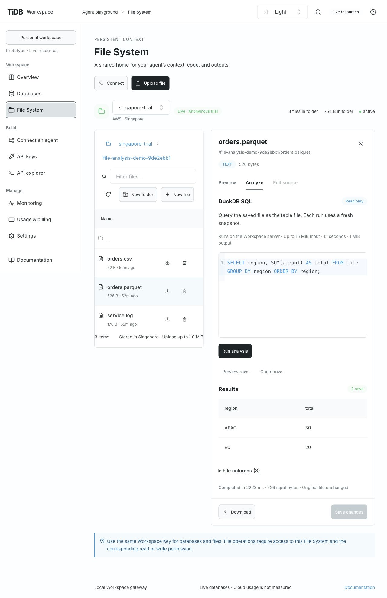
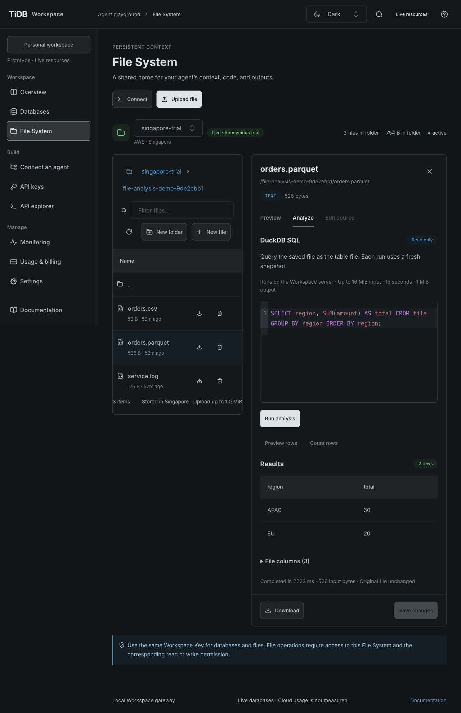
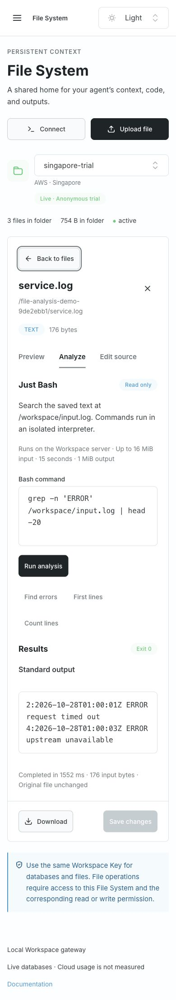
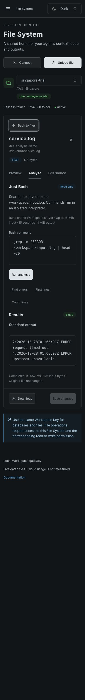

# Read-only File System analysis verification

- Date: 2026-10-28. Implementation against the owner-approved
  [GH-26 baseline at b76e1d](https://github.com/siddontang/tidb.ai/blob/b76e1dde2a02355552fcba50cb8299ec625ebeff/specs/gh-26/spec.md),
  source base `7031f13` (including DuckDB databases, the unified database UI and local-agent workflow).
- Boundary: [ADR 0009](decisions/0009-read-only-file-analysis.md).
  The actual candidate is identified by the implementation PR's head and its CI runs.
- Scope: local loopback API/Console with real native/interpreter engines and real Singapore
  anonymous files. No public deployment, new tenant, paid compute or source-file mutation.

## Use the feature

Open File System, choose the existing Singapore trial, and open
`/file-analysis-demo-9de2ebb1/orders.csv`, `orders.parquet` or `service.log`. Select **Analyze**.
The CSV/Parquet editor queries table `file`; Bash reads `/workspace/input.log`.
The file/resource and analysis tab remain in the URL for reload and direct links; scripts
and results are not serialized into links. Browser Download returned the original 176-byte log. Run explicitly or use Cmd/Ctrl+Enter. Each execution starts fresh. Download retains the
original file. Navigation or Cancel analysis aborts abandoned work; results are not persisted.

Agents use the generated OpenAPI operations with a Workspace Key granting `files:read`,
`files:analyze` and this File System. Existing keys do not gain the new permission.

```json
{
  "resourceId": "<file-system-id>",
  "path": "/orders.csv",
  "engine": "duckdb",
  "sql": "SELECT region, SUM(amount) AS total FROM file GROUP BY region"
}
```

POST this body to `/api/v1/workspaces/{workspaceId}/file-analyses`. For text, use
`"engine":"bash","command":"grep -n ERROR /workspace/input.log | head -20"`.
Inspect GET `/file-analyses/capabilities?resourceId=…&path=…` first for availability and limits.
No provider credential or runtime destination is a public input.

## Requirement evidence

| ID    | Verification                                                                                                                                                                                                                                                                                                                                     |
| ----- | ------------------------------------------------------------------------------------------------------------------------------------------------------------------------------------------------------------------------------------------------------------------------------------------------------------------------------------------------ |
| FA-01 | [Discovery evidence](evidence/file-analysis-2026-10-28.json) records the real hosted Exec 404. V1 uses independent engines and the existing file adapter; no unsupported hosted Exec flag is enabled.                                                                                                                                            |
| FA-02 | `server/file-analysis.test.mjs` runs native CSV/Parquet queries, schema, exact BIGINT, duplicate names and NULL. [Live API evidence](evidence/file-analysis-api-2026-10-28.json) records APAC 30 / EU 20 for both remote formats.                                                                                                                |
| FA-03 | Actual Just Bash grep, awk, pipelines, count and no-match exit status tests; the real service.log returns the two expected ERROR lines at 2 and 4.                                                                                                                                                                                               |
| FA-04 | API tests reject wrong workspace/resource, missing read/analyze action, expired/revoked keys before snapshot I/O. `server/duckdb.test.mjs` also rejects analysis of private backing storage and database IDs for both owner and wildcard keys before provider I/O. The live request used a new resource-scoped Workspace Key, revoked afterward. |
| FA-05 | Engine tests deny host/other-file reads, network, extensions, configuration changes, writes and credential inspection; the worker environment sentinel is absent. Live downloads before/after analysis have equal SHA-256 hashes.                                                                                                                |
| FA-06 | Input preflight and growing-stream tests, 15-second supervisor boundary (shortened injected deadline), real row/output limits, memory-heavy DuckDB failure with healthy subsequent query, malformed Parquet, Bash loops/output, two-run concurrency rejection. Memory is engine/heap-limited; no hard OS RSS cap is claimed.                     |
| FA-07 | Supervisor tests cover cancellation before/during a native worker and removal of its snapshot after failure. Browser checks cover Cancel, switching file/tab and stale-result clearing.                                                                                                                                                          |
| FA-08 | Real TiUI 2.9.1 Paper/Tabs/Buttons/Textarea/Table/Alert/Badge and official SQL Editor 0.0.6 with Standard SQL. Light/Dark at 1280×900 and 390×844, 16px editor text, keyboard execution and internal table scrolling; screenshots below.                                                                                                         |
| FA-09 | Generated contract/schema tests exercise both operations; artifact tests boot unpacked API without installation and run both engines. Console and API build/package independently; full quality gate and credential-free CI validate the actual PR head.                                                                                         |

## Live observations

Reused the three task-owned Singapore files. CSV (52 bytes) and Parquet (526 bytes) each
returned APAC = 30, EU = 20. The UTF-8 log (176 bytes) returned matching lines 2 and 4.
Each request finished in approximately 2–3 seconds, including provider reads; this is a
small-file connectivity result, not a performance benchmark. One browser run encountered a
transient provider-read failure; its sanitized error remained recoverable and an explicit
manual rerun succeeded. There is no implicit execution retry. Provider HEAD supplied ETags;
the gateway used conditional reads and a final revision comparison. All original hashes were
unchanged. [Sanitized evidence](evidence/file-analysis-api-2026-10-28.json) excludes keys,
provider bindings, SQL containing secrets and private machine paths.

## Browser observations

Analysis stays in the file panel, with the list visible on desktop and Back to files on narrow
screens. Analyze expands in page flow to fit its editor, Run/Cancel and results. SQL columns,
file schema, row count, duration and input size are shown. Bash separates stdout, stderr and
exit status. Wrong SQL clears stale results and displays a recoverable error; a new run works.
A Parquet file remains analyzable when the ordinary preview cannot render it. Unsupported and
oversized inputs explain the limitation and retain Download ([oversized local fixture](screenshots/file-analysis/oversized-fixture.png)); binary text is rejected by the
Bash engine. Unsaved source drafts must be saved/discarded before analyzing the saved version.






## Checks and limits

`npm run check` passed (91 tests, generated contract/types, lint, formatting and separate builds).
`npm audit --omit=dev` reported zero vulnerabilities. The bounded live Workspace API
verification and the browser flows above passed. The oversized/unsupported browser cases
used explicitly labeled local fixtures because the live upload limit is below the analysis
input ceiling. CI uses native platform bindings and fixtures without
cloud credentials. Packaging resolves installed dependencies even when they are ESM-only,
hide their package.json behind exports, or share a name with a Node built-in (for example
`buffer`). Exclusion checks distinguish Console assets from dependency documentation.

V1 copies the entire selected file (maximum 16 MiB); the current live upload maximum remains
1 MiB. Large-file scan performance, browser access to production identities, multi-file joins,
persistent sessions, source writes and public OS/container isolation are not implemented.
Native bindings are platform-specific: package on the deployment OS/architecture. New
provider/engine versions require renewed access-control, limits and artifact verification.
