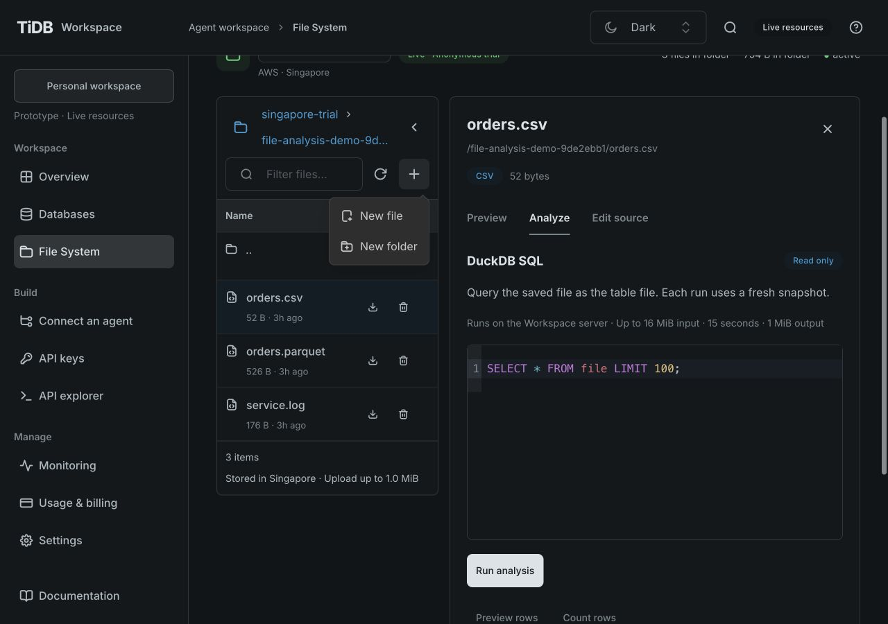
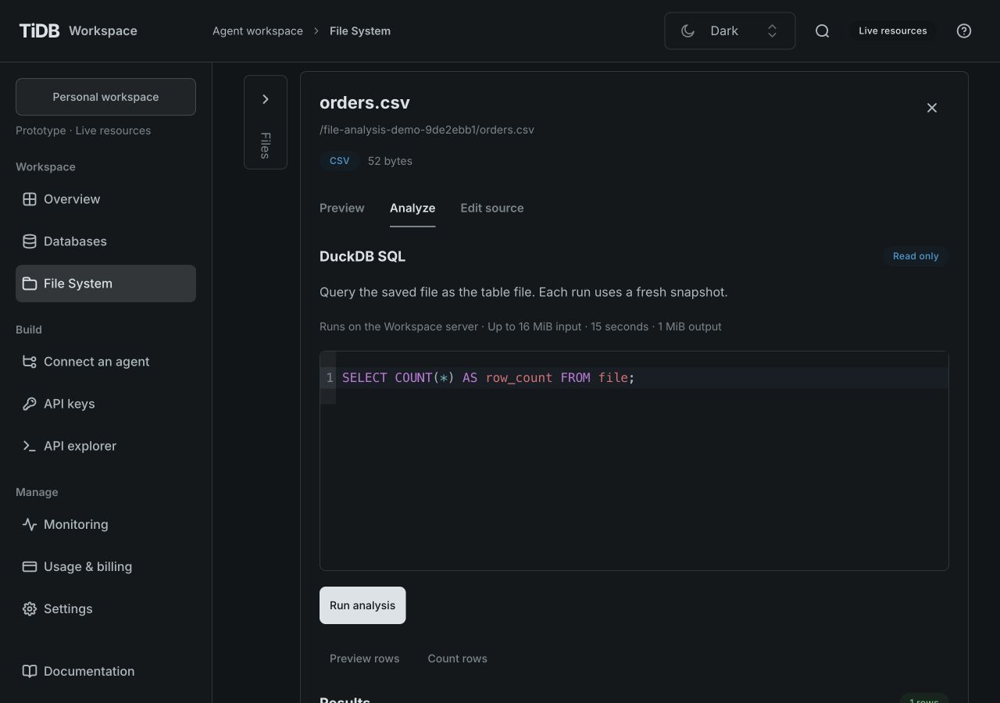

# File browser density and collapse verification

- Owner correction and reproduction: [GH-43](https://github.com/siddontang/tidb.ai/issues/43).
- Reproduction baseline: `c1be992fd8ee417d2a470af939ac855c6601c5af`.
- Integrated source baseline: `ab65ddfdf64bff92de058b67bb5d7b67f511e8af`.
- Design reference: [TiUI standard](standards/tiui-design-system.md), installed UIKit 2.9.1.
- Implementation: `src/features/files/FileBrowserPanel.tsx`, existing file workspace state and
  `file-preview.css`; shared chrome/collapse now lives in `src/ui/WorkspaceBrowserPanel.tsx`
  and `workspace-browser.css`, also used by the database table navigator. Use real TiUI Menu,
  ActionIcon, Anchor, TextInput and Paper; existing
  Table uses supported contextual spacing. No dependency, API, backend or permission change.

## Behavior

New file and New folder share one labeled plus menu. A 320px desktop browser sits beside
Preview/Edit source/Analyze; collapse replaces it with a 56px rail and gives 264px to the editor
(at a 1280px viewport). Path links keep full values in their titles; directory labels can wrap
or truncate visually without changing identity. The list scrolls independently when long.

Collapse changes grid sizing and the browser's hidden attribute only. The selected-file
preview and analysis components retain their keys and remain mounted. Hidden controls leave
the focus order; the same toggle stays focused and exposes aria-expanded/aria-controls.
Narrow screens retain the existing selected-file / Back to files flow.

The menu normally returns focus on Escape. When an item opens a conditional dialog, it first
focuses the stable plus trigger and disables the menu's delayed focus return for that handoff;
the existing WorkspaceModal returns focus to that trigger on close. Reopening the menu restores
its ordinary focus behavior. This avoids a removed menu item becoming the modal's return target.

## Observed evidence

- Real Singapore CSV analysis: edited SQL grouped totals by region, then collapsed while it
  was running. It completed successfully (APAC 30, EU 20); expanding retained SQL and results.
- At 1280px, the expanded browser measured 320px, SQL computed to 16px and document width
  matched the viewport. The plus menu opens by keyboard; Escape returns focus to its trigger.
  Keyboard selection opened New folder at the correct directory, and Cancel returned focus
  to the same plus button.

- Created a folder and then a file inside it through the plus menu in an isolated local-demo
  copy. The dialogs used the current directory, the list updated, and the unrelated unsaved
  source draft remained unchanged. No cloud files were created or removed for this UI check.
- Collapse/expand retained an unsaved Markdown source draft. At 390×844, Back to files
  prompted Keep editing / Discard changes; both flows worked and returned to the usable list.
- Checked Light and Dark at actual 1280×800, 1280×900 and 390×844 viewports. SQL/source text
  remained 16px, plus/toggle targets measured 44px and the filter remained 48px high. Desktop
  browser and selected-file panel had the same initial top coordinate. The collapsed rail
  measured 56px, with no internal horizontal overflow.
- The list's labeled focusable region supports keyboard horizontal scrolling on mobile:
  ArrowRight moved its scrollLeft to 40px while the plus button stayed fixed in the viewport.
  Document width matched the viewport in expanded, collapsed and narrow states.
- Explicit supported Paper layout plus a responsive CSS variable preserves flex layout despite
  stylesheet ordering, without an important override. Rechecked mobile preview hidden (`none`)
  and Back to files restored (`flex`). At 1280×800, a long local list occupied a 680px panel
  with a 457px scrolling region and 666px content; internal scroll reached 208px while the
  outer panel scroll stayed zero. Header/footer remain outside that list scroller.
- Final-code read-only CSV count completed while collapsed (row_count 4); keyboard expansion
  retained the edited SELECT, filter value `orders` and results. Desktop screenshots capture
  the plus menu and collapsed rail; mobile screenshots capture both themes. Screenshots are
  sanitized demo artifacts linked below; no credentials or private account details are shown.

## Scope and remaining behavior

This is presentation only. Existing loading/error/empty states, authenticated file operations,
preview limits and original-file download remain. The desktop collapse preference lasts for
the mounted file workspace; it is not persisted across reloads. Narrow screens continue the
existing one-panel navigation. Long analysis editors/results still use page scrolling. Revisit
with resizable panes or multiple editor documents. CI validates application health, not visual
fidelity; the browser observations above provide the UI evidence.

## Review screenshots

Captured from the integrated code at 1280×900 with a generic Developer profile. Additional
Light/Dark 1280×800 and 390×844 checks are described above.

