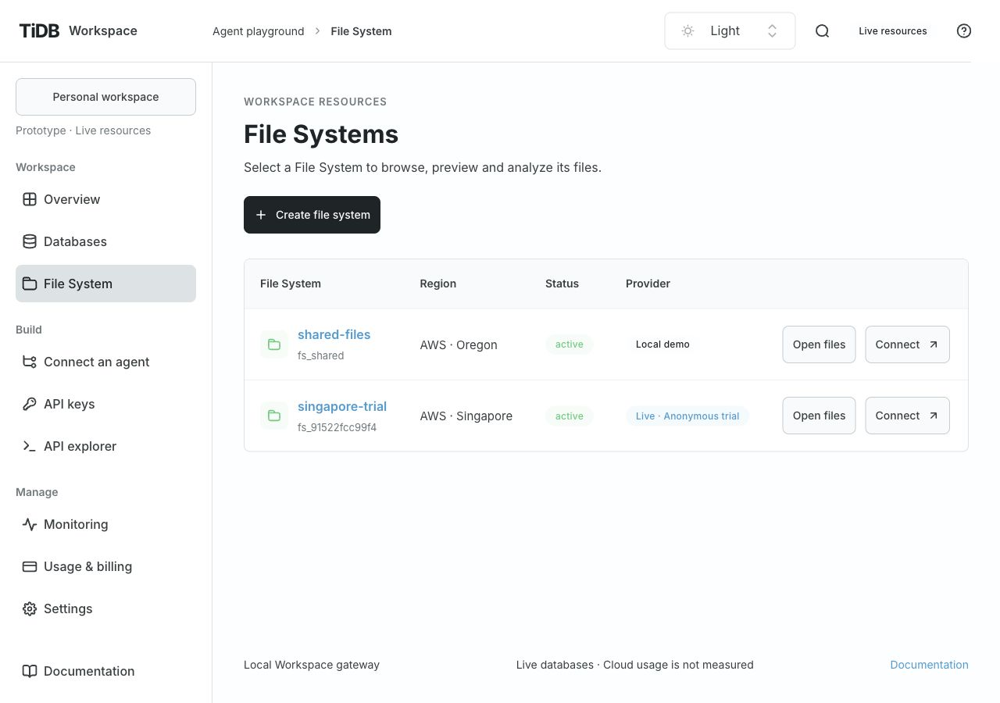
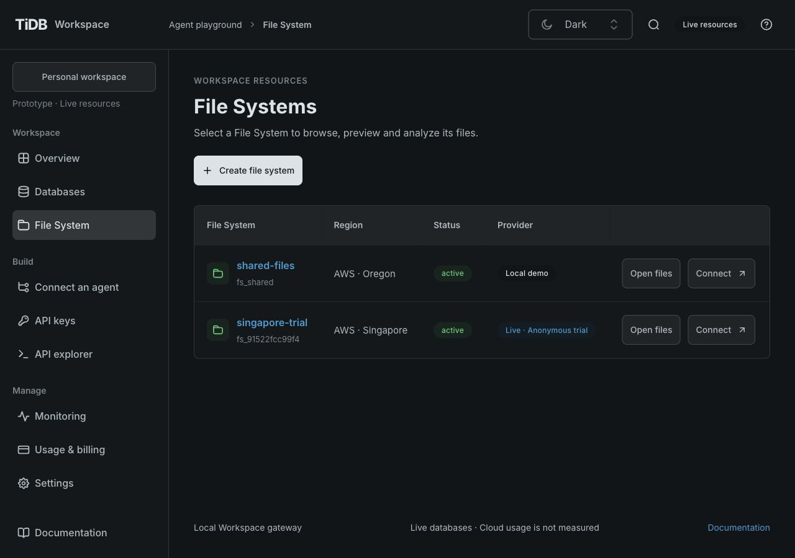
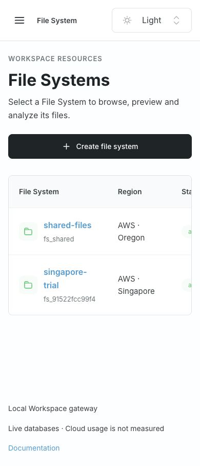
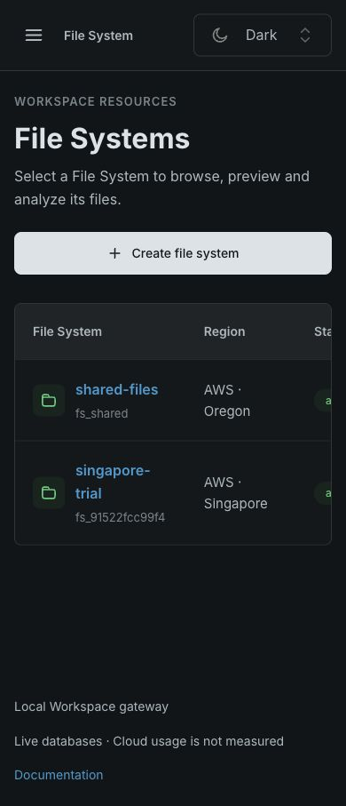

# File System collection navigation

- Date: 2026-10-29. Small-fix reproduction: the File System sidebar destination opened the
  first live File System automatically, while Databases opened its global collection.
- Source baseline: `ee1bd56`; the implementation PR records the evaluated candidate and CI.
- Result: `#files` always displays the global File Systems list, including zero or one
  resources. It shows public resource identity, region, status and provider, with explicit
  open/connect/create actions. No directory browser is mounted before selection.

## Navigation and compatibility

`#files?resourceId=<id>` opens one File System. Existing `path`/`view` file-preview and
analysis links retain their exact resource and file. Refresh and browser history keep the
explicit selection. Unknown and database IDs show File System unavailable with a list
return, rather than selecting another resource. A malformed file path stays scoped to its
explicit File System and shows a recovery message.

Closing a file returns to the current resource's browser. **All file systems** returns to
the collection through the existing unsaved-draft guard (including the sidebar collection link); it and resource selection are
unavailable during active file/analysis operations. The resource selector now changes the
explicit resource URL. Connection dialogs open the exact chosen File System. Create file
system preselects that type and its default region; no resources were provisioned for QA.

## Verification

- `src/features/files/file-location.test.mjs` covers collection versus explicit selection,
  exact/reserved-character IDs, legacy file links and malformed paths without fallback.
  Existing database route tests remain unchanged.
- Browser checks use the existing real Singapore resource for navigation and preserved
  Parquet analysis links. The multi-resource list includes the existing local/demo and live
  resources. Isolated local fixtures cover the single-resource and empty collections.
- Desktop and narrow layouts at 1280×900 and 390×844 in Light/Dark retain 16px body text and
  TiUI controls. Wide resource tables scroll within their panel; the page does not overflow.
- Back-to-list, reload/history, resource switching, Connect/Open file browser, create-form
  defaults, unknown/wrong-kind IDs, file-close context and unsaved draft keep/discard flows
  are inspected. There are no API, permission, provider or credential changes.

The Console uses TiUI 2.9.1 Table/Anchor/Badge/Button/ActionIcon/Paper and the existing shared
resource header and theme adapters. `FileSystemsList` is a focused feature module; collection
versus resource routing stays outside the file-workspace hooks. `npm run check` passed with 134 tests, strict types, lint, formatting, generated-contract checks
and independent production builds. The latest-head CI is required before merge. Verification here concerns Console navigation;
it does not claim new cloud provisioning, quota measurement or native mounts.
