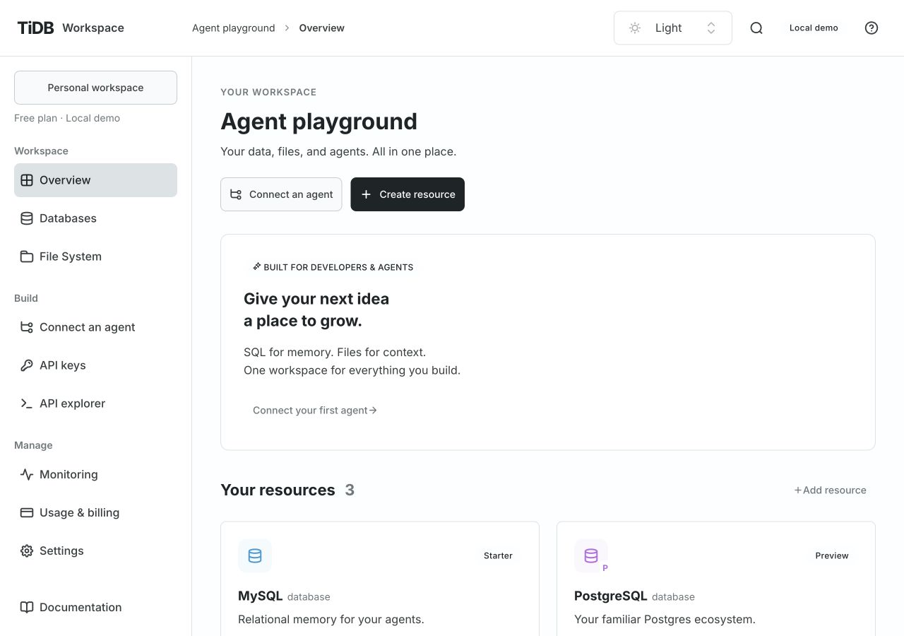
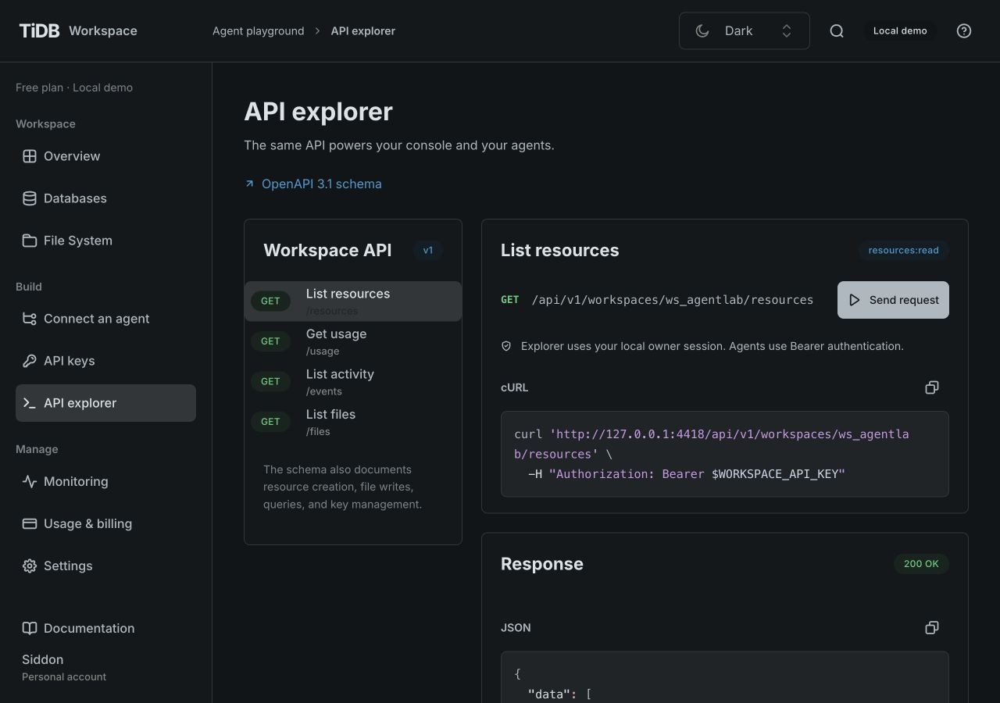
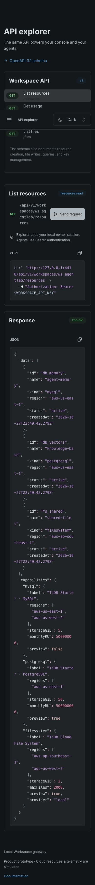

# Independent Console and API delivery

Status: Implemented for the loopback prototype. Public production hosting and identity are
not implemented. [ADR 0005](decisions/0005-independent-console-and-api.md) records the boundary.

## Repository and commands

Use the pinned Node/npm versions and `npm ci` from the repository root. One npm lockfile owns
all dependencies, including the isolated contract generator workspace. The backend includes mysql2, DuckDB Node bindings, Just Bash and their pinned runtime dependency closures for SQL and read-only file analysis;
frontend and contract-generator dependencies are excluded. See [ADR 0006](decisions/0006-zero-sql-gateway.md).

| Component | Source                           | Build                                     | Run from source / serve output                  |
| --------- | -------------------------------- | ----------------------------------------- | ----------------------------------------------- |
| Console   | `src/`, `console/public/`        | `npm run build:console` → `dist/console/` | `npm run dev:console` / `npm run start:console` |
| API       | `server/`, `public/openapi.json` | `npm run build:api` → `dist/api/`         | `npm run dev:api` / `npm run start:api`         |

`npm run dev` starts both development servers as a convenience. `npm run build` builds both
independent outputs. `npm start` starts only the source API; `npm run preview` serves only
built Console output. There is no API proxy inside the Console server.

For independent local runs, use two terminals:

```sh
npm run start:api
```

```sh
npm run build:console
npm run start:console
```

Open `http://127.0.0.1:4173`. The API is at `http://127.0.0.1:4318`; navigating to that API
origin's `/` returns a JSON 404. `/api/health` and `/openapi.json` are available without the
Console. To run the built backend independently, copy `dist/api/` anywhere and execute
`node server/index.mjs` from that directory. No `npm install` or frontend assets are needed.

## Configuration

| Setting                              | Default                                                       | Behavior                                                                                                                                                                                                    |
| ------------------------------------ | ------------------------------------------------------------- | ----------------------------------------------------------------------------------------------------------------------------------------------------------------------------------------------------------- |
| Console `/config.json` → `apiOrigin` | `http://127.0.0.1:4318`                                       | Exact HTTP(S) origin; set an empty string for an explicitly configured same-origin gateway. No paths, userinfo, or secrets. Read before Console startup.                                                    |
| `WORKSPACE_API_ORIGIN`               | unset                                                         | Local static runner override for the response at `/config.json`; does not rebuild JavaScript. Generic static hosts serve the edited JSON file.                                                              |
| `WORKSPACE_CONSOLE_PORT`             | `4173`                                                        | Port of the optional Node static runner. Vite development uses `5173`.                                                                                                                                      |
| `WORKSPACE_CONSOLE_DIRECTORY`        | `dist/console/`                                               | Optional static runner's content directory.                                                                                                                                                                 |
| `WORKSPACE_API_PORT`                 | `4318`                                                        | API listen port; binding remains loopback.                                                                                                                                                                  |
| `WORKSPACE_CONSOLE_ORIGINS`          | HTTP `localhost` and `127.0.0.1` on ports `5173` and `4173`   | Comma-separated exact allowed browser origins; an empty value allows no separate Console origins. The API's own origin is always accepted. Only HTTP loopback origins are accepted in this guest prototype. |
| `WORKSPACE_DATA_FILE`                | `.data/workspace.json` relative to the API source/output root | Use an absolute path on persistent storage across artifact replacement. Provider credentials stay in sibling `.providers.json` (Files), `.databases.json` (Zero) and `.db9.json` (PostgreSQL) files.        |
| `WORKSPACE_FILES_PROVIDER`           | `local`                                                       | Existing explicit `drive9-anonymous` opt-in remains unchanged.                                                                                                                                              |

DuckDB database resources require a separately provided verified native tidbfs artifact; see [DuckDB runtime setup](duckdb-databases.md). File snapshot analysis uses the installed native engine without that extension; see [ADR 0010](decisions/0010-read-only-file-analysis.md).

`WORKSPACE_MYSQL_PROVIDER=tidb-cloud-zero` enables real anonymous MySQL creation; default `local` retains demos. Trials expire and existing bindings are preserved.

`WORKSPACE_POSTGRES_PROVIDER=db9-anonymous` enables anonymous db9 PostgreSQL creation; the
default is `disabled`. Existing native bindings survive disabling creation. Preserve the
owner-only `.db9.json` vault beside the state file across releases; see [recovery](db9-postgres.md).

Use the same hostname for Console and API (`127.0.0.1` for both, or `localhost` for both).
They can use different ports. The HttpOnly SameSite=Strict cookie is not shared between
`localhost` and `127.0.0.1`; cross-site cookie authentication is not implemented. Every browser
API request includes credentials; CORS does not grant API permissions. Unknown origins are
rejected before session creation or provider access. Non-browser agents use Workspace Keys
without relying on CORS or Console sessions.

Example with non-default ports, in two terminals:

```sh
WORKSPACE_API_PORT=4418 WORKSPACE_CONSOLE_ORIGINS=http://127.0.0.1:4273 \
  WORKSPACE_DATA_FILE=/absolute/persistent/workspace.json npm run start:api
```

```sh
WORKSPACE_CONSOLE_PORT=4273 WORKSPACE_API_ORIGIN=http://127.0.0.1:4418 npm run start:console
```

A malformed/missing Console configuration shows a startup error and Retry. An API connection
or authorization failure continues to use the Console's existing error/retry behavior. Generated
agent instructions, code samples, schema links, file preview/upload/download, and API explorer
must all point at the configured API origin.

## Contract-first changes

1. Define requests, responses, errors, and permissions in `server/generate-openapi.mjs` before
   implementing the interaction. Console aggregation and session endpoints are documented;
   owner-only privileges do not become Workspace Key privileges.
2. Run `npm run api:generate` to update OpenAPI and the generated TypeScript declarations.
3. Implement the API and update `src/api/client.ts` / consumers using the generated types.
   Binary uploads must use an identity body serializer; JSON serialization corrupts raw bytes.
4. Add meaningful behavior and contract cases. Run `npm run check`, which checks generation
   drift, tests, lint, types, and both builds. JSON Schema checks cover structure/required fields;
   separate behavior tests establish authorization, state changes, and provider safety. No claim
   is made that schema validation alone proves all semantics or every error case.

## Artifacts, promotion, and rollback

After checks, run `npm run package -- <full-source-sha>`. Packaging does not deploy anything.
The manual internal-artifact workflow uses the same packager. It produces:

- `release/workspace-api.tar.gz`: `api/server/`, `api/public/openapi.json`, a minimal package
  manifest, bundled SQL runtime dependencies for the build platform, instructions, and source metadata. No Console, frontend dependencies, or tests.
- `release/workspace-console.tar.gz`: `console/static/`, an optional local static runner,
  instructions, and source metadata. No backend or local data.
- `release/SHA256SUMS` and `release/build-info.json`: component hashes and exact source identity.

Extract and run each component separately. Serve `console/static/` using a static host, or use
`WORKSPACE_CONSOLE_DIRECTORY=static node serve-console.mjs` from the extracted Console directory.
Edit `static/config.json` for the API origin before serving. Start the extracted API using
`node server/index.mjs` from `api/`, with an external persistent data path. Local guest artifacts
must remain on trusted loopback hosts; they are not suitable for a public proxy.

A configured staging/production target, real identity, protected promotion, and exercised rollback
are still required before public hosting. Follow [CI/CD policy](ci-cd.md). For compatible internal
versions, retain both artifact hashes, promote one component at a time, verify `/api/health`, an
authorized request and a denied request, and check the Console against that API. On a failed
check, restore the previous component artifact and its Console configuration; keep persistent
data outside either artifact. Breaking contracts require coordinated migration/versioning.

## Browser verification

The split delivery is checked with the built Console on a different origin/port from a fresh,
fixture-backed API. Verification covers startup/session, reads, scoped key creation/revocation,
API explorer and generated URLs, a local file write, and keyboard navigation. Desktop light
and dark at 1280px and narrow layout at 390px are inspected. Screenshots and observed results
are recorded with the PR; the UI components remain TiUI 2.9.1 with the existing shared overrides.

Observed on 2026-10-28 using the production Console build and standalone API build, a fresh
local store, Console port 4273 and API port 4418. `npm ci` and `npm run check` passed with 58
tests. No cloud credentials or real resource provisioning were used. Browser warning/error
logs were empty during the checked flows. Existing build warnings remain for bundle size
and UIKit's transitive phone-number parser; no checks or warnings were suppressed.

| Flow                    | Observed result                                                                                                               |
| ----------------------- | ----------------------------------------------------------------------------------------------------------------------------- |
| Startup and reload      | Configuration loads before session creation; resources render across origins; the route and Light/Dark choice survive reload. |
| SQL                     | `SELECT 1 AS connected` returns one row through the configured API.                                                           |
| Files                   | Create `split-api.txt`, edit and save 48 bytes; the listing and stored size update.                                           |
| Keys                    | Create a seven-day key restricted to `shared-files`, close reveal, then revoke successfully.                                  |
| API explorer            | Resource requests return 200 on desktop and narrow layouts. Schema links and cURL examples use port 4418.                     |
| Agent instructions      | Downloaded instructions include the configured API and OpenAPI origins.                                                       |
| Settings                | Save workspace description through the generated client.                                                                      |
| Navigation and keyboard | Narrow navigation reaches API explorer; search opens and Escape dismisses it.                                                 |
| Layout                  | 1280×900 Light/Dark and 390×844 Dark inspected; narrow document width is 390px, with no page-wide horizontal overflow.        |






