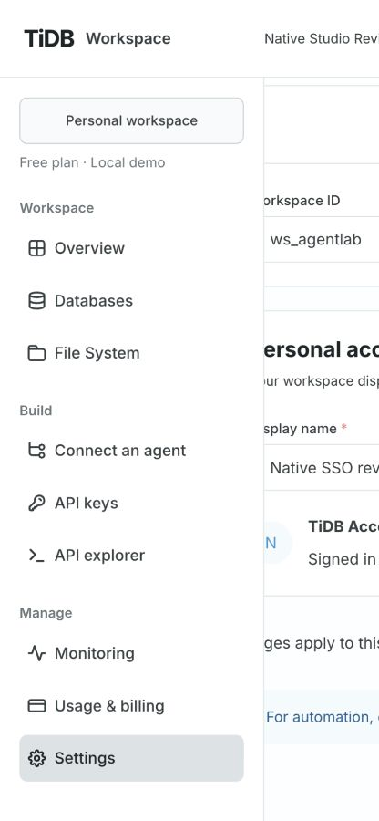
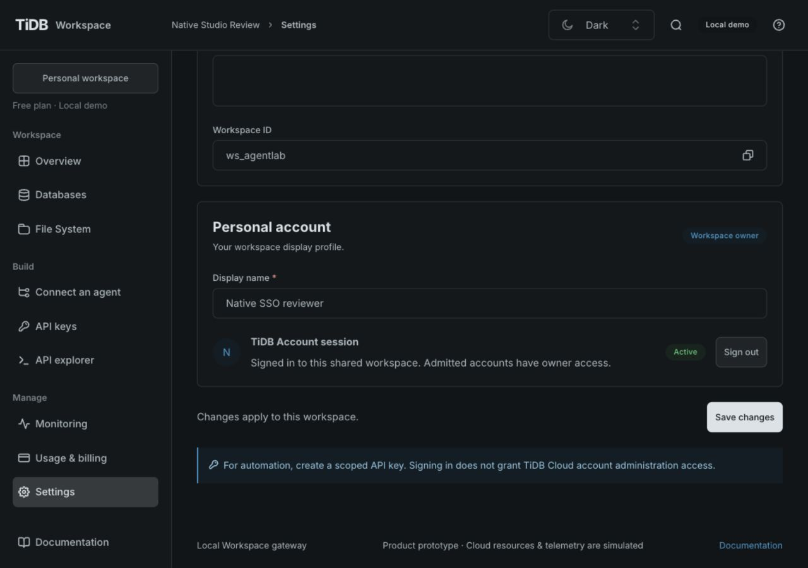
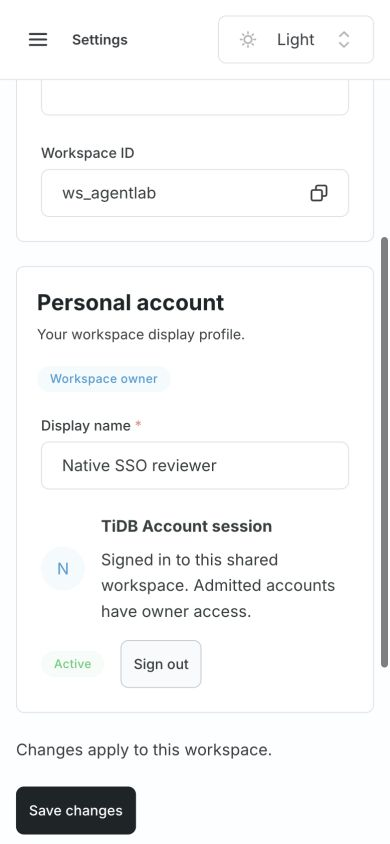
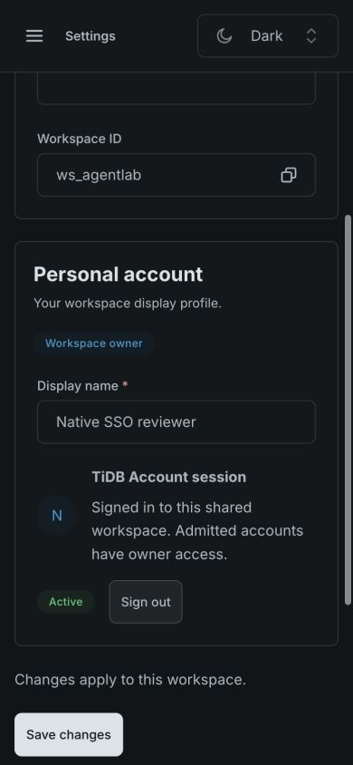
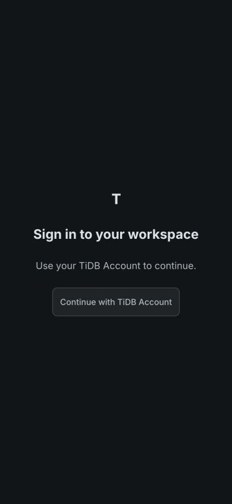

# Native hosted Studio verification

Tracking: [GH-13](https://github.com/mem9-ai/tidb.ai/issues/13), [implementation PR](https://github.com/mem9-ai/tidb.ai/pull/15). Accepted baseline: [`b6bf364`](https://github.com/mem9-ai/tidb.ai/blob/b6bf3645547ee2f172fc93b6249a966fb3f19079/specs/gh-13/spec.md). Exact final candidate and remote checks are recorded in the PR.

## Local evidence

- `npm run check`: repository/runtime/format/lint/generated contract checks, 268 passing oracle/tooling cases, 20 explicitly gated native cases, strict types and production Console build. Native skips are independently exercised below.
- `npm run backend:check`: format/build/Clippy, 19 Rust unit cases and 21 real isolated RustFS/native/API/package cases passed, zero integration skips. Static DuckDB remains checksum-pinned; the native artifact runs computation without Node in PATH.
- Native SSO tests use signed local fake-provider tokens and actual HTTP code exchange: exact PKCE form/no client secret, JWKS signature, issuer/audience/nonce/expiry failures, immutable scalar subject, verified email/exact domains, org filters, replay/browser binding, request Host/Origin, separate Key authentication, session audit labels, logout and per-peer throttling resistant to forged forwarding headers. A real native import fixture logs out after CREATE; reauthorization blocks INSERT and returns the partial-write error. Review handles reject a different SSO session. Negative control: disabling in-flight revocation makes this regression fail (a late 401 replaces the expected pre-INSERT partial-write failure); the check was restored and the passing case rerun.
- Explicit initialization creates independent Global/Region S3 roots and an empty Workspace, releases ownership, and permits steady-plan restart. Steady flags are false. Configuration tooling refuses an existing output directory and generates independent random keys/tokens. Legacy target delivery is rejected before mutation; rollback and concurrent-change preconditions remain tested. Read-only target inspection reports field names, never values.

## Browser evidence

Production Console built with `/studio/`, behind a local same-origin gateway forwarding to the compiled Rust executable. The API used isolated real RustFS metadata and a signed local fake identity provider. No Node business backend, real account or cloud resource was involved.

Observed: sign-in prompt → Continue with TiDB Account → browser authorization redirect → Rust callback → empty Workspace → Settings save → reload preserves `Native Studio Review`/display name → Sign out returns to the sign-in prompt → new login retains saved settings. Generated API examples retain `/studio/api/`. The eight-hour server session and ten-minute flow are covered by HTTP/unit tests; this browser sequence does not wait for their full lifetimes.

TiUI 2.9.1 components/shared theme were retained. Both themes at 1280×900 and 390×844 were inspected. The account summary wraps above its status/sign-out controls on narrow screens; no smaller font or reduced targets were introduced. Narrow document width was exactly 390px. No browser console errors were recorded in the checked sequence.

## Operational boundary

The API image targets verified Linux amd64 only. Remote native-image results, protected dev inspection, live S3 selection, fresh target bootstrap, rollout and real TiDB Account callback verification are separate evidence; local tests do not establish them. Existing GitHub dev identity/cluster/registry secret names were confirmed by the owner. Reuse that protected Actions identity instead of requiring a second local AWS login. Do not expose secret values in diagnostic output.
