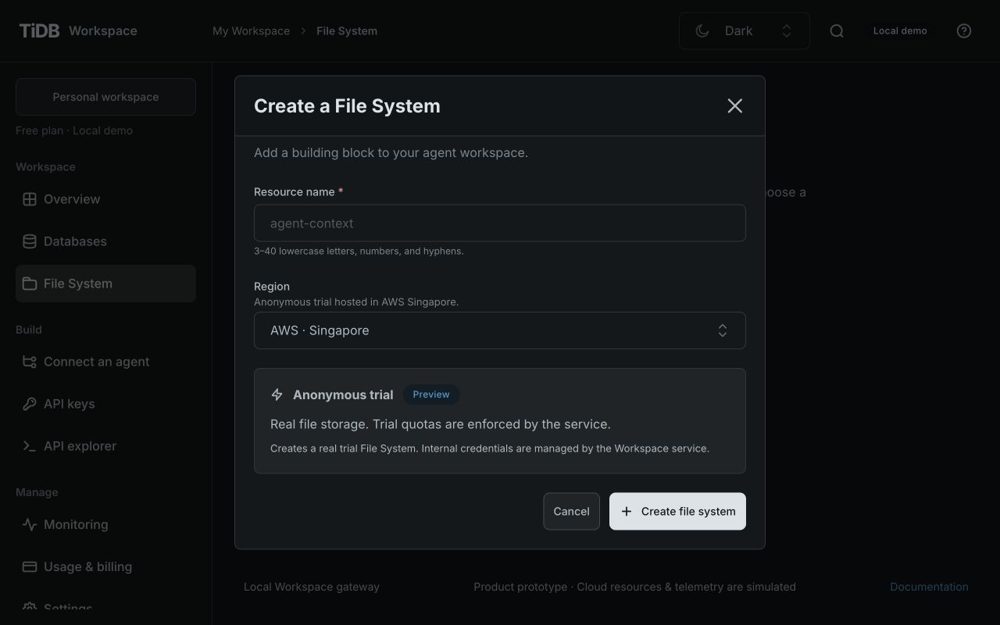
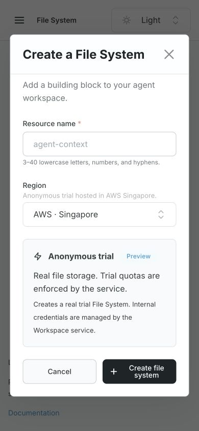
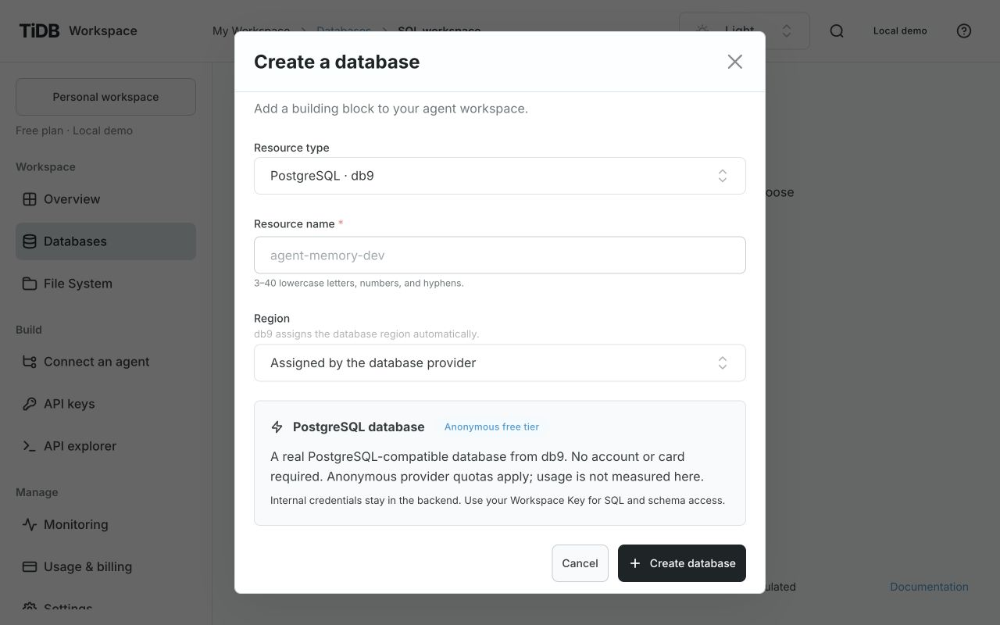
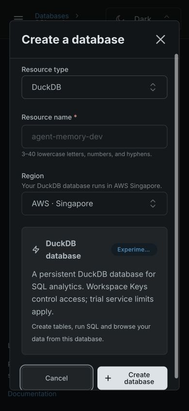

# Shared Database and File System workspaces

- Owner correction: [GH-48](https://github.com/siddontang/tidb.ai/issues/48).
- Reproduction baseline: `9aad9eb122f4ceb19678bd17f67ee12d0afc0894`.
- Scope: presentation and resource-selection hierarchy. No API, provider, authorization,
  dependency or persisted-data change. The PR records the final source revision and CI result.
- Components: TiUI 2.9.1 Paper, NativeSelect, NavLink, Typography, Badge, Button, ActionIcon,
  Menu and Popover; existing official SQL Editor 0.0.6 and the shared Workspace theme.

## Compact resource header

Owner correction [GH-61](https://github.com/siddontang/tidb.ai/issues/61), reproduced on
`9ba5f0d6871841a52f9b996ce71eebde9e149c0a`: the section title/description, large resource
icon, selector caption and duplicate Live/active indicators occupied two large rows.
The shared header now has one selector/status/actions row. NativeSelect includes a small
official icon and the database protocol; TiUI VisuallyHidden preserves the semantic H1.
Details uses one shared Popover for provider/region/expiry context and file counts/size.
Abnormal states and connection-error alerts remain visible. The File System header is
extracted into its feature module while its existing selection/draft callbacks stay in place.

Verified in the local live-resource Console:

- At 1280×800 Dark and 1280×900 Light, both headers are 48px tall, start at y=100 and
  place the work area at y=164. The selector remains 16px/48px; browser toggles and the
  labeled All databases icon retain 44px targets. No document-wide overflow.
- At 390×844, both themes retain the same controls in two rows (108px total). The mode/state
  badge does not shrink; long native select values remain available in the option list/title.
  File and table collapse/expand retain their existing behavior. Details fits the viewport.
- DuckDB → PostgreSQL updates the exact route, table list and empty query results together.
  The All databases action returns to the resource list. A real read-only DuckDB
  `SELECT 1 AS connected;` returned 1 in 5,662ms; selection was disabled while running.
- Database Details retains DuckDB Experimental, PostgreSQL compatibility and MySQL temporary
  expiry guidance. Escape closes the popover and returns focus to Details.
- File Details shows the selected resource, region, trial mode, status and current folder
  totals (4 files / 619 B for the observed folder). A transient file-service read failure
  remained visible inline and recovered after Retry.
- An unsaved README draft blocked switching File Systems. Keep editing retained the draft
  through the mobile transition; Discard changes switched the resource. The original file
  preview was read again successfully. No file save, upload or database write was performed.

Existing non-active resource branches were reviewed; no live resource was forced into an
expired/provisioning state for this presentation check. `npm run check` passes (126 tests,
formatting/lint, generated contract, types and both builds); build warnings remain the existing
large-chunk and transitive `google-libphonenumber` eval notices. The PR carries the evaluated
commit and remote CI result. No API, provider, authorization or persisted-data contract changes.

Screenshots:

- [Database, Dark 1280×800](screenshots/compact-resource-header/database-dark-1280x800.png)
- [Database, Light 1280×900](screenshots/compact-resource-header/database-light-1280x900.png)
- [File System, Dark 1280×800](screenshots/compact-resource-header/files-dark-1280x800.png)
- [File System, Light 1280×900](screenshots/compact-resource-header/files-light-1280x900.png)
- [Database, Dark 390×844](screenshots/compact-resource-header/database-dark-390x844.png)
- [File System, Light 390×844](screenshots/compact-resource-header/files-light-390x844.png)

## Layout and state ownership

Both pages follow resource selection/actions → browser and working panel.
`ResourceWorkspaceHeader` and `ResourceWorkspaceBar` own the common top composition.
Following [GH-61](https://github.com/siddontang/tidb.ai/issues/61), this is one compact toolbar
with a visually hidden semantic page heading. Database names and protocol remain in the
selector, alongside one live/demo/state badge. Supplemental provider/region/expiry information
and File System counts/size are in shared Details. The database selector is above both Tables
and SQL Editor, rather than inside the editor while controlling a sibling table navigator.

The shared desktop browser is 320px wide, collapsing to 56px. `WorkspaceBrowserItem` uses
TiUI NavLink for the common icon/name/secondary-information/selection layout, with separate
44px row actions for files. Long names clamp visually to two lines while retaining their full
accessible name/title and exact path/identifier. File System now uses this browser before a
file is selected, with an explicit right-hand Select a file panel. The prior full-width file
table is superseded. File/folder details remain in each item and its selected-file panel.
Browser and file-preview height budgets are shared (500px at an 800px-tall desktop viewport,
600px at 900px); long preview content scrolls inside while header/footer actions remain
reachable. Analyze retains its existing page-flow expansion rather than clipping controls.

At the GH-48 baseline, DuckDB file sources were inside SQL Editor. The later native-database
correction in [GH-50](https://github.com/siddontang/tidb.ai/issues/50) removes that picker/counter;
see [current verification](duckdb-verification.md#native-database-workspace-correction).
The editor toolbar identifies the tool and its Run action; resource identity belongs to the
outer resource bar. Existing database,
table and file URLs, route keys, data permissions and draft lifetimes remain unchanged.

On narrow screens the work area stacks. Tables can collapse to a horizontal disclosure;
selected files retain the existing Back to files flow. A file browser/placeholder is not
shown alongside a narrow selected-file panel. Wide query/preview tables scroll internally.

## Observed verification

These historical observations and screenshots describe the GH-48 candidate before the GH-50
correction and the [compact resource header](#compact-resource-header).

| Case                       | Result                                                                                                                                                                                                                                                                                                              |
| -------------------------- | ------------------------------------------------------------------------------------------------------------------------------------------------------------------------------------------------------------------------------------------------------------------------------------------------------------------- |
| Desktop hierarchy          | At 1280×900 and 1280×800, both resource bars began near y=190 and browser/working panels near y=285. Browser widths matched at 320px. There is no Database selector inside `.sql-panel`; DuckDB sources are inside it.                                                                                              |
| Resource switching         | The top selector changed DuckDB to PostgreSQL, updating URL, provider caption, table listing and editor together. Previous results and DuckDB sources cleared. Existing missing-resource routing was preserved.                                                                                                     |
| Active query               | A real DuckDB `SELECT 1 AS connected;` returned 1 in 7,343ms while the browser was collapsed. The outer Database selector was disabled during execution; SQL and the completed result remained after expansion. No database write was executed.                                                                     |
| Edited SQL                 | PostgreSQL retained an edited `SELECT 11 AS keep_draft;` through table selection and the existing Query table → Keep my query dialog. The same draft survived narrow/desktop changes and collapse/expand.                                                                                                           |
| File preview               | The real Singapore README rendered successfully. Its identity/content remained through browser collapse and expansion. Only existing files were read.                                                                                                                                                               |
| File operations            | An isolated local-demo store created a folder and a file inside it through the plus menu. The dialog used the selected directory; both were then deleted through the row actions and confirmations. The source draft on another file survived creation and directory navigation. No real provider/file was mutated. |
| Unsaved files              | Switching the outer File system selector with a dirty draft kept the original resource selected and showed Keep editing / Discard changes. Keep editing and collapse/expand retained the draft. Selecting another file prompted the same guard.                                                                     |
| Mobile return              | At 390×844, the selected-file browser was hidden. Back to files → Keep editing retained the source draft; Discard changes restored the browser with no page overflow.                                                                                                                                               |
| Long names and empty state | The isolated store used a long file name and a second, empty File System. Full names remained in accessible labels/titles; the list stayed 356px wide without internal horizontal overflow at 390px. Switching to the empty File System showed the existing empty state and the desktop unselected-file panel.      |
| Theme and controls         | Light/Dark inspected at actual 1280×800/900 and 390×844 viewports, with document widths matching the viewport after responsive transitions settled. Keyboard menu/dialog/collapse actions and focus return were checked. Source/SQL text remains 16px; row actions and toggles retain 44px targets.                 |

The local fixture used a separate hostname from the live preview to isolate owner cookies,
with its own data, ports and Vite cache. Its temporary files were discarded after verification.
Browser error logs were empty in the completed live and isolated flows.

An installed TiUI 2.9.1 active NavLink description initially computed to dark text against
the dark selected-row background. The shared item adapter now uses the supported description
color override to inherit the resolved row color. Both selected names and metadata were
rechecked in Light/Dark; this avoids a second palette.

## Screenshots

- [Database, 1280×900 Dark](screenshots/resource-workspaces/databases-desktop-dark.jpg)
- [File System, 1280×900 Dark](screenshots/resource-workspaces/files-desktop-dark.jpg)
- [Database, 1280×800 Light](screenshots/resource-workspaces/databases-desktop-light-800.jpg)
- [File System, 1280×800 Light](screenshots/resource-workspaces/files-desktop-light-800.jpg)
- [Database, 390×844 Dark](screenshots/resource-workspaces/databases-mobile-dark.jpg)
- [File System, 390×844 Dark](screenshots/resource-workspaces/files-mobile-dark.jpg)
- [Database, 390×844 Light](screenshots/resource-workspaces/databases-mobile-light.jpg)
- [File System, 390×844 Light](screenshots/resource-workspaces/files-mobile-light.jpg)

## Limits

This does not introduce durable SQL drafts or make resource switches preserve old query
results; existing route-scoped behavior remains. Large file previews, expanded editors,
source pickers and results can require vertical scrolling. The activity/usage demo boundary
is unchanged. SQL/provider authorization and failure cases continue to run in the normal
test suite; no new cloud resources, credentials or deployment were required.

Validation: the final `npm run check` result is recorded in the implementation PR. It covers
runtime/repository policy, formatting, lint, generated API/client alignment, behavior tests,
strict types and independent Console/API builds. Browser observations above cover the visual
and interaction checks that CI does not prove.

## Shared interaction audit

Owner correction: [GH-52](https://github.com/siddontang/tidb.ai/issues/52), source base
`e153f2141e774cee335cf1fe19827da92acbe848`. This extends the hierarchy work above into the
actual working controls. The implementation PR identifies the evaluated source and CI head.

| Inconsistency                                                                    | Shared behavior                                                                                                                                                                                                                                             |
| -------------------------------------------------------------------------------- | ----------------------------------------------------------------------------------------------------------------------------------------------------------------------------------------------------------------------------------------------------------- |
| Database Run query was above SQL; File System Run analysis was below it          | Both SQL tools use `WorkspaceExecutionPanel`: SQL Editor title, top-right Run query with Play icon, 48px control, Running state, Samples menu, Limits and Expand/Collapse editor. Bash uses the same frame with Run command.                                |
| Different editor height, padding, nested file-analysis borders and panel margins | One shared editor-height/spacing layer. Analyze uses the full working-column width, with file identity and tabs above the shared frame. The generic `.panel` margin cannot add extra gaps.                                                                  |
| Different result tables, labels and feedback                                     | `WorkspaceQueryResults` shares Results/count/export, 12px row spacing, bounded internally scrolling cells, empty/running/error feedback and completion metadata. Bash uses the same result-panel header/footer. File columns remain an explicit disclosure. |
| File row actions squeezed names and sat outside the selected surface             | Names/icons/metadata share full-width NavLink selection; one sibling overflow menu contains Download/Delete. Menu controls are not nested inside the main button. File paths move below the title/count/toggle row.                                         |
| Files could collapse only after selection and hid their browser on mobile        | Both browsers collapse before/after selection to a 56px desktop rail or the same horizontal mobile disclosure. Narrow expanded lists have a 160px scroll region. Back to files and unsaved-change protection remain.                                        |
| Different resource Connect controls and busy behavior                            | Same Connect button/icon. Running work disables the resource selector and refresh; file analysis also disables upload/create/delete while retaining explicit cancellation.                                                                                  |

The tools keep their domain behavior: native database SQL may write real data; File System
analysis remains selected-file, read-only and cancelable. No query-source picker is restored,
no API or permission changes are introduced, and no runtime/provider credential enters UI.

Observed against the existing live loopback Console/API:

- Native DuckDB `SELECT 1 AS connected` returned 1 in 6,085ms while its browser was collapsed.
  An edited `SELECT 52 AS unified_editor` returned 52 in 5,954ms in the same frame. Filters and empty states survived
  keyboard collapse/expand; the toggle retained focus. Editor expansion reached 420px and
  retained SQL/results. Table inspection and the Query table keep/replace guard remained.
- Existing Singapore CSV analysis returned four rows, then `COUNT(*)` returned 4. Invalid SQL
  produced the shared error state and corrected SQL recovered. Cmd+Enter ran explicitly.
  A deliberately long read-only SELECT was canceled; SQL remained editable and rerunnable.
  Resource selection, upload/create/delete and refresh are disabled while work is running.
- The existing 176-byte synthetic log returned its two ERROR lines with Bash exit 0, using
  the shared toolbar/result frame. Original files were only read. A CSV source draft was
  edited locally and discarded; no file save, deletion, provisioning or database write occurred.
- The file action menu opened its delete confirmation without selecting/opening a different
  file. Cancel/Escape returned focus to the stable overflow trigger. No deletion was submitted.
- At 390×844 the Files browser stayed available as a disclosure alongside the selected file.
  Collapse/expand retained SQL, result 4 and the filter. An unsaved source draft survived
  collapse and a blocked File System switch; Keep editing retained its contents and original
  resource. Back to files → Discard changes closed the preview, expanded the browser and
  returned focus to the original item. The source file still reported its original 52 bytes.
- Limits Escape initially also closed the file because TiUI portal key events bubbled through
  React. The file panel now checks physical DOM ownership before handling its own Escape.
  Real Escape closed only Limits, returned focus to its trigger, and kept the file/SQL open.
- Light/Dark at 1280×800, 1280×900 and 390×844 were inspected. At 1280px the Database and File
  SQL working frames both measured 592px; Run query measured 122.64×48px at x=1096.36, with
  the same 20px inset. At 390px, document width stayed 390px, text stayed 16px, primary targets
  stayed 48px and expanded lists were capped at 160px. Longer tool titles reflow without shrinking.

Browser heading badges count the unfiltered current collection. Filtering the seven-entry
File System root to zero matches retained the Files badge at seven, matching Tables behavior.

TiUI 2.9.1 Button/Menu/Popover/Paper/NavLink/Table and SQL Editor 0.0.6 remain installed.
No dependencies or backend contracts changed. Existing native/API authorization, cancellation,
persistence and packaging tests run in the shared gate. The final PR records `npm run check`
and CI results; browser observations cover the interaction/visual behavior those tests do not.
Screenshots of File System use full-page capture from the stated viewport so its file context,
SQL and results can be reviewed together.

- [Database, 1280×900 Dark](screenshots/resource-interactions/databases-desktop-dark.jpg)
- [Database, 1280×900 Light](screenshots/resource-interactions/databases-desktop-light.jpg)
- [Database, 1280×800 Dark](screenshots/resource-interactions/databases-desktop-dark-800.jpg)
- [File SQL, 1280×900 Dark](screenshots/resource-interactions/files-desktop-dark.jpg)
- [File SQL, 1280×900 Light](screenshots/resource-interactions/files-desktop-light.jpg)
- [File SQL, 1280×800 Dark](screenshots/resource-interactions/files-desktop-dark-800.jpg)
- [File Bash, 1280×800 Dark](screenshots/resource-interactions/bash-desktop-dark-800.jpg)
- [Database, 390×844 Dark](screenshots/resource-interactions/databases-mobile-dark.jpg)
- [Database, 390×844 Light](screenshots/resource-interactions/databases-mobile-light.jpg)
- [File SQL, 390×844 Dark](screenshots/resource-interactions/files-mobile-dark.jpg)
- [File SQL, 390×844 Light](screenshots/resource-interactions/files-mobile-light.jpg)

## Compact editor toolbar

Owner correction: [GH-56](https://github.com/siddontang/tidb.ai/issues/56), source base
`cd3d02f9bf348a886d6d5aa7c3f9c6a1d6a4841d`. The large repeated SQL Editor heading and
second footer in the GH-52 audit above are superseded by this correction. The implementation
PR identifies the final candidate and its CI results.

Database SQL, File SQL and Bash retain `WorkspaceExecutionPanel`, now with a quiet SQL/Bash
marker, visible live/demo/read-only context and one primary Run action. Editor tools contains
the existing samples, expansion and Limits controls, plus the keyboard shortcut reminder.
The editor remains an accessible named section. This does not add query tabs or draft persistence.

Observed against the existing loopback Console/API on 2026-10-28:

- At 1280×800 the toolbar measured 65px and the SQL frame 217px, retaining the 150px editor
  body while removing 65px of surrounding chrome. At 1280×900 the editor body remains 180px.
  Run keeps its 48px target and Editor tools its 44px target. Empty/error result messages use
  supported TiUI padding props; the empty message now has a verified 20px inset.
- Native PostgreSQL `SELECT 56 AS toolbar_check` ran with Cmd+Enter and returned 56 in
  4,244ms. Expanding/collapsing the editor preserved SQL/results; expanding the table kept
  its five columns inline and left Query results selected.
- The existing Singapore CSV Count rows sample prepared SQL without running it; explicit
  Run returned 4 in 2,510ms. Editor expansion reached 420px and collapse retained the script
  and result. Limits opened a compact dialog; Escape returned focus to Editor tools and
  kept the selected file, Analyze view and SQL open.
- At 390×844 a long read-only file query exposed a labeled 44px Cancel query control beside
  Running and Editor tools, with document width still 390px. Samples were disabled while
  running; upload/resource selection were disabled. Cancellation returned Query canceled
  and preserved the script for editing. No real database writes or file modifications occurred.
- The existing synthetic log's default Bash command returned its two ERROR lines, exit 0,
  in 2,603ms. It uses the same quiet marker/context/Run layout and shared result frame.
- Light/Dark at desktop 1280×800/900 and mobile 390×844 were inspected. Narrow screens move
  context onto a full second line without truncating it or shrinking controls. Browser
  collapse preserves the working editor/results. No browser warning/error logs were recorded.

The full local `npm run check` passed all 118 tests, strict types, lint, formatting, generated
contract checks and independent builds. TiUI 2.9.1 and SQL Editor 0.0.6 remain unchanged.
This is shared Console presentation only; public contracts, authorization and native DuckDB
storage behavior are unchanged. Screenshots of File System use full-page capture from the
stated viewport to show the file context, editor and results together.

- [Database, 1280×800 Dark](screenshots/compact-editor/database-dark-800.jpg)
- [Database, 1280×900 Light](screenshots/compact-editor/database-light-900.jpg)
- [Database, 390×844 Dark](screenshots/compact-editor/database-dark-mobile.jpg)
- [Database, 390×844 Light](screenshots/compact-editor/database-light-mobile.jpg)
- [File SQL, 1280×800 Dark](screenshots/compact-editor/files-dark-800.jpg)
- [File SQL, 1280×900 Light](screenshots/compact-editor/files-light-900.jpg)
- [File SQL, 390×844 Dark](screenshots/compact-editor/files-dark-mobile.jpg)
- [File SQL, 390×844 Light](screenshots/compact-editor/files-light-mobile.jpg)
- [File Bash, 1280×800 Dark](screenshots/compact-editor/bash-dark-800.jpg)

## Contextual resource creation

GH-29 fixes the shared Create callback losing the source resource kind. The reproduction
was a File System action opening MySQL; overview PostgreSQL/DuckDB cards used the same
untyped callback. Resource creation now lives in `src/features/resources/`, with explicit
targets captured when opening the dialog. TiUI 2.9.1 and the existing Workspace theme/modal
remain in use; no style, dependency, provider or API contract was changed.

Browser regression, 2026-10-30:

| Entry or transition                                | Verified result                                                                                                                                                 |
| -------------------------------------------------- | --------------------------------------------------------------------------------------------------------------------------------------------------------------- |
| Four empty overview cards                          | MySQL, PostgreSQL, DuckDB and File System each open their own titled form; no unrelated type chooser                                                            |
| Initial regions                                    | MySQL/PG use automatic assignment; DuckDB/File System use Singapore from capabilities                                                                           |
| Global resource action                             | All four types remain available                                                                                                                                 |
| Database collection header and empty-state actions | Only MySQL/PG/DuckDB; File System is absent                                                                                                                     |
| Cancel after changing type/name                    | Reopening a File System form clears the draft and restores Singapore; reopening the database chooser resets its selection                                       |
| Unavailable resource link in an empty workspace    | Direct Create file system/Create database plus the collection link, without silently selecting another resource                                                 |
| Successful File System creation                    | Isolated fixture received `kind: filesystem`, Singapore and the entered name, then the Console opened its exact `#files?resourceId=…`                           |
| Successful PostgreSQL creation                     | Isolated fixture received `kind: postgresql`, automatic region and the entered name, then the Console opened its exact database SQL URL                         |
| Occupied File System region                        | Create stays disabled; Open existing-resource link closes the dialog and opens the exact existing File System                                                   |
| Keyboard and responsive behavior                   | Escape restores focus to the invoking Create button; both themes checked at 1280×800 and 390×844; no horizontal document overflow; long forms scroll vertically |

Submission/navigation used a loopback-only in-memory fixture with captured requests and no
cloud I/O. Empty/stale-link forms and capabilities were also checked against the existing
native API without submitting or provisioning a cloud resource. The backend was unchanged;
this verification does not claim a new provider-integration or native-backend test run.

