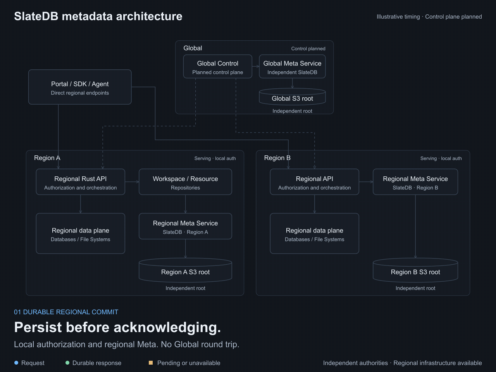
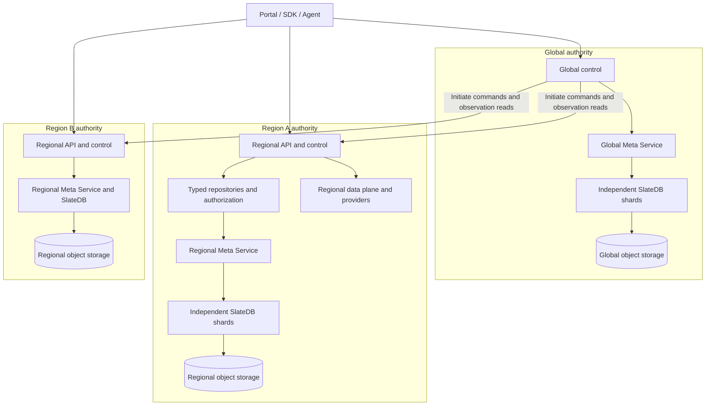
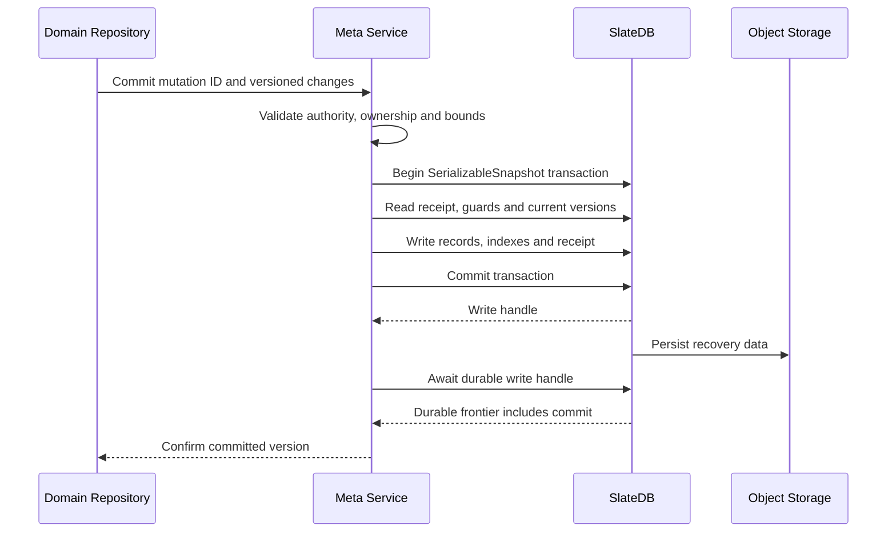
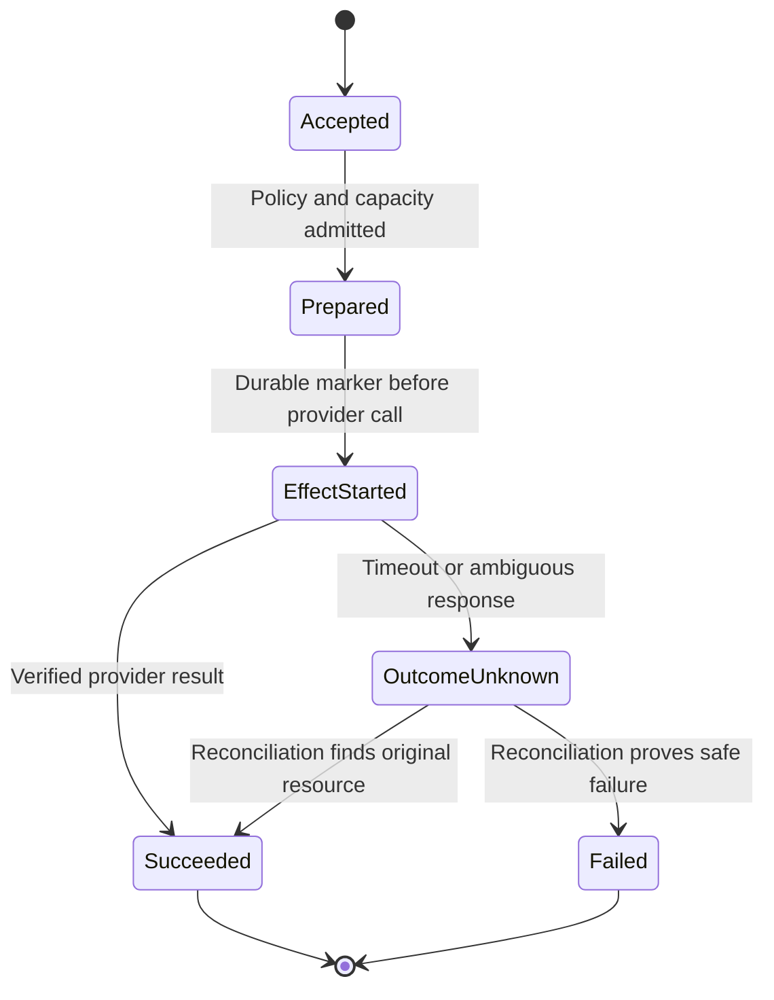

# SlateDB Metadata Architecture Version 1

- Edition: 1, 2026-10-30.
- Audience: backend, infrastructure, security and product engineers.
- Direction: independent Global and regional metadata authorities, Rust services and SlateDB with object storage as the source of truth.
- Initial Meta implementation baseline: [141652e501c942128ccae617d088a2cdccf9f780](https://github.com/mem9-ai/tidb.ai/tree/141652e501c942128ccae617d088a2cdccf9f780), using SlateDB 0.17.0. Hosted Studio SSO has since been implemented under [ADR 0026](decisions/0026-native-hosted-studio.md); regional continuity grants and autonomous renewal remain future work.
- Status: architecture reference for iteration. The foundations below reflect accepted owner direction; target domain schemas, control protocols and scale mechanisms require implementation as identified in [Implementation and iteration](#implementation-and-iteration).

The metadata system records ownership, permissions, resource placement, lifecycle operations and private provider bindings. Each authority owns a Rust Meta Service and independent SlateDB storage. A successful mutation is recoverable from object storage without the original compute host, provided the object service, encryption roots and required bootstrap identity remain available. Authority-owned application and runtime metadata use the [System State boundary](decisions/0040-system-state-metadata.md); fresh installations store security checkpoints in Meta.

Design records around domain entities and bounded consistency groups. Historical JSON shapes and compatibility imports do not constrain this model. This edition changes documentation; the running wire contract and storage format change only through subsequent implementation work.

## Reading map

- [Architecture and authority](#architecture-and-authority)
- [SlateDB capabilities](#slatedb-capabilities)
- [Storage layout and identity](#storage-layout-and-identity)
- [Domain records and atomic groups](#domain-records-and-atomic-groups)
- [Transactions and durable reads](#transactions-and-durable-reads)
- [Service boundary](#service-boundary)
- [Resource lifecycle and external effects](#resource-lifecycle-and-external-effects)
- [Authorization and credentials](#authorization-and-credentials)
- [Global and regional communication](#global-and-regional-communication)
- [Scale and discovery](#scale-and-discovery)
- [Recovery and operation](#recovery-and-operation)
- [Implementation and iteration](#implementation-and-iteration)

## Architecture and authority

Play the [animated architecture](diagrams/slatedb-metadata-architecture.html) to follow a
durable regional commit, Global-initiated control and regional serving during a Global outage.
It supports playback, chapter selection, stepping and scrubbing. The [diagram guide](diagrams/README.md)
explains offline/local viewing and the illustrative timeline; GitHub displays the HTML source.



An **authority** is Global or one Region. A **cell** is independently budgeted serving capacity inside an authority. A **shard** is one physical SlateDB root and its active writer. A **group** is a bounded domain consistency boundary placed on one shard. A Workspace defines ownership and policy; it does not require a dedicated process, database or shard.



This is the target topology. Independent Meta installations and regional serving exist; Global business control, policy distribution, hosted multi-tenant routing and multi-shard cells remain future work.

| Plane            | Authoritative responsibilities                                                                                                         | Request path                                             |
| ---------------- | -------------------------------------------------------------------------------------------------------------------------------------- | -------------------------------------------------------- |
| Global control   | Organizations, Workspace policy, global grants and quota allocation, region eligibility, placement and desired state, command dispatch | Global APIs and Global Meta                              |
| Regional control | Installed local policy, admitted operations, regional capacity, provider bindings, credentials, observed state and recovery            | Regional APIs and regional Meta                          |
| Regional data    | SQL, file transfer, managed connections, private DuckDB storage and bounded computation                                                | Direct regional endpoint to regional provider or runtime |

Global status is a projection of observations it has requested. It cannot replace a Region's execution record or infer deletion from silence. Resources carry an explicit `regionId`; a Workspace's default region affects future placement. Moving a resource is an explicit operation with stable identity and ownership transition.

All backend roles share Rust modules. One executable can compose roles with in-process calls or run them in separate processes with remote Meta calls. Global and each Region always have separate engines, installations, storage roots and cryptographic identities. Independent availability additionally requires separate processes, hosts and regional infrastructure; one binary containing several roles still shares its process failure domain.

## SlateDB capabilities

SlateDB is an embedded ordered KV engine. The service uses its native storage and concurrency APIs directly; it does not implement another LSM, transaction manager or replaceable-engine framework.

| Capability                                 | Use in the metadata service                                               |
| ------------------------------------------ | ------------------------------------------------------------------------- |
| Ordered keys, point reads and prefix scans | Entity lookup, bounded collection pages and explicit indexes              |
| Native `SerializableSnapshot` transactions | Atomic group updates and detection of concurrent read/write conflicts     |
| MVCC sequences                             | Coherent reads across related records                                     |
| Write handles and `await_durable()`        | Confirm a mutation only after its recovery data reaches object storage    |
| WAL, SSTs and manifests                    | Recover acknowledged state and maintain compacted durable storage         |
| Compaction, filters and caches             | Engine-managed read and storage efficiency                                |
| Native writer fencing                      | Prevent an obsolete engine writer from continuing to modify the same root |

The pinned release supplies these primitives. Product backup workflows, CDC-based projections, automatic shard movement and read-replica authorization are separate integrations. An independently polling reader may lag and cannot be substituted for a fresh authorization read without proving the required freshness.

Object storage latency is part of the durable-write path. Batching amortizes object requests; it does not remove the wait for acknowledged writes. Tune only after measuring the durability contract under the selected object service.

### Choosing when to wait for durability

Product analytics is the explicit approximate-data exception in [ADR 0050](decisions/0050-isolated-analytics-service.md):
it uses a separately hosted SlateDB service, not the authoritative Meta service described here.
Its queued acknowledgments, loss tolerance and lower availability do not relax the Meta rules below.

`async` execution and asynchronous durability are different decisions. A Rust `.await`
on SlateDB or Meta yields the executor while waiting; it does not require a blocking thread.
The durability decision is whether the caller can proceed before the acknowledged state can
survive process loss. SlateDB 0.17 returns a write handle after accepting a transaction;
`await_durable()` waits for its recovery data to reach the configured object store. It does
not mean that every write needs an individual `flush()`: concurrent writes can share a WAL
flush, and only callers that need durability wait for their own handle.

| Data or decision                                                                                      | Required behavior                                                                                                                                             | Why                                                                                                               |
| ----------------------------------------------------------------------------------------------------- | ------------------------------------------------------------------------------------------------------------------------------------------------------------- | ----------------------------------------------------------------------------------------------------------------- |
| Key creation/rotation/revocation, membership, grants and regional policy                              | Wait for durable commit before returning success, issuing a credential or acknowledging policy installation.                                                  | An acknowledged Key or revocation must survive restart; an old permission must not reappear.                      |
| One-use tickets, proof/refresh replay markers, refresh rotation and renewal witnesses                 | Wait for durable commit before returning the credential or applying the effect.                                                                               | Losing a consumed marker or rotation can permit replay or lose the only valid credential.                         |
| Security clock                                                                                        | Reserve a bounded time window durably before using it; check current time locally within that window.                                                         | Each check need not perform storage I/O, but restart must not make an expired credential valid again.             |
| Workspace/resource metadata, ownership/fencing, operation receipts and pre-effect idempotency markers | Wait for the relevant atomic commit before confirming success or performing a non-idempotent external effect.                                                 | A crash must not lose an acknowledged resource, writer fence or evidence needed to reconcile an uncertain effect. |
| Billing ledger, quota enforcement and required security audit                                         | Wait for the agreed durable ledger or audit acceptance point before making a decision that relies on it.                                                      | Approximate telemetry cannot be treated as a billing, quota or security authority.                                |
| Debug metrics, traces, caches and explicitly approximate activity hints                               | May be buffered or written in the background if the caller and product contract accept loss, lag and bounded memory.                                          | These are useful observations; they do not grant access, decide quota or prove an acknowledged effect.            |
| Derived search/list indexes or usage summaries                                                        | May be asynchronous only if the canonical data is already durable, staleness is visible, and rebuild plus a durable replay/watermark protocol is implemented. | A stale or lost projection must not hide authoritative state or authorize a mutation.                             |

The current generic `MetaRequest::Commit` is **durable-only**: every successful response
waits for the SlateDB handle, and its receipt and mutations share one transaction. No generic
fire-and-forget or configurable weak acknowledgement is implemented. In particular, the
existing `lastUsedAt` update is stored inside a Key record, and query counts and activity events
participate in current transactions; none is automatically safe to make lossy. A future
best-effort activity stream must use a separately classified record and must never rewrite the
authoritative Key, advance an authorization version, or participate in quota/billing decisions.
Its bounded buffering, crash loss window, shutdown behavior, overload behavior and freshness
must be specified and tested before enabling it. A `202 Accepted` is not a durable acceptance
unless its job or intent was itself durably recorded.

The current snapshot transaction waits for the database-wide durable frontier at its starting
sequence. Consequently a future unflushed best-effort write in the same SlateDB could still
delay an unrelated authoritative read; key prefixes alone do not prove latency isolation.
Introducing weaker writes therefore requires explicit read isolation, recovery and performance
evidence, rather than just skipping `await_durable()`. Global and each Region retain their own
independent Meta authority. The five-second clock reservation and restart tradeoff are defined
in [ADR 0040](decisions/0040-system-state-metadata.md).

## Storage layout and identity

Each installation has a stable authority, environment, installation ID, format version, encryption-key reference and explicit storage root. Startup validates that these identities match existing storage. Initialization is an explicit empty-root operation; a missing expected root never becomes a new empty Workspace.

The current physical layout is:

```text
s3://<bucket>/<root>/
  control/installation.json
  control/owner.json
  slatedb/
    ... engine-managed WAL, SST and manifest objects ...
```

Many KV records share WAL and SST objects. One resource record does not require one object or a bucket per Workspace. In-memory state and optional local disk caches accelerate access and can be rebuilt; they are never the sole copy of an acknowledged commit.

The current internal namespace derives `records/v2/<scope-hash>/` from authority, owner kind/ID, family and partition. Ordered record keys live under `data/`; mutation receipts live separately. This encoding is a physical implementation detail. The target typed repositories below expose domain identities and consistency groups independently of physical cell/shard placement.

Global keeps a private regional deployment directory:

| Field                                             | Purpose                                                                     |
| ------------------------------------------------- | --------------------------------------------------------------------------- |
| `regionId`, `metaDeploymentId`, `installationId`  | Bind the directory entry to an intended deployment                          |
| `engine`, `engineRelease`, `formatVersion`        | Declare storage/runtime compatibility                                       |
| Storage endpoint, signing region, bucket and root | Locate the regional object authority                                        |
| Catalog locator and configuration generation      | Discover regional shard metadata without listing every resource             |
| IAM, encryption and PKI references                | Identify independent bootstrap capabilities without embedding secret values |
| Last observed generation and time                 | Describe queried progress, never a serving lease                            |

The initial local directory implements a subset of these fields. A Region's durable bootstrap configuration and regional object-backed catalog must be sufficient to restart without Global. Global knowing a bucket path grants neither S3/KMS access nor permission to open the Region's SlateDB as a second writer. Normal observation goes through the Region service.

## Domain records and atomic groups

The following is the clean target model. Entity names and fields describe domain semantics; they are not a promise that these typed schemas already exist in the public API.

| Entity                           | Owner                                 | Important fields and relationships                                                                             |
| -------------------------------- | ------------------------------------- | -------------------------------------------------------------------------------------------------------------- |
| Organization                     | Global                                | ID, status, membership/policy version; large membership is separate edges                                      |
| Workspace                        | Global                                | ID, Organization ID, status, default region, policy version                                                    |
| Workspace regional policy        | Region                                | Workspace ID, verified policy generation, grants, deny floors, delegated local authority                       |
| Resource desired state           | Global                                | Resource ID, Workspace ID, `regionId`, desired generation/specification, operation identity                    |
| Resource observed state          | Region                                | Resource ID, Workspace ID, `regionId`, observed generation, lifecycle state, binding and credential references |
| Operation                        | Its execution authority               | ID, request fingerprint, resource ID, phase, attempt/ownership epoch, effect evidence and result               |
| Provider binding                 | Region                                | Provider instance identity, lifecycle stage, credential reference and reconciliation evidence                  |
| Credential version               | Region                                | Secret ID/version, encrypted payload, permitted consumer and rotation/recovery state                           |
| Access grant and credential      | Global or explicitly delegated Region | Principal/Workspace, action/resource ceiling, validity, revocation generation, verifier digest                 |
| Name claim and quota reservation | The allocating authority              | Owner, normalized identity or budget, operation ID, state and release evidence                                 |
| Observation journal entry        | Region                                | Stream/sequence, resource/operation ID, desired generation and safe result                                     |
| Shard catalog entry              | Its authority                         | Group/range mapping, owner epoch, storage locator and movement state                                           |

All resource and operation ownership is checked against canonical records. Stable IDs survive retries, restarts and shard moves. Native connection passwords and provider account secrets never enter a public Resource representation.

A typical record envelope contains a schema version, opaque record version and typed payload. Schema version describes decoding; record version is an optimistic-concurrency token, not a globally ordered timestamp. Collection ordering uses an explicit stable tuple such as `(createdAt, id)`. Large grants, inventories and operation histories are separate records rather than unbounded arrays.

A group contains the records that must commit atomically:

| Group                | Records committed together                                                                                             |
| -------------------- | ---------------------------------------------------------------------------------------------------------------------- |
| Resource             | Local resource state, operation transition, binding/credential reference changes, receipt and observation/outbox entry |
| Policy               | One bounded policy generation or atomic activation pointer to verified staged chunks                                   |
| Credential           | Credential version and its local activation/revocation state                                                           |
| Claim or reservation | Name/budget ownership, request identity and release state                                                              |
| Index entry          | A canonical-group index where co-located, or replay identity/watermark for a separate projection                       |

A request must remain within its declared group and physical shard. Global and regional records never share a transaction. Separate claims, quotas or index partitions require recoverable coordination even when their records happen to be on the same server.

Logical key examples for the target repositories are:

```text
workspaces/<workspaceId>/descriptor
resources/<resourceId>/descriptor
resources/<resourceId>/operations/<operationId>
resources/<resourceId>/binding
resources/<resourceId>/credential-versions/<versionId>
grants/<grantId>/descriptor
grants/<grantId>/resource-edges/<resourceId>
indexes/key-digest/<digest>
indexes/resource-list/<stripe>/<workspaceId>/<view>/<createdAt>/<resourceId>
```

These are logical examples, not literal S3 paths or a replacement for the running key codec. Physical routing must co-locate each atomic group and independently distribute collection index writes.

## Transactions and durable reads

A mutation carries its authority/group, a stable `mutationId`, an operation fingerprint and bounded record changes. Each change supplies `expectedVersion`; null requires an absent record. Updating or deleting an existing record requires the version the caller actually read.



The receipt and changes commit in the same native transaction. An identical mutation ID/fingerprint returns the original result; changed content under that identity conflicts. A known OCC conflict returns a conflict for domain re-evaluation. The service never automatically replays a business callback or provider effect.

A response lost after durability does not imply failure. Reconcile the same mutation through `resolve` or an identical commit. An unknown result remains unknown until there is evidence: a missing receipt alone does not authorize repeating an external effect. After a non-conflict commit/durability failure, the current engine fails serving closed; reopen under the recovery procedure before reconciliation.

For authoritative reads, begin a native transaction, pin its sequence, wait until the durable frontier reaches that sequence and read using the explicit remote-durability filter. Later writes cannot enter that snapshot. This prevents pending in-memory grants from authorizing a request and prevents a response mixing old and new related records. The current frontier wait is bounded at 30 seconds; storage stalls can delay or fail reads.

A list page is coherent within its own transaction. Separate pages are a live listing, not one retained cross-request snapshot. Export, deletion or migration requiring an exhaustive inventory must add an explicit snapshot/journal protocol. Ordinary list completion is not proof that every child or unresolved operation has been accounted for.

## Service boundary

Public APIs call domain operations; trusted repositories call Meta. Customers never receive raw Meta access. The existing `get`, `list`, `commit` and `resolve` operations are a thin authority-bound service interface over SlateDB, shared by remote and in-process composition.

| Operation | Semantics                                                                           |
| --------- | ----------------------------------------------------------------------------------- |
| `get`     | Read named records coherently; absence is distinct from a record containing null    |
| `list`    | Scan an ordered prefix with an exclusive cursor and explicit row/byte budgets       |
| `commit`  | Check versions and guards, atomically modify records plus receipt, await durability |
| `resolve` | Report durable receipt evidence for a mutation identity                             |

Current bounds are 512 records per get/list, 18 MiB per response/page, up to 4096 changes and 18 MiB per commit, and 12 MiB per individual value. These are ceilings, not recommended group sizes or scale targets. Typed operations should normally touch small groups. The remote service currently admits eight requests concurrently and rejects overload; a future hosted implementation also needs per-tenant fairness.

Transport failures are structured and do not disclose credentials. Remote calls use explicit origins, no automatic redirects or retries, bounded timeouts and authority/installation checks. In-process composition retains engine scope and writer checks. It is an internal trust boundary, not a sandbox against arbitrary code running in the process.

## Resource lifecycle and external effects

A metadata transaction cannot atomically commit a provider API call. A regional operation persists its identity and effect marker before invoking a non-idempotent external action, then records the resulting binding and state durably.



These are target semantic phases; existing provider adapters use provider-specific states. A provider with an idempotency API receives the original operation identity. Otherwise retain enough evidence to reconcile its account/resource state. A lost response or a new process must not allocate another free-tier instance blindly.

Global admission can persist desired state and dispatch intent in a local group. Region durably accepts a command into its inbox before effects. Global later queries completion; acceptance is not provider completion. Receipt identity, resource ID and desired generation remain stable across delivery retries.

Deletion is a resumable operation. Deny new admissions as required, enumerate bounded inventories, reconcile outstanding effects, delete provider resources explicitly and retain tombstones/receipts until duplicate work can no longer resurrect them. Releasing a name, quota or credential reference requires evidence that no unresolved operation still owns it.

## Authorization and credentials

Backend authorization derives the Workspace and permitted resources from the authenticated principal. It verifies action grants and canonical ownership before provider or secret I/O. A Scope hash organizes keys; it does not establish tenant permission. A valid Meta service token remains a privileged internal credential.

Key authentication uses a digest index to find the canonical Key/grant and checks its real expiry and revocation. An index entry or token claim alone never authorizes access. Large resource grants use bounded indexed edges; public tokens must not contain a million resource IDs.

Values are individually encrypted with AES-256-GCM and random nonces. Associated data binds installation identity and full record path, preventing ciphertext from being moved to another tenant/record. Each authority has independent encryption roots and service identities. Record names and access patterns require separate confidentiality assessment; hex encoding is not encryption.

Binding records expose only safe metadata and opaque secret references. Credential payloads are loaded only for authorized provider work and excluded from public responses, user computation, logs and search projections. Same-group credential changes can use one transaction. An external vault requires staged recoverable versions before publishing references and its own regional availability/recovery contract.

Remote Meta uses TLS 1.3/mTLS plus service-token, authority and installation checks. Production object access uses HTTPS and region-scoped IAM/KMS. HTTP is permitted only in explicit loopback tests. Separate prefixes alone do not enforce IAM isolation.

Regional continuity requires a locally installed grant and explicitly delegated regional authentication/rotation authority. Region validates, refreshes and reauthenticates locally within that ceiling. Existing expiring Keys retain their hard expiry; an actual grant end or received denial still applies. Synchronization age is not a lease that expires otherwise valid regional access. Distributed grants and regional renewal remain future implementation under the [regional auth contract](../specs/gh-74/regional-api-auth.md).

## Global and regional communication

Global initiates every cross-plane command, policy delivery, observation read, health read and result query. Region returns a bounded response to that request. It does not call Global for renewal, policy pull, callbacks, telemetry publication or startup discovery. No indirect broker or shared global store may create the reverse dependency.

Production uses authenticated TLS 1.3/mTLS and network rules denying Region-initiated Global connections. Identity bootstrap and certificate/key renewal need regional or out-of-band deployment paths. Global may request rotation material and deliver replacements; Region cannot depend on a Global enrollment endpoint to remain available.

Desired generations originate from an authorized Global workflow. Regional observations report actual progress for that generation. Global polling updates projections and cursors, without manufacturing new desired generations or commands. This separates retries from new work and prevents response/command echo loops.

Region atomically installs verified policy generations and retains deny/version floors through restart and recovery. Global tracks per-target applied evidence. A deny issued while Region is unreachable is pending there; arbitrary outage continuity and a finite global revocation deadline cannot both be guaranteed. Received denials and real credential expiries remain effective.

During Global failure, known authorized regional requests, locally renewable sessions, admitted operations and regional restart continue using regional state. New globally coordinated enrollment, placement or budget allocation may wait. This availability depends on regional storage, IAM/KMS, PKI, DNS and authenticators remaining usable. SQL/file payloads and native secrets remain regional. Protocol details are canonical in the [control-channel contract](../specs/gh-74/control-channel.md).

## Scale and discovery

Target millions of Workspaces and hot Workspaces with up to a million resource descriptors. Treat inventory size, active traffic, churn, tenant skew and provider quotas as different dimensions. An inactive resource needs no resident worker, timer or database connection.

Pool small tenants in shared cells. Route bounded groups using authority, family, owner and subject identity; resource groups include Resource ID. Hashing only Workspace ID cannot distribute one hot Workspace. A shard catalog stored in regional objects supplies versioned placement and ownership epochs; routing caches are hints, never authority. Do not allocate thousands of shards or directory entries for every empty tenant.

Shard movement requires a fenced ownership epoch and explicit transfer/replay boundaries. Refresh or reject stale routes before writes; never redirect to an empty root. Cross-shard workflows use durable claims/reservations and reconciliation rather than a distributed transaction spanning all regions or tenant records.

Collection discovery uses purpose-built indexes and bounded keyset pagination. List by immutable sort tuples with a tie-breaker, support declared indexed filters, shard write hotspots and bound read fan-out with merged server-side cursors. A colocated index can update atomically with its canonical record. A separate projection carries a replay identity and watermark and is revalidated before authorization or irreversible actions.

Optional SQL/search indexes are rebuildable from authoritative records plus retained changes. Expose their lag and supported queries. Quota allocation, uniqueness and permission decisions stay on authoritative guards. Engine WAL/CDC retention is separate from the product operation journal and cannot substitute for an indefinite audit history.

Resource query telemetry and high-volume access events belong in an appropriate data/telemetry service. Avoid turning a low-write control plane into one hot counter or last-used write per customer query. Detailed capacity and pagination requirements remain in the [scale profile](../specs/gh-74/metadata-scale.md).

## Recovery and operation

Three ownership mechanisms serve different purposes:

| Mechanism                      | Responsibility                                                                                                         |
| ------------------------------ | ---------------------------------------------------------------------------------------------------------------------- |
| Native SlateDB writer fencing  | Protect one physical root from obsolete engine writers while allowing concurrent transactions inside the active engine |
| Meta installation owner record | Prevent unsafe startup/takeover and reject fresh reads from a displaced service                                        |
| Workspace API writer guard     | Current business-workflow coordination while provider operations are process-local                                     |

A Workspace writer guard is not required by SlateDB's transaction model. Replacing it requires distributed operation claiming and provider recovery semantics. Current crash recovery identifies the exact stopped owner; time passing alone does not authorize stealing ownership. Graceful shutdown drains accepted transactions, closes SlateDB and releases ownership. Automatic election and HA are future work.

| Failure                                                   | Required behavior                                                                      |
| --------------------------------------------------------- | -------------------------------------------------------------------------------------- |
| Global unavailable                                        | Continue known authorized regional work without a Global lookup or renewal             |
| Object store stalled                                      | Bound admission and durability waits; do not acknowledge volatile state                |
| Commit response lost                                      | Resolve the original mutation/operation identity                                       |
| Commit outcome uncertain                                  | Fail serving closed, recover and reconcile; never assume external failure              |
| Meta process or local disk lost                           | Reopen the same validated object root with keys/identity after safe ownership recovery |
| Old writer resumes                                        | Fence reads and writes before it can serve cached authorization                        |
| Storage missing, wrong installation or corrupt ciphertext | Reject explicitly; no implicit fresh initialization                                    |
| Regional object service or encryption root destroyed      | Follow declared backup/key recovery RPO/RTO; host replacement alone is insufficient    |

Bootstrap identity, storage locator, regional IAM/KMS access and encryption recovery material must be independently recoverable. The only copy of a key needed to decrypt the catalog cannot be inside that catalog. Backups need a coherent engine-supported retention/recovery boundary and encryption-key recovery; copying arbitrary live prefixes is not a documented backup protocol.

Track commit and durable-frontier latency, receipt resolution, conflicts, owner/fencing failures, request saturation, per-tenant budgets, object GET/PUT cost, cache misses, compaction backlog and oldest retained operations/journal entries. Receipt/journal/tombstone GC requires explicit retry, observation and recovery retention rules before deletion.

Current fresh-read owner checks add object-store round trips. Measure those barriers alongside WAL flushes and cold caches before optimizing them; replacing them must preserve displaced-reader safety. The initial engine uses default settings. Expose reviewed tuning for cache budgets, flush batching and compaction only with durability, bounded-memory and latency evidence. An operator should not infer service latency or cost from object-storage capacity alone.

The embedded metadata service can read the Workspace ownership marker and its regional policy
in one bounded, durable snapshot. Both installation-owner barriers and each scope's writer guard
remain in force; grouping is restricted to the same Workspace and authority. This does not cache
authorization or remove the existing checks before effects and responses. Remote metadata retains
the existing sequential fenced reads; the metadata wire protocol is unchanged. The isolated RustFS
snapshot test verifies scope and writer rejection and that policy revocation is observed.

Test with independent temporary storage and credentials. Functional RustFS tests verify an S3 path, not every compatible provider's conditional-write, consistency or durability behavior. Qualify the exact production object store and failure model before offering recovery guarantees.

## Implementation and iteration

The running implementation is deliberately narrower than the target model.

| Area                         | Baseline implementation                                                                    | Next iteration                                                                           |
| ---------------------------- | ------------------------------------------------------------------------------------------ | ---------------------------------------------------------------------------------------- |
| Rust composition             | In-process or remote metadata modules; common executable with independent roles            | Hosted deployment automation and failure-domain qualification                            |
| Storage                      | Independent Global/Region installations and SlateDB 0.17.0 roots; local RustFS development | Production IAM/KMS, storage qualification and backup drills                              |
| Record semantics             | Versioned encrypted records, native transactions, durable reads/ACKs and receipts          | Typed small-group domain repositories and retention policy                               |
| Domain access                | Point authentication/resource checks; some bounded aggregate views                         | Remove aggregate-dependent operations; public collection indexes/pagination              |
| Business concurrency         | One active API writer per Workspace and process-local provider coordination                | Distributed operation claims and qualified HA                                            |
| Global directory             | Local initialization records regional storage descriptors                                  | Durable regional shard catalog and controlled relocation                                 |
| Regional autonomy            | Regional startup/auth/request path does not call Global                                    | Installed policy distribution, delegated renewal and independent hosted reauthentication |
| Control channel              | Direction and protocol specified                                                           | Commands, inbox/journal, Global polling and network enforcement                          |
| Scale                        | One physical shard per authority; internal bounded record pages                            | Shared cells, hot-tenant distribution, route epochs and measured capacity                |
| Advanced engine integrations | Native transactional storage path                                                          | Checkpoints/backup, qualified readers and replayable projections where needed            |

Current aggregate views reject more than 4096 records or 24 MiB. That is an implementation ceiling to remove, not the target entity model. Million-resource capacity needs representative skew, crash recovery, pagination and tenant-isolation benchmarks; record-level storage by itself does not establish it.

Implement in bounded steps: typed repositories and public pagination first; independently verifiable Global/Region policy and operation flows next; then measured sharding, HA and retention/recovery automation. An iteration must name its record schema, API behavior, fault model and acceptance evidence. Keep this reference and the implementation-status table current as those pieces ship.

The existing native/S3 suites cover version races, ordered pagination, receipts, object durability, coherent reads, shutdown, writer recovery, mTLS, authority/Workspace separation, regional independence and remote/in-process API behavior. New features add negative/failure cases for their own contracts. Local and CI commands remain in [the runtime guide](meta-service.md) and [Rust backend guide](rust-backend.md).

## Sources and related decisions

- [ADR 0020](decisions/0020-modular-rust-backend.md): shared Rust modules and composable service roles.
- [ADR 0022](decisions/0022-native-slatedb-transactions.md): native transaction and durable-snapshot rationale.
- [ADR 0024](decisions/0024-fresh-record-metadata.md): independent fresh record storage and bootstrap boundaries.
- [Object metastore](../specs/gh-74/object-metastore.md): durability, storage directory and recovery requirements.
- [Global control channel](../specs/gh-74/control-channel.md), [regional auth](../specs/gh-74/regional-api-auth.md) and [metadata scale](../specs/gh-74/metadata-scale.md): detailed future contracts.
- [Meta engine](../meta-service/src/engine.rs), [service transport](../meta-service/src/server.rs), [Rust contract](../backend/contracts/src/lib.rs) and [Workspace repository](../backend/workspace/src/repository.rs): implementation source.
- [SlateDB 0.17.0 source](https://github.com/slatedb/slatedb/tree/c1e36fc07fb9b759d31484dda18c1c1aad8a2853): pinned upstream release.
- [SlateDB write path](https://slatedb.io/docs/design/writes/): write handles, WAL and durability; reconcile live documentation with the pinned source when upgrading.
