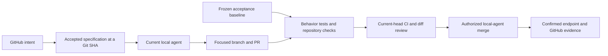
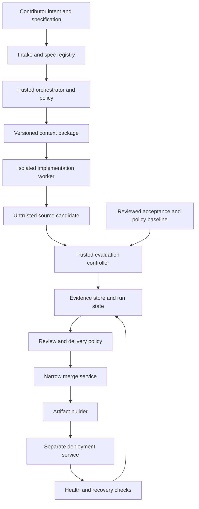

# Intent driven contribution and agent delivery

- Design baseline: 2026-10-28.
- Scope: Product design, open source contribution, and delivery by humans and coding agents.
- Accepted direction: Welcome contributions of intent, detailed specifications, and acceptance
  cases; design public APIs and the agent experience as primary product surfaces. This captures
  the project owner's direction on this date.
- Accepted execution model: The already running local agent performs the work. GitHub holds
  intent, accepted specifications, PRs, and CI evidence. The owner clarified that this system
  should define principles and a local workflow, without adding external model calls or keys.
- Proposed extensions: Unattended execution and production-delivery models below are optional
  designs requiring a separate explicit request. They do not grant new merge,
  cloud-operation, or deployment authority. Existing [CI/CD policy](../ci-cd.md) governs delivery.
- Revisit: After the first end-to-end specification pilot, before public contributor execution,
  and before any production deployment.

Enable a contributor to describe a useful outcome precisely enough that different coding
agents can deliver compatible implementations. The project preserves the reasoning,
observable contract, and acceptance evidence so a contribution remains useful when the
implementation or agent changes. Maintainers remain accountable for product decisions and
released behavior.

The target is **consistent observable behavior**, including permissions, failures, compatibility,
and operational limits. Source code need not be identical. A finite test suite provides evidence
for specified cases; it cannot prove two implementations equivalent in every circumstance.

GitHub is the accepted collaboration interface for this model. Follow the
[GitHub contribution workflow](github-contribution-workflow.md) for intent Issues, specification
PRs, bounded task handoffs, implementation PRs, and delivery evidence. Accepted specifications
live at Git revisions; ordinary Issue edits do not silently change the baseline. Native forms
and local agent coordination are the current foundation. Comment commands describe work to
hand off to the local agent; they do not start an external agent service.

## Local agent first

The development system is a contract the current local agent follows. A contributor should
be able to clone the repository, read `start-here.md`, open the relevant Issue, and continue
from shared documents without needing the original chat or a new model-service integration.

| Principle                      | Concrete rule                                                                                                                                                                                          |
| ------------------------------ | ------------------------------------------------------------------------------------------------------------------------------------------------------------------------------------------------------ |
| Local execution                | Use the agent session the contributor already runs. Do not add a model API key, cloud dispatcher, webhook, daemon, or agent-calling-agent layer to perform ordinary contribution work.                 |
| GitHub as shared memory        | Record intent, ownership, accepted spec revision, task handoff, PR and evidence on GitHub. An Issue comment is a request, not an automatic execution authority.                                        |
| API and agent experience first | Define the observable public contract before interface-specific implementation. Keep API behavior, structured errors and examples usable by both people and agents.                                    |
| Portable context               | Keep rules, source maps, specs and reproducible commands in the repository. A feature must not depend on a specific agent vendor, private skill or personal memory.                                    |
| Frozen acceptance              | Acceptance comes from the accepted specification and versioned checks. The implementer cannot weaken that baseline to obtain a pass.                                                                   |
| Independent evidence           | Independent acceptance means a separately defined baseline and verifiable results; it does not require another AI agent, another model call, or another service.                                       |
| Smallest useful harness        | Start with existing repository commands, meaningful behavior tests, contract checks and CI. Add tooling only for a demonstrated gap and within an explicitly requested scope.                          |
| Evidence before delivery       | The same local agent can prepare a PR and perform an authorized merge after diff review, acceptance and latest-head CI. Follow the existing merge policy and enforced GitHub requirements.             |
| Bounded completion             | Missing requirements return to design; failed checks return to implementation. Stop at the agreed endpoint, preserve partial work, and report blockers instead of launching an unattended repair loop. |

The minimum loop is: Issue intent → accepted spec PR → local implementation → frozen
acceptance and `npm run check` → implementation PR → current-head CI and authorized merge.
GitHub CI runs deterministic checks; it does not need to call a model. An already authorized
local agent may carry the loop through without a separate agent orchestration system.

## Contribution as a shared contract

Recognize several first-class contributions:

| Contribution        | Useful result                                                   | Acceptance basis                                                        |
| ------------------- | --------------------------------------------------------------- | ----------------------------------------------------------------------- |
| Intent              | A user, a concrete problem, an example, and the desired outcome | A maintainer can assess product value and ask focused questions         |
| Specification       | Scope, observable rules, failure behavior, and compatibility    | Another contributor can implement without guessing material behavior    |
| Acceptance case     | A fixture, counterexample, reproduction, or behavioral check    | It distinguishes a correct result from a plausible wrong result         |
| Implementation      | Code and evidence satisfying an accepted specification          | The applicable quality, review, and release gates pass                  |
| Harness improvement | A reusable way to detect defects or contain execution           | It detects a demonstrated failure without weakening existing guarantees |

An intent contribution may begin as an issue with a few paragraphs. Do not require a new
contributor to understand the whole architecture, write tests, or choose an agent before
their problem can be considered. Maintainers help turn valuable intent into an executable
specification. Specification acceptance and feature release are separate milestones.

Keep normal code PRs valid. A small bug fix can reference its reproduction and regression
test; it does not require a large specification package. Use the full package for new
capabilities, ambiguous behavior, public contracts, and consequential changes.

Record the intent author, specification author, acceptance contributors, implementer, and
reviewer where applicable. Credit accepted specifications and counterexamples even if a
different person or agent implements the feature. Repository submissions retain normal
licensing and attribution requirements; no agent fabricates contributor attribution.

## Design principles

### Specify the outcome before implementation

Describe the user's job, observable result, non-goals, and constraints before prescribing
modules or libraries. Separate requirements from illustrative solutions. Reserve implementation
constraints for real boundaries such as authorization, provider isolation, TiUI, and persistence.

An accepted feature must identify material unresolved decisions. An implementer may decide
local details, but must not silently choose a new billing rule, weaken a permission boundary,
or expand product scope. Route those decisions to the responsible maintainer while continuing
independent work.

### Design public APIs as the product foundation

Every reusable product capability should have a documented API and authorization model.
Design request/response semantics, resource identity, errors, and compatibility before building
the Console flow. Deliberate exceptions, such as a browser sign-in interaction, must explain
their boundary. Internal provider administration is not automatically a public capability.

Use OpenAPI for the public HTTP contract. The [OpenAPI 3.1 specification](https://spec.openapis.org/oas/v3.1.0.html)
defines a machine-readable description that tools and people can consume. It describes an
interface; authorization correctness, retry safety, and product usefulness still need behavioral
specifications and tests.

In this repository, `server/generate-openapi.mjs` remains the canonical contract source and
`public/openapi.json` its generated artifact. The same command generates
`src/api/schema.d.ts` for the Console client, and `npm run api:check` verifies both artifacts.
See [independent delivery](../independent-delivery.md) for build/runtime boundaries. Design the contract first, then update the
generator, implementation, affected clients, and tests together. Run `npm run api:generate`;
never hand-edit the generated file. API-first design does not require changing the current
source format or upgrading the pinned OpenAPI version.

### Treat the agent experience as a primary user experience

An agent should be able to discover capabilities, obtain appropriately scoped access, make
one useful request, understand failure, and resume work with bounded context. Measure that
journey alongside the human Console journey.

Design the following into relevant contracts:

- Discoverable resource capabilities, supported regions, limits, and required permissions.
- Stable identifiers and structured errors with request IDs, retryability, and recovery guidance.
- Explicit pagination and bounded responses, including an indication that results were truncated.
- Idempotency semantics for retriable mutations, with defined key scope, retention, conflicts,
  and reconciliation after uncertain outcomes.
- Operation status for asynchronous work, including terminal states and cancellation limits.
- Concurrency controls for conflicting writes and a documented consistency model.
- Examples that can be run against the declared environment and expose no provider secrets.

Distinguish an action's retry safety from a generic transient error. A timeout during resource
creation may require status reconciliation rather than another create request. Requesting
additional privileges must remain an explicit authorization action.

Prioritize low ambiguity and safe recovery before optimizing token count. Avoid forcing
agents to infer capabilities from UI screenshots, scrape the Console, or repeatedly load an
entire manual. These are design targets; the current API does not implement all of them.

### Share domain operations across every interface

The Console, public REST API, and future CLI, SDK, and MCP adapters must use the same domain
rules and backend authorization. An adapter may change presentation and authentication
transport, but must not invent a second resource lifecycle, bypass permissions, or duplicate
billing logic. Console owner operations may have stronger privileges than a Workspace Key;
shared logic does not imply equal authority.

Apply this principle to the development system as well. A future harness should expose
stable operations for submitting a spec, starting a run, reading status, retrieving evidence,
and cancelling execution. A dashboard or agent adapter should call those operations.

### Make behavior precise and verification independent

Assign stable requirement IDs. Define happy paths, negative cases, boundaries, persistence,
and failures with observable expected results. Link each mandatory requirement to a check or
an explicitly identified review. Fix seeds and normalize incidental values such as generated
IDs when comparing runs. Preserve meaningful differences such as ordering or error codes.

Keep a reviewed acceptance baseline separate from implementation output. Agents may add
tests and propose better requirements. They cannot satisfy a failed requirement by deleting
its assertion, weakening a threshold, or changing the expected result without a separately
reviewed specification revision. A second model's agreement is supplementary evidence;
deterministic checks and authoritative review remain necessary.

### Put authority in the harness

The harness is the controlled runtime that prepares context, limits tools, runs checks, records
evidence, and authorizes transitions. Repository instructions help an agent understand the
task; they do not enforce permissions.

Derive execution rights from trusted policy and maintainer authorization. Treat contributed
specifications, repository code under review, provider responses, and logs as untrusted inputs.
Text inside any of them cannot grant a new credential, change the acceptance baseline, or
authorize deployment. Classify risk using the requested behavior and actual diff; a contributor
cannot obtain lower scrutiny by choosing a low-risk label.

### Increase autonomy within explicit boundaries

Give the agent enough autonomy to finish authorized, reversible work. Avoid approval prompts
for routine edits or checks. Set finite execution time, retry counts, spending limits, and
resource scope before a run. Escalate material ambiguity, exhausted limits, missing authority,
or an uncertain external side effect with the evidence needed to decide.

Separate the rights to implement, evaluate, merge, publish an artifact, and deploy. Successful
tests do not create authority. Authorization for one workspace, environment, or task does not
extend to another. Existing early-prototype merge authorization continues to apply unchanged.

### Preserve compatibility and recovery

Specify how existing clients, data, grants, and sessions behave after a change. Prefer additive
contracts and staged migrations. Every external side effect needs a recovery or reconciliation
path appropriate to its failure modes.

For the current pre-production phase, the owner permits clean interface redesigns
(2026-10-31). Replace discarded development names rather than adding compatibility aliases,
dual implementations or migration paths unless the task explicitly requires them. Update
first-party callers, examples and tests together. Internal backend changes still preserve
the accepted public OpenAPI behavior; intentional public changes need an explicit revised
contract. This interface policy does not authorize metadata resets, resource recreation or
credential rotation. Revisit it before the first supported customer release.

Code rollback does not necessarily undo a schema migration, a deleted file, or a billed cloud
resource. Define restoration or compensation separately and identify irreversible steps before
execution. Tests use isolated temporary state; live validation uses explicitly authorized,
limited resources and records cleanup results.

### Preserve portable context and reproducible evidence

Store specifications and reusable knowledge in versioned repository files with ordinary links,
formats, and commands. Keep tool-specific integration in adapters. A contribution must not
depend on a private chat, a particular model, or a personal skill installation.

Record inputs needed to reproduce evaluation: source revision, spec revision, acceptance suite,
policy, runtime, dependencies, fixture versions, commands, and results. Model execution itself
may remain nondeterministic; reproducible evaluation and resumable state are the initial goals.
Record agent/version metadata when available without storing hidden reasoning or secrets.

### Improve the system from observed failures

Convert escaped defects into regression cases, ambiguous requirements into spec revisions,
and repeated operational problems into harness checks. Update canonical knowledge through
[knowledge maintenance](knowledge-maintenance.md). A green build, test coverage percentage,
or a polished completion message alone does not establish that a feature is safe or useful.

## The specification package

Use [the feature specification template](../templates/feature-spec.md) as the starting point.
The proposed canonical location for an accepted feature is `specs/<feature-id>/spec.md`.
Additional fixtures or explanations belong alongside it when needed. Reuse the existing
contract generator and test modules instead of maintaining competing copies.

| Part               | Required content                                                                |
| ------------------ | ------------------------------------------------------------------------------- |
| Intent             | User, problem, evidence, concrete example, outcome, and success measure         |
| Scope              | Included behavior, non-goals, dependencies, and unresolved decisions            |
| Contract           | API semantics, observable state transitions, errors, and compatibility          |
| Invariants         | Authorization, isolation, credentials, billing, durability, and resource limits |
| Acceptance         | Requirement IDs, Given/When/Then cases, negative examples, and evidence mapping |
| Execution boundary | Allowed changes, capabilities, external effects, and finite run limits          |
| Delivery           | Review obligations, rollout, observation, recovery, and definition of done      |

Keep structured metadata small: stable feature ID, spec status/revision, applicable source
baseline, dependency IDs, acceptance references, proposed risk, and an accountable maintainer
once assigned. Revision content should have a digest in execution records. Risk labels in a
spec are requests; the policy evaluator determines effective permissions.

During refinement, unresolved questions are normal. Before unattended execution, resolve
questions that change observable behavior or authority. A schema check can detect missing
fields, but a maintainer must still assess whether the intended behavior is coherent and useful.

### Example of an authorization specification

For the existing scoped Workspace Key behavior, an intent could be: "Let an agent read
files from one File System without granting writes or access to another resource."
Refine it into observable requirements:

| ID     | Scenario                                                              | Expected behavior                                                                            |
| ------ | --------------------------------------------------------------------- | -------------------------------------------------------------------------------------------- |
| KEY-01 | A valid key grants `files:read` on `fs_shared`; list that File System | Authorized read succeeds using the current API contract                                      |
| KEY-02 | The same key attempts a file write                                    | Reject with `INSUFFICIENT_SCOPE`; file state is unchanged                                    |
| KEY-03 | The key addresses a different resource                                | Reject according to the authorization contract before provider I/O; disclose no file content |
| KEY-04 | The owner revokes the key, then a new request uses it                 | Reject authentication; define the completed-revocation boundary explicitly                   |
| KEY-05 | Expiration has passed, including after a server restart               | Reject authentication without requiring the Console to be open                               |
| KEY-06 | A new resource is created after an explicit resource grant            | The existing grant does not expand to include it                                             |

These cases describe a regression specification for an existing capability, not a newly
introduced API. `server/api.test.mjs` already exercises scope/resource restrictions and key
expiration. The full acceptance package would map each row to exact assertions, add missing
side-effect checks, and identify any unsupported cases before claiming coverage. Native data
sessions and multi-workspace execution require their own implemented fixtures; this example
does not claim those integrations exist.

An implementation that merely hides a write button fails KEY-02. A check that asserts an
HTTP denial but never verifies that the provider was untouched may miss a serious defect.
Use such plausible wrong implementations to assess the strength of an acceptance suite.

## Delivery lifecycle

The proposed lifecycle is:

```mermaid
flowchart LR
  intent[Intent submitted] --> refine[Specification refined]
  refine --> accept[Specification accepted]
  accept --> build[Implementation run]
  build --> verify[Independent evaluation]
  verify --> review[Policy and diff review]
  review --> merge[Merged source]
  merge --> package[Immutable artifact]
  package --> stage[Authorized staging]
  stage --> release[Protected production release]
  release --> observe[Observe and reconcile]
  verify -->|defect within scope| build
  verify -->|requirement ambiguity| refine
  observe -->|regression| intent
```

Each transition records the acting identity, input revisions, evidence, and reason. Keep
specification status, run status, and release status separate. Accepting a specification does
not mean its implementation exists, and merging code does not mean it was deployed.

A run may finish as succeeded, failed, cancelled, or requiring a decision. Track its current
stage separately. A decision request identifies the blocked requirement, attempted recovery,
and smallest necessary decision. Resume at a recorded checkpoint with a new attempt ID;
do not replay external mutations merely because a worker restarted.

### Conditions for starting implementation

- A maintainer has accepted the intended behavior and bounded the scope.
- Mandatory requirements have acceptance cases, or a specific review obligation where
  automation cannot establish correctness.
- Relevant contracts, ADRs, invariants, and dependencies are linked and mutually consistent.
- Trusted policy has assigned effective risk, tools, resource scope, and finite execution limits.
- External effects, rollout obligations, and recovery paths are explicit where applicable.

### Conditions for completing delivery

- Every mandatory requirement maps to passing evidence or completed required review.
- The shared quality gate and applicable focused checks pass on the candidate source.
- The diff has been reviewed for scope, compatibility, credentials, and sensitive changes.
- Documentation, generated contracts, affected clients, and implementation agree.
- Required attribution and hosting protections are satisfied.
- For an artifact: its digest and source are recorded. For a deployment: environment authority,
  health verification, observation, and recovery evidence are also recorded.

Required checks that are skipped, unavailable, or inconclusive block that transition. Report
partial progress accurately. An implementation can be complete while deployment remains
unconfigured or unauthorized.

## Harness architecture

The minimum harness is the repository's reproducible checks and accepted delivery contract:
versioned specs/fixtures, meaningful behavior tests, generated-contract checks, `npm run check`,
and current-head CI. The current local agent reads the context, implements, records evidence,
opens a PR, and performs delivery when authorized by the existing policy. No new execution
service or second model is needed to apply these principles.

### Optional unattended execution model

The following architecture describes stricter boundaries only if unattended execution is
separately requested later. It is not the default contribution path or a prerequisite for
local-agent work. Its components are logical responsibilities, not a requirement to deploy
separate services or agents. No external model integration is authorized by this design.

The implementation worker has no merge or production credentials. The evaluation controller
launches candidate code and tests in disposable, restricted processes; it does not import
candidate scripts into a privileged controller. Deployment receives verified artifacts and
an authorized environment identity, never the worker's workspace or arbitrary commands.

| Component              | Responsibility                                                          | Enforced boundary                                                                |
| ---------------------- | ----------------------------------------------------------------------- | -------------------------------------------------------------------------------- |
| Spec registry          | Resolve feature IDs, revisions, dependencies, and acceptance references | Only trusted review can accept requirements or revise the baseline               |
| Context builder        | Assemble relevant standards, source, contracts, and fixtures            | Record exact inputs; exclude secrets and unrelated private data                  |
| Policy evaluator       | Classify behavior and changed files; grant capabilities                 | Derive authority from trusted policy; sensitive changes trigger reclassification |
| Worker                 | Implement and run local checks in an isolated checkout                  | Finite resources, controlled network, no deployment identity                     |
| Evaluation controller  | Evaluate exact candidate revisions against reviewed requirements        | Candidate code cannot edit the authoritative tests, policy, or results           |
| Evidence store         | Persist results, revisions, artifacts, and transition history           | Access control, secret redaction, retention, and tamper resistance               |
| Merge integration      | Recheck the actual head and hosting requirements, then merge            | Narrow token, task scope, expected head precondition, no bypass                  |
| Deployment integration | Promote a verified artifact, verify health, recover if needed           | Separate environment identity, approvals, concurrency, and target scope          |

### Run inputs and results

Define a portable run request containing feature ID, specification revision/digest, source
base SHA, acceptance baseline, trusted policy revision, environment profile, and bounded
time/attempt/cost limits. The orchestrator resolves executable commands from trusted
configuration. Do not execute shell strings supplied by a contributor's metadata.

Return a stable run ID, current stage, status, requirement results, artifact references, and
structured reasons for failure or escalation. Persist operation IDs for external effects,
cleanup obligations, and checkpoints. Cancellation stops new work and reconciles in-flight
operations; it cannot promise that an already accepted remote operation was undone.

A proposed evidence record includes:

| Area        | Recorded fields                                                                                       |
| ----------- | ----------------------------------------------------------------------------------------------------- |
| Identity    | Feature ID, run/attempt ID, actor, agent/version when available                                       |
| Inputs      | Spec digest, source base and candidate SHAs, contract digest, acceptance and policy revisions         |
| Environment | Runtime, dependency lock digest, worker image, fixture versions, execution limits                     |
| Evaluation  | Requirement ID to check/review mapping, commands, exit status, results, sanitized logs                |
| Delivery    | Reviewed head, artifact digest, merge/release result, target environment, health and recovery outcome |

Treat a worker's report as a claim to verify. Checksums identify content; they do not establish
who created a record or whether it is trustworthy. Production evidence needs authenticated
producers and access-controlled or signed attestations. [SLSA provenance](https://slsa.dev/spec/v1.2/provenance)
provides a model for tracing artifacts to their production process; this proposal does not
claim SLSA compliance.

### Evidence freshness and concurrent changes

Bind acceptance to the spec, contract, suite, policy, fixtures, and candidate revision. A change
to any relevant input invalidates the affected evidence. A generic green status from a previous
head is insufficient.

Before merge, evaluate the candidate with the current base or use a configured merge queue
that validates the actual merge candidate. Serialize overlapping changes when needed. At merge
time, re-read hosting requirements and use the reviewed head as a precondition. Rebuild the
release artifact from the resulting merged SHA and evaluate it as required; record the relation
between PR evidence, merged source, and artifact. Promote the same immutable release artifact
between environments.

### Threat boundaries and failure handling

Use disposable workers, dedicated temporary data, minimal filesystem mounts, and scoped
network access. Treat dependency installation and test execution as arbitrary code execution.
Keep production credentials, privileged caches, and the controller's state out of workers.
Dependencies may require allowed network access; tests should use deterministic local fixtures
where possible. A file allowlist helps scope review but is not an execution sandbox.

Run external contributor code without privileged credentials. GitHub documents the risks of
combining untrusted checkouts with privileged workflow contexts in its [secure use reference](https://docs.github.com/en/actions/reference/security/secure-use).
Keep the current policy prohibiting privileged PR-code execution. A privileged downstream
workflow must verify artifact identity and provenance rather than trusting an upstream file
because it has a familiar name.

The worker cannot authorize changes to the evaluator, acceptance baseline, policy, workflows,
or its own capability grants. Changes to those areas are separate reviewed inputs to a future
run. Resolve base policy from the trusted control plane, not the contributor's branch.

Bound repair attempts and classify failures. Retry a safe transient read; diagnose a deterministic
failure; reconcile an uncertain mutation; request a decision on a contract ambiguity. Never
turn a failure into success by lowering checks, silently suppressing a flaky test, increasing
limits, or relabeling a real provider as a mock. A crash or controller restart must preserve
enough durable state to reconcile effects and reclaim resources.

## Risk and autonomy

The following is a proposed classification model for the harness. Actual rights continue to
come from [CI/CD policy](../ci-cd.md) and the authorization for the task. Sensitive behavior
can appear in an otherwise small diff; classify by impact as well as file paths.

| Class | Typical work                                                                                          | Proposed treatment                                                                                           |
| ----- | ----------------------------------------------------------------------------------------------------- | ------------------------------------------------------------------------------------------------------------ |
| A     | Documentation or presentation changes without sensitive policy changes                                | Automated checks and diff review; eligible for authorized automatic merge                                    |
| B     | Bounded feature behavior with additive contracts and no new sensitive boundary                        | Full requirement evaluation, integration checks, compatibility review, and authorized merge                  |
| C     | Authorization, tenant isolation, billing, credentials, schema migration, harness policy, or workflows | Domain review and ADR where required; no unattended promotion under a low-risk policy                        |
| D     | Production release, destructive data operation, or billable cloud mutation                            | Explicit environment/resource authority and operation limits, staging/recovery evidence, protected execution |

One task may cross several classes. Authorization changes in a UI PR still require backend
review. Updating a policy document is sensitive even when no application code changes.
Category labels alone never grant execution rights.

Once a policy and scope have been authorized, execute routine steps without repeated approval.
Before shared production use, adopt the independent review and environment protections already
specified by CI/CD policy. Keep the current prototype's rapid merge policy distinct from this
future unattended service.

## Quality and experience measurements

Measure outcomes over a recorded time window, grouped by feature complexity, risk, environment,
and agent/version where available. Establish a baseline before setting targets.

| Question                                | Suggested measure                                                                                          |
| --------------------------------------- | ---------------------------------------------------------------------------------------------------------- |
| Can people contribute useful intent?    | Time from intent submission to a maintainer decision; contributor effort to obtain an accepted spec        |
| Can another implementer use the spec?   | Material clarification count; acceptance rate when a second agent implements from the same frozen package  |
| Is delivery reliable?                   | Escaped defects, security regressions, rollback/compensation rate, and flaky-check rate                    |
| Does autonomy reduce work?              | Human intervention count and minutes per accepted feature, split by decision type                          |
| Is the agent product experience usable? | Time to first useful authenticated request; onboarding completion; recovery after a documented error       |
| Is the harness efficient?               | Wall time and total evaluation/agent cost per accepted change, including failed attempts                   |
| Is evidence trustworthy?                | Mandatory requirements with current evidence; stale evidence rejected; artifact/source mismatches detected |
| Can operations recover?                 | Reconciliation success, orphaned resources, cleanup failures, and time to restore service                  |

To test portability, have two independently started agents implement one bounded feature from
the same source/specification baseline in separate checkouts, then evaluate both with the same
reviewed suite. Record disagreements as either underspecified behavior, implementation defects,
or evaluator gaps. Run this deliberately for pilots and major spec changes; multiple agents
are not a prerequisite for routine contributions. No score or result from this experiment is
claimed yet.

## Incremental adoption

Each stage should produce a useful contribution path without requiring the next stage first.

| Stage                        | Deliverable                                                                                            | Exit evidence                                                                                                    |
| ---------------------------- | ------------------------------------------------------------------------------------------------------ | ---------------------------------------------------------------------------------------------------------------- |
| 1 Contributor workflow       | Publish principles/template; accept one intent/spec PR without requiring implementation                | A maintainer can refine and accept it with explicit unresolved decisions and contributor credit                  |
| 2 Specification pilot        | One bounded feature, frozen acceptance baseline, isolated implementation, requirement report           | Implementation passes behavior and quality gates; a portability trial identifies and resolves material ambiguity |
| 3 Reproducible local harness | Versioned acceptance, existing repository commands, requirement evidence and resumable handoffs        | A local session can resume work and identify modified baselines, failed requirements and stale evidence          |
| 4 Authorized local delivery  | Local diff review, current-head CI and the existing merge policy                                       | Reject stale, failing, conflicting or unauthorized candidates before merging                                     |
| 5 Protected delivery         | Configured staging/production targets, verified artifacts, scoped identity, health/recovery procedures | Release and recover in an authorized test environment; verify tenant boundaries and audit the result             |

For the first pilot, prefer a bounded feature using existing local domain operations and
fixtures. Avoid making payments, public provisioning, or a new identity system the first
autonomy experiment. The authorization example above is useful for evaluating regression
quality but remains sensitive work under the existing review policy.

Improve each stage only when a demonstrated gap requires a focused change. Unattended
orchestration and external model integration are not implied next steps. Proposed metadata and
operations become public contracts only after review, an ADR when applicable, implementation,
and generated/client/test alignment.

## Current repository status

| Capability                                                              | Status at this design baseline                                                                                 |
| ----------------------------------------------------------------------- | -------------------------------------------------------------------------------------------------------------- |
| Shared agent instructions and reusable standards                        | Implemented through `AGENTS.md`, tool entry points, and the standards index                                    |
| Public API contract                                                     | OpenAPI 3.1 generated from `server/generate-openapi.mjs`; contract drift checked                               |
| Common local/CI gate                                                    | `npm run check` covers runtime, repository policy, formatting, lint, contract, tests, types, and build         |
| API behavior and provider fixtures                                      | Existing tests use temporary state and controlled provider behavior; coverage must be assessed per requirement |
| Internal artifact packaging                                             | Existing manual workflow records source SHA and checksums; it does not deploy                                  |
| Merge authorization                                                     | Existing early-iteration policy; repository-side protection and independent review are not configured by prose |
| Contribution template and local-agent workflow                          | Shared principles, feature template and GitHub handoff procedure are available; comments do not start a model  |
| Isolated autonomous runtime and trusted evaluator                       | Proposed; existing CI and repository checks are not this security boundary                                     |
| Persistent runs, independent evidence, and automatic policy enforcement | Proposed                                                                                                       |
| Protected staging and production delivery                               | Proposed; no configured production target is introduced here                                                   |

This design builds on existing local development and CI without claiming that documentation
has supplied a new autonomous runtime. Apply the bounded specification workflow with the
current local agent first. Additional infrastructure needs a demonstrated gap and explicit scope.
