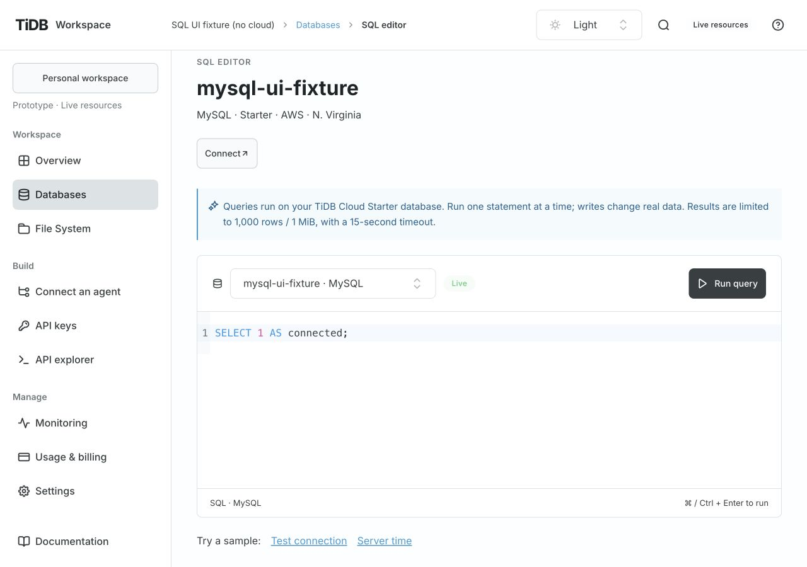
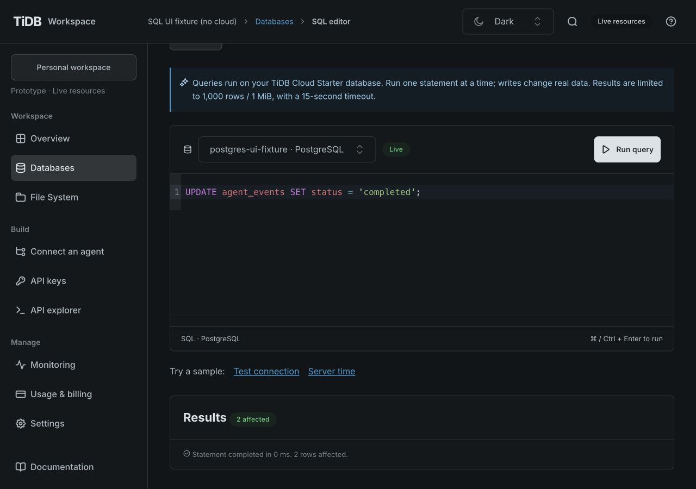
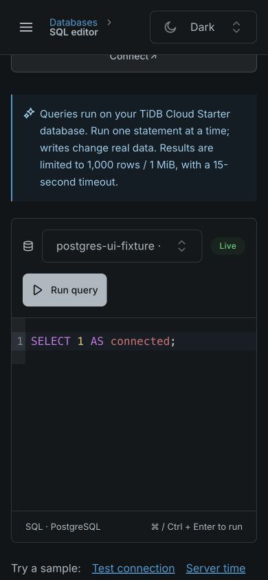
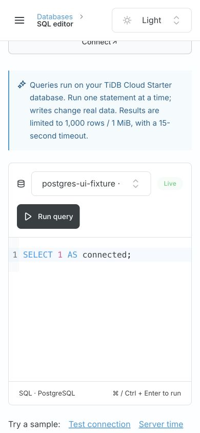

# Starter SQL verification

Date: 2026-10-28. Implementation and fixtures only; **real TiDB Cloud SQL has not been verified**.
The available management credential was rejected (HTTP 401). The main local preview and its
Drive9 files remain unchanged. Do not merge this change until both real protocols pass.

## Automated checks

`npm run check` passes: runtime/repository policy, formatting, ESLint, generated OpenAPI,
63 tests, strict frontend types, and production build. The existing dependency eval/build-size
warnings remain. No cloud credentials are used by CI.

New tests cover one Workspace Key across MySQL/PG, write results, restart, scope/resource/
workspace denials, revocation/expiry, missing/mismatched/private bindings, SQL input bounds,
concurrency, duplicate column names, output bounds, sanitized errors, TLS identity checks,
connection teardown, timeouts, cancellation, and operator role guards. Runtime packaging boots
an extracted backend and includes both drivers and their dependencies.

## UI checks

TiUI 2.9.1 and the official SQL Editor 0.0.6, retaining shared 16px text/48px controls and themes.
An isolated backend with injected test responses was used; its workspace is named
`SQL UI fixture (no cloud)`. These screenshots prove presentation and interactions, not cloud
connectivity. The fixture has no usable provider credentials.

- 1280 × 900 Light: SELECT result and export action.
- 1280 × 900 Dark: PG selection, write affected-row result, Cmd+Enter.
- 390 × 844 Light/Dark: toolbar stacking, theme control, editor, no page horizontal overflow.
- Syntax error clears stale results; Test connection restores a successful result.
- Switching database changes the route and resets editor/results. Resource context remains under Databases.

## Pending cloud acceptance

Using dedicated free Starter instances and least-privilege roles, verify TLS, create table,
insert, select, update, delete, and drop of task-owned test tables for both protocols. Use one
scoped Workspace Key for both and the File System; verify wrong-resource/no-query-scope keys,
revocation and expiry. Probe that native roles cannot access another database's data or admin
credential catalogs. Check syntax errors, a bounded slow query, oversized output, and reload.
Record protocol/region and outcomes, never passwords, provider keys or private connection URLs.
After acceptance, run the complete quality gate again, merge only a green latest PR head, and
restart the main preview without replacing existing files/keys.
