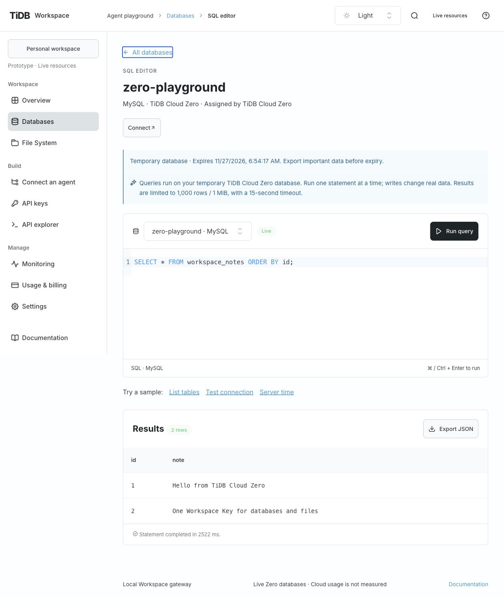
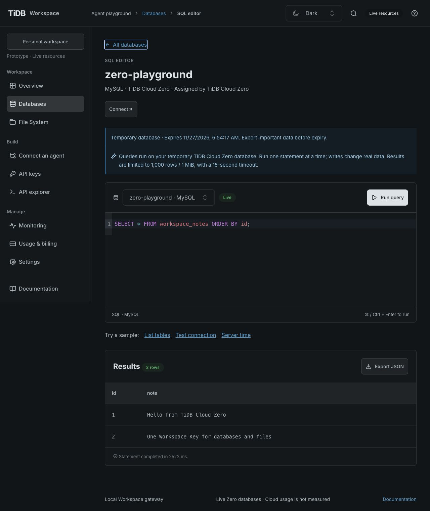
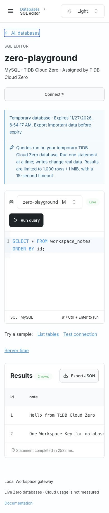
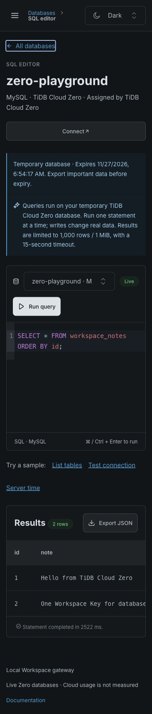

# Zero SQL verification

Date: 2026-10-28. Real anonymous TiDB Cloud Zero MySQL and Singapore Drive9 were verified.
PG is intentionally disabled; no equivalent anonymous PG service is assumed. See
[ADR 0005](decisions/0005-starter-sql-gateway.md) for scope, credential boundaries and recovery.

## Acceptance evidence

| Intent                                           | Evidence                                                                                                                                                           | Result                                                                            |
| ------------------------------------------------ | ------------------------------------------------------------------------------------------------------------------------------------------------------------------ | --------------------------------------------------------------------------------- |
| Create real MySQL without a cloud account/key    | Console created `zero-playground`; backend created a separate database-scoped native user                                                                          | Active; real SQL succeeds                                                         |
| Execute useful real SQL through Workspace APIs   | `scripts/verify-zero.mjs` created a unique table, inserted, selected, updated, deleted and dropped it                                                              | Correct values and affected-row counts; test table removed                        |
| One key across components                        | The same scoped key executed SQL and wrote/read a Markdown file in the real Singapore File System                                                                  | Passed; verification file retained for inspection                                 |
| Restrict customer and native access              | Live missing-query-scope, wrong-resource and revoked keys; native `mysql.user` read and out-of-scope database creation                                             | Denied                                                                            |
| Bound errors and execution                       | Live syntax/multi-statement rejection, >1 MiB result and a slow query                                                                                              | Safe structured errors, result limit and 15-second timeout                        |
| Preserve recovery and credential isolation       | `server/zero.test.mjs`: concurrent/repeated creation, restart, unknown POST outcome, incomplete setup, expiry, private files, scope/workspace/resource/key denials | Covered without cloud credentials                                                 |
| Keep PG unavailable without deleting prior state | Discovery, creation, key grant, query and persisted legacy-record tests                                                                                            | Hidden/denied publicly; original records retained                                 |
| Preserve driver and release behavior             | `server/sql-drivers.test.mjs`, runtime package tests                                                                                                               | TLS identity, teardown, exact values, DML packets and packaged dependency loading |

The live script takes only a loopback URL and public resource IDs. It creates short-lived
verification keys, revokes them in cleanup, and never reads native credentials. It must be
explicitly invoked by an operator and never runs in CI. It modifies only its randomly named
test table and a uniquely named verification Markdown file. Cloud API calls are not mocked in
this script. The Console-created `zero-playground` retains a `workspace_notes` table with two
sample rows for the local preview. A separate QA trial was used for destructive/error probes.

## Browser evidence

Real provider responses, TiUI 2.9.1 and official SQL Editor 0.0.6. Shared 16px typography,
48px controls, spacious layout and Light/Dark/System modes remain in place.

- 1280 × 900 Light/Dark: creation form offers MySQL/Files only, automatic region, real expiry,
  database list, SQL execution, two-row SELECT and affected-row results.
- Cmd+Enter executed a real INSERT; SELECT confirmed both rows. No provider credentials appear.
- 390 × 844 Light/Dark: toolbar stacks and editor wraps, with no page horizontal overflow.
- SQL remains scoped under Databases; local demo resources retain their separate explicit label.

## Limits

Zero trial data expires; export before the displayed date. The integration does not claim,
upgrade or renew instances. Cloud usage/billing are unmeasured. Local private credential files
are not encrypted secret management. Persistent Starter, PG, native external client gateways,
public identity and public hosting remain outside this loopback validation release.
