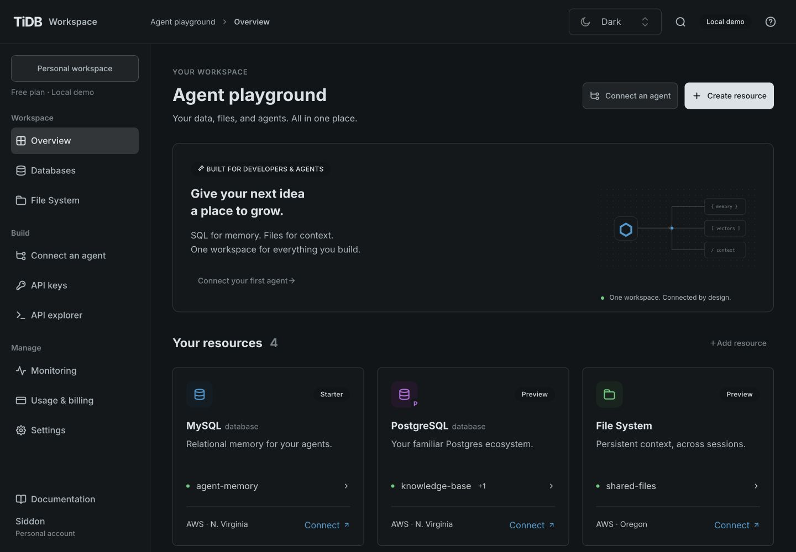
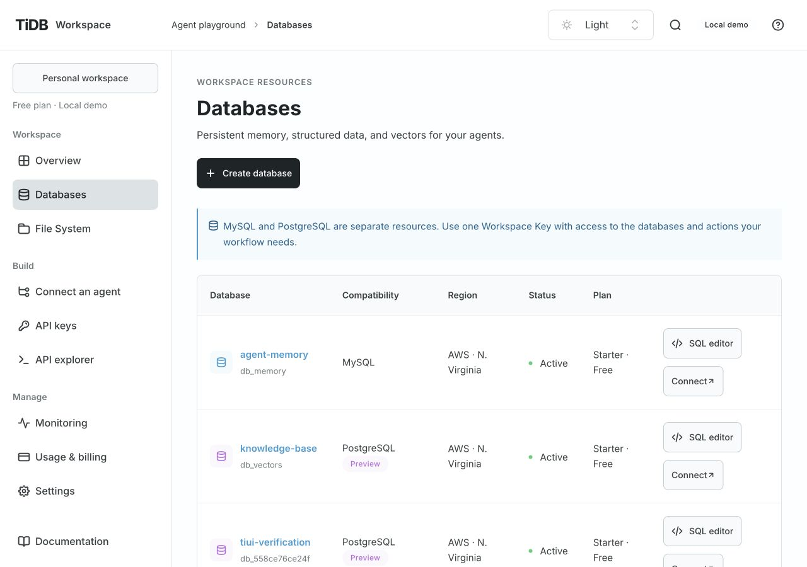
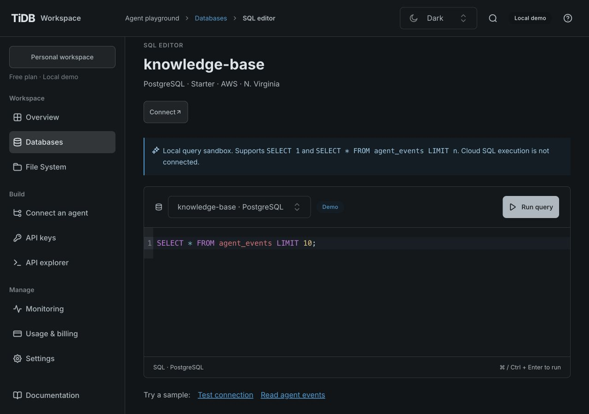
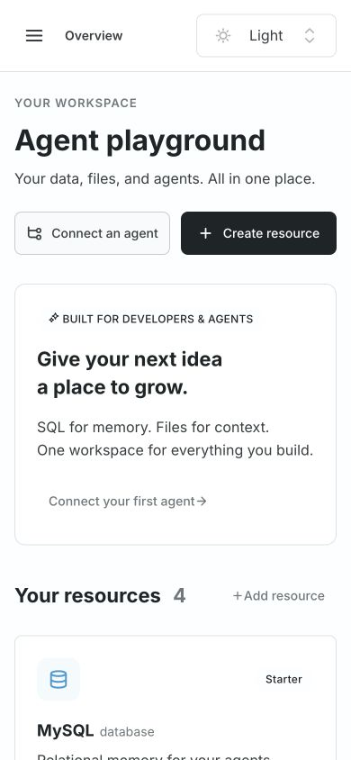
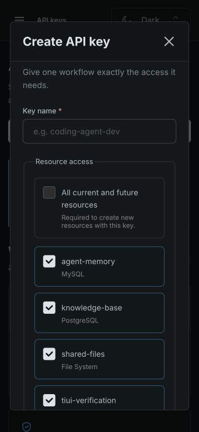

# TiUI Console migration verification

Verified on 2026-10-27 against the production build, using an isolated local demo store.
The original preview store was not used for mutation tests.

## Implementation

- `@tidbcloud/uikit@2.9.1`: root provider/stylesheet, AppShell, official icons, Typography,
  navigation, buttons, forms, cards, tables, alerts, notifications, dialogs, tabs, and CodeBlock.
- `@tidbcloud/tisqleditor-react@0.0.6`: actual CodeMirror editor with MySQL/PostgreSQL dialects,
  official syntax themes, route-scoped cache, and the existing sample query service.
- React/React DOM 18.3.1 satisfy the editor and transitive peer requirements. React Hook Form
  7.91.0 satisfies UIKit's peer contract. Strict peer resolution is enabled in `.npmrc`.
- Shared readability overrides in `src/ui/workspace-theme.ts`; self-hosted Inter, semantic
  carbon/peacock tokens, and a single Light/Dark/System preference owner.
- Domain layout, illustrative charts, and resource artwork remain application code. Native
  file selection remains a hidden browser file input. No backend/public API contract changed.

See the [canonical standard](standards/tiui-design-system.md#verified-integration-findings)
for style composition, dialog lifetime, theme migration, and SQL extension rules.

## Automated checks

`npm ci` passes with strict peers, no compatibility override, and zero reported vulnerabilities.
`npm run check` passes: runtime, repository policy, formatting, lint, OpenAPI drift, 33 tests,
TypeScript, and production build. Tests include legacy preference migration, malformed/blocked
storage recovery, existing database route behavior, authorization, persistence, and API limits.

The SQL editor is loaded separately. The build reports a main-chunk size warning (about 626 kB
uncompressed, 195 kB gzip) and warnings while parsing UIKit's transitive phone-number module.
The emitted JavaScript contains neither that module's identifying code nor direct `eval(`.
Warnings have not been hidden or dependency files patched. Revisit bundle size when splitting
more feature modules; this is not a claim of a completed performance audit.

## Browser verification

Checked 1440×1000, 1280×900, and 390×844. Desktop and narrow layouts were inspected in light
and dark modes. Measured 32px page headings, 16px form values/SQL text/action text, and 48px
primary controls. Checked pages have no page-wide horizontal overflow; wide tables scroll
inside their containers. Browser error/warning logs were empty after the final route checks.

| Area             | Observed behavior                                                                                                                                                                                                                                             |
| ---------------- | ------------------------------------------------------------------------------------------------------------------------------------------------------------------------------------------------------------------------------------------------------------- |
| Resources        | PostgreSQL resource creation updates the list and count; type/region controls work; the demo boundary remains visible.                                                                                                                                        |
| Keys             | Create a key restricted to one database and selected actions; reveal once; list permissions; revoke and see Revoked. Workspace-wide access enables resource creation and disables individual selections. Mobile dialog actions remain reachable by scrolling. |
| Files            | Create a text file, open its TiUI editor dialog, save content, reopen and verify persistence.                                                                                                                                                                 |
| SQL              | MySQL and PostgreSQL route selection, reload, sample replacement, button and macOS Command+Enter execution, result table, and unsupported-query error. Theme changes preserve the query.                                                                      |
| Connection       | Python tab displays the corresponding example; copying reports success. Tabs have associated panels.                                                                                                                                                          |
| API explorer     | Resource request returns the real local response.                                                                                                                                                                                                             |
| Monitoring       | Activity tab and filtering show the expected empty state.                                                                                                                                                                                                     |
| Billing/settings | Billing labels and amount remain distinct at desktop width; settings save and survive reload.                                                                                                                                                                 |
| Keyboard         | Keyboard-opened dialog traps focus, closes on Escape, and restores its trigger; drawer navigation and SQL shortcut checked.                                                                                                                                   |
| Theme            | Light/Dark switching, persisted reload, System selection/resolution, and propagation from a second tab. Legacy choices and storage failure paths are covered by unit tests.                                                                                   |

Limitations: these are manual browser checks, not an automated visual-regression suite or full
accessibility audit. Live OS-theme changes and the Windows/Linux Control+Enter path were not
exercised; the implementation uses TiUI's system observer and CodeMirror's platform-aware Mod
binding. Real cloud provisioning, cloud SQL, identity, and payment integrations remain deferred.

## Screenshots

