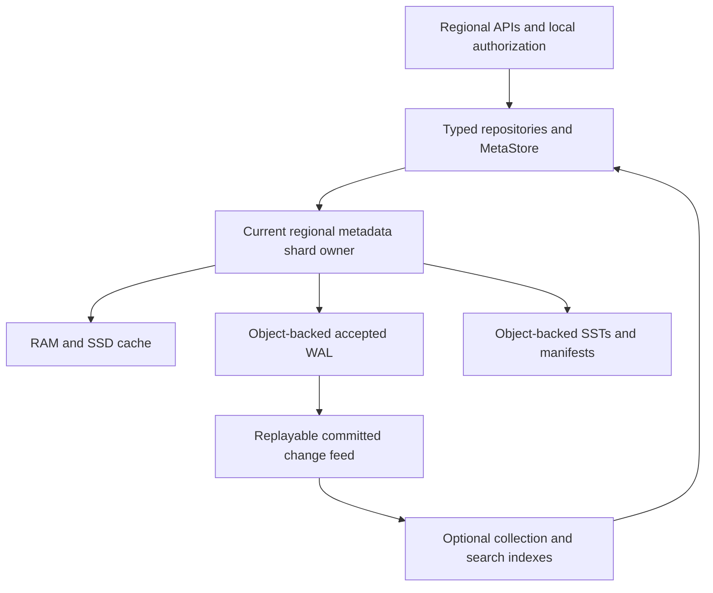

# GH-74: Object storage as metadata source of truth

- Status: Owner-requested hosted persistence direction; engine/protocol selection remains proposed.
- Date: 2026-10-29.
- Parent: [control-plane specification](spec.md), [scale profile](metadata-scale.md), and
  [proposed ADR 0017](../../docs/decisions/0017-workspace-kv-control-plane.md).
- Implementation: None. The running service still uses
  [`createStore`](../../server/store.mjs), process memory and whole-file JSON replacement.
  There is no implemented object-backed MetaStore, WAL, LSM or distributed writer protocol.

## 1. Persistence direction and reference

For the hosted profile, object storage should hold the authoritative recoverable metadata,
including every acknowledged commit. Local development keeps ordinary files as its authority.
These are explicit deployment profiles behind the same logical KV contract. This supersedes
the earlier recommendation to benchmark TiDB/MySQL first and defer an object-backed engine.

The [Redpanda metastore article](https://www.redpanda.com/blog/cloud-topics-metastore)
describes partitioned LSMs with object-backed SSTs/manifests, local caching and Raft-backed
WALs. Writes acknowledge a Raft majority; object-only recovery follows the last memtable
flush, ten minutes by default. Its useful separation is logical KV, partition ownership and
pluggable persistence. That acknowledgement rule does not give object-only recovery of
every acknowledged metadata write. These are upstream facts checked on the design date.

Our proposed stronger recovery requirement follows from resource bindings, deny records,
refresh rotation and provider-attempt identities: losing an acknowledged recent mutation
could restore access or repeat an external effect. Persist their accepted commit in objects
before reporting success or allowing a dependent external action. A local/Raft WAL followed
by asynchronous object checkpoints is a different durability profile and does not satisfy
this requirement by itself.

## 2. What must survive loss of all metadata compute

Given the configured object roots and independent bootstrap IAM/KMS access, replacement
compute must recover all acknowledged metadata without the old disks, a SQL primary or
Global connectivity for a Region. Object storage is the durable authority; it need not be
the serving path of every read or the leader-election system.

| Component                                        | Role in the hosted object-authoritative profile                                                           |
| ------------------------------------------------ | --------------------------------------------------------------------------------------------------------- |
| Installation/shard catalog and ownership history | Durable namespace, routing generations and recovery discovery; no RAM-only shard registry                 |
| Accepted WAL/commit records                      | Complete batches, revisions, mutation fingerprints/receipts and replay evidence after the last checkpoint |
| SSTs and manifests/checkpoints                   | Indexed materialization and verified recovery/compaction boundaries                                       |
| RAM, local SSD and read replicas                 | Disposable acceleration; never the only copy of an acknowledged commit                                    |
| TiDB/MySQL or another search service             | Optional rebuildable collection/search projection, with explicit lag and watermark                        |
| CredentialStore and encryption root              | Separate private authority, independently recoverable in the Region; not a public metadata index          |

Canonical policy, exact grants, uniqueness claims, quota rights and operation/outbox state
remain authoritative KV records. Their group-local guards/indexes participate in the same
atomic durable batch. An asynchronous SQL projection cannot authorize a request, allocate
quota or establish a unique name. It can discover candidates that repositories revalidate.
Public metadata contains opaque secret references, never native credentials.

An object-backed CredentialStore may hold immutable encrypted secret versions. Its IAM/KMS
root and bootstrap locator cannot exist only inside that encrypted store. Stage a recoverable
secret before publishing a binding reference; retain unresolved versions and reconciliation
evidence. An external managed vault is also possible, but its independent regional recovery
must be declared. Metadata recovery alone does not restore a lost vault or customer database.

The target is no loss of acknowledged metadata when compute/disks are lost while the
configured authoritative object service remains intact. This is not a promise of zero loss
after destruction of that service/Region or with an asynchronously replicated backup. Declare
those failure domains, backup RPO/RTO and key recovery separately. Missing/corrupt initialized
state fails closed; it never seeds an empty replacement Workspace.

## 3. Physical shards beneath logical atomic groups

This is the regional storage path; Global has its own independent deployment. Neither shares
the other's metadata authority, bucket credentials or availability dependency. Global reads
regional status through Global-initiated service requests, not a shared writable bucket.

An engine instance belongs to a bounded **physical metadata shard**, pooling many tenants
and many logical groups. Do not create an LSM, bucket, Raft group or resident process per
Workspace/resource. Route by the scale profile's group/resource identity; a large Workspace
spans shards, while a small Workspace need not occupy dedicated compute. Increase or isolate
shards using measured load and the ownership-fenced movement protocol.

The logical group remains the revision/atomicity boundary. An adapter encodes a group's
revision, records, derived keys and receipt in one engine atomic batch, with serialized or
transactionally checked expected-revision validation. It cannot implement CAS as a read
followed by uncoordinated writes. An engine may batch independent group commits into one
object flush without requiring a cross-group transaction. Names, quota and provider work
still use the specified staged workflows.

Object paths may separate installation, authority, cell, shard and immutable engine objects.
Exact layout is engine-owned and versioned; repositories do not depend on filenames. There
is no single global/Workspace HEAD on the resource write path. A small, sharded routing
catalog changes on placement/movement, not on every resource mutation. Recover its accepted
state before serving; restoring an older catalog cannot create two active shard owners.

## 4. Commit, visibility and ownership

The following is an adapter contract, not an instruction to implement a new WAL/LSM format:

1. Route to the current shard incarnation/owner. Validate the group revision, canonical
   fingerprint, complete batch and budgets inside its serialized/transactional commit path.
2. Append the batch and receipt to the engine's ordered pending stream. Pending memory or
   local disk is not an acknowledged commit and cannot authorize dependent external I/O.
3. Persist enough object data and engine commit/ownership evidence to make that exact batch
   recoverable as accepted. A successful upload of an unreferenced speculative blob alone
   is insufficient. Use the chosen engine's verified equivalent, including writer fencing.
4. Establish the durable committed frontier, expose the complete group revision and return
   success. Reads/authorization and outbox consumers cannot observe speculative state beyond
   that frontier. A read never reveals a permission grant that disappears on immediate recovery.
5. Flush/compact SSTs and publish manifests asynchronously. Recovery combines the accepted
   checkpoint with the accepted WAL tail; it must not stop at the last SST flush.
6. On a lost reply, return/retain an unknown outcome until the authoritative receipt proves
   the result. Reopen under the same mutation identity; do not repeat provider work because
   a client or an object request timed out.

Microbatching amortizes object PUTs. It also adds queuing latency: measure flush delay,
object-store tail latency and cost rather than promising a local-disk commit latency.
An optional replicated regional log can accelerate coordination/failover, but cannot replace
object durability before ACK in this profile. No Global lease or control-channel round trip
participates in shard ownership, commits or regional recovery.

Automatic takeover requires more than a timestamp lock: the storage protocol must exclude
old writers from accepting commits after a new epoch wins. Use verified engine fencing and
conditional publication semantics. Independent S3 PUTs, versioning and bucket LIST do not
create this protocol. [S3 conditional writes](https://docs.aws.amazon.com/AmazonS3/latest/userguide/conditional-writes.html)
apply to individual objects; compatible providers need separate conformance evidence.

Write fencing alone also does not prove `openLatest` linearizability. An old isolated owner
must not serve stale cached authorization after replacement. The selected service must
provide a verified regional read-ownership/barrier protocol, or use explicit stopped-owner
manual takeover until it has one. Tests must cover both obsolete writes and obsolete reads.
Snapshot/polling readers can serve declared stale collection/export views, but not canonical
authorization or a fresh CAS validation. A cold cache does not weaken this rule.

Object storage unavailability can stop metadata mutations and reads requiring a fresh
authority barrier. It must never trigger local-only success or a fallback to Global. Regional
autonomy removes Global dependencies; it does not remove the Region's own storage dependency.

## 5. Recovery, compaction and derived indexes

Recovery verifies installation/environment, shard incarnation, ownership history, committed
manifest/checkpoint and accepted WAL tail before exposing a group. Check integrity and schema
versions; preserve mutation receipts, deletion/deny floors, refresh-family state, unresolved
provider attempts and outboxes. Cache loss changes warm-up time, not recovered identities.
Recovering a Region with Global blackholed uses regional object roots, IAM/KMS, signers and
trusted bootstrap/routing; it must not fetch new policy approval or recreate upstream resources.

Compaction first writes complete new SSTs, then durably publishes a manifest covering them.
Delete superseded WAL/SSTs only after recovery coverage and reader/backup/retention references
are proven. Crash before publication leaves garbage, not a partial committed state. A lost
publication reply needs reconciliation. Tombstone/deny removal requires semantic retention
proof, not just an engine age threshold. Backup includes every referenced object plus required
WAL and secret versions; a bucket lifecycle rule cannot silently break that closure.

Collection/search projections consume a durable change/outbox stream and store a per-shard
cursor/watermark. Apply changes idempotently and publish cursor progress with the projection's
durable update. Rebuild from a pinned checkpoint plus overlapping retained changes, including
deletions, then activate the new index generation. Deleting that index must not lose policy,
bindings or operations. Declare stale results; revalidate candidates against canonical state.

Engine WAL retention and product journal retention are separate policies. Physical CDC is
not an indefinite archive. For example, [SlateDB CDC](https://slatedb.io/docs/design/change-data-capture/)
reports a truncation error when a requested WAL has been collected. Our Region retains
recoverable current state and unresolved effects, compacts resolved telemetry locally, and
returns cursor-expired/resnapshot to a later Global query. It never retains all WAL forever
waiting for Global ingestion or initiates a Global callback to unblock compaction.

## 6. Engine and backend choices

Evaluate **SlateDB first** as an object-native engine candidate, behind the existing proposed
MetaStore boundary. This is a proposed evaluation order, not a selected/pinned dependency or
claim of conformance. Pin a release and verify its format/runtime/storage APIs before a PoC.
Keep the current ESM domain/API code; decide supported bindings versus a private regional
metadata process after that evaluation, without introducing another public API framework.

Two integration traps are already documented upstream:

- [Writes](https://slatedb.io/docs/design/writes/): the documented write handle initially
  acknowledges memory. The Rust API requires `await_durable()` or an explicit flush for
  object durability. The selected release/binding must expose and correctly await that
  boundary before our `commit` succeeds. WAL-disabled async writes are not a shortcut.
- [Readers](https://slatedb.io/docs/design/readers/): checkpoint/polling handles can lag the
  writer. They cannot be assumed to implement fresh authorization reads. Verify durable
  visibility, group CAS/atomic batches, ownership and recovery together, not just get/put.

The candidate must also satisfy indexed scans, durable changes, safe GC/checkpoints,
encrypted storage/credential recovery, sharded placement and the scale/failure gates.
Do not select a library merely because it writes SSTs to S3. Do not build a general LSM,
Raft or transaction system from scratch before testing an existing engine.

TiDB File System remains an explicit owner-requested candidate. It can provide the metadata
authority or storage beneath an engine only when the complete contract is verified. If
file bytes are in S3 but the only namespace/inode/manifest mapping lives in an unrecoverable
TiDB catalog, the combination does not meet object-only metadata recovery. Require a verified
object-backed recovery closure for that catalog, or label it a separate filesystem-authority
profile. Layers/checkpoints and an S3 data path alone do not prove this property.

TiDB/MySQL remain valid alternative authoritative adapters under their declared database
durability profile, or rebuildable indexes under the object-authoritative profile. Do not
silently dual-write two authorities or advertise SQL plus asynchronous object export as the
same durability contract. A bounded snapshot+conditional-HEAD S3 adapter is useful for small
inventories/conformance, but is not the million-resource serving engine.

## 7. Implementation and acceptance gates

First implement the common contract, bounded local files and lossless importer as already
planned. The first hosted engine evaluation should target this object-authoritative profile
rather than implement both SQL and custom S3 databases. No new runtime or live migration is
started by this document.

The proposed META-59–66 cases in the main specification require object-only recovery of an
acknowledged WAL tail; durable visibility before effects; stale-owner read/write rejection;
unknown commit reconciliation; safe compaction/GC/backups; projection rebuild; independent
regional cold recovery including credentials; and measured sharded latency/cost/isolation.
Existing repository tests do not exercise those protocols. Hosted HA or million-resource
claims remain gated on executable evidence against a pinned engine/provider configuration.
