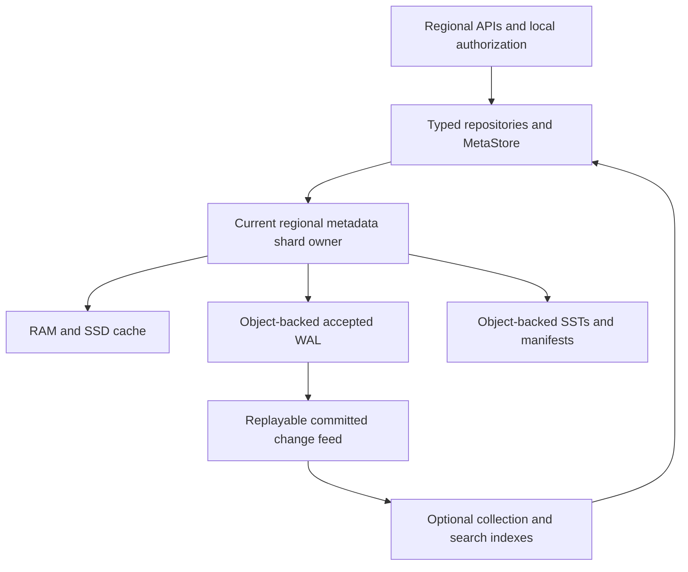
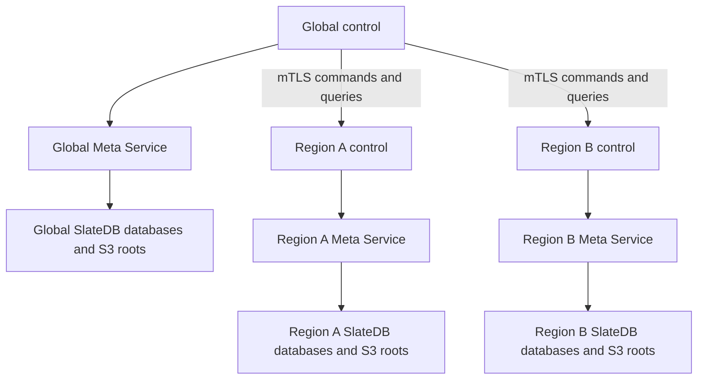

# GH-74: Object storage as metadata source of truth

- Status: Owner-selected SlateDB for hosted metadata; service/protocol details remain proposed.
- Date: 2026-10-29.
- Parent: [control-plane specification](spec.md), [scale profile](metadata-scale.md), and
  [proposed ADR 0019](../../docs/decisions/0019-workspace-kv-control-plane.md).
- Historical baseline: GH-86 introduced the Rust Meta service on SlateDB 0.17.0 alongside a Node adapter. The [original JSON store](https://github.com/mem9-ai/tidb-agentspace/blob/d7f9a01551e9dd37f2f664e550ed648cd12c275c/server/store.mjs) and document importer are retired. See [the Meta runtime guide](../../docs/meta-service.md) for current startup, persistence and verification.

## 1. Persistence direction and reference

For the hosted profile, object storage should hold the authoritative recoverable metadata,
including every acknowledged commit. Local development keeps ordinary files as its authority.
These are explicit deployment profiles behind the same logical KV contract. The owner has
selected **SlateDB** for both hosted Global and regional metadata, accepting object-durable
write latency for control-plane mutations. This supersedes the earlier candidate-only
evaluation and SQL-first recommendation. GH-86 pins the Rust service/release; remaining
production and scale conformance is separate from that engine choice.

The [Redpanda metastore article](https://www.redpanda.com/blog/cloud-topics-metastore)
describes partitioned LSMs with object-backed SSTs/manifests, local caching and Raft-backed
WALs. Writes acknowledge a Raft majority; object-only recovery follows the last memtable
flush, ten minutes by default. Its useful separation is logical KV, partition ownership and
pluggable persistence. That acknowledgement rule does not give object-only recovery of
every acknowledged metadata write. These are upstream facts checked on the design date.

Our proposed stronger recovery requirement follows from resource bindings, deny records,
refresh rotation and provider-attempt identities: losing an acknowledged recent mutation
could restore access or repeat an external effect. Persist their accepted commit in objects
before reporting success or allowing a dependent external action. A local/Raft WAL followed
by asynchronous object checkpoints is a different durability profile and does not satisfy
this requirement by itself.

## 2. What must survive loss of all metadata compute

Given the configured object roots and independent bootstrap IAM/KMS access, replacement
compute must recover all acknowledged metadata without the old disks, a SQL primary or
Global connectivity for a Region. Object storage is the durable authority; it need not be
the serving path of every read or the leader-election system.

| Component                                        | Role in the hosted object-authoritative profile                                                           |
| ------------------------------------------------ | --------------------------------------------------------------------------------------------------------- |
| Installation/shard catalog and ownership history | Durable namespace, routing generations and recovery discovery; no RAM-only shard registry                 |
| Accepted WAL/commit records                      | Complete batches, revisions, mutation fingerprints/receipts and replay evidence after the last checkpoint |
| SSTs and manifests/checkpoints                   | Indexed materialization and verified recovery/compaction boundaries                                       |
| RAM, local SSD and read replicas                 | Disposable acceleration; never the only copy of an acknowledged commit                                    |
| TiDB/MySQL or another search service             | Optional rebuildable collection/search projection, with explicit lag and watermark                        |
| CredentialStore and encryption root              | Separate private authority, independently recoverable in the Region; not a public metadata index          |

Canonical policy, exact grants, uniqueness claims, quota rights and operation/outbox state
remain authoritative KV records. Their group-local guards/indexes participate in the same
atomic durable batch. An asynchronous SQL projection cannot authorize a request, allocate
quota or establish a unique name. It can discover candidates that repositories revalidate.
Public metadata contains opaque secret references, never native credentials.

An object-backed CredentialStore may hold immutable encrypted secret versions. Its IAM/KMS
root and bootstrap locator cannot exist only inside that encrypted store. Stage a recoverable
secret before publishing a binding reference; retain unresolved versions and reconciliation
evidence. An external managed vault is also possible, but its independent regional recovery
must be declared. Metadata recovery alone does not restore a lost vault or customer database.

The target is no loss of acknowledged metadata when compute/disks are lost while the
configured authoritative object service remains intact. This is not a promise of zero loss
after destruction of that service/Region or with an asynchronously replicated backup. Declare
those failure domains, backup RPO/RTO and key recovery separately. Missing/corrupt initialized
state fails closed; it never seeds an empty replacement Workspace.

## 3. Physical shards beneath logical atomic groups

This is the regional storage path; Global has its own independent deployment. Neither shares
the other's metadata authority, bucket credentials or availability dependency. Global reads
regional status through Global-initiated service requests, not a shared writable bucket.

For the hosted profile, **each control-plane authority has an independently deployed Meta
Service and its own SlateDB databases**:

The services may reuse the same source, binary, client protocol and MetaStore contract.
Their processes/endpoints, installation identities, engine instances, ownership state,
WALs, manifests, compaction/GC and object roots are independent. An authority cannot be a
tenant prefix inside another authority's open SlateDB instance. Global's registry contains
regional storage descriptors, not live handles or writer access to those databases.

Provision disjoint service-owned S3 roots with independently scoped IAM/KMS access; separate
buckets are the normal production layout, while bucket sharing requires explicit permission,
residency and failure-domain review. Merely using different prefixes in one database does
not establish independent services or engine instances. Losing/restarting Global or Region A
must not stop Region B's metadata service. Local single-process functional tests remain an
explicit development exception and make no hosted isolation/availability claim.

Within one authority, an engine instance belongs to a bounded **physical metadata shard**, pooling many tenants
and many logical groups. Do not create an LSM, bucket, Raft group or resident process per
Workspace/resource. Route by the scale profile's group/resource identity; a large Workspace
spans shards, while a small Workspace need not occupy dedicated compute. Increase or isolate
shards using measured load and the ownership-fenced movement protocol.

The logical group remains the revision/atomicity boundary. An adapter encodes a group's
revision, records, derived keys and receipt in one engine atomic batch, with serialized or
transactionally checked expected-revision validation. It cannot implement CAS as a read
followed by uncoordinated writes. An engine may batch independent group commits into one
object flush without requiring a cross-group transaction. Names, quota and provider work
still use the specified staged workflows.

Object paths may separate installation, authority, cell, shard and immutable engine objects.
Exact layout is engine-owned and versioned; repositories do not depend on filenames. There
is no single global/Workspace HEAD on the resource write path. A small, sharded routing
catalog changes on placement/movement, not on every resource mutation. Recover its accepted
state before serving; restoring an older catalog cannot create two active shard owners.

## 4. Commit, visibility and ownership

The following is an adapter contract, not an instruction to implement a new WAL/LSM format:

1. Route to the current shard incarnation/owner. Validate the group revision, canonical
   fingerprint, complete batch and budgets inside its serialized/transactional commit path.
2. Append the batch and receipt to the engine's ordered pending stream. Pending memory or
   local disk is not an acknowledged commit and cannot authorize dependent external I/O.
3. Persist enough object data and engine commit/ownership evidence to make that exact batch
   recoverable as accepted. A successful upload of an unreferenced speculative blob alone
   is insufficient. Use the chosen engine's verified equivalent, including writer fencing.
4. Establish the durable committed frontier, expose the complete group revision and return
   success. Reads/authorization and outbox consumers cannot observe speculative state beyond
   that frontier. A read never reveals a permission grant that disappears on immediate recovery.
5. Flush/compact SSTs and publish manifests asynchronously. Recovery combines the accepted
   checkpoint with the accepted WAL tail; it must not stop at the last SST flush.
6. On a lost reply, return/retain an unknown outcome until the authoritative receipt proves
   the result. Reopen under the same mutation identity; do not repeat provider work because
   a client or an object request timed out.

Microbatching amortizes object PUTs. It also adds queuing latency: measure flush delay,
object-store tail latency and cost rather than promising a local-disk commit latency.
An optional replicated regional log can accelerate coordination/failover, but cannot replace
object durability before ACK in this profile. No Global lease or control-channel round trip
participates in shard ownership, commits or regional recovery.

Automatic takeover requires more than a timestamp lock: the storage protocol must exclude
old writers from accepting commits after a new epoch wins. Use verified engine fencing and
conditional publication semantics. Independent S3 PUTs, versioning and bucket LIST do not
create this protocol. [S3 conditional writes](https://docs.aws.amazon.com/AmazonS3/latest/userguide/conditional-writes.html)
apply to individual objects; compatible providers need separate conformance evidence.

Write fencing alone also does not prove `openLatest` linearizability. An old isolated owner
must not serve stale cached authorization after replacement. The selected service must
provide a verified regional read-ownership/barrier protocol, or use explicit stopped-owner
manual takeover until it has one. Tests must cover both obsolete writes and obsolete reads.
Snapshot/polling readers can serve declared stale collection/export views, but not canonical
authorization or a fresh CAS validation. A cold cache does not weaken this rule.

Object storage unavailability can stop metadata mutations and reads requiring a fresh
authority barrier. It must never trigger local-only success or a fallback to Global. Regional
autonomy removes Global dependencies; it does not remove the Region's own storage dependency.

## 5. Recovery, compaction and derived indexes

Recovery verifies installation/environment, shard incarnation, ownership history, committed
manifest/checkpoint and accepted WAL tail before exposing a group. Check integrity and schema
versions; preserve mutation receipts, deletion/deny floors, refresh-family state, unresolved
provider attempts and outboxes. Cache loss changes warm-up time, not recovered identities.
Recovering a Region with Global blackholed uses regional object roots, IAM/KMS, signers and
trusted bootstrap/routing; it must not fetch new policy approval or recreate upstream resources.

Compaction first writes complete new SSTs, then durably publishes a manifest covering them.
Delete superseded WAL/SSTs only after recovery coverage and reader/backup/retention references
are proven. Crash before publication leaves garbage, not a partial committed state. A lost
publication reply needs reconciliation. Tombstone/deny removal requires semantic retention
proof, not just an engine age threshold. Backup includes every referenced object plus required
WAL and secret versions; a bucket lifecycle rule cannot silently break that closure.

Collection/search projections consume a durable change/outbox stream and store a per-shard
cursor/watermark. Apply changes idempotently and publish cursor progress with the projection's
durable update. Rebuild from a pinned checkpoint plus overlapping retained changes, including
deletions, then activate the new index generation. Deleting that index must not lose policy,
bindings or operations. Declare stale results; revalidate candidates against canonical state.

Engine WAL retention and product journal retention are separate policies. Physical CDC is
not an indefinite archive. For example, [SlateDB CDC](https://slatedb.io/docs/design/change-data-capture/)
reports a truncation error when a requested WAL has been collected. Our Region retains
recoverable current state and unresolved effects, compacts resolved telemetry locally, and
returns cursor-expired/resnapshot to a later Global query. It never retains all WAL forever
waiting for Global ingestion or initiates a Global callback to unblock compaction.

## 6. Global storage directory and independent regional bootstrap

Global must know where each Region's metadata lives. Store a private **regional metadata
deployment descriptor** in Global's own SlateDB, alongside the region catalog. It identifies
the recoverable object roots and desired deployment configuration; Region remains the sole
normal writer of its own metadata. Knowing a bucket/path grants no S3 or KMS permission.

Proposed descriptor fields, not an implemented API:

| Field                                                      | Meaning                                                                                             |
| ---------------------------------------------------------- | --------------------------------------------------------------------------------------------------- |
| `regionId`, `metaDeploymentId`, `environmentId`            | Product Region, immutable metadata installation identity and environment; verify on every bootstrap |
| `engine`, `engineRelease`, `formatVersion`                 | `slatedb`, pinned deployment release and supported metadata format                                  |
| `mainStorage`                                              | Provider, HTTPS endpoint, actual storage region, bucket and installation prefix; no secret values   |
| `walStorage`                                               | Explicit separate WAL location when configured, otherwise an explicit same-as-main setting          |
| `catalogKey`                                               | Stable regional shard/cell catalog entry within the registered root; not a list of every resource   |
| `encryptionKeyRef`                                         | Regional KMS/key identifier; access requires a separately authorized regional identity              |
| `runtimeIdentityRef`, `recoveryIdentityRef`                | References to scoped deployment/recovery identities; never access keys or refresh tokens            |
| `configGeneration`, `desiredState`                         | Monotonic desired configuration and provisioning/active/draining/retired lifecycle                  |
| `observedGeneration`, `observedDeploymentId`, `observedAt` | Last safe status queried by Global; freshness/progress, not a serving lease                         |

For example, a Region's main root could be
`s3://example-control-meta/prod/regions/rgn-a/installations/meta-a/`. This is illustrative;
the actual AWS/S3 storage location must satisfy metadata residency independently of the
product Region's name. Within that root, Region's object-backed catalog maps cells/shards
to SlateDB prefixes and active ownership generations. The first profile co-locates WAL and
main storage; any later split must register both and include both in recovery/backup.
Engine file layout remains engine-owned. Global does not need every manifest filename or
a resource-by-resource S3 mapping to locate and recover a deployment.

This descriptor is private operator/control-plane metadata. Public regional API descriptors
expose authorized service origins and capabilities, not buckets, KMS refs or service identities.
Workspace Keys cannot create/edit storage descriptors or supply storage endpoints. Trusted
deployment configuration validates endpoints, namespace, environment and identities before I/O.
Normal Global credentials have no regional metadata write permission. Direct object inspection
or recovery uses separately authorized scoped operator tooling; Global never opens a regional
SlateDB as a second writer to query its state. It queries the Region's service over mTLS.

Bootstrap and update protocol:

1. Operators bootstrap Global from an out-of-band descriptor of **Global's own** S3 root,
   installation and IAM/KMS identities. The locator cannot live only in the database it unlocks.
2. Before regional activation, Global records the desired regional descriptor and the deployment
   system installs a matching durable regional bootstrap configuration and scoped workload
   identity. They are independent copies with explicit generations, not a per-start Global lookup.
3. Region starts from its deployment configuration, verifies its own object installation and
   shard catalog, acquires ownership and replays SlateDB. It uses regional IAM/KMS access and
   installed trust. Missing/mismatched state fails closed; it never creates an empty catalog
   or falls back to asking Global for permission to serve known resources.
4. Global pushes permitted configuration changes and queries applied generation/identity/status.
   A lost acknowledgement leaves Global pending until a later query proves application. Region
   sends no registration callback or upstream heartbeat. Observation age cannot expire the
   installed configuration or regional policy.
5. Region manages shards and rebalances inside its already registered roots locally. Global
   can query their current layout when needed. Internal shard changes need no per-shard Global
   write/ACK; accepted work and cold restart continue if Global disappears. New external storage
   roots/placements require coordinated configuration before use and may wait for Global.

A root change is an explicit fenced migration/recovery workflow, not an edit that redirects
a running writer to a different bucket. Bind activation to installation/configuration/ownership
generations; old descriptors cannot reopen an obsolete authority. Preserve original IDs,
secrets and unknown effects, verify the complete target, and retain source/backup references
until cutover/recovery proof permits GC. Global failure after an accepted regional workflow
does not leave Region waiting for a final upstream ACK to finish or safely abort.

Thus Global stores the fleet's deployment/recovery directory, while each Region has everything
needed to open its own authority independently. Registry freshness and regional availability
are separate facts. Losing Global does not erase a Region's locator, identity or metadata.

## 7. Selected engine and integration gates

Use **SlateDB** behind the proposed MetaStore boundary for hosted Global and regional
metadata. Pin a release and verify its format/runtime/storage APIs during implementation.
[ADR 0020](../../docs/decisions/0020-modular-rust-backend.md) supersedes retaining ESM as
the long-term business backend: migrate domain/API modules to Rust in verified slices.
Hosted APIs connect only to their own authority's metadata port, via a remote adapter or
an embedded independently owned Meta instance. Global and different Regions never share
one engine/database; code reuse and co-location do not merge these ownership boundaries.

Control-plane writes may accept object-storage latency while reads use the current owner
and caches under the required freshness contract. A SQL/file request must not require a
new canonical metadata commit merely to update a last-used timestamp; keep bounded usage/
telemetry separate. Real policy, credential-rotation/replay and operation changes still
require durable commits. Sparse per-tenant writes do not establish low fleet-wide volume;
measure aggregate flush cost, contention and tail latency with the scale workload.

Two integration traps are already documented upstream:

- [Writes](https://slatedb.io/docs/design/writes/): the documented write handle initially
  acknowledges memory. The Rust API requires `await_durable()` or an explicit flush for
  object durability. The selected release/binding must expose and correctly await that
  boundary before our `commit` succeeds. WAL-disabled async writes are not a shortcut.
- [Readers](https://slatedb.io/docs/design/readers/): checkpoint/polling handles can lag the
  writer. They cannot be assumed to implement fresh authorization reads. Verify durable
  visibility, group CAS/atomic batches, ownership and recovery together, not just get/put.

The adapter must also satisfy indexed scans, durable changes, safe GC/checkpoints,
encrypted storage/credential recovery, sharded placement and the scale/failure gates.
The engine decision does not certify those properties or select a release/binding. Build
the domain adapter and service around SlateDB rather than writing a new LSM/Raft engine.

TiDB File System remains an alternative profile/storage integration for separate evaluation;
it is no longer a competing default engine choice. It can provide the metadata authority or
storage beneath an engine only when the complete contract is verified. If
file bytes are in S3 but the only namespace/inode/manifest mapping lives in an unrecoverable
TiDB catalog, the combination does not meet object-only metadata recovery. Require a verified
object-backed recovery closure for that catalog, or label it a separate filesystem-authority
profile. Layers/checkpoints and an S3 data path alone do not prove this property.

TiDB/MySQL remain valid alternative authoritative adapters under their declared database
durability profile, or rebuildable indexes under the object-authoritative profile. Do not
silently dual-write two authorities or advertise SQL plus asynchronous object export as the
same durability contract. A bounded snapshot+conditional-HEAD S3 adapter is useful for small
inventories/conformance, but is not the million-resource serving engine.

## 8. Implementation and acceptance gates

First implement the common contract, bounded local files and lossless importer as already
planned. The hosted implementation targets SlateDB and this object-authoritative profile
rather than implementing both SQL and custom S3 databases. No new runtime or live migration is
started by this document.

The proposed META-59–66 cases in the main specification require object-only recovery of an
acknowledged WAL tail; durable visibility before effects; stale-owner read/write rejection;
unknown commit reconciliation; safe compaction/GC/backups; projection rebuild; independent
regional cold recovery including credentials; and measured sharded latency/cost/isolation.
Existing repository tests do not exercise those protocols. Hosted HA or million-resource
claims remain gated on executable evidence against a pinned engine/provider configuration.
META-67–69 additionally cover the private Global directory, independent regional bootstrap,
Global-queried configuration status, shard autonomy and safe storage-root migration.
