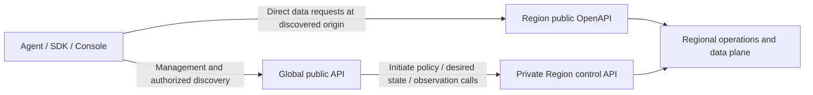

# GH-74: Direct regional APIs and regional token authority

- Status: Proposed extension of the [control-plane specification](spec.md), [autonomy/channel contract](control-channel.md) and [ADR 0019](../../docs/decisions/0019-workspace-kv-control-plane.md).
- Owner direction: Global and regional API origins differ; data requests go directly to Region, and Global failure must not disable established regional service.
- Owner clarification (2026-10-31): Global is the common management/discovery entry; clients use the discovered Region OpenAPI directly for regional data work. Entry/discovery must not become a required hop for every data request.
- Implementation: Design only. Current generated OpenAPI, routes, Key/session expiry and Console single-origin configuration remain unchanged.

## 1. Contract and origin ownership

Publish separate contracts generated from shared schemas and explicit route ownership:

| Contract                     | Illustrative origin                          | Responsibility                                                                                                                          |
| ---------------------------- | -------------------------------------------- | --------------------------------------------------------------------------------------------------------------------------------------- |
| Public Global API            | `https://api.product.example`                | Identity/Organization/Workspace policy, global inventory/placement, Key/grant administration and shared quota allocation                |
| Public Region API            | `https://ap-southeast-1.api.product.example` | Installed regional bootstrap/inventory, scoped metadata, SQL/files/analysis/results, local operation status and regional authentication |
| Private regional control API | Operator-configured mTLS origin              | Global-initiated desired/policy push and observation queries; never exposed as a customer SDK surface                                   |

These `.example` hosts are placeholders, not existing deployments or upstream provider URLs.
Region data APIs are public product gateways; native credentials remain private. The control
API has separate service identity/security requirements even if infrastructure is shared
within a regional failure domain. A Workspace Key cannot call internal policy/control methods.

Proposed generated artifacts are `openapi-global.json`, `openapi-region.json` and a privately
distributed control contract. Each deployment advertises its concrete verified `servers`
origin/base path. Template server variables can aid documentation but are not routing logic.
Do not put Global and Region in one top-level server list and assume clients will select the
right authority per operation. OpenAPI permits path/operation server overrides, but separate
contracts and `GlobalClient`/`RegionClient` instances make credential/route ownership explicit.
Use unique operation IDs and one canonical shared schema/permission definition.

The current generator emits one prototype contract with relative `/api/v1` and explicit
API-root session overrides. The current Console has one `apiOrigin`. A later implementation
must update generator, route dispatch, generated clients, configuration, packaging and tests
together. This design does not edit generated JSON or advertise unimplemented endpoints.
Metadata-only migration keeps its current origin. A hosted multi-origin rollout separately
migrates client base URLs while preserving IDs/relative paths; compatibility must not hide a
Global data proxy or forward credentials through an automatic cross-origin redirect.

## 2. Direct data requests and discovery

### Global entry and operation ownership

Global is the common entry for API documentation/catalogs, account and Workspace management,
and authorized Region/placement discovery. Its catalog links the Global and Region contracts;
each contract still declares the authority that actually serves its operations. Downloading
a contract from Global does not make Global the execution origin for its regional operations.

| Work                                                                                                                                      | Serving authority and boundary                                                                                                                                                                                                                      |
| ----------------------------------------------------------------------------------------------------------------------------------------- | --------------------------------------------------------------------------------------------------------------------------------------------------------------------------------------------------------------------------------------------------- |
| Identity, Organization/Workspace policy, Key/grant administration and regional assignment                                                 | Global manages authoritative policy and placement. Cross-plane installation and observation are Global-initiated control calls.                                                                                                                     |
| Regional resource inventory/details, table metadata and rows, SQL, files and previews, analysis, import/export preparations and execution | Client calls the selected Region API directly. SQL, uploads, downloads and result bytes remain on the regional path.                                                                                                                                |
| Setup-attempt execution/history and other admitted regional operation observations                                                        | Region executes against saved local bindings and serves its own operation records; observation never starts work.                                                                                                                                   |
| Resource desired lifecycle/placement versus provider execution                                                                            | Global owns desired state/placement; Region owns admitted execution, credentials and observed state. Any public regional mutation of desired state requires explicit installed delegation and quota authority, not an implicit call back to Global. |

This ownership is the target multi-origin boundary. The current regional `POST /resources`
and `DELETE /resources/{id}` remain implemented under their existing contract. Their future
Global/delegated ownership must be specified and migrated explicitly; this clarification
does not move a running route or assert a Global API implementation.

The client learns or is configured with a Region origin once and can reuse that validated
route. Discovery is not a mandatory preflight for every call. Global does not relay a data
request, buffer its payload, or transparently retry it at another Region. Cached or explicitly
configured Region access continues during Global outage, within locally installed grants.
Preparations, setup attempts and other operation IDs stay bound to their originating Region;
their Location links resolve there. Cross-resource imports/exports must validate every source
and target's regional ownership; cross-Region transfer needs its own explicit contract and
cannot silently route bytes through Global.

Client -> Region API carries SQL/file bytes and receives results directly. Global API does
not proxy those bytes, authorize each request or issue a required redirect. Regional public
API HTTPS and private Global/Region mTLS follow their own declared identity profiles.

Global discovery returns an authorized descriptor with `regionId`, API origin/base path,
auth issuer/audience, schema/capability version and routing identity. Clients persist validated
known descriptors; synchronization age is diagnostic, not a Global-availability deadline.
An explicitly configured known Region endpoint also works without Global discovery.
Regional bootstrap returns only its installed Workspace/resource scope and own auth metadata.

Acceptance for the later multi-origin implementation must prove discovery followed by direct
regional requests, audience/Region rejection before provider effects, origin-local operation
links, and continued known-Region requests after Global is blackholed. Verify SQL, file
upload/download, preparation/confirmation and setup observations without a Global data hop.
The current single-origin tests do not establish those multi-origin properties.

Route from canonical product `regionId`, not provider `automatic`/geography labels. Stable
regional DNS, gateways and issuer endpoints are independently available. Wrong-region access
is rejected before provider I/O; SDKs never forward secrets to arbitrary URLs in an error,
redirect or create body. Pin allowed service origins/issuers, reject cross-origin credentialed
redirects and do not fall back to Global when a Region request fails. New unknown assignments
may need discovery, while cached known regional routes continue through Global outage.

## 3. Three distinct lifetimes

The running prototype explicitly requires `expiresInDays` of 7, 30 or 90; Key and local
owner-session checks use those real expiries. A short access-token refresh endpoint alone
would not remove that longer-term dependency. Separate the following concepts in a new
explicit hosted auth profile:

| Object                 | Lifetime / authority                                                                                                                                        | Global-outage behavior                                                                               |
| ---------------------- | ----------------------------------------------------------------------------------------------------------------------------------------------------------- | ---------------------------------------------------------------------------------------------------- |
| Workspace access grant | Stable principal, Workspace/resource/action ceiling, permitted Regions and regional-auth delegation; durable until denied/replaced or an explicit grant end | Last installed regional grant remains authoritative; no synchronization lease                        |
| Credential version     | A secret/device/session credential authenticating that principal, with its own rotation/expiry                                                              | Region may rotate/re-authenticate only where the installed grant explicitly delegates that authority |
| Regional access token  | Short-lived derived proof for one regional audience; proposed 5–15 minutes for evaluation                                                                   | Region issues/replaces it locally under current policy; Global renewal is unnecessary                |

The duration range is a proposed setting, not an existing default or a security guarantee.
An explicit `grantEndsAt` or locally received deny is a real authorization limit and no
rotation/refresh may cross it. Credential expiry must not be silently reinterpreted as a
non-expiring grant. Delivery/enrollment-ticket expiry governs accepting that proof, whereas
the permitted life of an already established regional session comes from its explicit grant.

Offer two clearly versioned policies:

- **Legacy bounded Key:** existing `expiresAt` remains the hard source limit; all derived
  token/session validity is bounded by it. Existing/imported Keys do not become durable
  continuation grants and cannot enable that mode merely by exchanging a token.
- **Regional continuity grant:** an authorized owner explicitly provisions a durable grant
  and regional authentication/rotation authority. A bootstrap credential can expire without
  canceling separately enrolled regional credentials under that grant. Region can renew those
  credentials for the same principal/region/ceiling, but cannot mint Global-management rights,
  add another Workspace or extend an actual grant end. Revoking the logical grant affects all
  its regional descendants once each target applies the denial.

This preserves one customer permission model. Derived regional sessions are product
credentials managed by the SDK/session flow, not upstream keys customers must supply.
Grant rotation, credential-version rotation and full descendant revocation have separate
explicit semantics and audit identities; expiring one bootstrap secret is not ambiguous
permission to keep a legacy expiring Key alive forever.
Revoking the logical Workspace Key/continuity grant must deny its regional descendants;
rotating/retiring only a bootstrap credential version is a separately named operation.

## 4. Recommended exchange and renewal flows

Illustrative paths are proposed product protocols, not an assertion of OAuth conformance:

| Public Region API                  | Authentication / result                                                                                                                          |
| ---------------------------------- | ------------------------------------------------------------------------------------------------------------------------------------------------ |
| `POST /api/v1/auth/exchange`       | Verify a Workspace Key or approved enrollment proof locally; return a region-bound access token within its delegated policy                      |
| `POST /api/v1/auth/refresh`        | Verify a regional refresh family/client binding and current local grant; rotate locally and return a narrowed access token                       |
| `POST /api/v1/auth/reauthenticate` | Verify a previously enrolled regional factor/client credential when full reauthentication is required; never redirect to Global as the sole path |
| `POST /api/v1/auth/logout`         | Revoke the caller's regional family locally, retaining replay/audit evidence                                                                     |

For agents, direct Workspace Key authentication remains the simple bounded compatibility
path. An SDK can exchange that Key at the target Region and cache short access tokens. While
the Key remains valid it can exchange again locally without a separate refresh token. For
continuity beyond bootstrap-Key expiry, explicitly enroll under the continuity grant; do not
pretend exchange extends a legacy Key's deadline.

For a human/browser, regional session/refresh state and signer live in Region. An online
Global login can supply a one-use audience-bound enrollment ticket, but it is not a recurring
dependency. Ticket delivery expiry must be distinguished from any explicit delegated grant
end. Once established, the session uses regional refresh and an independently usable,
previously enrolled regional reauthentication method when its absolute age/idle limit is met.
The actual method/vendor is an identity implementation gate: a profile offering only Global
SSO after a finite session deadline does not satisfy regional autonomy.

Every mint/refresh/reauth request requires possession of a valid proof, never just a grant ID.
Region cannot extend an expired credential without an independently valid regional proof and
explicit delegated authority. If all proofs truly expire and only Global can replace them,
arbitrary-duration isolated reauthentication is impossible; increasing JWT TTL only postpones
the failure. Such a credential profile cannot be labeled outage-independent. This is why
regional enrollment/rotation is part of the architecture rather than a later timeout tweak.

No secret/root-key rotation or new identity implementation is authorized by this design.

SDKs persist enrolled regional refresh/client credentials in appropriate client-side secure
storage, separate from in-memory access-token caches. Client/process restart during a Global
outage must not require reenrollment using an expired bootstrap secret. Losing every local
credential still requires a valid independent reauthentication proof; it is not permission
to bypass authentication. Browser persistence uses the protected cookie flow below.

## 5. Access-token validation and permission ceilings

If JWT is selected, use a vetted implementation with explicit access-token type/algorithm,
issuer, audience, environment/Region, subject, token ID, issue/expiry, Workspace/grant and
credential/family references. Regional private signing keys stay in regional Vault/KMS;
trusted verification keys and rotation are independently available in Region. Unknown `kid`
refreshes only from configured regional trust, or rejects; no token-supplied `jku`/`x5u` or
Global JWKS/introspection lookup is allowed.

Global-management tokens, Region A access tokens, Region B access tokens, enrollment tickets,
refresh tokens, Workspace Keys and upstream credentials are distinct validated types. A valid
signature from another issuer/audience is not interchangeable permission. Global endpoints
must reject a regional token for management even if an action string overlaps.

Effective permission is the intersection of the enrolled session's ceiling, current locally
installed grant/deny, requested token scopes and canonical resource ownership. Token claims
do not override a local revocation before their expiry. A refresh cannot widen exact grants
to wildcard, confer global administration or include hidden DuckDB storage. Large grants are
indexed references, not million-ID arrays in JWTs. The actual grant end and legacy source-Key
expiry cap token/session validity; short bootstrap delivery expiry is not such a grant end.

## 6. Refresh state, rotation and browsers

Refresh families persist Region/Workspace/principal/grant, enrolled scope ceiling, credential
mode, generation, verifier digests, expiry/idle/absolute bounds, revocation and consumed-token
replay evidence. Plaintext refresh secrets are never public metadata/log fields. Rotate and
detect authenticated old-token reuse; random invalid input must not revoke another family's
session merely by guessing its locator. Local restart recovers state without Global access.

Use single-flight SDK refresh and bounded idempotent handling of a lost response. If retaining
a retry response is needed, seal it in regional secret storage for a short declared window,
bound to the same attempt/client/verifier/generation; it cannot mint another family. A stale
generation must not overwrite a newer browser credential. Real replay outside the permitted
retry behavior revokes the affected family and requires regional reauthentication. Exact
rotation/client-binding behavior is tested and pinned before release, not left to SDK retries.

Browser refresh credentials use Secure, HttpOnly, host-only regional cookies; access tokens
stay out of URLs/logs and persistent browser storage. Origins, CORS/credentials, CSRF and
SameSite are explicit deployment policy. Different origins under one registrable site are
not the same deployment case as different sites; cross-site cookie support needs its own
tested profile. Do not share a Global admin cookie with regional hosts or forward it as API
authorization. Agents use scoped header credentials without depending on browser cookies.

## 7. SDK retry, compatibility and implementation gates

Create separate Global and per-Region clients/token stores keyed by origin/issuer/audience
and Workspace/actor. A single shared bearer variable is unsafe. Auth failures return typed
expired/revoked/reauth-required/wrong-audience results; missing regional issuer/storage is a
regional failure, not a reason to renew at Global or loosen verification.

Refresh can be retried only under its pinned protocol. Data writes and SQL never replay just
because authentication refreshed after a timeout/connection loss. Only a documented pre-I/O
`ACCESS_TOKEN_EXPIRED` rejection proves an operation did not start; preserve request/operation
IDs and existing unknown-effect/idempotency behavior. Authorization expiry after admission
does not turn a possibly committed write into a safe retry.

Implement by: declare route/credential ownership -> generate separate public/private contracts
and clients -> add independently runnable regional auth/refresh storage/signer -> exercise
Global-blackhole/restart/expiry/replay and browser-origin cases -> migrate clients explicitly.
Keep current `/openapi.json`, 7/30/90-day Keys, guest local session and existing resource URLs
compatible until the reviewed versioned transition. Never relabel current features as deployed
multi-origin/token support. Main-spec META-51–58 define the acceptance gates.

Primary references checked on 2026-10-29:

- [OpenAPI 3.1 Server Object and overrides](https://spec.openapis.org/oas/v3.1.0.html): describes server URLs/variables and per-path/operation selection, not client-side discovery or token renewal.
- [RFC 9068](https://www.rfc-editor.org/rfc/rfc9068.html): access-token typing and issuer/audience/signature validation. It is a profile reference, not a claim that these illustrative product endpoints implement OAuth.
- [RFC 9700 §4.14](https://www.rfc-editor.org/rfc/rfc9700.html#section-4.14): refresh-token scope/client binding, replay protection and rotation/expiration considerations.
