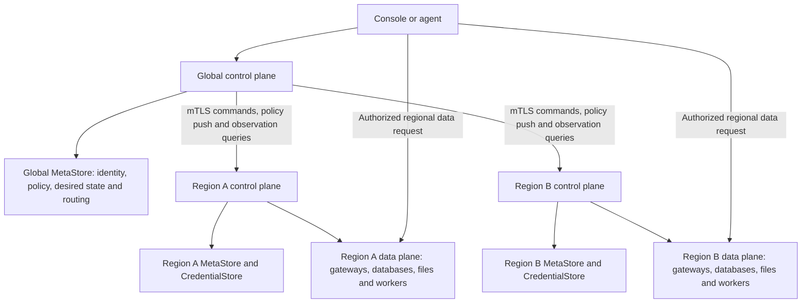

# GH-74: Multi-tenant Workspace control plane with portable KV metadata

## Identity, authority, and delivery

| Field                                       | Value                                                                                                                                                                                                                                                                          |
| ------------------------------------------- | ------------------------------------------------------------------------------------------------------------------------------------------------------------------------------------------------------------------------------------------------------------------------------ |
| Parent intent                               | [Issue #74](https://github.com/siddontang/tidb.ai/issues/74)                                                                                                                                                                                                                   |
| Status                                      | Draft specification for review; no runtime or migration implementation                                                                                                                                                                                                         |
| Date                                        | 2026-10-29                                                                                                                                                                                                                                                                     |
| Intent contributor / accountable maintainer | Siddon Tang                                                                                                                                                                                                                                                                    |
| Source baseline                             | `ee1bd56f5a4a53d7864493634bf7d0eb228b878f`                                                                                                                                                                                                                                     |
| Accepted direction                          | Logical KV metadata, replaceable storage, local files first, hosted SlateDB with object storage as source of truth, TiDB File System as a candidate, global/regional control and regional data planes, regional resources, tenant isolation, and identity-preserving migration |
| Proposed choices                            | Scope-atomic commits, record/index layouts, roles, adapter protocols, API evolution, limits, and the migration procedure below                                                                                                                                                 |
| Dependencies                                | ADRs 0001, 0004, 0005, 0006, 0008, 0010, 0011 and proposed [ADR 0017](../../docs/decisions/0017-workspace-kv-control-plane.md)                                                                                                                                                 |
| Risk                                        | Tenant authorization, credentials, concurrency, provider lifecycle, and migration; implementation requires the acceptance suite below                                                                                                                                          |
| Delivery endpoint                           | Reviewable specification and ADR in a design PR; the parent feature remains open                                                                                                                                                                                               |

This document specifies intended behavior. It neither changes the running Portal nor
authorizes live migration, provider provisioning, account registration, credential rotation,
public hosting, or deployment. Existing Portal edits and its restored resource configuration
are outside this design's checkout and must be preserved.

## 1. Outcome and current boundary

An individual or team owns an Organization, creates multiple Workspaces, and operates its
authorized databases and File Systems using the Console or Workspace Keys. Restarting or
moving the control plane preserves the same product resource IDs, upstream instances, native
roles, files, and grants. Changing metadata backends does not change domain behavior.

The current service has one fixed `ws_agentlab`, an unauthenticated loopback owner-session
bootstrap, process-local sessions, a public JSON state file, and four sibling private vault
files. `createStore` serializes mutations inside one process and replaces a whole JSON file
with `writeFile` plus `rename`; it has no cross-process ownership or directory-sync protocol.
Provider adapters also have process-local provisioning maps. These are not distributed locks.
Local file contents are embedded in JSON; live customer data remains upstream. Activity is
limited to 200 records, with no complete Run or failure history.

The new abstraction is **logical KV plus bounded indexes**, not an ORM and not an arbitrary
JSON document with unrestricted queries. It supplies a useful consistency contract across
files, TiDB File System, TiDB/MySQL, object storage, or a conforming KV engine. Local files
remain a valid local backend; multi-server availability is an additional backend/deployment
capability. Hosted metadata should use object storage as its recoverable source of truth,
including every acknowledged commit; local files remain authoritative for the local profile.
The owner has selected SlateDB for hosted Global and regional metadata, accepting durable
write latency for control-plane changes. The [object-metastore design](object-metastore.md)
supersedes the earlier candidate-only and SQL-first hosted evaluation. The engine choice is
accepted direction; release/binding and protocol conformance remain implementation gates.
This requirement is not implemented by the existing JSON store or by
asynchronous database backups. The owner also requires separate global control, regional control and regional
data-plane responsibilities. Current resource region strings do not implement that topology.

### Scope and exclusions

Included: record schemas, retrieval, atomic metadata changes, Organization/Workspace identity,
permission evaluation, provider bindings and secrets, durable resource operations, backup,
offline import, cutover, recovery, compatibility, and adapter acceptance. The owner-requested
scale target includes millions of Workspaces and individual million-resource Workspaces;
the [metadata scale profile](metadata-scale.md) defines partitioning and evidence requirements,
not a verified capacity promise.

Excluded from this delivery: implementation; SQL schema migrations on customer databases;
new native protocol gateways; arbitrary SQL access to metadata; full-text search; a general
distributed transaction manager; production billing; a complete Run/review/publish product;
and automatic migration of customer application data between providers.

## 2. Architecture and ownership



Arrows describe permitted invocation/dependency direction. Regional replies belong to the
Global-initiated exchange; Region/data services never initiate a Global RPC or callback.
The [control-channel contract](control-channel.md) supersedes earlier online regional
Global-admission and Region-published result proposals.

Both metadata authorities use typed repositories over the same `MetaStore` contract. Each
can select a conforming adapter for its explicit persistence profile. The hosted default
engine is SlateDB; ordinary files support local use, while TiDB File
System and TiDB/MySQL remain candidates/alternative profiles. Sharing an interface does not
require sharing a physical root or database.

| Entity             | Ownership / meaning                                                                                   |
| ------------------ | ----------------------------------------------------------------------------------------------------- |
| User               | Product identity bound to an authentication issuer and subject; not an email address as a primary key |
| Organization       | Our customer and administrative/quota boundary; personal sign-up creates a personal Organization      |
| Workspace          | Project and resource-access boundary, belonging to exactly one Organization                           |
| Public resource    | One database or independent File System, belonging to exactly one Workspace                           |
| Provider account   | Internal account and provider quota boundary; initially belongs to one Organization                   |
| Binding            | Internal mapping from a public resource to its actual provider instance, role or private storage      |
| Credential version | Private, immutable value referenced by bindings/accounts; inaccessible through public APIs            |
| Operation          | Durable intent and recovery state for a lifecycle action; distinct from a query Run                   |

Organization and Workspace IDs are immutable. Resource ownership cannot be changed by
editing `orgId` or `workspaceId`. Moving resources between customers requires a separate
reviewed transfer design. An application's `externalCustomerId` is attribution only; our
customer's own end-user tenancy needs its own resource/application boundary.

### 2.1 Three planes and authority

| Plane                | Authoritative responsibilities                                                                                                                                                                                         | Deliberately kept elsewhere                                                                                     |
| -------------------- | ---------------------------------------------------------------------------------------------------------------------------------------------------------------------------------------------------------------------- | --------------------------------------------------------------------------------------------------------------- |
| Global control plane | Product identity, Organizations, Workspaces, membership and Keys; region catalog/eligibility; product quota/account ownership; resource ID/name/placement and desired lifecycle; durable dispatch and aggregate status | SQL/file payloads, native credentials, live sessions and regional execution claims                              |
| Region control plane | Validate local placement/capacity; accept/deduplicate commands; provisioning/deletion/recovery; actual provider bindings, regional account access, native credential refs, observed state and data-plane configuration | Global policy decisions, changing a resource's owner/region, globally allocating another customer's account     |
| Region data plane    | SQL/file access, managed connections, DuckDB storage and bounded analysis workers; enforce admitted tenant/action/resource/region context before I/O                                                                   | Global membership/billing administration, direct metadata access by customer SQL, choosing a replacement region |

Global services decide **who may request what and where**. Regional control decides how a
permitted desired state becomes real using that region's adapters. Regional data services
execute the permitted data work. Region control and data services use separate service
identities and credential purposes even when initially packaged in one local process.
"Global" describes product authority, not one process, one worldwide transaction or a promise
that all metadata is replicated everywhere. Deployments must declare the location of global
identity/policy metadata separately from resource data residency.

### 2.2 Workspace and resource placement

An Organization and Workspace are global logical objects. A Workspace may contain resources
in several regions. `homeRegion` is the Workspace's suggested creation default, not a claim
that every resource resides there. Organization policy may restrict allowed regions. Resource
names remain unique across the whole Workspace, including different regions.

Every resource receives one immutable `regionId` (our execution/control-plane region) before
dispatch, plus `routingEpoch` and a provider-location descriptor. The region catalog maps our
stable IDs to allowlisted service endpoints, provider-specific locations, supported kinds,
modes and lifecycle (`active`, `draining`, `disabled`). Creation chooses an active region
from the intersection of product eligibility, Organization policy and verified provider
capability; draining regions accept existing permitted work but no new placements.
Neither a client-supplied URL nor a region code by itself authorizes dispatch.

Keep three facts separate: requested/default placement, assigned product `regionId`, and
verified upstream location. Existing provider values such as `automatic` remain preserved
as compatibility/provider metadata; they are not a real geographic region. Automatic
selection for a new resource must resolve our `regionId` before dispatch. A provider that
does not attest upstream location is explicitly `provider-managed`/`unverified` and cannot
satisfy a geographic residency policy by adopting the gateway's region label. Likewise, a
local demo's product region does not mean its files physically left the developer's machine.

Changing `homeRegion` affects future defaults only. Changing an existing resource's region
requires a separately specified transfer/copy, credential and data-consistency protocol;
it is not a `PATCH region` or automatic failover. This design provisions a new resource/ID
for an explicit cross-region copy and leaves in-place relocation/active-active out of scope.
Hidden DuckDB backing storage must have compatible verified placement with its database.

### 2.3 Metadata, credentials and residency

Keep global Organization/Workspace records and regional Workspace records in independently
owned `MetaStore` deployments. Global records own desired state and dispatch; a regional
record owns binding/execution/observed state. A global list can include an asynchronous
regional status projection with `observedAt`, `observedGeneration` and explicit stale/unknown
state. That projection cannot authorize access, settle an unknown create or free capacity.
Regional reconcilers use their own canonical records, not a periodically copied global JSON.

Global's private `region/<regionId>` group records a `metadata-deployment` descriptor:
engine/release, installation/environment identity, S3 endpoint/storage region/bucket/prefix,
regional catalog locator, WAL location, IAM/KMS references and desired/applied configuration
generations. The [storage-directory contract](object-metastore.md#6-global-storage-directory-and-independent-regional-bootstrap)
defines the fields, bootstrap and fenced root changes. Global locates each Region's metadata;
Region starts from an independently installed durable configuration and its own objects.
Internal shard maps remain regional. Global queries service status rather than opening a
regional SlateDB writer; metadata paths and identities are private operator information.

Global account records contain ownership/entitlement and capacity reservations; regional
records hold the allowed provider access and native binding refs. Native resource secrets,
file/query bytes, results and detailed logs stay in the declared regional storage/vault.
An upstream account with inseparable multi-region privileges needs an explicitly reviewed
credential broker/profile; merely storing its token in a regional vault does not make it
region-scoped. Export only allowlisted safe status, audit attribution and usage summaries
to global control; detailed usage ledgers remain a separate product design.

For TiDB File System metadata, use a distinct service-owned global root and region-owned
roots/filesystems with separate access identities and bootstrap secret refs. A shared logical
KV layout is not permission for one regional service to read another region or the entire
global catalog. Metadata backup, encryption keys, failover destinations and service logs
must follow the declared location policy; a prefix alone is not a residency guarantee.

### 2.4 Dispatch and data request paths

A create follows global admission -> durable desired resource/operation/outbox -> account
reservation -> Global-pushed regional inbox -> regional execution -> local observed journal.
Global later queries the operation/journal and updates its projection. Commands can be
delivered at least once; stable IDs, inbox/receipts and generations handle duplicates and
lost replies. All cross-plane requests originate in Global, over the control-channel
contract. Region never pulls commands, publishes results, refreshes policy from Global or
reaches a Global broker/store indirectly. The stores do not share a transaction.

For queries/files, discover an authorized region endpoint and route bytes to that region's
data plane. Any retained compatibility gateway must be an independently available regional
data role, never a Global-control proxy; declare its location in the residency profile.
Global control carries no SQL/file bytes. Hosted client-origin migration is explicit rather
than a hidden Global hop or cross-origin credential redirect. One Workspace Key still covers its granted resources;
service-issued internal admission is audience/action/resource/request bound, and upstream
provider credentials never reach the caller. Section 6 defines local regional admission from
Global-pushed signed policy durably activated in Region; no per-request Global call or
policy-renewal deadline gates regional service.

Cross-region file analysis is rejected by default. An explicit later transfer design must
authorize source read, destination execution and allowed data movement before any snapshot
I/O. Two resources in the same Workspace do not imply permission to copy bytes between
their regions. Regional membership/configuration is managed by trusted operators, not by
customer Workspace Keys.

### 2.5 Failure and deployment profiles

If one region is unavailable, global lists preserve its resource IDs and last-known state;
operations remain pending/unknown and retain reservations. Other reachable regions can
continue with healthy regional dependencies and complete locally installed policy. No
automatic create, secret fallback or redirect to another region is allowed. Global failure
or elapsed synchronization age cannot stop known regional data requests, local session
renewal, accepted work or regional restart. Retain the last verified policy until replaced;
enforce actual credential/resource expiry and locally applied denials independently. Global
views remain stale and global-only changes may wait, without blocking existing regional work.
Revocation completion requires per-target applied evidence; disconnected targets remain pending.

Local functional development can package the three modules in one API process, with separate
repositories/service contexts. Hosted availability requires separate Global/regional processes,
regional data entry points, stores, identity/refresh, routing, Vault/KMS/PKI and failure domains,
including a one-Region deployment. Losing a shared Global gateway/login or issuer cannot
silently defeat regional independence. The channel contract defines required failure tests.
Region redundancy, disaster recovery and cross-region replication need their own measured
SLOs and recovery design; region labels alone supply none of them.

## 3. MetaStore contract

### 3.1 Atomic scope

All keys belong to one explicit bounded atomic scope. Workspace/Organization ownership is
not a requirement to serialize all of their metadata through one revision. The previous
coarse per-Workspace proposal is replaced by the following group layout:

```text
Global MetaStore:
  directory/<shard>       identity/routing hints; never authorization truth
  organization/<orgId>/policy       small Organization policy/status
  organization/<orgId>/edges/<edge> bounded member/workspace/account groups
  workspace/<workspaceId>/policy    small Workspace policy/status
  workspace/<workspaceId>/resources/<resourceId> desired resource, operations/outbox/receipts
  workspace/<workspaceId>/names/<normalized-name> unique name claim
  workspace/<workspaceId>/keys/<keyId> Key descriptor; grants in separate bounded groups
  workspace/<workspaceId>/requests/<request-hash> request identity/fingerprint
  quota/<owner>/<pool>/<shard>        bounded allocation rights/reservations
  region/<regionId>       trusted region catalog, endpoints, lifecycle and declared capabilities

Region-owned MetaStore:
  region-workspace/<regionId>/<workspaceId>/resources/<resourceId> binding, observed state, attempts/inbox/journal
  region-control/<regionId>/<family>/<partition> capacity pools, configuration and account-access groups
```

The scope is chosen by a trusted repository after authorization. Public callers cannot
supply raw KV scopes, key prefixes, storage paths, SQL tables, bucket names, or secret refs.
Directory shards prevent a global routing record from becoming the write bottleneck.
An immutable Workspace descriptor binds it to its Organization; mismatches fail closed.

**An atomic scope commit is required. A cross-scope transaction is not required.** A global
resource intent, its local authoritative indexes, operations and outbox commit together;
regional state/binding/attempts/inbox/journal commit in that resource's regional group.
Names, request identity and quota reservations are separate bounded groups coordinated
through the staged create protocol. Provider I/O waits for confirmed prerequisites. Neither
namespace strings nor a shared adapter grant access to global or other-region scopes.

### 3.2 Proposed internal interface

The following TypeScript is contract notation, not an exported SDK or implemented module.

```ts
type Scope = {
  authorityId: string; // configured global/regional authority; never caller-selected
  ownerKind: 'system' | 'organization' | 'workspace';
  ownerId: string;
  family: string; // trusted repository's allowlisted record family
  partitionId: string; // resource, edge, name, request or bounded pool identity
};
type Revision = string; // opaque, never reused, local to the scope
type JsonValue = null | boolean | number | string | JsonValue[] | { [key: string]: JsonValue };
type Change = { key: string; value: JsonValue } | { key: string; delete: true };

interface MetaSnapshot {
  scope: Scope;
  revision: Revision;
  get(key: string): Promise<JsonValue | undefined>;
  scan(input: { prefix: string; after?: string; limit: number }): Promise<{
    items: { key: string; value: JsonValue }[];
    nextAfter?: string;
  }>;
  close(): Promise<void>;
}

interface MetaStore {
  openLatest(scope: Scope): Promise<MetaSnapshot>;
  initialize(input: { scope: Scope; mutationId: string; changes: Change[] }): Promise<Revision>;
  commit(input: {
    scope: Scope;
    expectedRevision: Revision;
    mutationId: string;
    changes: Change[];
  }): Promise<{ revision: Revision; replayed: boolean }>;
  resolveCommit(
    scope: Scope,
    mutationId: string,
  ): Promise<
    | { outcome: 'committed'; revision: Revision }
    | { outcome: 'not-committed' }
    | { outcome: 'unknown' }
  >;
}
```

Required semantics:

1. `openLatest` is a linearizable read of one committed scope revision. Its `get` and `scan`
   see that same revision until `close`. It never reads an eventually consistent replica
   for authorization. This is a per-scope guarantee, not a global snapshot of every scope.
2. `commit` validates the exact expected revision and publishes all changes, including
   derived keys and a commit receipt, atomically. It either wins once or reports
   `META_CONFLICT`; domain code re-reads and revalidates before constructing another change.
3. A repeated `mutationId` with the same canonical change fingerprint returns its original
   committed outcome. Different content under that ID returns `META_MUTATION_MISMATCH`.
   An indeterminate reply is `META_COMMIT_UNKNOWN`, not a definitive failure.
4. `initialize` is a conditional create of a new scope. Scope IDs are never reused after
   deletion. Revision tokens contain a new random identity as well as any adapter counter;
   restoring older content creates a new revision, preventing an ABA match.
5. A successful reply acknowledges the adapter's declared durable commit. Memory-only
   acknowledgement or an unflushed asynchronous engine write cannot satisfy this contract.
   The hosted object-authoritative profile additionally requires recovery of every acknowledged
   batch from objects, including the accepted WAL tail, without old metadata disks or a SQL
   primary. Local/Raft-only ACK plus a later object checkpoint does not meet that profile.
6. `resolveCommit` may return `not-committed` only when it can prove no commit took place.
   A lost/expired receipt, unavailable authority, or inconsistent snapshot yields `unknown`.
7. Callbacks/transactions never contain provider requests, emails, secret mutations, or other
   external side effects. Conflict retries repeat metadata validation only.

Initial portable limits: key <= 512 UTF-8 bytes; record <= 256 KiB encoded JSON; commit <= 100
changed keys and 1 MiB encoded changes; scan default 100 / maximum 500 entries. Local and
initial S3 snapshot representations cap one bounded atomic group at 16 MiB, including
indexes/receipts; this is not a Workspace resource-count or whole-Workspace size limit.
Exceeding a limit returns `META_LIMIT_EXCEEDED` before publication; it never silently splits
one atomic operation. These are proposed safety budgets, not measured performance promises.
Larger individual groups require a conforming paged/transactional adapter or reviewed split.
Collections grow by adding groups/index partitions, never by expanding a single Workspace file.

Canonical fingerprints sort change keys and JSON object keys, reject duplicate change keys,
non-finite numbers and unsafe integer values, and include scope, operation kind and all value
bytes. Large exact integers use explicitly typed decimal strings. Codecs use safe maps and
reject prototype-pollution keys at untrusted boundaries. Snapshot checksums cover the canonical
payload excluding the checksum field itself. A checksum identifies bytes, not their authority.

Commit receipts are retained for at least 7 days; business operation/idempotency records are
retained separately for the lifetime needed to reconcile effects. Pruning cannot erase an
unresolved operation. Authorization/lifecycle state is never expired through a cache TTL.

### 3.3 Domain repositories and module boundary

Proposed modules: `server/meta/contract.mjs`, `server/meta/adapters/`,
`server/control-plane/repositories/`, `server/control-plane/authorization.mjs`, and
`server/credentials/`. Existing ESM and API/Console delivery boundaries remain unchanged.

Domain services call typed operations such as `findResourceByName`, `listResources`,
`authorizeWorkspaceKey`, `reserveProviderCapacity`, and `claimOperation`. Only repositories
know key layout; only storage adapters know SQL, file layout, object APIs, or engine revisions.
Only the regional provider broker can resolve private bindings and credentials after
authorization. Repositories select the configured global or region-owned authority; domain
code cannot choose a global store as a fallback when its regional store is unavailable.

Record codecs validate schema versions and tenant relationships on reads and writes. A
newer unsupported schema is an explicit unavailable/error state, not a record to skip.
Storage adapters cannot weaken authorization, invent defaults, seed missing customer state,
or implement provider-specific business policy.

Index verification/repair is an explicit operation against a pinned scope revision. Rebuild
indexes from canonical records and publish atomically by CAS; a concurrent change restarts
the repair. An ownership/guard inconsistency fails closed rather than making an arbitrary
record win. Cross-scope discovery hints can be repaired independently because they do not
authorize anything.

### 3.4 Metadata scale profile

The [scale profile](metadata-scale.md) is canonical for pooled cells, group routing, hot-tenant
isolation, small policy records, name/request/quota sagas, grant edges, indexed pagination,
fair scheduling, repartitioning and load acceptance. Base MetaStore durability is necessary
but insufficient for a hosted scale claim. That profile additionally requires efficient
point/page access, incremental indexed writes, replayable change/outbox discovery, ownership
fencing, bounded active memory/work and measured isolation under skew.
Typed `CatalogIndex` and `ChangeSource` capabilities complement group-local MetaStore scans;
a collection query never enumerates every atomic group through the basic `scan` interface.

Local ordinary files remain the first bounded implementation and need no hosted database.
TiDB File System remains a hosted candidate; neither a million JSON files nor a shared HEAD
establishes its scale behavior. Backend selection must declare supported profiles and bounds;
repositories preserve domain semantics while adapters supply the profile's proven storage
and query capabilities. No backend is required to pretend it has unimplemented scale support.

## 4. Logical schemas and key layout

### 4.1 Envelope and key encoding

Every authoritative record has `schemaVersion`, `id`, `createdAt`, `updatedAt`, and immutable
ownership fields where applicable. State changes use scope CAS, not wall-clock timestamps.
Times are UTC; scheduling does not infer ordering from clock equality. IDs are opaque,
random product IDs; existing IDs remain valid. Display names are never filesystem paths.

Key segments use one canonical reversible encoding of UTF-8 bytes. Reject control characters,
empty segments, traversal, alternative encodings of the same ID, and oversized keys.
Name guards use the existing lowercase resource-name contract. Lexicographic ordering is
defined on encoded bytes; timestamps for time indexes use one fixed-width UTC encoding.

Example envelope:

```json
{
  "schemaVersion": 1,
  "id": "db_example",
  "orgId": "org_example",
  "workspaceId": "ws_example",
  "name": "customer-analytics",
  "kind": "postgresql",
  "provider": "db9-anonymous",
  "region": "automatic",
  "regionId": "aws-ap-southeast-1",
  "routingEpoch": 1,
  "providerPlacement": { "status": "provider-managed", "location": null },
  "desiredState": "present",
  "status": "provisioning",
  "generation": 1,
  "observedGeneration": 0,
  "createdAt": "2026-10-29T00:00:00.000Z",
  "updatedAt": "2026-10-29T00:00:00.000Z"
}
```

### 4.2 Authoritative record families

The rows below are logical collections and ownership prefixes, not SQL tables or one atomic
scope per Workspace. Their records map to the bounded groups in section 3.1 and the scale
profile. Unqualified Organization/Workspace rows belong to the global authority; regional
rows belong only to the indicated region. `region` is preserved legacy/provider metadata;
`regionId` is explicit product placement and must not invent upstream location.

| Scope / key                                                     | Required fields beyond the common envelope                                                                                                                                                                                               | Rules                                                                                                   |
| --------------------------------------------------------------- | ---------------------------------------------------------------------------------------------------------------------------------------------------------------------------------------------------------------------------------------- | ------------------------------------------------------------------------------------------------------- |
| Organization `organization`                                     | `name`, `status`, `authVersion`, `planRef`                                                                                                                                                                                               | `planRef` does not assert billing is implemented                                                        |
| Organization `members/<userId>`                                 | `userId`, `role`, `status`, `authVersion`                                                                                                                                                                                                | owner/admin/member; no granting ownership by email matching                                             |
| Organization `workspaces/<workspaceId>`                         | `name`, `status`, `creationOperationId`                                                                                                                                                                                                  | Directory entry for an owned Workspace; pending entries are not ready Workspaces                        |
| Organization `workspace-names/<normalizedName>`                 | `workspaceId`, reservation state                                                                                                                                                                                                         | Name claim finalized by recoverable directory/policy initialization                                     |
| Organization `provider-accounts/<accountId>`                    | `provider`, `ownerOrgId`, `status`, `allowedRegionIds`, opaque regional access refs, `quotaPolicyRef`                                                                                                                                    | Ownership/entitlement only; no native secrets in the global account record                              |
| Organization `account-reservations/<accountId>/<operationId>`   | `workspaceId`, `resourceId`, `regionId`, units, state                                                                                                                                                                                    | Enforce shared provider quota and any genuine per-region dimension without duplicating account capacity |
| Workspace `workspace`                                           | `orgId`, `name`, `status`, `homeRegion`, `authVersion`                                                                                                                                                                                   | `orgId` cannot change in place                                                                          |
| Workspace `members/<userId>`                                    | `role`, `status`, `authVersion`                                                                                                                                                                                                          | admin/developer/viewer within the Organization boundary                                                 |
| Workspace `resources/<resourceId>`                              | `orgId`, `workspaceId`, `name`, `kind`, `provider`, legacy `region`, `regionId`, `routingEpoch`, `providerPlacement`, `desiredState`, `generation`; safe status projection with `observedGeneration`, `observedAt`, optional `expiresAt` | Canonical global placement/intent; projected regional status is not execution authority                 |
| Workspace `resource-names/<normalizedName>`                     | `resourceId`                                                                                                                                                                                                                             | Unique across resource kinds, preserving existing behavior; reserved while provisioning/uncertain       |
| Workspace `keys/<keyId>`                                        | `name`, `digestAlgorithm`, `digest`, `prefix`, `scopes`, explicit `workspaceWildcard`, grant-set ref, `expiresAt`, `revokedAt`, `authVersion`, optional `lastUsedAt`                                                                     | Missing legacy grants become empty/denied, never wildcard; digest is never returned                     |
| Regional Workspace `resources/<resourceId>`                     | `orgId`, `workspaceId`, `regionId`, `routingEpoch`, admitted desired generation, `observedGeneration`, state, observation sequence/time                                                                                                  | Actual regional state; ownership/placement must match global intent                                     |
| Regional Workspace `bindings/<resourceId>`                      | `regionId`, `providerAccountId`, `providerResourceId`, `state`, `credentialRef`, provider-specific non-secret connection metadata                                                                                                        | Internal regional repository only; verify tenant and placement before resolution                        |
| Regional Workspace `internal-storage/<resourceId>`              | `regionId`, internal backing ID, provider, credential/binding ref, placement evidence and state                                                                                                                                          | DuckDB backing storage; not a public resource or a Key target; same permitted data location             |
| Workspace `operations/<operationId>`                            | kind, actor ID, resource ID, desired generation, state, request ID, fingerprint, attempt, optional claim/receipt/error                                                                                                                   | Global resource-local intent/dispatch; regional group owns provider attempts                            |
| Workspace `outbox/<operationId>/<generation>`                   | `orgId`, `workspaceId`, `resourceId`, `regionId`, `routingEpoch`, desired generation, action, request fingerprint and reservation refs                                                                                                   | Committed with global intent; no provider secrets; delivery ACK alone is not execution success          |
| Regional Workspace `inbox/<operationId>/<generation>`           | original operation ID, fingerprint, placement, receive state and local operation ref                                                                                                                                                     | Duplicate content reuses one operation; changed content/region conflicts                                |
| Regional Workspace `operations/<operationId>`                   | original actor, action, desired generation, state, attempt/lease, unknown-effect marker, result/receipt refs                                                                                                                             | Owns regional external effects; never a second operation identity on redelivery                         |
| Regional Workspace `observations/<operationId>/<sequence>`      | desired/observed generation, routing epoch, monotonically increasing observation sequence, safe status and reservation disposition                                                                                                       | Durable replayable observation; global projection rejects stale/wrong-region results                    |
| Workspace `idempotency/<principalId>/<action>/<requestKeyHash>` | request fingerprint, operation/resource IDs, response status, created/retention times                                                                                                                                                    | Same input returns same identity; mismatched input conflicts                                            |
| Workspace `events/<time>/<eventId>`                             | actor ID, action, target, outcome, request/operation ID, safe error reference                                                                                                                                                            | Append records through service policy; never contain credential values                                  |
| Workspace `quotas/<policyId>`                                   | policy version, limits, disjoint rights-pool allocations and reservation refs                                                                                                                                                            | Product limits; independent of actual provider-account limits                                           |
| Workspace `compat/legacy-import`                                | import manifest ID, source schema, opaque archive refs, original counters                                                                                                                                                                | Preserves legacy information without presenting it as current telemetry                                 |
| Region `region`                                                 | `regionId`, lifecycle, allowlisted endpoints/audiences, supported kinds/modes, capability version and residency evidence                                                                                                                 | Operator-owned global catalog; not client-discovered arbitrary URLs                                     |
| Region control `accounts/<accountId>`                           | `ownerOrgId`, `regionId`, allowed provider access, `credentialRef`, capability/quota evidence                                                                                                                                            | Regional credential context; global ownership/capacity is checked separately                            |
| Region control `capacity/<poolId>`                              | limits, units, reservations keyed by original operation identity                                                                                                                                                                         | Physical regional capacity, independent of global product/account quotas                                |

Additional internal groups implement the Global-initiated channel:

| Authority / family           | Required durable state                                                                                                                                         | Rule                                                                                                    |
| ---------------------------- | -------------------------------------------------------------------------------------------------------------------------------------------------------------- | ------------------------------------------------------------------------------------------------------- |
| Global policy delivery       | Target identity, desired policy/source manifest, command delivery identities and queried applied evidence                                                      | Global pushes versions; synchronization status never gates regional serving                             |
| Global regional-auth grant   | Stable grant/principal/Workspace, action/resource ceiling, Regions, legacy-bounded or continuity mode, explicit grant end/denial and delegated rotation policy | Owner-authorized grant is distinct from credential version; imports preserve old expiry                 |
| Global ingestion cursor      | Region/cell/stream epoch, committed page/sequence and replay progress                                                                                          | Advance only after all bounded projection updates are durably accounted for                             |
| Regional policy projection   | Signed manifest/chunk refs, epoch/sequence/base version, staging/active state and checksum                                                                     | Publish a complete verified version atomically; no Global fetch                                         |
| Regional policy activation   | Active policy hash/version, retained verified signer/provenance and monotonic applied/deny floors                                                              | Durable local authority with no synchronization TTL; restart needs no Global reapproval                 |
| Regional session/deny state  | Regional signer/verifier refs; family/grant/credential mode, scope ceiling, generation, expiry/revocation/replay digests; deny overlays                        | Plain refresh secrets/retry envelopes stay in CredentialStore; no Global renewal or privilege expansion |
| Regional observation journal | Safe resource/operation observations, generation/sequence and local read-index checkpoints                                                                     | Read only on Global request; no result/metrics publisher to Global                                      |

Directory scopes contain `users/<userId>`, identity mappings by issuer+subject, and optional
user/legacy-Key Workspace routing hints. Lookups always verify the canonical Organization,
Workspace and Key records. Hint poisoning must not authorize a resource. Sharding is an
adapter/repository policy, not information that a customer can choose.

CredentialStore contains the sensitive portions of account and binding payloads. Provider
responses with embedded secrets belong there as private opaque payloads during recovery;
they must not be copied into `resources`, indexes, events or error messages.

Keys use a small descriptor plus separately partitioned `key-grants/<keyId>/<resourceId>`
edges for exact resource grants, and an explicit Workspace wildcard flag. The table's legacy
`resourceIds` shape is preserved for bounded compatibility/import only, never a million-ID
JSON array. Large membership, directory and grant collections are paginated edges; small
policy roots do not embed their full collections. Quota counters in the logical table map
to bounded rights pools, not one row updated for every Workspace resource.

### 4.3 Retrieval and indexes

| User/domain query                        | Key or index                                                                | Consistency                                                                           |
| ---------------------------------------- | --------------------------------------------------------------------------- | ------------------------------------------------------------------------------------- |
| Get Workspace/resource/Key by ID         | Direct record lookup                                                        | Latest canonical state                                                                |
| Find resource by exact name              | Conditional name claim -> canonical resource group                          | Verify claim/resource ownership and finalized relationship; pending is explicit       |
| List resources in Workspace              | Sharded Workspace/kind listing projection                                   | Bounded indexed page with watermark; canonical detail/read-your-write token available |
| List resources by region                 | Sharded Workspace/region listing projection                                 | Placement rechecked canonically before action; status/index freshness explicit        |
| List resources needing reconciliation    | Regional resource-local status/outbox plus shared task-discovery projection | Claim canonical regional operation before effects; feed lag/replay is explicit        |
| List Organization Workspaces/members     | Partitioned directory/membership indexes and canonical edges                | Bounded pages; policy/edge checks remain authoritative                                |
| List operations by state / runnable time | Resource-local operation/outbox and sharded due index                       | Local bundle atomic; shared discovery is replayable and never execution authority     |
| List recent activity                     | Sharded activity projection with stable time/ID order                       | Declared index snapshot/live-page semantics and freshness                             |
| Find a legacy Key's Workspace            | Sharded digest routing hint, then canonical Key digest/grants               | Hint is not authoritative                                                             |
| Find Workspaces available to a user      | User-directory hint, then canonical membership                              | Stale positive is filtered; stale negative can delay discovery, not authorization     |

Resource-local authoritative indexes/outboxes commit with the bounded resource group.
Name claims and quota pools are independently authoritative groups; their relationship to a
resource follows the staged lifecycle protocol, not an eventual count/search result. Cross-
group lists/search/task-discovery projections can be asynchronous, with lag/watermarks and
replay/repair. Canonical records decide authorization, reservations, claims and provider work.
Search results never expose private binding/storage identifiers.

Public cursors bind tenant, filters, immutable sort tuple, continuation/routing/index context
and expiry, and are integrity protected. Reauthorize each page. Default live keyset pages do
not restart after unrelated resource writes or claim a frozen inventory. Snapshot/export
pins an explicit MVCC projection or manifest; expiry/unsupported routing history returns
`PAGE_RESTART_REQUIRED`. A local atomic-group snapshot can still reject a changed group
revision. No arbitrary joins, regex or unbounded scan is in the portable API. Small local
filters have an explicit inventory bound; hosted collections use the scale profile's
indexed, candidate-budgeted queries and explicit read-your-write/freshness behavior.

Bulk events, traces, query/Run payloads, result bytes, customer file bytes, and billing ledgers
are separate data stores. The hot metadata scope retains bounded pointers/status, not an
ever-growing history. Last-used timestamps are coalesced/telemetry writes; they must not make
each API read contend on the Workspace commit or become authorization evidence. When
capacity/retention limits are approached, compact only resolved historical receipts/events
under declared retention policy; never drop keys, grants or unresolved operation state.

For `customer-analytics`, first conditionally claim the request/name identities and reserve
quota rights. A commit to this resource's group publishes its desired record, local indexes,
operation and outbox under that group's expected revision. Confirm name/reservation links
before dispatch eligibility. Another resource's write does not change this revision or the
Workspace policy version. Same-name races serialize at that one name claim; unresolved
cross-group steps remain recoverable/pending without provider effects. Domain code uses
this staged protocol, not an assumed Workspace-wide transaction or independent unchecked PUTs.

## 5. Persistence adapters

The [object-metastore design](object-metastore.md) defines the preferred hosted profile:
object-backed accepted WAL, SSTs and manifests; disposable local caches; and optional
rebuildable query projections. It covers commit/visibility, shard ownership, recovery and
the selected SlateDB engine's integration gates. The adapters below preserve the same domain contract while declaring
their own authority and limits; they are not interchangeable durability claims.

### 5.1 Ordinary local files: first implementation

Use a configured private root, with no embedded database prerequisite:

```text
meta-root/
  INSTANCE.json                         installation ID, environment, format, adapter
  LOCK/owner.json                       exclusive authority process ownership
  authorities/<encoded-authority>/owners/<kind>/<encoded-id>/groups/<family>/<encoded-partition>/state.json
  secrets/<opaque-ref>/<version>.json    separate permissions and service interface
  local-data/<resource-id>/...           customer local file content, outside metadata
  backups/<backup-id>/manifest.json
```

Each `state.json` contains `{formatVersion, scope, revision, records, commitReceipts, checksum}`.
`records` is a map of logical keys to validated JSON values. A key is a logical record, not
one physical file. This keeps a multi-record atomic update as simple as replacing one
bounded group file, not a whole Workspace catalog. Direct-ID reads and prefix scans run over the bounded in-memory snapshot;
the initial file adapter does not implement a custom database, LSM tree, or secondary engine.
Its inventory/active-memory limits must be declared; a million-file local deployment is not
implied. Hosted engines pool these groups physically and provide incremental access.

One authority process owns the entire root. Acquire ownership with an exclusive directory
creation before opening writable state; record an instance identity. A second writer fails
`META_ROOT_LOCKED`. A lock is not stolen because of a timestamp or a PID check. After a crash,
offline operator recovery confirms no old process owns the root before removing the stale
lock. Graceful shutdown releases it. This consciously trades automatic local failover for
simple, explicit ownership. Multiple API processes may use a single metadata authority
service; they may not open the same directory as independent writers.

Within the owner, serialize commits per scope and check `expectedRevision`. Build/validate
the new complete file; create a unique sibling temporary file with exclusive creation and
mode 0600; write and sync it; rename within the same filesystem; sync the containing
directory; then publish the in-memory revision and acknowledge success. Directory creation
and initial `INSTANCE.json` creation also require the supported platform's durable directory
protocol. A failure after rename but before durable acknowledgement reports an unknown
commit and requires reloading/validating the authoritative file before another write.

Crash recovery accepts only a valid old or new complete snapshot. Ignore unreferenced temp
files after verification; a bad checksum/schema or missing expected scope fails closed. Do
not silently seed an empty Workspace or restore an arbitrary older file. A supported restore
is an explicit backup operation with a new revision and an audit record.

Filesystem guarantees must be verified on each supported OS/filesystem. Initial support is
local APFS/ext4-class storage with tested file/directory sync behavior; no NFS, shared mounts,
object-store FUSE, multi-host writes, or Windows durability claim without platform acceptance.
Filesystem permissions provide local secret protection; this does not claim encryption at
rest against the host administrator or disk loss. Encryption can be supplied by the host
or the managed CredentialStore profile.

Treat the root/ownership files and encoded scope directories as trusted service state:
reject unexpected symlinks, use exclusive/no-follow opens where the platform supports them,
validate the descriptor's scope against its directory, and verify existing permissions.
Customer file APIs cannot address this root. Unsupported safe-open/sync behavior must be
reported explicitly instead of being silently treated as a durable local adapter.

Opening a nonexistent root requires an explicit initialization action. Ordinary startup
requires the expected installation ID and environment in `INSTANCE.json`. Distinguish
`development`, `test`, and `production` roots, and expose only a safe installation ID/mode
in diagnostics. A changed root cannot silently look like the same customer workspace. This
addresses the observed failure mode of serving a fresh test root on the normal Portal URL.

Local customer files belong to a separate File System data adapter. Its resource-private
catalog preserves file IDs, paths, directory entries, timestamps, sizes and immutable payload
references. Write/sync a new payload before atomically replacing that catalog; a lost reply
is reconciled against the catalog revision. Never overwrite a payload still referenced by
the current catalog or a backup. This data adapter follows authenticated path validation and
does not expose metadata/credential directories. During migration, stage both catalog and
payloads while the target is inaccessible, then verify them before Workspace activation.
No cross-file/control-plane atomic transaction or large-file payload in `state.json` is implied.

### 5.2 TiDB / MySQL adapter: KV semantics over SQL

This is an alternative database-authoritative profile. In the preferred object-authoritative
profile, SQL may instead maintain rebuildable collection/search projections; it cannot be a
second canonical writer or a dependency for recovering acknowledged metadata from objects.

An illustrative physical schema uses two tables. Domain objects remain KV records:

```sql
CREATE TABLE meta_scopes (
  scope_id VARBINARY(256) PRIMARY KEY,
  revision VARBINARY(128) NOT NULL,
  format_version INT NOT NULL
);
CREATE TABLE meta_records (
  scope_id VARBINARY(256) NOT NULL,
  record_key VARBINARY(512) NOT NULL,
  record_value LONGBLOB NOT NULL,
  PRIMARY KEY (scope_id, record_key)
);
```

Within a database transaction, lock the scope row, check its revision/receipt, apply records,
guards, indexes and receipt, then advance the revision and commit. Concurrent commits to
the same scope conflict/serialize; different scopes may proceed independently. A snapshot
read uses the primary and a consistent database transaction to obtain revision+records;
it never mixes rows from multiple committed revisions. Prefix ranges use byte ordering.
Bootstrap a scope with a unique scope-row insert. Failure outcomes retain MetaStore semantics.

Exact driver, isolation/locking behavior, payload limits and durable commit configuration
must pass the conformance suite on pinned TiDB and MySQL versions. The SQL above is a design
mapping, not executed DDL or a claim that every version is already certified. No domain
joins, vendor JSON operators, foreign-key implementation, or RLS is required by the core.
An adapter can add efficient indexes without changing logical authorization or uniqueness.

### 5.3 S3 snapshots: bounded conditional-publication profile

Amazon S3 documents strong object-read/list consistency and conditional writes, but does not
provide atomic updates across arbitrary keys. S3-compatible APIs must be verified separately.
Use an adapter protocol, not uncoordinated `PUT` of each logical key:

1. Read `scope/HEAD` and its opaque ETag; load its referenced immutable snapshot.
2. Validate the expected logical revision, then write a new immutable complete snapshot
   (including records and the mutation receipt) under a new random object key.
3. Publish one new `HEAD` with `If-Match` against the prior ETag; initialize it with
   `If-None-Match: *`. This successful publication is the scope commit's linearization point.
4. A 412 is a conflict; reread and revalidate. A 409, lost reply, or connection failure is
   reconciled against the latest HEAD/receipts before claiming success or retrying metadata.

HEAD contains a fresh logical revision, snapshot reference/checksum, and mutation identity;
it is never physically reset to a prior HEAD or reused after deletion. Domain scans use the
snapshot indexes, not bucket LIST as a transaction or an authorization filter. Incomplete
snapshot uploads are unreachable, and an old writer cannot publish without winning CAS.
Private bucket/service credentials are independent of all customer File Systems.

Retain snapshots referenced by a current HEAD, backup, active read, or unresolved commit.
Garbage collection needs an explicit grace period and reachability proof; it cannot delete
objects just because they are absent from one listing. A response lost after a successful
HEAD update may be resolved by a receipt copied into later snapshots. Versioning/lifecycle
rules must not expire data required for a supported recovery window.

This bounded S3 design rewrites the bounded scope snapshot and serializes writes through one
HEAD per scope. It is suitable to evaluate for low metadata write rates, not a throughput
promise or the preferred million-resource engine. The hosted production direction instead
uses SlateDB with incremental indexed access and durable WAL
batches as specified in [object metastore](object-metastore.md). Do not build a general
database on S3 just to satisfy the local use case.

### 5.4 TiDB File System: service-owned metadata storage

TiDB File System is an explicit owner-requested candidate for storing control-plane
metadata, alongside ordinary local files and other hosted adapters. A dedicated remote
filesystem can hold the same bounded KV snapshot/index records. Use the supported HTTP API
or SDK behind `MetaStore`; Ti CLI and a filesystem mount are not product dependencies.

Use a **service-owned control-plane File System**, separate from public customer File
Systems and each DuckDB database's private backing store. One deployment/shard can hold
multiple authorized scopes under encoded prefixes; a separate File System for every
Workspace is not required. Workspace Keys, user file browsing, exports and analysis workers
cannot list or address this storage, including through wildcard resource grants. Customer
resource deletion must not delete its own control-plane authority.

The deployment needs an out-of-band bootstrap locator and credential/secret reference for
this File System. They cannot exist only inside the same metadata root that they unlock.
The expected installation/environment identity and credential recovery path are configured
by the operator; absence is an unavailable state, never permission to auto-provision a new
filesystem or seed a replacement tenant catalog. Keep provider-account credentials in the
separate CredentialStore; a filesystem-backed managed secret implementation would additionally
require encrypted values and an external key/IAM root of trust.

Two adapter profiles are candidates, subject to the shared conformance suite:

1. **One metadata authority process:** multiple APIs call that authority, which serializes
   scope updates and publishes complete remote snapshots. Verify latest reads, atomic
   publication and durable acknowledgement using the remote protocol. Cold/manual takeover
   first confirms the old writer is stopped or fenced. This is not multi-writer HA. Do not
   copy the local `mkdir` lock, rename or `fsync` assumptions onto a FUSE/WebDAV mount and
   infer their distributed semantics.
2. **Revision-conditional publication:** create immutable snapshot files, then atomically
   replace a small stable HEAD with a server-enforced expected version, following the S3
   publication pattern. Retain mutation receipts, verify the referenced bytes before return,
   and reconcile lost replies. Competing publishers must not both win from one version.
   Version checks must include path incarnation or an equivalently enforced stable-HEAD
   namespace: revision-only CAS does not protect a path deleted/recreated with a reset
   revision. HEAD is never renamed, deleted, or reset during normal operation; restoration
   creates a new installation namespace so an old writer cannot publish into the restored
   authority. Automatic failover requires verified stale-writer exclusion.

Evidence and gaps at this design date are deliberately separate:

- Official TiDB Cloud Filesystem documentation describes persistent shared files and controlled
  access. Its layers/checkpoints are not full-filesystem backups or authorization boundaries;
  layer commit is not assumed to implement MetaStore's atomic scope transaction.
- The [upstream ordinary-file server contract](https://github.com/drive9-ai/duckdb/blob/0e225c8d7b6adcccf8ce499d603350172dcca53e/docs/server-contract.md)
  describes `X-Dat9-Expected-Revision: 0` for create-only and a positive value for conditional
  replacement, with revision conflicts. It also states that revision-only writes do not
  fence inode replacement. This is an upstream contract reference, not certification of
  the current hosted endpoint for metadata.
- This product's current `createDrive9().write` exposes create-only or unconditional writes;
  it does not expose expected-positive-revision replacement, a complete remote metadata CAS
  protocol, or remote root ownership. Existing conditional reads/snapshot checks are not
  evidence that concurrent metadata publication is already implemented.
- The current product gateway caps uploads at 1 MiB; a 16 MiB MetaStore snapshot budget does
  not override it. A candidate adapter must declare verified limits and either use supported
  bounded snapshots within the actual upload ceiling or implement verified multipart/paged
  snapshots. Oversized metadata fails before effects; no silent split of an atomic commit.

Keep a capability/limit manifest with the selected endpoint/runtime version and tests for
fresh reads, publication, path replacement, durability, maximum payload and unknown outcomes.
To satisfy the hosted object-authoritative profile, also prove object-only recovery of the
filesystem's namespace/catalog and accepted metadata commits. Object-backed file bytes alone
are insufficient if essential inode/revision mappings require an unrecoverable SQL catalog.
If the endpoint only meets immutable-blob storage requirements, it can store staged/backup
snapshots while another authority controls publication; it cannot claim full MetaStore
support. Keep primary data and backup failure domains/recovery credentials explicit.

### 5.5 Selected engine and alternative profiles

| Backend                 | Recommendation                                                 | Additional work before claiming support                                                                                             |
| ----------------------- | -------------------------------------------------------------- | ----------------------------------------------------------------------------------------------------------------------------------- |
| Plain local files       | First local adapter; no database service required              | Exclusive root owner, durable replace, recovery, backup, bounded indexes                                                            |
| SlateDB                 | Owner-selected engine for hosted Global and regional metadata  | Object-durable ACK and visibility, read/write ownership, group CAS/atomicity, indexed changes, restore, runtime and measured scale  |
| TiDB File System        | Explicit candidate; qualify the authority/recovery profile     | Publication/CAS, stale-writer reads/writes, payload limits and recovery of namespace/catalog from objects for an object-truth claim |
| TiDB / MySQL            | Alternative database authority or rebuildable query projection | Transaction/primary-read conformance for authority; checkpoint/change replay and lag for projections                                |
| Custom S3 snapshot+HEAD | Bounded small-inventory adapter candidate                      | Conditional publication, receipt recovery, snapshot retention, GC and latency/cost testing                                          |
| etcd                    | Alternative consistent KV authority                            | Scope revision mapping, transactional limits, snapshot pagination/compaction and operations; not object-authoritative by default    |

Current official SlateDB documentation describes a single writer, multiple readers, writer
fencing and transactions. These do not establish multi-writer service behavior or guarantee
that a chosen asynchronous acknowledgement is durable. Follow the pinned engine's explicit
durability wait/flush and verify reads cannot expose pending state as committed authorization.
The [object-metastore design](object-metastore.md) records the selected engine's upstream evidence
and remaining proof obligations. etcd's default KV guarantees are
stronger than an eventually consistent cache, but stale/serializable read modes are unsuitable
for canonical authorization. SlateDB is the owner-selected hosted engine; it is not installed
or certified by this design. etcd remains an alternative profile, not the default.

## 6. Authorization and isolation

### 6.1 Proposed roles

| Principal/role                        | Workspace discovery/read                                     | Data operations                                                                      | Control administration                                                                   |
| ------------------------------------- | ------------------------------------------------------------ | ------------------------------------------------------------------------------------ | ---------------------------------------------------------------------------------------- |
| Organization owner                    | All Workspaces in its Organization                           | Through explicit domain checks                                                       | Owners, members, Workspaces, provider allocation and keys; cannot remove the final owner |
| Organization admin                    | All Workspaces in its Organization                           | Through explicit domain checks                                                       | Member/Workspace/resource/key administration; cannot transfer Organization ownership     |
| Organization member + Workspace admin | Assigned Workspace                                           | Authorized data actions                                                              | Workspace members, resources and Keys within that Workspace                              |
| Workspace developer                   | Assigned Workspace                                           | Existing file/query actions allowed by role                                          | Create resources within quotas; no member or Key administration                          |
| Workspace viewer                      | Assigned Workspace/resource metadata and permitted file read | No `queries:execute`, catalog reads requiring it, or write/analyze action by default | None                                                                                     |
| Workspace Key                         | Its bound Workspace and permitted resource projections       | Intersection of scopes and exact IDs or explicit Workspace wildcard                  | Never Organization, membership, credential or Key administration                         |

Organization membership is required for human Workspace membership to have effect. Roles are
products of explicit policy, not implicit privileges from an arbitrary record attribute.
Organization owners/admins have administration through the same service checks; no customer
role gains direct access to the metadata root, provider account credentials, or hidden storage.
Local development identity is explicitly enabled loopback-only and bound to its migrated
personal Organization. The current unauthenticated local-owner bootstrap must not become
the authentication path of a hosted deployment.

`queries:execute` currently allows reads and writes within the native database role. It must
not be described as viewer/read-only access. Dedicated read-only SQL/catalog policy requires
an independently enforced native/gateway contract; changing a UI label or rejecting strings
in a viewer's browser is insufficient. Analysis requires both `files:read` and `files:analyze`
plus the selected File System grant, preserving existing behavior.

### 6.2 Request admission

Global management requests authenticate the human/Key and validate current canonical
Organization/Workspace policy, member/Key/grant edges and desired ownership. Bounded O/W
read sets bracket the desired resource read; conflicts reauthorize metadata work. Global
may initiate regional observations but Region never calls it back. Global-only changes may
remain unavailable while Global is down; this cannot stop established regional serving.

Global uploads complete signed policy manifests/chunks, then Region verifies and atomically
activates a version with durable provenance and monotonic applied/deny floors. An invalid or
incomplete replacement preserves the last complete active version. Installed policy has no
synchronization-age TTL, Global heartbeat requirement or renewable authorization lease.
The [control-channel contract](control-channel.md) supersedes the earlier online-admission
and lease-expiry shutdown proposals.

Evaluate local **P1 -> R -> P2** using installed policy/Key/session/grant state and the
canonical regional resource. Require unchanged complete policy, correct ownership/Region,
action, generation and binding, and the customer's actual credential validity. Mutations
validate their expected resource version; conflicts repeat local admission. Never fetch
Global policy, introspect a token, obtain a Global session refresh or read a Global vault
on the regional serving path. Unknown/missing/corrupt local authority fails closed for its
scope; the age of a valid installed policy is not a denial reason.

Regional verifiers/session signing and refresh state, metadata/routing, credentials, Vault/
KMS and needed PKI are independently available in Region. Known clients reconnect through
regional endpoints without a Global gateway/discovery/login prerequisite. The original
customer Key/session expiry still applies; renew regional sessions from valid local proof,
never by extending an expired Key or minting Global privileges. A short command envelope
limits new-message acceptance, not the execution lifetime of already accepted intent.
Durable local operation/service authority and current local policy govern continuation;
claim leases and unknown-effect receipts keep their separate fencing/recovery semantics.

Global denial immediately applies to new Global admissions. Regional effectiveness requires
Global-pushed policy plus per-target durable applied evidence. A disconnected Region retains
its established policy and keeps serving, so revocation may remain pending without a finite
propagation deadline. Global cannot infer completion from a former policy lease or a health
timeout. Locally delivered revocation, genuine credential expiry and an audited local deny-only
overlay from previously authorized regional operators still stop affected admissions. Keep
local overlays/floors until explicitly resolved during recovery; they cannot add Global grants.

Accepted work follows explicit local cancellation/service-authority rules; cancellation
cannot undo an existing provider effect. Preserve unknown outcomes/reservations and never
repeat create on disconnect, restart or missing Global status. Regional restart restores
validated policy/trust/provenance from regional replicas/backups without Global approval;
new incoming control identities still need valid encryption/signature checks.

Workspace wildcard covers only public resources of that Workspace; hidden DuckDB storage
remains inaccessible. Verify org/workspace/region ownership, routing epoch and generation
before secret/provider/engine/file I/O for reads, lists, search, usage, events, results and
jobs. Unauthorized probing returns uniform `404 NOT_FOUND`; an accessible Workspace with a
missing action returns `403 INSUFFICIENT_SCOPE`. Missing/corrupt local state or an actually
expired credential returns its structured error; Global health and policy-sync age do not.

### 6.3 Data-plane and provider-account boundaries

KV namespacing isolates management records. Actual data isolation continues to depend on
provider instances, restricted native roles, independently authorized File Systems, and
isolated workers. Never route customer SQL to the control-plane database. Do not mount the
metadata root or CredentialStore into analysis workers.

Initially a provider account belongs to one Organization, possibly serving multiple
Workspaces in it. Workspace, account and regional-capacity quotas are separate canonical
records. Reserve global account capacity through its bounded rights pools, then regional physical
capacity under the same operation ID; reference both from the regional execution. A genuine
provider per-region quota is a dimension of that account, not a fresh independent account.
Reconcile these cross-scope workflows. Timeout/uncertain provider creation does not
release the reservation. Cross-Organization account pooling is not enabled by the schema;
it requires provider-policy, isolation, quota and commercial review before implementation.
Do not multiply anonymous registrations to evade provider limits or call a per-account free
allowance an independent free allowance for every Workspace.

### 6.4 CredentialStore

The separate internal interface is `putVersion(ownerContext, importOrOperationId, value)`,
`resolveVersion(serviceContext, secretRef)`, and `markRetired(ownerContext, secretRef)`.
Values are opaque private payloads; refs and immutable versions have owner, provider,
resource/account purpose, authority/region and integrity metadata. Service identity and the
validated tenant/region/binding context must match before resolving a ref. A regional data
worker never receives a global account secret or another region's secret. Public APIs do not expose a generic secret-read
operation, vault path, secret bytes or provider administration token.

Local mode may use ordinary 0700 directories and 0600 private files, plus exclusive create,
sync and immutable version writes. Managed mode uses a chosen secret manager/KMS envelope
encryption with independent IAM and backups. A local file implementation does not become a
production encrypted vault merely by implementing this interface.

Write a new secret version durably before publishing its metadata reference. Failed or
uncertain publication leaves a recoverable staging version, not an active dangling ref.
Active versions are retained until replacement metadata is confirmed and reconciliation
proves no live operation/backup needs them. Secret-service failure blocks provider work;
it never triggers a fresh account/database. Recovery uses operation/import IDs and sealed
receipts so a lost credential-write reply can be resolved. Backup includes accessible secret
versions and required encryption-key access; metadata alone is not a restorable backup.

## 7. Resource lifecycle and cross-scope coordination

### Workspace creation

Conditionally claim request identity and the Organization's Workspace name under one durable
initialization identity. Initialize the small Workspace policy group with its exact owner,
then finalize its name/directory edges through recoverable steps. This does not update one
Organization-wide file containing all Workspaces. Before finalization it is `initializing`,
not discoverable as ready; retries use the same ID. Reconcile canonical edges and policy,
never adopt mismatched ownership, and update directory/search projections only afterwards.

### Provider provisioning

1. Global control authorizes and selects a permitted active region. Conditionally claim the
   request identity and normalized name for stable resource/operation IDs; reserve product/
   account rights through bounded quota pools. No Workspace-wide revision/array is required.
2. In that resource's global group, commit desired placement, operation and dispatch outbox.
   Finalize the name link and confirm prerequisite reservations before dispatch eligibility.
   IDs, region/routing/generation are fixed before delivery. Partial steps stay pending and
   resume the original identity under the scale profile's staged-create protocol.
3. The target regional control plane authenticates the dispatcher, checks its audience,
   the pushed signed intent/placement and current durable local policy, then atomically records its inbox,
   regional resource and execution operation. Duplicate delivery with the same fingerprint
   reuses these records; different content under the same identity conflicts. Reserve regional
   capacity before provider I/O and hold global capacity while regional disposition is unknown.
4. Claim the operation by regional resource-group CAS with `attemptId`, owner and lease
   deadline. Check current durable local policy/service authority before each external step. A process-local `Map` and an
   acknowledged message are not execution authority.
5. Before a non-idempotent provider request, durably mark the attempt `request-may-have-been-sent`.
   A restarted/expired claim with that marker enters reconciliation; it does not issue the
   same non-idempotent create again. Even a crash just before sending is conservatively unknown.
6. Persist any returned regional credential version/receipt, then publish regional binding/state under a CAS
   that still matches the operation/attempt/generation. Uncertain secret/metadata outcomes
   retain the provider identity and capacity reservation for recovery.
7. Validate the existing native binding/role and provider location evidence, then mark regional
   state active and persist a local observation. Global control initiates a result/journal read
   and applies only observations matching
   the resource/region/routing epoch/generation, advancing the observation sequence without
   regressing newer state. Mark reservations allocated and reconcile partial finalization.
   Lost query replies leave global status pending/stale until Global retries the same read; they never repeat create.
   Unexpected/unverified provider placement that violates the requested policy quarantines
   the binding for reconciliation; it is neither active success nor permission to create elsewhere.

Proposed operation states: `pending`, `reserved`, `executing`, `needs_reconciliation`,
`succeeded`, `failed`, `canceled`. `failed` means a confirmed terminal failure, not an unknown
provider effect. A late stale worker may submit a sealed receipt for recovery but cannot
activate a new generation or override a newer claim. A metadata lease/fencing token cannot
fence an external provider that does not accept it; do not take over and repeat an uncertain
create just because the lease expired.

Provider-specific recovery remains authoritative: db9 may recover a uniquely matching
saved instance name; Zero/Drive9 unknown creation cannot be blindly repeated. Preserve
`requested`, `received`, `configuring`, admin/native-role setup information and expiry rather
than flattening all pending records to a generic failure. Deletion first tombstones global
desired access and dispatches the same durable regional intent/receipt protocol. An unreachable
region stays deleting/unknown; global control does not claim physical erasure or free provider
capacity until authoritative regional/provider evidence permits it. Workspace/tenant deletion
cannot immediately garbage-collect upstream ownership or secret references.

Metadata outbox records may enqueue workers, but duplicate delivery is expected. The durable
operation, generation checks and provider-specific reconciliation govern side effects.
Neither outbox nor a scope transaction supplies exactly-once cloud creation or atomic
rollback of customer SQL/file mutations.

## 8. Proposed public API and agent experience

These are proposed contracts for a later implementation PR; generated OpenAPI is unchanged.

The [regional API/auth contract](regional-api-auth.md) defines separate Global/public Region/
private control contracts and origins. SQL/file/analysis/results and regional auth/status
requests go directly to Region. Generate separate clients with origin/issuer-bound credentials;
OpenAPI server lists are not automatic discovery/routing/refresh behavior. Known regional
descriptors and bootstrap remain usable without Global. The current single contract/origin
and 7/30/90-day Key semantics remain implemented until an explicit versioned transition.

Short regional access tokens renew at Region. A new owner-authorized continuity grant separates
durable permission, credential-version expiry and delegated regional rotation; it never silently
extends an imported/legacy Key. Regional grant administration remains a Global management action;
local exchange/refresh/reauthentication can use only explicitly delegated authority. A finite
Global-only root credential cannot provide arbitrary-duration regional reauthentication, so
the hosted profile requires independent regional proofs/rotation rather than a longer JWT TTL.

| Operation                                                       | Principal / policy                                                     | Observable behavior                                                                                               |
| --------------------------------------------------------------- | ---------------------------------------------------------------------- | ----------------------------------------------------------------------------------------------------------------- |
| `GET /api/v1/organizations`                                     | Authenticated user                                                     | Accessible Organizations only; bounded cursor page                                                                |
| `GET /api/v1/regions`                                           | Authenticated user/Key, applicable product policy                      | Allowed active/draining regions with per-kind/mode capabilities and endpoint discovery; no internal URLs/secrets  |
| `POST /api/v1/organizations`                                    | Authenticated user, applicable account policy                          | Organization+owner initialized through durable intent; stable idempotent identity                                 |
| `GET /api/v1/organizations/{orgId}/workspaces`                  | Organization member, canonical authorization                           | Assigned Workspaces; owner/admin may see all                                                                      |
| `POST /api/v1/organizations/{orgId}/workspaces`                 | Organization owner/admin                                               | `202` with Workspace and initialization operation; requires Idempotency-Key                                       |
| Global `GET /api/v1/workspaces/{workspaceId}/bootstrap`         | Authorized human Workspace access                                      | Global view/route discovery; no upstream secrets or universal regional proxy                                      |
| Region `GET /api/v1/workspaces/{workspaceId}/bootstrap`         | Locally verified installed user/Key and visibility grants              | Regional scope/capabilities and authorized paginated inventory; no Global call                                    |
| Existing resource/file/query routes                             | Workspace human role or Key plus action/resource                       | Explicit Workspace from path, authenticated before data/provider I/O                                              |
| Existing Workspace Key routes                                   | Organization owner/admin or Workspace admin                            | Bound Workspace only; cannot grant a wider scope than role/policy permits                                         |
| `GET /api/v1/workspaces/{workspaceId}/operations/{operationId}` | Authorized principal and resource visibility                           | Safe state, request ID, retry/reconciliation guidance; no provider secrets                                        |
| `POST /api/v1/workspaces/{workspaceId}/resources`               | Existing creation scope plus Workspace wildcard / human role and quota | New contract selects explicit `regionId`; `202` returns the same global resource/operation and assigned placement |

Membership administration needs owner/admin-only actions and final-owner protection; its
exact request shapes and identity-provider login/session integration must be reviewed before
hosted implementation. Production browser sessions require actual authenticated identity,
secure cookie/session handling and CSRF/origin policy, not `POST /api/session` as a guest owner.

New Global placement/Key/grant/membership management terminates at Global control; a regional data endpoint
does not forward a management request upstream. Global alone pushes signed desired state,
policy and quota rights and queries regional progress. Revocation/suspension/access denial
exposes accepted/pending/regionally-effective state with per-target applied evidence, following the
control-channel contract. Unknown/corrupt regional authority returns a scoped unavailable
result; synchronization delay does not expire installed policy. Region never introspects
the Key at Global. Regional endpoint/session/recovery and public status contracts must be
pinned before hosted implementation.

Migration mode preserves the existing Workspace/resource URLs and response shapes. Do not
silently replace the current resource-create `201` contract: introduce explicit opt-in
async negotiation or a versioned contract. The compatibility handler can return `201` only
after confirming the existing synchronous completion semantics; an unfinished/unknown action
returns a documented structured error with an operation ID, not a fabricated active resource.
This compatibility/async transition must be pinned in the implementation's OpenAPI revision.

New resource projections include `regionId`, safe provider-placement verification state,
desired/observed generation, and status freshness. Preserve the existing `region` field and
its semantics for compatibility; do not rename `automatic` into a location. Resource lists
support an authorized region filter, with global name uniqueness. The Console can offer an
All regions view and resource-specific region labels; a Workspace selector is separate from
the region filter. Resource details show the assigned region, available endpoint and stale/
unavailable status. A form validates the selected region against per-kind capabilities;
changing a filter/default does not relocate an existing resource. No UI change ships here.

Region endpoints come from authenticated discovery and trusted routing, never arbitrary
URLs in a create body or dispatch message. A wrong-region request is rejected before data
I/O or resolved through trusted discovery after authorization; it is not blindly redirected
with its Key to a caller-supplied endpoint. Proposed errors include `REGION_UNAVAILABLE`,
`REGION_NOT_ALLOWED`, `RESOURCE_REGION_MISMATCH`, `PLACEMENT_UNVERIFIED` and
`CROSS_REGION_TRANSFER_REQUIRED`; unauthorized callers still receive the existing uniform
ownership error. Global resource detail may serve a labeled status projection; a fresh
regional detail request must report unavailability rather than substitute stale state.

New stable errors include `META_UNAVAILABLE`, `META_CONFLICT`, `META_COMMIT_UNKNOWN`,
`IDEMPOTENCY_CONFLICT`, `PAGE_RESTART_REQUIRED`, `META_LIMIT_EXCEEDED`,
`MIGRATION_INCOMPLETE` and `PROVIDER_OUTCOME_UNKNOWN`, all with request IDs and safe recovery
guidance. New Key authentication carries a non-secret, versioned Workspace/Key locator (for
example, `wk_v1.<workspaceId>.<keyId>.<randomSecret>`); the locator is validated against
canonical ownership and digest and never grants access by itself. New keys do not require
a global directory write on their authentication path. Existing
`aw_demo_...` tokens remain verifiable through digest routing and the original digest algorithm.
Do not parse a Key prefix as authorization. Existing legacy `ws_agentlab` maps to one imported
Workspace, not a global alias pointing every tenant to its current Workspace.

The importer must build and verify all legacy digest hints before activation. Missing hints
deny rather than falling back to a cross-tenant unbounded public scan; a trusted repair can
rebuild them from canonical imported keys. Workspace-Key plaintext is shown once. A lost
creation reply may leave a valid Key whose secret the caller did not receive; an idempotent
retry returns the same Key identity and an explicit secret-unavailable state, not a newly
minted token or reconstructed secret. Revocation/reissue is an explicit operation.

An agent's path is: authenticate -> list authorized Workspaces/resources/capabilities ->
choose an explicit Workspace and resource region -> perform a permitted request -> inspect its operation/error
when necessary. Capabilities distinguish environment/provider availability, limits, scope
requirements and unimplemented telemetry. The Console stores selected Workspace in the URL
and removes the hardcoded client constant during implementation.

Scale-capable API revisions paginate resources, membership and exact-grant edges; bootstrap
returns small identity/policy/capability summaries instead of a whole Workspace inventory.
List cursors use the scale profile's live/snapshot semantics and may carry `minWriteToken`
and projection watermarks. Bulk management/export returns a durable job over a bounded
selection or pinned manifest, with progress and per-item results. Legacy array responses
remain a bounded compatibility profile: version/explicitly negotiate large-inventory shapes,
never truncate silently or make an incomplete page look like a missing resource. These
contract changes require generator/client/behavior alignment in their implementation PR.

## 9. Lossless migration specification

### 9.1 Definition and source bundle

Lossless means retaining all existing accessible resource identities, upstream account/
instance/storage identities, native role/password values, Workspace Key digest and grants,
local file bytes, recovery state, expiry, timestamps and historical information. It does not
recover an upstream database already expired/deleted, reconstruct missing credentials, or
invent Key plaintext from a digest. Missing/ambiguous sources block activation.

The source bundle contains the selected state file plus its exact siblings:

```text
<state-file>
<state-file>.providers.json
<state-file>.databases.json
<state-file>.duckdb.json
<state-file>.db9.json
```

Include runtime/provider enablement, the DuckDB artifact identity/checksum, source schema,
installation/environment identity, permissions and a manifest of referenced files. This is
a private backup bundle, not Git content or CI input. A changed source path must not be
mistaken for a new customer installation.

### 9.2 Mapping

| Legacy data                                      | Destination / preservation rule                                                                                                                                                   |
| ------------------------------------------------ | --------------------------------------------------------------------------------------------------------------------------------------------------------------------------------- |
| `workspace`                                      | Preserve the original ID/name/settings; assign an explicitly selected personal Organization                                                                                       |
| `profile` / local owner                          | Preserve display data; bind ownership only through explicit local-owner import or verified authenticated subject; never claim by matching an email                                |
| Public `resources`                               | Preserve IDs, provider, region, expiry and state; establish exact Workspace ownership                                                                                             |
| Historical simulated PG / unknown resource kinds | Preserve sealed legacy records, hidden and non-addressable; never rebind to db9 or silently delete                                                                                |
| `keys`                                           | Preserve IDs, digest bytes/algorithm, prefix, scopes, exact `resourceIds`, wildcard semantics, expiry/revocation/last-use times; no reissue required solely for storage migration |
| Missing/invalid legacy grants                    | Preserve original evidence and deny; do not replace with wildcard or assign another resource                                                                                      |
| `files`                                          | Preserve directories, IDs, paths, content string and its UTF-8 bytes, timestamps and explicit zero-byte files; move local data to the local-file data adapter                     |
| Main `events` and counters                       | Preserve records/IDs/times and original counters; mark legacy coverage, not reconstructed full runs or billing                                                                    |
| Main `idempotency`                               | Preserve the legacy actor/key slots, fingerprints and resource associations in a compatibility namespace; check them before creating a new operation                              |
| `.providers.json`                                | Preserve every Drive9 binding/credential, including private DuckDB backing entries; classify public versus private before building indexes                                        |
| `.databases.json`                                | Preserve Zero binding state, instance identity, expiry and native/admin recovery credentials                                                                                      |
| `.duckdb.json`                                   | Preserve public DB -> private `storageId` mapping and state; never turn the backing ID into a public File System                                                                  |
| `.db9.json`                                      | Preserve the one existing anonymous account and every binding; retain registration/received/configuring state, tokens, instance IDs, role identities and passwords                |
| Unknown fields/orphan bindings                   | Preserve in a private versioned import archive; quarantine and require reconciliation if they affect access; never silently discard or automatically attach to a tenant           |

An anonymous provider account imported from this single-user installation belongs to the
selected Organization. Native credentials keep their original bytes and identity. Account
ownership and capacity are not cloned for a second tenant. Existing retired IDs remain
reserved, so they cannot be reused for unrelated resources.

Import global ownership/policy/desired descriptors into global scopes, and bindings, native
credential refs, execution recovery and local bytes into their explicitly mapped regional
authority. M0 must record an operator-selected execution-region mapping for every resource,
including hidden DuckDB storage, plus the separate provider-location evidence. Preserve the
original `region` string exactly. A local installation can use a declared `local` compatibility
region while retaining upstream location separately; it must not claim hosted geographic
placement. `automatic`, demo labels and an endpoint hostname alone do not verify residency.
Ambiguous or policy-incompatible mappings block hosted activation and remain quarantined;
no importer rewrites location, duplicates an account, copies customer data across regions or
provisions a replacement. The default local import leaves the existing provider route intact.

### 9.3 Phases and checkpoints

**M0 — Inventory and dry-run.** Resolve the intended source installation and target backend;
validate JSON/version, vault permissions, path safety and ownership; build a complete reference
graph. Verify every public resource's expected binding, every DuckDB private-storage edge,
provider account uniqueness, exact Key grants and local-file bytes. Produce a sanitized
counts/compatibility report and an opaque private manifest. The tool performs no provider
create, setup, native DDL, registration, deletion or credential rotation. Provider reads for
later validation are separately bounded and are not permission to mutate recovery state.

**M1 — Freeze and consistent backup.** Drain API/worker/native work and stop every writer,
including token-refresh/status processes. Acquire exclusive migration ownership; copy the
whole source bundle, local data and required runtime configuration; sync and checksum it.
Do not copy the five files independently while a server can still update them. Retain the
original source read-only and record its checksum set. A consistent snapshot must include
credentials needed for an already-committed public binding.

**M2 — Stage import.** Create a new target installation in `importing` mode, inaccessible to
normal requests. Use a deterministic import ID and a private journal of source checksums,
source-to-target record mapping, staged secret refs and completed scope commits. Re-running
the same import resumes its checkpoints and reuses the same identities. A different source
under that import ID fails. Secret values and opaque legacy payloads remain private.

**M3 — Verify.** Compare source and target graphs, counts, IDs, grants, native identities,
expiry/recovery states and UTF-8 file hashes. Compare sensitive values through a keyed
integrity check inside the trusted migration process; do not emit plaintext or public
credential fingerprints. Public reports contain counts and pass/fail only. Exercise existing
Key verification with fixture tokens; real tokens are not required when only their stored
digests exist. Verify backup readability and required secret/KMS access. Dry-run must report
all orphan/unknown/denied records, with no implicit defaulting.

**M4 — Read validation.** Before making new public writes, start a bounded read-only target
instance with provider create/setup/rotation blocked. Validate discovery and authorized
catalog/file reads against the same existing bindings when live validation is authorized.
Metadata activation never requires calling `provision`. Provider token refresh, if necessary,
is an explicit controlled credential mutation with the same saved account identity; do not
run concurrent legacy and target refreshers.

Account-level token refresh and credential rotation serialize through the canonical
Organization account operation and the regional credential broker's expected credential
version. The global operation references the regional version without receiving its bytes. A late worker cannot
publish an older account secret ref over a newer version. Preserve unresolved versions and
provider receipts for recovery; metadata fencing alone does not undo a provider-side token
invalidation or make a refresh/rotation request idempotent.

Repeated legacy Key digests in different target Workspaces are an ambiguous routing conflict
and block compatibility activation until an explicit mapping/rotation plan is chosen. Legacy
`local-owner` idempotency entries apply only to the verified imported owner, not to any new
user who happens to have an owner role. Old idempotency snapshots containing unknown fields
remain in the private archive even after their canonical resource identity is extracted.

**M5 — Cutover.** Confirm the source remains frozen, target checks pass and ownership is
unambiguous. Publish the expected target installation ID/backend configuration atomically
through the deployment mechanism, then enable writes on that authority only. Remove the
implicit global local-owner assumption; legacy local mode binds only its explicit imported
owner. Normal startup fails if target import is incomplete, a scope/secret is missing, or
the configured installation/environment differs. Keep the sealed source backup.

Global installs the target Region's complete current policy and issues its activation;
Region does not fetch Global bootstrap state. Cutover/restore verifies stream epochs,
revocation floors, offline policy provenance and regional trust/credential access before admissions. Frozen legacy
writers stay stopped; restoring an old policy or clock cannot enable a second active authority.

**M6 — Observe and retire.** Check access, original resource identities and reconciliation
backlog. Only after a declared recovery window and verified restorable backup may legacy
files be retired by an explicit operator step. Retirement is not provider deletion.

### 9.4 Rollback and restore

Before target writes are enabled, stop target authority and restart the exact frozen source
bundle/configuration. Do not copy a random public state file without its vault siblings.

After target writes are enabled, pointing the server back to old JSON loses new metadata and
can sever access to new upstream resources. Freeze again; export/reconcile all newer resource,
Key, credential and operation state into a supported reverse migration, or forward-fix the
target. If reverse mapping is incomplete, remain stopped/read-only and recover from target;
do not claim automatic rollback. Customer SQL/file effects and upstream deletions are not
undone by restoring metadata.

Multi-scope backup also requires a write barrier or a version-pinned consistent manifest
plus secret references; independent copies of current scope files are not automatically a
globally consistent backup. Restore needs its own new installation/revision lineage and
explicit authorization/Key-revocation reconciliation so old credentials or grants are not
silently resurrected. One legacy `ws_agentlab` can be imported with its ID intact; merging
multiple installations with that same ID into one hosted namespace requires a separate
collision plan, such as a dedicated legacy gateway mapping, before cutover.

A distributed restore manifest identifies global and every required regional authority,
their revision lineages, pending inbox/outbox/results, account reservations and required
regional secret versions. A missing regional vault or a status projection ahead of recovered
execution blocks activation for affected resources. Reconcile durable intents and receipts
before enabling their dispatch, preserve post-backup revocations, and never replay an unknown
provider create because one side was restored earlier. Recovery into another region is a
data-transfer/residency decision, not a backend path change.

## 10. Mandatory requirements and acceptance baseline

These cases are requirements for later implementation, not passing tests delivered by prose.

| ID      | Requirement and observable acceptance case                                                                                                                                                                                                                                                                                                                                                              |
| ------- | ------------------------------------------------------------------------------------------------------------------------------------------------------------------------------------------------------------------------------------------------------------------------------------------------------------------------------------------------------------------------------------------------------- |
| META-01 | Run the same repository behavior suite on local files and every claimed backend; domain services use no backend-specific query/locking calls.                                                                                                                                                                                                                                                           |
| META-02 | Two commits to one name/group revision race; only one conditional claim/commit succeeds, with no partial resource-local state. Different resources in the same Workspace commit independently; staged name/quota relationships are covered by META-31.                                                                                                                                                  |
| META-03 | Inject failure before temp/object write, after write, after rename/HEAD publication, before acknowledgement, and after a later commit; reopen returns valid old/new state, resolves receipts or reports unknown, and never seeds an empty scope.                                                                                                                                                        |
| META-04 | Retry one mutation ID with same/different content and after receipt retention; replay is stable, mismatches conflict, lost proof is unknown. Scope/revision IDs never ABA-match after restore.                                                                                                                                                                                                          |
| META-05 | Local root opened by a second writer is rejected; stale lock is not stolen on TTL/PID assumptions. Missing/corrupt/wrong-environment roots fail startup.                                                                                                                                                                                                                                                |
| META-06 | Resource-local indexes/outboxes agree with canonical groups after concurrent changes/restart. Local snapshot cursors reject changed group versions; live collection cursors survive unrelated writes under documented semantics. Filters, candidate/byte budgets and oversized-commit rejection are enforced.                                                                                           |
| META-07 | User/Key from Organization A requests B's Workspace/resource through read, list, search, bootstrap, usage, events and operation routes; all are denied before secret/provider/engine/file I/O, verified with spies. Poison directory hints and conflicting envelope ownership do not bypass checks.                                                                                                     |
| META-08 | Wildcard stays inside one Workspace and excludes hidden storage; exact/missing grants never broaden. Global denial blocks new Global admissions, while regional revocation needs applied evidence. Region continues on installed policy during disconnection; delivered/local denies and actual credential expiry still reject affected work.                                                           |
| META-09 | A viewer cannot obtain read/write SQL through `queries:execute`, a Key cannot administer members/other Keys, and a final Organization owner cannot be removed. Hosted mode cannot obtain a guest local-owner session.                                                                                                                                                                                   |
| META-10 | Concurrent claims, process death and lease expiry around provider creation never produce a second non-idempotent create. Late receipts reconcile under original IDs; stale workers cannot overwrite a newer generation. Unknowns retain capacity/name/secret references.                                                                                                                                |
| META-11 | Account quotas are enforced across two Workspaces of one Organization; another Organization cannot bind that account. Product and provider quotas are independently enforced; partial reservations reconcile without free-tier circumvention.                                                                                                                                                           |
| META-12 | Cross-scope Workspace initialization crashes at each boundary; repeated requests expose only the same owned Workspace or a pending operation, with no orphan ready directory or ownership mismatch.                                                                                                                                                                                                     |
| META-13 | CredentialStore rejects wrong service/tenant/resource contexts, stores no plaintext in metadata/events/errors, and recovers an unconfirmed secret write/publication. Analysis workers cannot read metadata/vault/host paths.                                                                                                                                                                            |
| META-14 | Import a fixture containing all resource kinds, shared provider account, all provider recovery states, expired/revoked/missing-grant Keys, orphan bindings, hidden DuckDB storage, retired PG, unknown fields, local Unicode/zero-byte files, counters and idempotency records. Preserve all identities/bytes/states; quarantine ambiguity; public discovery never reveals private/retired records.     |
| META-15 | Interrupt and resume every migration checkpoint. Source remains unchanged; same import reuses IDs/secret versions; altered source fails; target cannot serve until verification/activation. Provider create/register/setup/delete/rotate spies remain unused during import.                                                                                                                             |
| META-16 | Existing fixture Bearer tokens and old Workspace/resource URLs retain identical allowed/denied behavior after import; unknown Key plaintext is never invented. Legacy idempotency records prevent duplicate provider work.                                                                                                                                                                              |
| META-17 | Exercise backup restore with a missing vault/version/KMS permission and with post-cutover writes; incomplete restore fails closed, and old-source rollback is refused until newer state is reconciled.                                                                                                                                                                                                  |
| META-18 | For an S3 claim, race conditional HEAD publication, return 412/409, lose successful replies, stale a read cache and run GC with active readers/backups; only complete committed snapshots authorize, with no lost references. Other S3-compatible systems must pass independently.                                                                                                                      |
| META-19 | For a SQL/engine claim, inject transaction conflict, leader/reconnect failure and stale replica reads; scope-atomic/durable/fresh semantics remain intact. Stale/default asynchronous engine modes are refused.                                                                                                                                                                                         |
| META-20 | Measure bounded-group snapshot/point/page/write behavior and declared limits; publish hardware/version/workload/results. File limits apply per group, not to an entire Workspace. Hosted scale additionally requires META-29–37 and measured skew/isolation/amplification.                                                                                                                              |
| META-21 | For a TiDB File System claim, verify fresh/conditional reads, atomic durable publication, two publishers from one revision, lost replies, inode replacement/restore and stale writers, actual upload/multipart limits, unavailable bootstrap credentials, and isolation from public customer/DuckDB storage. A mount, advisory lock or layer checkpoint alone is not passing evidence.                  |
| META-22 | One Workspace holds resources in two regions; names remain globally unique. Creation validates regional eligibility/kind/mode and freezes placement before dispatch. Draining/disabled regions and unverified/automatic provider location cannot satisfy an incompatible placement/residency policy. Changing homeRegion never relocates an existing resource.                                          |
| META-23 | Crash each global-outbox/regional-inbox/result boundary; duplicate/reordered/lost messages reuse the same resource/operation identity and reservation. Fingerprint, region, routing-epoch and generation mismatches reject before effects. Late observations cannot regress state; unknown provider requests are reconciled without another create.                                                     |
| META-24 | Validate Global bounded canonical reads and local P1/R/P2 using complete durable policy. Wrong audiences, replay, missing grants and actual credential/delivery expiry deny before I/O. Global health, policy age and renewal absence cannot deny established regional work; no reverse callback or Workspace-wide write counter is introduced.                                                         |
| META-25 | A Region A service cannot read Region B/global private stores, resolve its credentials, or route customer SQL to metadata. Test public/private TiDB File System roots and bootstrap identities with spies before secret/provider/data I/O; ownership prefixes alone never substitute for service authorization.                                                                                         |
| META-26 | Race product/account rights and regional capacity across Workspaces/regions. Outage preserves IDs/unknown allocations; Global views may be stale without replacement create or fake erasure. Healthy Region serves on installed policy independently of Global health; only real local/provider/credential limits affect its scope.                                                                     |
| META-27 | Query/file bytes and detailed logs follow the declared regional path. Cross-region analysis and unapproved proxy/backup destinations reject before data movement. DuckDB backing location must satisfy its resource policy; membership in one Workspace never authorizes regional export.                                                                                                               |
| META-28 | Import and restore global plus regional fixtures with original region strings, automatic/unverified provider placement, private backing storage, pending dispatch/results and missing regional vaults. Preserve identities/bytes/grants and explicit execution-region mappings; quarantine ambiguity, reconcile generations/revocations, and never infer a new location or repeat an unknown create.    |
| META-29 | Model millions of sparse Workspaces with lazy pooled routing and bounded active memory/handles. No database, worker, timer, watcher or preallocated bucket set exists per inactive Workspace/resource. Show distribution across cells and isolation of tenant/authority routes.                                                                                                                         |
| META-30 | Generate a million-resource Workspace and mixed skewed traffic. Independent resources do not lock/rewrite a Workspace head or advance its auth version; point work is bounded by its resource/policy groups. Record incremental bytes, conflicts, index amplification and p95/p99 latency.                                                                                                              |
| META-31 | Crash/replay every request-claim, name-claim, rights-reservation, resource-intent and dispatch-eligibility boundary. Same request/name has one identity; no provider effect precedes confirmed prerequisites. Unknown claims/rights remain held until proof permits release; bulk delete resumes safely.                                                                                                |
| META-32 | Live indexed keyset pages progress during concurrent writes, with bounded fan-out/candidates/bytes and no global OFFSET/full scan. Test lag/minWriteToken, exact-grant filtering and explicit continuation on exhausted budgets. Snapshot/export pins a declared projection, respects expiry/current auth and never mixes routing generations.                                                          |
| META-33 | A Key with a million grants and large member/directory collections use bounded edges/manifests. Import preserves permissions; pushed policy replacement/revocation uses applied-version evidence. Local point admission needs no upstream lookup; large replacement stages a set rather than a million-key transaction.                                                                                 |
| META-34 | Under concurrent pooled creates/returns, issued quota rights plus allocation never exceed hard limits; unknown/late/duplicated reservations and returns, pool rotation, coordinator outage and limit reduction do not free or double-consume rights. Approximate counters cannot authorize creation.                                                                                                    |
| META-35 | A hot tenant's create/reconcile/export/delete backlog cannot monopolize interactive workers/connections/provider calls. Exercise feed gaps/replay, jitter/backoff and idle inventory without per-resource polling/timers; measure an unrelated small tenant's latency under the same load.                                                                                                              |
| META-36 | Move/split partitions with stale routers/workers, writes at freeze, lost replies and in-flight provider effects. One ownership epoch may accept writes; IDs, grants, receipts, unresolved markers and location policy survive. Old cursors pin supported routing or explicitly restart; GC waits for reachability/retention proof.                                                                      |
| META-37 | Every claimed scale backend passes core/region/scale suites and a reproducible declared workload with versions, costs, skew, memory, amplification, feed lag and failure/repair/export/rebalance results. Small file conformance or available conditional PUT alone cannot be reported as million-resource support.                                                                                     |
| META-38 | Enforce the Global -> Region call/import/egress graph. Spy/deny reverse admission, result/metrics publication, command/policy pull, token/credential/certificate refresh and indirect Global broker/store access from Region/data roles. Only replies to authenticated Global-initiated requests are permitted.                                                                                         |
| META-39 | Lose/duplicate command acknowledgements and Global journal-query pages; preserve one operation/effect identity and advance ingestion only after durable idempotent projection. Gaps/stream restore/retention trigger an explicit Global-requested snapshot. Polling never emits an echo observation or new desired generation.                                                                          |
| META-40 | Stage partial/corrupt/wrong-audience chunks and gapped/reordered updates; preserve the last complete durable policy without a synchronization TTL. Reject rollback, invalid new signatures and inconsistent roots. A missing initialized scope denies, but an update/signer/control-channel failure cannot expire established regional policy.                                                          |
| META-41 | Control clocks and disconnect Global beyond prior heartbeat/lease intervals: policy age alone never denies known regional work. Verify real Key/session and new-message expiry, local session renewal, accepted operation continuation and valid control repair separately. Restart retains installed signer/provenance and denial floors without Global reapproval.                                    |
| META-42 | Revoke across Region/cell targets with delayed/reordered application and missing acknowledgements. Global remains pending for an unreachable target until durable applied evidence exists; no old policy-lease timeout proves completion. Locally applied revocation/deny and actual credential expiry still take effect.                                                                               |
| META-43 | Actual TLS 1.3/mTLS rejects wrong CA/identity/hostname/environment/Region/purpose, expired certificates, downgrade, replay and 0-RTT controls before tenant/provider I/O. Control-channel failure does not invalidate established regional serving. Regional token/TLS/Vault key renewal and control trust recovery introduce no Global dependency or insecure fallback.                                |
| META-44 | Explicit in-process/loopback test identity or local-insecure HTTP works only in its declared test profile. Non-loopback/hosted/production targets and failure-triggered downgrade are rejected. Local relaxation does not weaken caller direction, tenant/action ownership, generation or replay checks.                                                                                                |
| META-45 | At scale, Global polls bounded Region/cell/stream deltas and pushes policy with priority/fairness; no resource heartbeat, authorization-renewal gate or regional publisher appears. Measure batching, update completeness, retention and catch-up under prolonged disconnection without starving regional serving.                                                                                      |
| META-46 | Blackhole every Global control/auth/discovery endpoint past superseded lease/heartbeat deadlines. Known regional SQL/files, new valid sessions/reconnect/renewal and accepted tasks continue under installed policy; synchronization age changes only freshness/alerts. Actual revoked/expired credentials and invalid local grants still deny.                                                         |
| META-47 | Restart Region with Global unreachable and empty process caches. Recover policy/provenance, grant indexes, routing, bindings and Vault/KMS/PKI access from regional replicas/backups; do not fetch Global approval or seed a replacement catalog. Corrupt/missing local scope fails closed only for that scope.                                                                                         |
| META-48 | Hold Global ingestion offline through journal retention/queue pressure. Region compacts resolved telemetry into local recoverable snapshots/archives without Global ACK and keeps serving within regional budgets; unresolved provider identities remain intact. Reconnection returns cursor-expired/resnapshot explicitly and preserves resource IDs.                                                  |
| META-49 | Apply a local authorized deny during isolation, expire a real customer credential and leave a new Global revocation undelivered. Enforce the known local conditions while the Global target stays pending. Recovery/policy replacement cannot erase local floors, re-enable an unresolved deny, regress generations or duplicate provider effects.                                                      |
| META-50 | In separately runnable hosted roles, terminate Global and deny its stores/issuer/KMS/gateway while exercising direct regional clients, independent local auth/renewal, delegated budgets and restart/repair. Global-only changes wait without stopping known resources. Shared-process local success or disabling security checks is not availability evidence.                                         |
| META-51 | Generate/check separate Global/public Region/private control contracts from shared definitions. Operation ownership, server origins, security and unique IDs agree with actual role dispatch; SQL/file/analysis/result bytes and region-local auth/status do not hit or proxy Global. Existing prototype contract stays compatible until explicit transition.                                           |
| META-52 | With Global unavailable, verify Workspace Key locally and exchange/refresh regional access tokens through expiry/restart. Legacy/imported 7/30/90-day Key deadlines cap descendants; only explicit owner-approved continuity grants permit independent regional rotation. Bootstrap delivery expiry is distinct from real grant end; no source scope/expiry silently widens.                            |
| META-53 | Race refresh rotation and lose replies; single-flight/idempotent retry preserves one family/generation and does not overwrite newer credentials. Authenticated consumed-token replay follows family-revocation policy; random invalid locators cannot revoke another family. Digests, sealed short retry responses and regional restart remain confidential/durable.                                    |
| META-54 | Reject Global-management/other-region tokens, enrollment/refresh token confusion, wrong environment/issuer/audience/type/algorithm and unknown key URLs. Regional signer/key rotation stays local. Locally applied grant/Key denial defeats an otherwise unexpired JWT, and tokens cannot expand exact grants or reveal private storage.                                                                |
| META-55 | Persist a trusted regional descriptor and reconnect/bootstrap/query directly with Global discovery/gateway blackholed. Stale routing metadata does not disable a known service. Wrong-region/resource requests reject safely; redirects/errors/spec metadata cannot send root credentials or cookies to an arbitrary origin or Global fallback.                                                         |
| META-56 | Test supported browser origin/site profiles, regional host-only Secure/HttpOnly refresh cookies, exact CORS/CSRF and isolated client token stores. Global admin cookies cannot become regional data authority; secrets stay out of URLs/logs/persistent browser storage. Cross-site support is explicitly verified rather than inferred from subdomain behavior.                                        |
| META-57 | Refresh access authentication without replaying an uncertain SQL/file write. Only a typed pre-I/O rejection permits safe retry under its documented contract; retain operation IDs/idempotency and effects after lost responses. No automatic Global renewal/proxy fallback or upstream credential exposure appears.                                                                                    |
| META-58 | Outlast absolute session and bootstrap-version lifetimes during Global isolation using the profile's pre-enrolled regional reauthentication/rotation authority. Real legacy-Key/grant end and local denials still enforce; a profile with only Global replacement proofs fails the autonomy gate. Logical grant revocation covers descendants; version rotation does not mint wider/Global permissions. |

Additional cases for the hosted object-authoritative profile:

| ID      | Observable case                                                                                                                                                                                                                                                                                                                                                                            |
| ------- | ------------------------------------------------------------------------------------------------------------------------------------------------------------------------------------------------------------------------------------------------------------------------------------------------------------------------------------------------------------------------------------------ |
| META-59 | Acknowledge mutations after the last SST checkpoint, then remove all metadata compute/disks/caches and SQL projections. Recover their exact revisions, receipts, bindings, denials and unresolved effects from accepted object WAL plus manifests/SSTs; no acknowledged tail is lost and no upstream resource is recreated.                                                                |
| META-60 | Delay/fail object durability after a library returns an in-memory write handle. MetaStore cannot return success, expose a speculative grant as committed, issue a usable token or dispatch dependent provider work. Confirmed writes become visible atomically; a lost durable reply remains reconcilable under its original mutation identity.                                            |
| META-61 | Replace a shard owner during a network partition and leave the old process/cache alive. Obsolete writes cannot commit and obsolete readers cannot authorize from stale state. Test read barriers, epoch/incarnation recovery and group CAS under concurrent writers; a write-fencing check alone does not pass. Manual takeover requires verified old-owner shutdown.                      |
| META-62 | Inject lost replies, partial/corrupt objects, orphan uploads and failures around WAL acceptance/manifest publication. Reopen only accepted complete batches, retain receipt/unknown outcomes, reject wrong installation/schema and never seed or restore an arbitrary older catalog. Upload success without accepted recovery evidence is insufficient.                                    |
| META-63 | Crash compaction/GC before and after manifest publication with active readers, backups and unresolved commits. Preserve the recovery closure, needed WAL/secret versions and semantic tombstones/denials. Reject lifecycle policies that delete required objects; backup restore includes acknowledged tail coverage rather than SSTs alone.                                               |
| META-64 | Delete/rebuild collection/search projections while mutations and deletions continue. Pinned snapshot plus overlapping changes reconstructs the index with durable idempotent watermarks. Lag/gaps are explicit; stale indexes never authorize or allocate unique names/quota. Region handles Global cursor expiry without unbounded WAL retention or upstream callbacks.                   |
| META-65 | Cold-recover Region with Global endpoints/stores/signers/KMS blackholed and empty metadata disks. Regional objects plus declared independent IAM/KMS/CredentialStore/bootstrap recover routing, installed policy, denial/refresh state, secrets and operations without Global renewal. A TiDB File System object-truth claim must also recover its namespace/catalog.                      |
| META-66 | On a pinned engine/provider, measure pooled sparse tenants and a sharded million-resource Workspace: object flush/ACK p50/p95/p99, throughput, PUT/GET bytes/cost, batching, WAL replay/cold start, compaction/GC, read barriers, skew and unrelated-tenant isolation. No whole-Workspace rewrite/HEAD or per-tenant engine is required; compare against agreed SLOs before a scale claim. |

Additional cases for the private storage directory and bootstrap:

| ID      | Observable case                                                                                                                                                                                                                                                                                                                                                                                                                                                              |
| ------- | ---------------------------------------------------------------------------------------------------------------------------------------------------------------------------------------------------------------------------------------------------------------------------------------------------------------------------------------------------------------------------------------------------------------------------------------------------------------------------- |
| META-67 | Global's private directory identifies each Region's actual installation, engine release, S3 main/WAL roots, catalog and IAM/KMS refs. Untrusted endpoints and malformed/mismatched descriptors reject before storage I/O; object installation/format mismatches reject before serving. Required WAL roots are included. Public discovery/Workspace Keys cannot expose or edit these records or obtain credentials; normal Global roles cannot open regional SlateDB writers. |
| META-68 | Restart Region with Global and its directory unavailable. The durable regional bootstrap config and independently scoped IAM/KMS recover the registered objects/catalog without Global lookup/renewal. Regional shard changes inside registered roots continue; Global later queries the new layout. Corrupt/mismatched initialized config never triggers empty seeding or an upstream fallback.                                                                             |
| META-69 | Push/replay configuration generations, lose acknowledgement, and migrate storage roots with stale descriptors/owners. Global keeps desired/applied status distinct and obtains progress only by querying Region. Activation requires verified installation/ownership/copy evidence; no raw bucket edit, second writer, rollback, callback or final Global ACK can compromise regional recovery or repeat external effects.                                                   |

Implementation acceptance needs shared adapter conformance, API negative tests with injected
providers, local crash/failure injection on supported OSes, a private migration-fixture suite,
and backup/restore exercises. Security/lifecycle cases cannot be replaced by screenshot or
document-presence checks. Live account creation is not necessary for ordinary CI.

## 11. Incremental implementation and review decisions

| Phase | Coherent deliverable                                                                                                       | Gate                                                                                        |
| ----- | -------------------------------------------------------------------------------------------------------------------------- | ------------------------------------------------------------------------------------------- |
| A     | MetaStore contract, codecs, typed repositories and local file authority; single-Workspace compatibility                    | META-01–06, 13 and existing API gate                                                        |
| B     | Offline importer, private backup/journal, legacy compatibility and read-only target validation                             | META-14–17; no live cutover by default                                                      |
| C     | Organization/Workspace identity, membership and Key isolation, discovery and explicit environment identity                 | META-07–09, 12, 16; identity integration decision                                           |
| D     | Global intent/dispatch, one local region inbox/execution, durable provider recovery and reservations                       | META-10–11, 22–26; local command/admission and provider recovery evidence                   |
| E     | Implement the selected hosted SlateDB adapter and private storage descriptors                                              | META-59–64/67, full shared conformance and META-20; hosted autonomy and scale add F/G gates |
| F     | Separate hosted global/regional control and regional data services, per-authority storage/vaults and trusted discovery     | META-22–28/65/68–69, full authorization/adapter conformance and declared residency/recovery |
| G     | Pooled metadata cells, resource-level groups, indexed queries/grants, quota rights, fair discovery/work and repartitioning | META-29–37/66; declared workload/SLO/cost targets and reproducible load/failure evidence    |

Every phase preserves existing credential/private-storage/API boundaries until its reviewed
replacement is complete. Hosted multi-tenant service requires C/D and F's independently
runnable regional entry/auth/store/recovery path, even with one Region. Local single-process
phase A/D tests make no availability claim. Million-Workspace/resource claims additionally
require G and a conforming measured hosted profile. Update API packaging, generated contracts,
clients and behavior tests in implementation when those surfaces change.

API origin/token/reauthentication cases META-51–58 are required before advertising the hosted
multi-origin profile. Regional continuity delegation is explicit; legacy/imported expiry is
unchanged. Generator/client/configuration migration and independently available regional
issuance/refresh are part of the same implementation gate.

Channel direction/local-policy cases META-38–42/44 apply from D. Hosted F requires real TLS
META-43 and Global-blackhole/regional restart/retention/recovery META-46–50. Scale G requires
META-45 under prolonged Global disconnection. No policy-age timeout or shared Global gateway
may be introduced as a shortcut. Global-only coordination can wait; known regional work continues.

| Open decision                                                   | Proposed default                                                                                                                                                  | Blocks                                 |
| --------------------------------------------------------------- | ----------------------------------------------------------------------------------------------------------------------------------------------------------------- | -------------------------------------- |
| Accept the scope-atomic KV contract and local snapshot budgets? | Adopt this specification after review; measure before increasing budgets                                                                                          | Phase A                                |
| Which SlateDB release and runtime binding?                      | SlateDB is selected; pin a supported release/binding and verify object durability, fresh reads and recovery. SQL indexes and alternative profiles remain optional | Phase E only                           |
| Which hosted identity and session provider?                     | No vendor selected; issuer/subject model plus independent regional verification/session renewal required                                                          | Hosted C/F                             |
| Regional identity/recovery and revocation observability?        | Independent local verification/refresh/storage; durable policy with no synchronization TTL; unreachable target remains pending                                    | First hosted deployment                |
| Which initial regions and verified provider placements?         | Local compatibility region first; select hosted regions from per-kind verified capability and residency evidence                                                  | Phase F, not the logical split         |
| Which managed secret service / residency profile?               | Local private files first; regional encryption/IAM/PKI and recovery cannot depend on Global broker/KMS                                                            | Hosted deployment                      |
| Provider-account commercial ownership and eligibility?          | One Organization owns its account; no cross-customer pool by default                                                                                              | New hosted provider allocation         |
| Retention, backup window and operational SLOs?                  | Bound hot metadata; measure and declare recovery objectives before hosted release                                                                                 | Hosted deployment; not document review |
| When to add complete Runs/results/review?                       | Separate product specification using Workspace ownership and private result storage                                                                               | That feature only                      |

## 12. Design verification and references

Design review checks: trace every record/index to a retrieval path and bounded atomic group; trace
each permission to a canonical authority; simulate cross-scope and provider crash windows;
map every current persisted source field to import/compatibility/private archive; distinguish
verified backend facts from unimplemented adapters. `npm run check` validates the existing
repository and document formatting/links, not the new adapter/migration behavior.

Primary references checked on 2026-10-29:

- [Amazon S3 consistency model](https://docs.aws.amazon.com/AmazonS3/latest/userguide/Welcome.html#ConsistencyModel): object consistency does not supply an arbitrary multi-key transaction.
- [Amazon S3 conditional writes](https://docs.aws.amazon.com/AmazonS3/latest/userguide/conditional-writes.html): conditional publication with If-Match / If-None-Match and conflict/unknown recovery requirements.
- [etcd KV guarantees](https://etcd.io/docs/v3.5/learning/api_guarantees/): durable strict-serializable default KV operations; watches and stale read modes have different guarantees.
- [SlateDB introduction](https://slatedb.io/docs/get-started/introduction/): single writer, multiple readers, fencing and transactions; adapter/service behavior still requires evaluation.
- [Object-metastore design and primary references](object-metastore.md): Redpanda comparison, preferred object-authoritative commit/recovery contract and SlateDB durability/read integration gaps.
- [Node filesystem APIs](https://nodejs.org/api/fs.html): file synchronization primitives; supported filesystem/platform durability must be tested.
- [TiDB Cloud Filesystem introduction](https://docs.pingcap.com/tidbcloud-filesystem/filesystem-intro/) and [layers/checkpoints](https://docs.pingcap.com/tidbcloud-filesystem/filesystem-layers-checkpoints/): persistent shared storage and the limits of layers as backup/authorization mechanisms.
- [Pinned TiDB Filesystem client/server contract](https://github.com/drive9-ai/duckdb/blob/0e225c8d7b6adcccf8ce499d603350172dcca53e/docs/server-contract.md): revision-checked ordinary-file writes and the inode-replacement boundary; not hosted metadata conformance evidence.

Source of current behavior: `server/store.mjs`, `server/index.mjs`, provider adapters,
`server/access-policy.mjs`, ADRs 0001/0004/0006/0008/0011, and their verification documents at
the source baseline above. No production tenant migration or new backend support is claimed.

### Design delivery evidence

- Reviewed resource-group CAS and staged name/request/quota coordination, current global
  policy and signed regional local-admission boundaries, S3 publication against a conditional group HEAD,
  and unknown provider/secret outcomes against retained operation identities.
- Extended review to global desired state versus regional observed authority, Global-pushed
  policy and pulled journal recovery, local P1/R/P2 checks, regional outage/quota retention,
  unverified upstream placement, data movement and multi-authority restore boundaries.
- Reviewed all five current persistence files, legacy idempotency/grants, retired PostgreSQL
  visibility, and DuckDB private-storage references against the migration mapping.
- `npm ci` used the committed lockfile; `npm run check` passed on the design checkout with
  Node 24.22.1/npm 11.6.2, 132 existing tests, generated-contract checks and independent builds.
  Formatting/repository links and the documentation diff were checked again after final edits.
- Reviewed pooled routing, resource-local write contention, grant edges, live/snapshot query
  semantics, quota-rights accounting, fair discovery, partition fencing and declared scale gates.
- Reviewed the one-caller dependency graph, mTLS/local-test profiles, signed complete policy
  publication, durable policy continuity, pending/effective revocation and Global-owned cursors.
- Reviewed independent regional endpoints/session renewal/store/PKI, restart, delegated rights,
  telemetry retention and resynchronization under prolonged Global failure.
- Reviewed split OpenAPI/client origins, direct regional data paths, real current Key expiry,
  explicit continuity grants, local token/refresh/reauthentication and safe unknown-effect retries.
- Reviewed current JSON persistence against object-authoritative hosted recovery, accepted WAL
  visibility, shard ownership, projection rebuild, secret recovery and compaction/retention.
- Recorded the owner's SlateDB selection and reviewed private Global storage descriptors,
  independent regional bootstrap/shard catalogs and fenced configuration/root changes.
- No new adapter, tenant isolation, migration or recovery test is claimed to pass: META-01–69
  are an implementation acceptance baseline. No live state, provider credential or existing
  resource was migrated or reprovisioned for this design.
