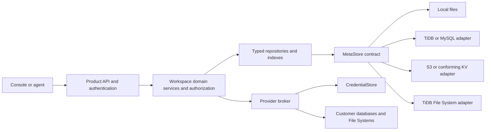

# GH-74: Multi-tenant Workspace control plane with portable KV metadata

## Identity, authority, and delivery

| Field                                       | Value                                                                                                                                                                                                     |
| ------------------------------------------- | --------------------------------------------------------------------------------------------------------------------------------------------------------------------------------------------------------- |
| Parent intent                               | [Issue #74](https://github.com/siddontang/tidb.ai/issues/74)                                                                                                                                              |
| Status                                      | Draft specification for review; no runtime or migration implementation                                                                                                                                    |
| Date                                        | 2026-10-29                                                                                                                                                                                                |
| Intent contributor / accountable maintainer | Siddon Tang                                                                                                                                                                                               |
| Source baseline                             | `ee1bd56f5a4a53d7864493634bf7d0eb228b878f`                                                                                                                                                                |
| Accepted direction                          | Logical KV metadata, a replaceable persistence layer, bounded retrieval, ordinary local files first, TiDB File System as a hosted candidate, explicit tenant isolation, and identity-preserving migration |
| Proposed choices                            | Scope-atomic commits, record/index layouts, roles, adapter protocols, API evolution, limits, and the migration procedure below                                                                            |
| Dependencies                                | ADRs 0001, 0004, 0005, 0006, 0008, 0010, 0011 and proposed [ADR 0017](../../docs/decisions/0017-workspace-kv-control-plane.md)                                                                            |
| Risk                                        | Tenant authorization, credentials, concurrency, provider lifecycle, and migration; implementation requires the acceptance suite below                                                                     |
| Delivery endpoint                           | Reviewable specification and ADR in a design PR; the parent feature remains open                                                                                                                          |

This document specifies intended behavior. It neither changes the running Portal nor
authorizes live migration, provider provisioning, account registration, credential rotation,
public hosting, or deployment. Existing Portal edits and its restored resource configuration
are outside this design's checkout and must be preserved.

## 1. Outcome and current boundary

An individual or team owns an Organization, creates multiple Workspaces, and operates its
authorized databases and File Systems using the Console or Workspace Keys. Restarting or
moving the control plane preserves the same product resource IDs, upstream instances, native
roles, files, and grants. Changing metadata backends does not change domain behavior.

The current service has one fixed `ws_agentlab`, an unauthenticated loopback owner-session
bootstrap, process-local sessions, a public JSON state file, and four sibling private vault
files. `createStore` serializes mutations inside one process and replaces a whole JSON file
with `writeFile` plus `rename`; it has no cross-process ownership or directory-sync protocol.
Provider adapters also have process-local provisioning maps. These are not distributed locks.
Local file contents are embedded in JSON; live customer data remains upstream. Activity is
limited to 200 records, with no complete Run or failure history.

The new abstraction is **logical KV plus bounded indexes**, not an ORM and not an arbitrary
JSON document with unrestricted queries. It supplies a useful consistency contract across
files, TiDB File System, TiDB/MySQL, object storage, or a conforming KV engine. Local files remain a valid local
backend; multi-server availability is an additional backend/deployment capability.

### Scope and exclusions

Included: record schemas, retrieval, atomic metadata changes, Organization/Workspace identity,
permission evaluation, provider bindings and secrets, durable resource operations, backup,
offline import, cutover, recovery, compatibility, and adapter acceptance.

Excluded from this delivery: implementation; SQL schema migrations on customer databases;
new native protocol gateways; arbitrary SQL access to metadata; full-text search; a general
distributed transaction manager; production billing; a complete Run/review/publish product;
and automatic migration of customer application data between providers.

## 2. Architecture and ownership



| Entity             | Ownership / meaning                                                                                   |
| ------------------ | ----------------------------------------------------------------------------------------------------- |
| User               | Product identity bound to an authentication issuer and subject; not an email address as a primary key |
| Organization       | Our customer and administrative/quota boundary; personal sign-up creates a personal Organization      |
| Workspace          | Project and resource-access boundary, belonging to exactly one Organization                           |
| Public resource    | One database or independent File System, belonging to exactly one Workspace                           |
| Provider account   | Internal account and provider quota boundary; initially belongs to one Organization                   |
| Binding            | Internal mapping from a public resource to its actual provider instance, role or private storage      |
| Credential version | Private, immutable value referenced by bindings/accounts; inaccessible through public APIs            |
| Operation          | Durable intent and recovery state for a lifecycle action; distinct from a query Run                   |

Organization and Workspace IDs are immutable. Resource ownership cannot be changed by
editing `orgId` or `workspaceId`. Moving resources between customers requires a separate
reviewed transfer design. An application's `externalCustomerId` is attribution only; our
customer's own end-user tenancy needs its own resource/application boundary.

## 3. MetaStore contract

### 3.1 Atomic scope

All keys belong to one explicit scope:

```text
directory/<shard>       identity and routing hints; never authorization truth
organization/<orgId>   organization, members, workspace directory, provider accounts and quotas
workspace/<workspaceId> workspace, members, resources, keys, bindings, operations and indexes
```

The scope is chosen by a trusted repository after authorization. Public callers cannot
supply raw KV scopes, key prefixes, storage paths, SQL tables, bucket names, or secret refs.
Directory shards prevent a global routing record from becoming the write bottleneck.
An immutable Workspace descriptor binds it to its Organization; mismatches fail closed.

**An atomic scope commit is required. A cross-scope transaction is not required.** A Workspace
resource, its name guard, operation intent, and current-state indexes are changed together.
An Organization member change and a Workspace change use explicit coordination, rather than
an adapter silently approximating a global transaction.

### 3.2 Proposed internal interface

The following TypeScript is contract notation, not an exported SDK or implemented module.

```ts
type Scope = { kind: 'organization' | 'workspace' | 'directory'; id: string };
type Revision = string; // opaque, never reused, local to the scope
type JsonValue = null | boolean | number | string | JsonValue[] | { [key: string]: JsonValue };
type Change = { key: string; value: JsonValue } | { key: string; delete: true };

interface MetaSnapshot {
  scope: Scope;
  revision: Revision;
  get(key: string): Promise<JsonValue | undefined>;
  scan(input: { prefix: string; after?: string; limit: number }): Promise<{
    items: { key: string; value: JsonValue }[];
    nextAfter?: string;
  }>;
  close(): Promise<void>;
}

interface MetaStore {
  openLatest(scope: Scope): Promise<MetaSnapshot>;
  initialize(input: { scope: Scope; mutationId: string; changes: Change[] }): Promise<Revision>;
  commit(input: {
    scope: Scope;
    expectedRevision: Revision;
    mutationId: string;
    changes: Change[];
  }): Promise<{ revision: Revision; replayed: boolean }>;
  resolveCommit(
    scope: Scope,
    mutationId: string,
  ): Promise<
    | { outcome: 'committed'; revision: Revision }
    | { outcome: 'not-committed' }
    | { outcome: 'unknown' }
  >;
}
```

Required semantics:

1. `openLatest` is a linearizable read of one committed scope revision. Its `get` and `scan`
   see that same revision until `close`. It never reads an eventually consistent replica
   for authorization. This is a per-scope guarantee, not a global snapshot of every scope.
2. `commit` validates the exact expected revision and publishes all changes, including
   derived keys and a commit receipt, atomically. It either wins once or reports
   `META_CONFLICT`; domain code re-reads and revalidates before constructing another change.
3. A repeated `mutationId` with the same canonical change fingerprint returns its original
   committed outcome. Different content under that ID returns `META_MUTATION_MISMATCH`.
   An indeterminate reply is `META_COMMIT_UNKNOWN`, not a definitive failure.
4. `initialize` is a conditional create of a new scope. Scope IDs are never reused after
   deletion. Revision tokens contain a new random identity as well as any adapter counter;
   restoring older content creates a new revision, preventing an ABA match.
5. A successful reply acknowledges the adapter's declared durable commit. Memory-only
   acknowledgement or an unflushed asynchronous engine write cannot satisfy this contract.
6. `resolveCommit` may return `not-committed` only when it can prove no commit took place.
   A lost/expired receipt, unavailable authority, or inconsistent snapshot yields `unknown`.
7. Callbacks/transactions never contain provider requests, emails, secret mutations, or other
   external side effects. Conflict retries repeat metadata validation only.

Initial portable limits: key <= 512 UTF-8 bytes; record <= 256 KiB encoded JSON; commit <= 100
changed keys and 1 MiB encoded changes; scan default 100 / maximum 500 entries. Local and
initial S3 snapshot representations cap a scope at 16 MiB, including indexes/receipts.
Exceeding a limit returns `META_LIMIT_EXCEEDED` before publication; it never silently splits
one atomic operation. These are proposed safety budgets, not measured performance promises.
Larger scopes require a conforming paged/transactional adapter or a reviewed scope redesign.

Canonical fingerprints sort change keys and JSON object keys, reject duplicate change keys,
non-finite numbers and unsafe integer values, and include scope, operation kind and all value
bytes. Large exact integers use explicitly typed decimal strings. Codecs use safe maps and
reject prototype-pollution keys at untrusted boundaries. Snapshot checksums cover the canonical
payload excluding the checksum field itself. A checksum identifies bytes, not their authority.

Commit receipts are retained for at least 7 days; business operation/idempotency records are
retained separately for the lifetime needed to reconcile effects. Pruning cannot erase an
unresolved operation. Authorization/lifecycle state is never expired through a cache TTL.

### 3.3 Domain repositories and module boundary

Proposed modules: `server/meta/contract.mjs`, `server/meta/adapters/`,
`server/control-plane/repositories/`, `server/control-plane/authorization.mjs`, and
`server/credentials/`. Existing ESM and API/Console delivery boundaries remain unchanged.

Domain services call typed operations such as `findResourceByName`, `listResources`,
`authorizeWorkspaceKey`, `reserveProviderCapacity`, and `claimOperation`. Only repositories
know key layout; only storage adapters know SQL, file layout, object APIs, or engine revisions.
Only the provider broker can resolve private bindings and credentials after authorization.

Record codecs validate schema versions and tenant relationships on reads and writes. A
newer unsupported schema is an explicit unavailable/error state, not a record to skip.
Storage adapters cannot weaken authorization, invent defaults, seed missing customer state,
or implement provider-specific business policy.

Index verification/repair is an explicit operation against a pinned scope revision. Rebuild
indexes from canonical records and publish atomically by CAS; a concurrent change restarts
the repair. An ownership/guard inconsistency fails closed rather than making an arbitrary
record win. Cross-scope discovery hints can be repaired independently because they do not
authorize anything.

## 4. Logical schemas and key layout

### 4.1 Envelope and key encoding

Every authoritative record has `schemaVersion`, `id`, `createdAt`, `updatedAt`, and immutable
ownership fields where applicable. State changes use scope CAS, not wall-clock timestamps.
Times are UTC; scheduling does not infer ordering from clock equality. IDs are opaque,
random product IDs; existing IDs remain valid. Display names are never filesystem paths.

Key segments use one canonical reversible encoding of UTF-8 bytes. Reject control characters,
empty segments, traversal, alternative encodings of the same ID, and oversized keys.
Name guards use the existing lowercase resource-name contract. Lexicographic ordering is
defined on encoded bytes; timestamps for time indexes use one fixed-width UTC encoding.

Example envelope:

```json
{
  "schemaVersion": 1,
  "id": "db_example",
  "orgId": "org_example",
  "workspaceId": "ws_example",
  "name": "customer-analytics",
  "kind": "postgresql",
  "provider": "db9-anonymous",
  "region": "automatic",
  "desiredState": "present",
  "status": "provisioning",
  "generation": 1,
  "observedGeneration": 0,
  "createdAt": "2026-10-29T00:00:00.000Z",
  "updatedAt": "2026-10-29T00:00:00.000Z"
}
```

### 4.2 Authoritative record families

The rows below are logical collections. They are not required SQL tables.

| Scope / key                                                     | Required fields beyond the common envelope                                                                                                                             | Rules                                                                                             |
| --------------------------------------------------------------- | ---------------------------------------------------------------------------------------------------------------------------------------------------------------------- | ------------------------------------------------------------------------------------------------- |
| Organization `organization`                                     | `name`, `status`, `authVersion`, `planRef`                                                                                                                             | `planRef` does not assert billing is implemented                                                  |
| Organization `members/<userId>`                                 | `userId`, `role`, `status`, `authVersion`                                                                                                                              | owner/admin/member; no granting ownership by email matching                                       |
| Organization `workspaces/<workspaceId>`                         | `name`, `status`, `creationOperationId`                                                                                                                                | Directory entry for an owned Workspace; pending entries are not ready Workspaces                  |
| Organization `workspace-names/<normalizedName>`                 | `workspaceId`, reservation state                                                                                                                                       | Uniqueness guard, committed with the directory entry                                              |
| Organization `provider-accounts/<accountId>`                    | `provider`, `ownerOrgId`, `status`, `credentialRef`, `quotaPolicyRef`                                                                                                  | Internal; no account credentials or native admin access in public projections                     |
| Organization `account-reservations/<accountId>/<operationId>`   | `workspaceId`, `resourceId`, units, state                                                                                                                              | Accounts for capacity shared across Workspaces; uncertain creations retain their reservation      |
| Workspace `workspace`                                           | `orgId`, `name`, `status`, `homeRegion`, `authVersion`                                                                                                                 | `orgId` cannot change in place                                                                    |
| Workspace `members/<userId>`                                    | `role`, `status`, `authVersion`                                                                                                                                        | admin/developer/viewer within the Organization boundary                                           |
| Workspace `resources/<resourceId>`                              | `orgId`, `workspaceId`, `name`, `kind`, `provider`, `region`, `desiredState`, `status`, `generation`, `observedGeneration`, optional `expiresAt`, safe error reference | Descriptive state; public serializers select allowed fields                                       |
| Workspace `resource-names/<normalizedName>`                     | `resourceId`                                                                                                                                                           | Unique across resource kinds, preserving existing behavior; reserved while provisioning/uncertain |
| Workspace `keys/<keyId>`                                        | `name`, `digestAlgorithm`, `digest`, `prefix`, `scopes`, `resourceIds`, `expiresAt`, `revokedAt`, `authVersion`, optional `lastUsedAt`                                 | Missing legacy grants become empty/denied, never wildcard; digest is never returned               |
| Workspace `bindings/<resourceId>`                               | `providerAccountId`, `providerResourceId`, `state`, `credentialRef`, provider-specific non-secret connection metadata                                                  | Internal repository only; ownership checked against the public resource                           |
| Workspace `internal-storage/<resourceId>`                       | internal backing ID, provider, credential/binding ref, state                                                                                                           | DuckDB backing storage; not a public resource or a Key target                                     |
| Workspace `operations/<operationId>`                            | kind, actor ID, resource ID, desired generation, state, request ID, fingerprint, attempt, optional claim/receipt/error                                                 | Durable lifecycle intent, not full query history                                                  |
| Workspace `idempotency/<principalId>/<action>/<requestKeyHash>` | request fingerprint, operation/resource IDs, response status, created/retention times                                                                                  | Same input returns same identity; mismatched input conflicts                                      |
| Workspace `events/<time>/<eventId>`                             | actor ID, action, target, outcome, request/operation ID, safe error reference                                                                                          | Append records through service policy; never contain credential values                            |
| Workspace `quotas/<policyId>`                                   | policy version, limits, reserved/allocated units                                                                                                                       | Product limits; independent of actual provider-account limits                                     |
| Workspace `compat/legacy-import`                                | import manifest ID, source schema, opaque archive refs, original counters                                                                                              | Preserves legacy information without presenting it as current telemetry                           |

Directory scopes contain `users/<userId>`, identity mappings by issuer+subject, and optional
user/legacy-Key Workspace routing hints. Lookups always verify the canonical Organization,
Workspace and Key records. Hint poisoning must not authorize a resource. Sharding is an
adapter/repository policy, not information that a customer can choose.

CredentialStore contains the sensitive portions of account and binding payloads. Provider
responses with embedded secrets belong there as private opaque payloads during recovery;
they must not be copied into `resources`, indexes, events or error messages.

### 4.3 Retrieval and indexes

| User/domain query                        | Key or index                                                          | Consistency                                                                       |
| ---------------------------------------- | --------------------------------------------------------------------- | --------------------------------------------------------------------------------- |
| Get Workspace/resource/Key by ID         | Direct record lookup                                                  | Latest canonical state                                                            |
| Find resource by exact name              | `resource-names/<normalizedName>` then canonical record               | Same scope revision                                                               |
| List resources in Workspace              | Scan `resources/`, or `indexes/resources-by-kind/<kind>/<resourceId>` | Same scope revision; bounded page                                                 |
| List resources needing reconciliation    | `indexes/resources-by-status/<status>/<resourceId>`                   | Updated with canonical record                                                     |
| List Organization Workspaces/members     | Their authoritative prefix                                            | Same Organization revision                                                        |
| List operations by state / runnable time | `indexes/operations/<state>/<dueTime>/<operationId>`                  | Updated with operation                                                            |
| List recent activity                     | Reverse time index `indexes/events/recent/<reverseTime>/<eventId>`    | Same revision; timestamps tie-break on ID                                         |
| Find a legacy Key's Workspace            | Sharded digest routing hint, then canonical Key digest/grants         | Hint is not authoritative                                                         |
| Find Workspaces available to a user      | User-directory hint, then canonical membership                        | Stale positive is filtered; stale negative can delay discovery, not authorization |

Uniqueness guards and indexes used for correct scheduling/quotas are part of the same scope
commit as the record. They are not eventually updated materialized views. Display-only,
cross-scope search can be asynchronous, with freshness indicated and authorization rechecked
against canonical records. Search results never expose private binding/storage identifiers.

Public pagination cursors bind scope, filters, last key, revision, policy context and expiry
and are integrity protected. Reauthorize each page. Initial adapters return
`PAGE_RESTART_REQUIRED` if the scope changed since the previous page; they do not pretend a
new read is the old snapshot. No arbitrary query language, joins, regex, or unbounded scan
is in the portable interface. Small local name filters may scan a bounded resource set;
larger search requires a separately indexed projection.

Bulk events, traces, query/Run payloads, result bytes, customer file bytes, and billing ledgers
are separate data stores. The hot metadata scope retains bounded pointers/status, not an
ever-growing history. Last-used timestamps are coalesced/telemetry writes; they must not make
each API read contend on the Workspace commit or become authorization evidence. When
capacity/retention limits are approached, compact only resolved historical receipts/events
under declared retention policy; never drop keys, grants or unresolved operation state.

For example, creating `customer-analytics` from Workspace revision R42 validates an absent
name and available product quota in that snapshot, then publishes one batch containing
`resources/<id>`, `resource-names/customer-analytics`, kind/status indexes, an operation and
its runnable index, an idempotency record, and the quota reservation. All use one
`expectedRevision: R42`. A competing name/quota claim changes the scope revision and makes
this entire batch conflict. No separate SQL uniqueness constraint or sequence of independent
KV PUTs is part of the domain algorithm.

## 5. Persistence adapters

### 5.1 Ordinary local files: first implementation

Use a configured private root, with no embedded database prerequisite:

```text
meta-root/
  INSTANCE.json                         installation ID, environment, format, adapter
  LOCK/owner.json                       exclusive authority process ownership
  scopes/organization/<encoded-id>/state.json
  scopes/workspace/<encoded-id>/state.json
  scopes/directory/<encoded-shard>/state.json
  secrets/<opaque-ref>/<version>.json    separate permissions and service interface
  local-data/<resource-id>/...           customer local file content, outside metadata
  backups/<backup-id>/manifest.json
```

Each `state.json` contains `{formatVersion, scope, revision, records, commitReceipts, checksum}`.
`records` is a map of logical keys to validated JSON values. A key is a logical record, not
one physical file. This keeps a multi-record atomic update as simple as replacing one
Workspace file. Direct-ID reads and prefix scans run over the bounded in-memory snapshot;
the initial file adapter does not implement a custom database, LSM tree, or secondary engine.

One authority process owns the entire root. Acquire ownership with an exclusive directory
creation before opening writable state; record an instance identity. A second writer fails
`META_ROOT_LOCKED`. A lock is not stolen because of a timestamp or a PID check. After a crash,
offline operator recovery confirms no old process owns the root before removing the stale
lock. Graceful shutdown releases it. This consciously trades automatic local failover for
simple, explicit ownership. Multiple API processes may use a single metadata authority
service; they may not open the same directory as independent writers.

Within the owner, serialize commits per scope and check `expectedRevision`. Build/validate
the new complete file; create a unique sibling temporary file with exclusive creation and
mode 0600; write and sync it; rename within the same filesystem; sync the containing
directory; then publish the in-memory revision and acknowledge success. Directory creation
and initial `INSTANCE.json` creation also require the supported platform's durable directory
protocol. A failure after rename but before durable acknowledgement reports an unknown
commit and requires reloading/validating the authoritative file before another write.

Crash recovery accepts only a valid old or new complete snapshot. Ignore unreferenced temp
files after verification; a bad checksum/schema or missing expected scope fails closed. Do
not silently seed an empty Workspace or restore an arbitrary older file. A supported restore
is an explicit backup operation with a new revision and an audit record.

Filesystem guarantees must be verified on each supported OS/filesystem. Initial support is
local APFS/ext4-class storage with tested file/directory sync behavior; no NFS, shared mounts,
object-store FUSE, multi-host writes, or Windows durability claim without platform acceptance.
Filesystem permissions provide local secret protection; this does not claim encryption at
rest against the host administrator or disk loss. Encryption can be supplied by the host
or the managed CredentialStore profile.

Treat the root/ownership files and encoded scope directories as trusted service state:
reject unexpected symlinks, use exclusive/no-follow opens where the platform supports them,
validate the descriptor's scope against its directory, and verify existing permissions.
Customer file APIs cannot address this root. Unsupported safe-open/sync behavior must be
reported explicitly instead of being silently treated as a durable local adapter.

Opening a nonexistent root requires an explicit initialization action. Ordinary startup
requires the expected installation ID and environment in `INSTANCE.json`. Distinguish
`development`, `test`, and `production` roots, and expose only a safe installation ID/mode
in diagnostics. A changed root cannot silently look like the same customer workspace. This
addresses the observed failure mode of serving a fresh test root on the normal Portal URL.

Local customer files belong to a separate File System data adapter. Its resource-private
catalog preserves file IDs, paths, directory entries, timestamps, sizes and immutable payload
references. Write/sync a new payload before atomically replacing that catalog; a lost reply
is reconciled against the catalog revision. Never overwrite a payload still referenced by
the current catalog or a backup. This data adapter follows authenticated path validation and
does not expose metadata/credential directories. During migration, stage both catalog and
payloads while the target is inaccessible, then verify them before Workspace activation.
No cross-file/control-plane atomic transaction or large-file payload in `state.json` is implied.

### 5.2 TiDB / MySQL adapter: KV semantics over SQL

An illustrative physical schema uses two tables. Domain objects remain KV records:

```sql
CREATE TABLE meta_scopes (
  scope_id VARBINARY(256) PRIMARY KEY,
  revision VARBINARY(128) NOT NULL,
  format_version INT NOT NULL
);
CREATE TABLE meta_records (
  scope_id VARBINARY(256) NOT NULL,
  record_key VARBINARY(512) NOT NULL,
  record_value LONGBLOB NOT NULL,
  PRIMARY KEY (scope_id, record_key)
);
```

Within a database transaction, lock the scope row, check its revision/receipt, apply records,
guards, indexes and receipt, then advance the revision and commit. Concurrent commits to
the same scope conflict/serialize; different scopes may proceed independently. A snapshot
read uses the primary and a consistent database transaction to obtain revision+records;
it never mixes rows from multiple committed revisions. Prefix ranges use byte ordering.
Bootstrap a scope with a unique scope-row insert. Failure outcomes retain MetaStore semantics.

Exact driver, isolation/locking behavior, payload limits and durable commit configuration
must pass the conformance suite on pinned TiDB and MySQL versions. The SQL above is a design
mapping, not executed DDL or a claim that every version is already certified. No domain
joins, vendor JSON operators, foreign-key implementation, or RLS is required by the core.
An adapter can add efficient indexes without changing logical authorization or uniqueness.

### 5.3 S3: possible, with conditional publication

Amazon S3 documents strong object-read/list consistency and conditional writes, but does not
provide atomic updates across arbitrary keys. S3-compatible APIs must be verified separately.
Use an adapter protocol, not uncoordinated `PUT` of each logical key:

1. Read `scope/HEAD` and its opaque ETag; load its referenced immutable snapshot.
2. Validate the expected logical revision, then write a new immutable complete snapshot
   (including records and the mutation receipt) under a new random object key.
3. Publish one new `HEAD` with `If-Match` against the prior ETag; initialize it with
   `If-None-Match: *`. This successful publication is the scope commit's linearization point.
4. A 412 is a conflict; reread and revalidate. A 409, lost reply, or connection failure is
   reconciled against the latest HEAD/receipts before claiming success or retrying metadata.

HEAD contains a fresh logical revision, snapshot reference/checksum, and mutation identity;
it is never physically reset to a prior HEAD or reused after deletion. Domain scans use the
snapshot indexes, not bucket LIST as a transaction or an authorization filter. Incomplete
snapshot uploads are unreachable, and an old writer cannot publish without winning CAS.
Private bucket/service credentials are independent of all customer File Systems.

Retain snapshots referenced by a current HEAD, backup, active read, or unresolved commit.
Garbage collection needs an explicit grace period and reachability proof; it cannot delete
objects just because they are absent from one listing. A response lost after a successful
HEAD update may be resolved by a receipt copied into later snapshots. Versioning/lifecycle
rules must not expire data required for a supported recovery window.

This first S3 design rewrites the bounded scope snapshot and serializes writes through one
HEAD per scope. It is suitable to evaluate for low metadata write rates, not a throughput
promise. Paging snapshots or an object-backed engine is a later adapter optimization with
the same atomic publication contract. Do not build a general database on S3 just to satisfy
the local use case.

### 5.4 TiDB File System: service-owned metadata storage

TiDB File System is an explicit owner-requested candidate for storing control-plane
metadata, alongside ordinary local files and other hosted adapters. A dedicated remote
filesystem can hold the same bounded KV snapshot/index records. Use the supported HTTP API
or SDK behind `MetaStore`; Ti CLI and a filesystem mount are not product dependencies.

Use a **service-owned control-plane File System**, separate from public customer File
Systems and each DuckDB database's private backing store. One deployment/shard can hold
multiple authorized scopes under encoded prefixes; a separate File System for every
Workspace is not required. Workspace Keys, user file browsing, exports and analysis workers
cannot list or address this storage, including through wildcard resource grants. Customer
resource deletion must not delete its own control-plane authority.

The deployment needs an out-of-band bootstrap locator and credential/secret reference for
this File System. They cannot exist only inside the same metadata root that they unlock.
The expected installation/environment identity and credential recovery path are configured
by the operator; absence is an unavailable state, never permission to auto-provision a new
filesystem or seed a replacement tenant catalog. Keep provider-account credentials in the
separate CredentialStore; a filesystem-backed managed secret implementation would additionally
require encrypted values and an external key/IAM root of trust.

Two adapter profiles are candidates, subject to the shared conformance suite:

1. **One metadata authority process:** multiple APIs call that authority, which serializes
   scope updates and publishes complete remote snapshots. Verify latest reads, atomic
   publication and durable acknowledgement using the remote protocol. Cold/manual takeover
   first confirms the old writer is stopped or fenced. This is not multi-writer HA. Do not
   copy the local `mkdir` lock, rename or `fsync` assumptions onto a FUSE/WebDAV mount and
   infer their distributed semantics.
2. **Revision-conditional publication:** create immutable snapshot files, then atomically
   replace a small stable HEAD with a server-enforced expected version, following the S3
   publication pattern. Retain mutation receipts, verify the referenced bytes before return,
   and reconcile lost replies. Competing publishers must not both win from one version.
   Version checks must include path incarnation or an equivalently enforced stable-HEAD
   namespace: revision-only CAS does not protect a path deleted/recreated with a reset
   revision. HEAD is never renamed, deleted, or reset during normal operation; restoration
   creates a new installation namespace so an old writer cannot publish into the restored
   authority. Automatic failover requires verified stale-writer exclusion.

Evidence and gaps at this design date are deliberately separate:

- Official TiDB Cloud Filesystem documentation describes persistent shared files and controlled
  access. Its layers/checkpoints are not full-filesystem backups or authorization boundaries;
  layer commit is not assumed to implement MetaStore's atomic scope transaction.
- The [upstream ordinary-file server contract](https://github.com/drive9-ai/duckdb/blob/0e225c8d7b6adcccf8ce499d603350172dcca53e/docs/server-contract.md)
  describes `X-Dat9-Expected-Revision: 0` for create-only and a positive value for conditional
  replacement, with revision conflicts. It also states that revision-only writes do not
  fence inode replacement. This is an upstream contract reference, not certification of
  the current hosted endpoint for metadata.
- This product's current `createDrive9().write` exposes create-only or unconditional writes;
  it does not expose expected-positive-revision replacement, a complete remote metadata CAS
  protocol, or remote root ownership. Existing conditional reads/snapshot checks are not
  evidence that concurrent metadata publication is already implemented.
- The current product gateway caps uploads at 1 MiB; a 16 MiB MetaStore snapshot budget does
  not override it. A candidate adapter must declare verified limits and either use supported
  bounded snapshots within the actual upload ceiling or implement verified multipart/paged
  snapshots. Oversized metadata fails before effects; no silent split of an atomic commit.

Keep a capability/limit manifest with the selected endpoint/runtime version and tests for
fresh reads, publication, path replacement, durability, maximum payload and unknown outcomes.
If the endpoint only meets immutable-blob storage requirements, it can store staged/backup
snapshots while another authority controls publication; it cannot claim full MetaStore
support. Keep primary data and backup failure domains/recovery credentials explicit.

### 5.5 Candidate comparison

| Backend                 | Recommendation                                             | Additional work before claiming support                                                                                             |
| ----------------------- | ---------------------------------------------------------- | ----------------------------------------------------------------------------------------------------------------------------------- |
| Plain local files       | First local adapter; no database service required          | Exclusive root owner, durable replace, recovery, backup, bounded indexes                                                            |
| TiDB File System        | Explicit hosted candidate reusing the snapshot/index model | Service-owned storage and bootstrap credentials, verified publication/CAS and stale-writer behavior, payload limits and recovery    |
| TiDB / MySQL            | Practical hosted adapter candidates                        | Scope transaction mapping, primary reads, locking/timeout/reconnect conformance                                                     |
| Custom S3 snapshot+HEAD | Valid design candidate for a later measured need           | Conditional-write and durability probes, snapshot retention, GC and latency/cost testing                                            |
| etcd                    | Candidate consistent KV service                            | Scope revision mapping, transactional limits, snapshot pagination/compaction and operations                                         |
| SlateDB                 | Candidate object-backed engine behind a metadata service   | Single-writer ownership/fencing, durable write acknowledgement, fresh authorization reads, transaction mapping, runtime integration |

Current official SlateDB documentation describes a single writer, multiple readers, writer
fencing and transactions. These do not establish multi-writer service behavior or guarantee
that a chosen asynchronous acknowledgement is durable. etcd's default KV guarantees are
stronger than an eventually consistent cache, but stale/serializable read modes are unsuitable
for canonical authorization. Neither engine is selected or installed by this design.

## 6. Authorization and isolation

### 6.1 Proposed roles

| Principal/role                        | Workspace discovery/read                                     | Data operations                                                                      | Control administration                                                                   |
| ------------------------------------- | ------------------------------------------------------------ | ------------------------------------------------------------------------------------ | ---------------------------------------------------------------------------------------- |
| Organization owner                    | All Workspaces in its Organization                           | Through explicit domain checks                                                       | Owners, members, Workspaces, provider allocation and keys; cannot remove the final owner |
| Organization admin                    | All Workspaces in its Organization                           | Through explicit domain checks                                                       | Member/Workspace/resource/key administration; cannot transfer Organization ownership     |
| Organization member + Workspace admin | Assigned Workspace                                           | Authorized data actions                                                              | Workspace members, resources and Keys within that Workspace                              |
| Workspace developer                   | Assigned Workspace                                           | Existing file/query actions allowed by role                                          | Create resources within quotas; no member or Key administration                          |
| Workspace viewer                      | Assigned Workspace/resource metadata and permitted file read | No `queries:execute`, catalog reads requiring it, or write/analyze action by default | None                                                                                     |
| Workspace Key                         | Its bound Workspace and permitted resource projections       | Intersection of scopes and exact IDs or explicit Workspace wildcard                  | Never Organization, membership, credential or Key administration                         |

Organization membership is required for human Workspace membership to have effect. Roles are
products of explicit policy, not implicit privileges from an arbitrary record attribute.
Organization owners/admins have administration through the same service checks; no customer
role gains direct access to the metadata root, provider account credentials, or hidden storage.
Local development identity is explicitly enabled loopback-only and bound to its migrated
personal Organization. The current unauthenticated local-owner bootstrap must not become
the authentication path of a hosted deployment.

`queries:execute` currently allows reads and writes within the native database role. It must
not be described as viewer/read-only access. Dedicated read-only SQL/catalog policy requires
an independently enforced native/gateway contract; changing a UI label or rejecting strings
in a viewer's browser is insufficient. Analysis requires both `files:read` and `files:analyze`
plus the selected File System grant, preserving existing behavior.

### 6.2 Request admission

1. Verify the user identity/session or Key secret; identify the canonical principal.
2. Resolve the requested Workspace and its immutable Organization, rejecting a path/key
   Workspace mismatch before provider, secret, file or engine I/O.
3. Read current canonical Organization membership/status and Workspace status/role or Key
   state. Validate expiration, revocation, action, resource grant and resource ownership.
4. Read Organization revision O1, then the Workspace policy snapshot W, then Organization
   revision O2. If O1 differs from O2, retry bounded metadata evaluation. With O1=O2, W's
   linearizable read supplies a coherent admission point bracketed by the unchanged
   Organization policy. Apply this to human and Workspace-Key admission, including
   Organization/Workspace suspension. No persisted allow-cache can replace these checks.
5. For mutations, include the Workspace authorization/resource predicates in the revision
   used for the scope commit. Conflict means reauthorize; never reuse a prior grant on a
   rebased write. When a queued worker is ready for external I/O, evaluate its current
   operation authority and current policy again, using the original submitting principal.

There is no assertion of an atomic snapshot across Organization and Workspace scopes. A
revocation completed before a new admission check denies that admission. Work admitted
before revocation can already have an upstream effect; cancellation cannot undo it. New
external steps and long-lived/delegated sessions require fresh checks and bounded lifetimes.
If a use case requires revocation and a cross-scope mutation to be globally atomic, it needs
co-location or a stronger coordinator contract, not a weaker adapter pretending to provide it.

An Organization can still change after O2 and before a Workspace commit; the operation was
admitted before that later change. This is the stated in-flight rule, not strict ordering of
all Organization mutations with every Workspace write. Requests whose admission starts after
a completed revocation must observe the revocation. Implementation tests must distinguish
these two histories rather than use the phrase "immediate revocation" without a boundary.

Canonical policy reads fail closed on metadata unavailability. Caches and watches can improve
discovery or invalidate data but cannot serve a stale positive authorization decision. Native
sessions are service-managed and bounded; customers do not receive upstream credentials to
bypass revocation. Key `resourceIds: ["*"]` covers only the bound Workspace, including its
future public resources; it never includes another Workspace or private DuckDB backing data.

Untrusted resource IDs, prefixes, names, filenames and search hints are not proof of ownership.
Every record reference verifies `orgId`/`workspaceId` in the repository. Backend-enforced
checks cover single reads, lists, search, usage, events, results, retries and background jobs.
Unauthorized Workspace/resource probing returns a consistent `404 NOT_FOUND`; an authenticated
principal inside an accessible Workspace with a missing action receives `403 INSUFFICIENT_SCOPE`.
Deleted/tombstoned state cannot be revived through an old pagination cursor or binding.

### 6.3 Data-plane and provider-account boundaries

KV namespacing isolates management records. Actual data isolation continues to depend on
provider instances, restricted native roles, independently authorized File Systems, and
isolated workers. Never route customer SQL to the control-plane database. Do not mount the
metadata root or CredentialStore into analysis workers.

Initially a provider account belongs to one Organization, possibly serving multiple
Workspaces in it. Workspace and account quotas are separate canonical records. Reserve
account capacity in the Organization scope and reference the reservation from the Workspace
operation; reconcile this cross-scope workflow. Timeout/uncertain provider creation does not
release the reservation. Cross-Organization account pooling is not enabled by the schema;
it requires provider-policy, isolation, quota and commercial review before implementation.
Do not multiply anonymous registrations to evade provider limits or call a per-account free
allowance an independent free allowance for every Workspace.

### 6.4 CredentialStore

The separate internal interface is `putVersion(ownerContext, importOrOperationId, value)`,
`resolveVersion(serviceContext, secretRef)`, and `markRetired(ownerContext, secretRef)`.
Values are opaque private payloads; refs and immutable versions have owner, provider,
resource/account purpose and integrity metadata. Service identity and the validated binding
context must match before resolving a ref. Public APIs do not expose a generic secret-read
operation, vault path, secret bytes or provider administration token.

Local mode may use ordinary 0700 directories and 0600 private files, plus exclusive create,
sync and immutable version writes. Managed mode uses a chosen secret manager/KMS envelope
encryption with independent IAM and backups. A local file implementation does not become a
production encrypted vault merely by implementing this interface.

Write a new secret version durably before publishing its metadata reference. Failed or
uncertain publication leaves a recoverable staging version, not an active dangling ref.
Active versions are retained until replacement metadata is confirmed and reconciliation
proves no live operation/backup needs them. Secret-service failure blocks provider work;
it never triggers a fresh account/database. Recovery uses operation/import IDs and sealed
receipts so a lost credential-write reply can be resolved. Backup includes accessible secret
versions and required encryption-key access; metadata alone is not a restorable backup.

## 7. Resource lifecycle and cross-scope coordination

### Workspace creation

Organization CAS reserves the Workspace ID/name and creates an initialization operation.
Initialize the Workspace scope with the exact Organization owner reference, then finalize the
Organization directory entry. Before finalization it is `initializing`, not discoverable as
ready; retries use the same ID. Crash reconciliation checks both canonical records and never
adopts a mismatched scope. Directory/user search hints update only after the canonical state.

### Provider provisioning

1. Authorize; in a Workspace commit reserve the resource name/product quota and persist a
   resource and operation intent. Do not invoke a provider before this commit is confirmed.
2. Reserve provider-account capacity in the Organization scope under the same operation ID.
   A crash between reservations is resolved by that identity, not a second resource create.
3. Claim the operation by Workspace CAS with `attemptId`, owner and lease deadline. The claim
   is durable coordination; a process-local `Map` is not its authority.
4. Before a non-idempotent provider request, durably mark the attempt `request-may-have-been-sent`.
   A restarted/expired claim with that marker enters reconciliation; it does not issue the
   same non-idempotent create again. Even a crash just before sending is conservatively unknown.
5. Persist any returned credential version/receipt, then publish binding/state under a CAS
   that still matches the operation/attempt/generation. Uncertain secret/metadata outcomes
   retain the provider identity and capacity reservation for recovery.
6. Validate the existing native binding/role, mark the resource active, and mark the
   reservation allocated. Reconcile the final cross-scope state if only one side committed.

Proposed operation states: `pending`, `reserved`, `executing`, `needs_reconciliation`,
`succeeded`, `failed`, `canceled`. `failed` means a confirmed terminal failure, not an unknown
provider effect. A late stale worker may submit a sealed receipt for recovery but cannot
activate a new generation or override a newer claim. A metadata lease/fencing token cannot
fence an external provider that does not accept it; do not take over and repeat an uncertain
create just because the lease expired.

Provider-specific recovery remains authoritative: db9 may recover a uniquely matching
saved instance name; Zero/Drive9 unknown creation cannot be blindly repeated. Preserve
`requested`, `received`, `configuring`, admin/native-role setup information and expiry rather
than flattening all pending records to a generic failure. Deletion follows the same durable
intent/receipt pattern, hides access first, and retains uncertain bindings. Workspace/tenant
deletion cannot immediately garbage-collect upstream ownership or secret references.

Metadata outbox records may enqueue workers, but duplicate delivery is expected. The durable
operation, generation checks and provider-specific reconciliation govern side effects.
Neither outbox nor a scope transaction supplies exactly-once cloud creation or atomic
rollback of customer SQL/file mutations.

## 8. Proposed public API and agent experience

These are proposed contracts for a later implementation PR; generated OpenAPI is unchanged.

| Operation                                                       | Principal / policy                                                     | Observable behavior                                                                 |
| --------------------------------------------------------------- | ---------------------------------------------------------------------- | ----------------------------------------------------------------------------------- |
| `GET /api/v1/organizations`                                     | Authenticated user                                                     | Accessible Organizations only; bounded cursor page                                  |
| `POST /api/v1/organizations`                                    | Authenticated user, applicable account policy                          | Organization+owner initialized through durable intent; stable idempotent identity   |
| `GET /api/v1/organizations/{orgId}/workspaces`                  | Organization member, canonical authorization                           | Assigned Workspaces; owner/admin may see all                                        |
| `POST /api/v1/organizations/{orgId}/workspaces`                 | Organization owner/admin                                               | `202` with Workspace and initialization operation; requires Idempotency-Key         |
| `GET /api/v1/workspaces/{workspaceId}/bootstrap`                | Authorized human Workspace access                                      | Workspace-scoped public projection; no global owner bypass, digests or private refs |
| Existing resource/file/query routes                             | Workspace human role or Key plus action/resource                       | Explicit Workspace from path, authenticated before data/provider I/O                |
| Existing Workspace Key routes                                   | Organization owner/admin or Workspace admin                            | Bound Workspace only; cannot grant a wider scope than role/policy permits           |
| `GET /api/v1/workspaces/{workspaceId}/operations/{operationId}` | Authorized principal and resource visibility                           | Safe state, request ID, retry/reconciliation guidance; no provider secrets          |
| `POST /api/v1/workspaces/{workspaceId}/resources`               | Existing creation scope plus Workspace wildcard / human role and quota | New clients receive `202` with operation; no unconfirmed synchronous success        |

Membership administration needs owner/admin-only actions and final-owner protection; its
exact request shapes and identity-provider login/session integration must be reviewed before
hosted implementation. Production browser sessions require actual authenticated identity,
secure cookie/session handling and CSRF/origin policy, not `POST /api/session` as a guest owner.

Migration mode preserves the existing Workspace/resource URLs and response shapes. Do not
silently replace the current resource-create `201` contract: introduce explicit opt-in
async negotiation or a versioned contract. The compatibility handler can return `201` only
after confirming the existing synchronous completion semantics; an unfinished/unknown action
returns a documented structured error with an operation ID, not a fabricated active resource.
This compatibility/async transition must be pinned in the implementation's OpenAPI revision.

New stable errors include `META_UNAVAILABLE`, `META_CONFLICT`, `META_COMMIT_UNKNOWN`,
`IDEMPOTENCY_CONFLICT`, `PAGE_RESTART_REQUIRED`, `META_LIMIT_EXCEEDED`,
`MIGRATION_INCOMPLETE` and `PROVIDER_OUTCOME_UNKNOWN`, all with request IDs and safe recovery
guidance. New Key authentication carries a non-secret, versioned Workspace/Key locator (for
example, `wk_v1.<workspaceId>.<keyId>.<randomSecret>`); the locator is validated against
canonical ownership and digest and never grants access by itself. New keys do not require
a global directory write on their authentication path. Existing
`aw_demo_...` tokens remain verifiable through digest routing and the original digest algorithm.
Do not parse a Key prefix as authorization. Existing legacy `ws_agentlab` maps to one imported
Workspace, not a global alias pointing every tenant to its current Workspace.

The importer must build and verify all legacy digest hints before activation. Missing hints
deny rather than falling back to a cross-tenant unbounded public scan; a trusted repair can
rebuild them from canonical imported keys. Workspace-Key plaintext is shown once. A lost
creation reply may leave a valid Key whose secret the caller did not receive; an idempotent
retry returns the same Key identity and an explicit secret-unavailable state, not a newly
minted token or reconstructed secret. Revocation/reissue is an explicit operation.

An agent's path is: authenticate -> list authorized Workspaces/resources/capabilities ->
choose an explicit Workspace -> perform a permitted request -> inspect its operation/error
when necessary. Capabilities distinguish environment/provider availability, limits, scope
requirements and unimplemented telemetry. The Console stores selected Workspace in the URL
and removes the hardcoded client constant during implementation.

## 9. Lossless migration specification

### 9.1 Definition and source bundle

Lossless means retaining all existing accessible resource identities, upstream account/
instance/storage identities, native role/password values, Workspace Key digest and grants,
local file bytes, recovery state, expiry, timestamps and historical information. It does not
recover an upstream database already expired/deleted, reconstruct missing credentials, or
invent Key plaintext from a digest. Missing/ambiguous sources block activation.

The source bundle contains the selected state file plus its exact siblings:

```text
<state-file>
<state-file>.providers.json
<state-file>.databases.json
<state-file>.duckdb.json
<state-file>.db9.json
```

Include runtime/provider enablement, the DuckDB artifact identity/checksum, source schema,
installation/environment identity, permissions and a manifest of referenced files. This is
a private backup bundle, not Git content or CI input. A changed source path must not be
mistaken for a new customer installation.

### 9.2 Mapping

| Legacy data                                      | Destination / preservation rule                                                                                                                                                   |
| ------------------------------------------------ | --------------------------------------------------------------------------------------------------------------------------------------------------------------------------------- |
| `workspace`                                      | Preserve the original ID/name/settings; assign an explicitly selected personal Organization                                                                                       |
| `profile` / local owner                          | Preserve display data; bind ownership only through explicit local-owner import or verified authenticated subject; never claim by matching an email                                |
| Public `resources`                               | Preserve IDs, provider, region, expiry and state; establish exact Workspace ownership                                                                                             |
| Historical simulated PG / unknown resource kinds | Preserve sealed legacy records, hidden and non-addressable; never rebind to db9 or silently delete                                                                                |
| `keys`                                           | Preserve IDs, digest bytes/algorithm, prefix, scopes, exact `resourceIds`, wildcard semantics, expiry/revocation/last-use times; no reissue required solely for storage migration |
| Missing/invalid legacy grants                    | Preserve original evidence and deny; do not replace with wildcard or assign another resource                                                                                      |
| `files`                                          | Preserve directories, IDs, paths, content string and its UTF-8 bytes, timestamps and explicit zero-byte files; move local data to the local-file data adapter                     |
| Main `events` and counters                       | Preserve records/IDs/times and original counters; mark legacy coverage, not reconstructed full runs or billing                                                                    |
| Main `idempotency`                               | Preserve the legacy actor/key slots, fingerprints and resource associations in a compatibility namespace; check them before creating a new operation                              |
| `.providers.json`                                | Preserve every Drive9 binding/credential, including private DuckDB backing entries; classify public versus private before building indexes                                        |
| `.databases.json`                                | Preserve Zero binding state, instance identity, expiry and native/admin recovery credentials                                                                                      |
| `.duckdb.json`                                   | Preserve public DB -> private `storageId` mapping and state; never turn the backing ID into a public File System                                                                  |
| `.db9.json`                                      | Preserve the one existing anonymous account and every binding; retain registration/received/configuring state, tokens, instance IDs, role identities and passwords                |
| Unknown fields/orphan bindings                   | Preserve in a private versioned import archive; quarantine and require reconciliation if they affect access; never silently discard or automatically attach to a tenant           |

An anonymous provider account imported from this single-user installation belongs to the
selected Organization. Native credentials keep their original bytes and identity. Account
ownership and capacity are not cloned for a second tenant. Existing retired IDs remain
reserved, so they cannot be reused for unrelated resources.

### 9.3 Phases and checkpoints

**M0 — Inventory and dry-run.** Resolve the intended source installation and target backend;
validate JSON/version, vault permissions, path safety and ownership; build a complete reference
graph. Verify every public resource's expected binding, every DuckDB private-storage edge,
provider account uniqueness, exact Key grants and local-file bytes. Produce a sanitized
counts/compatibility report and an opaque private manifest. The tool performs no provider
create, setup, native DDL, registration, deletion or credential rotation. Provider reads for
later validation are separately bounded and are not permission to mutate recovery state.

**M1 — Freeze and consistent backup.** Drain API/worker/native work and stop every writer,
including token-refresh/status processes. Acquire exclusive migration ownership; copy the
whole source bundle, local data and required runtime configuration; sync and checksum it.
Do not copy the five files independently while a server can still update them. Retain the
original source read-only and record its checksum set. A consistent snapshot must include
credentials needed for an already-committed public binding.

**M2 — Stage import.** Create a new target installation in `importing` mode, inaccessible to
normal requests. Use a deterministic import ID and a private journal of source checksums,
source-to-target record mapping, staged secret refs and completed scope commits. Re-running
the same import resumes its checkpoints and reuses the same identities. A different source
under that import ID fails. Secret values and opaque legacy payloads remain private.

**M3 — Verify.** Compare source and target graphs, counts, IDs, grants, native identities,
expiry/recovery states and UTF-8 file hashes. Compare sensitive values through a keyed
integrity check inside the trusted migration process; do not emit plaintext or public
credential fingerprints. Public reports contain counts and pass/fail only. Exercise existing
Key verification with fixture tokens; real tokens are not required when only their stored
digests exist. Verify backup readability and required secret/KMS access. Dry-run must report
all orphan/unknown/denied records, with no implicit defaulting.

**M4 — Read validation.** Before making new public writes, start a bounded read-only target
instance with provider create/setup/rotation blocked. Validate discovery and authorized
catalog/file reads against the same existing bindings when live validation is authorized.
Metadata activation never requires calling `provision`. Provider token refresh, if necessary,
is an explicit controlled credential mutation with the same saved account identity; do not
run concurrent legacy and target refreshers.

Account-level token refresh and credential rotation serialize through the canonical
Organization account operation and expected credential version. A late worker cannot
publish an older account secret ref over a newer version. Preserve unresolved versions and
provider receipts for recovery; metadata fencing alone does not undo a provider-side token
invalidation or make a refresh/rotation request idempotent.

Repeated legacy Key digests in different target Workspaces are an ambiguous routing conflict
and block compatibility activation until an explicit mapping/rotation plan is chosen. Legacy
`local-owner` idempotency entries apply only to the verified imported owner, not to any new
user who happens to have an owner role. Old idempotency snapshots containing unknown fields
remain in the private archive even after their canonical resource identity is extracted.

**M5 — Cutover.** Confirm the source remains frozen, target checks pass and ownership is
unambiguous. Publish the expected target installation ID/backend configuration atomically
through the deployment mechanism, then enable writes on that authority only. Remove the
implicit global local-owner assumption; legacy local mode binds only its explicit imported
owner. Normal startup fails if target import is incomplete, a scope/secret is missing, or
the configured installation/environment differs. Keep the sealed source backup.

**M6 — Observe and retire.** Check access, original resource identities and reconciliation
backlog. Only after a declared recovery window and verified restorable backup may legacy
files be retired by an explicit operator step. Retirement is not provider deletion.

### 9.4 Rollback and restore

Before target writes are enabled, stop target authority and restart the exact frozen source
bundle/configuration. Do not copy a random public state file without its vault siblings.

After target writes are enabled, pointing the server back to old JSON loses new metadata and
can sever access to new upstream resources. Freeze again; export/reconcile all newer resource,
Key, credential and operation state into a supported reverse migration, or forward-fix the
target. If reverse mapping is incomplete, remain stopped/read-only and recover from target;
do not claim automatic rollback. Customer SQL/file effects and upstream deletions are not
undone by restoring metadata.

Multi-scope backup also requires a write barrier or a version-pinned consistent manifest
plus secret references; independent copies of current scope files are not automatically a
globally consistent backup. Restore needs its own new installation/revision lineage and
explicit authorization/Key-revocation reconciliation so old credentials or grants are not
silently resurrected. One legacy `ws_agentlab` can be imported with its ID intact; merging
multiple installations with that same ID into one hosted namespace requires a separate
collision plan, such as a dedicated legacy gateway mapping, before cutover.

## 10. Mandatory requirements and acceptance baseline

These cases are requirements for later implementation, not passing tests delivered by prose.

| ID      | Requirement and observable acceptance case                                                                                                                                                                                                                                                                                                                                                          |
| ------- | --------------------------------------------------------------------------------------------------------------------------------------------------------------------------------------------------------------------------------------------------------------------------------------------------------------------------------------------------------------------------------------------------- |
| META-01 | Run the same repository behavior suite on local files and every claimed backend; domain services use no backend-specific query/locking calls.                                                                                                                                                                                                                                                       |
| META-02 | Two commits from the same scope revision race to claim one name; exactly one succeeds, with complete resource/guard/index/operation state and no partial writes. Different Workspace scopes remain independent.                                                                                                                                                                                     |
| META-03 | Inject failure before temp/object write, after write, after rename/HEAD publication, before acknowledgement, and after a later commit; reopen returns valid old/new state, resolves receipts or reports unknown, and never seeds an empty scope.                                                                                                                                                    |
| META-04 | Retry one mutation ID with same/different content and after receipt retention; replay is stable, mismatches conflict, lost proof is unknown. Scope/revision IDs never ABA-match after restore.                                                                                                                                                                                                      |
| META-05 | Local root opened by a second writer is rejected; stale lock is not stolen on TTL/PID assumptions. Missing/corrupt/wrong-environment roots fail startup.                                                                                                                                                                                                                                            |
| META-06 | Record/name/status/runnable indexes agree after concurrent create/update/delete and restart. Pages are bounded and deterministically ordered; a changed revision or filter rejects the cursor. Oversized batches fail before any publication.                                                                                                                                                       |
| META-07 | User/Key from Organization A requests B's Workspace/resource through read, list, search, bootstrap, usage, events and operation routes; all are denied before secret/provider/engine/file I/O, verified with spies. Poison directory hints and conflicting envelope ownership do not bypass checks.                                                                                                 |
| META-08 | A Workspace wildcard remains inside one Workspace and excludes hidden storage. Exact grants do not expand. Missing grants deny. Revocation/expiry/membership changes deny new admissions and new queued external steps; pre-admitted effect semantics are observed explicitly.                                                                                                                      |
| META-09 | A viewer cannot obtain read/write SQL through `queries:execute`, a Key cannot administer members/other Keys, and a final Organization owner cannot be removed. Hosted mode cannot obtain a guest local-owner session.                                                                                                                                                                               |
| META-10 | Concurrent claims, process death and lease expiry around provider creation never produce a second non-idempotent create. Late receipts reconcile under original IDs; stale workers cannot overwrite a newer generation. Unknowns retain capacity/name/secret references.                                                                                                                            |
| META-11 | Account quotas are enforced across two Workspaces of one Organization; another Organization cannot bind that account. Product and provider quotas are independently enforced; partial reservations reconcile without free-tier circumvention.                                                                                                                                                       |
| META-12 | Cross-scope Workspace initialization crashes at each boundary; repeated requests expose only the same owned Workspace or a pending operation, with no orphan ready directory or ownership mismatch.                                                                                                                                                                                                 |
| META-13 | CredentialStore rejects wrong service/tenant/resource contexts, stores no plaintext in metadata/events/errors, and recovers an unconfirmed secret write/publication. Analysis workers cannot read metadata/vault/host paths.                                                                                                                                                                        |
| META-14 | Import a fixture containing all resource kinds, shared provider account, all provider recovery states, expired/revoked/missing-grant Keys, orphan bindings, hidden DuckDB storage, retired PG, unknown fields, local Unicode/zero-byte files, counters and idempotency records. Preserve all identities/bytes/states; quarantine ambiguity; public discovery never reveals private/retired records. |
| META-15 | Interrupt and resume every migration checkpoint. Source remains unchanged; same import reuses IDs/secret versions; altered source fails; target cannot serve until verification/activation. Provider create/register/setup/delete/rotate spies remain unused during import.                                                                                                                         |
| META-16 | Existing fixture Bearer tokens and old Workspace/resource URLs retain identical allowed/denied behavior after import; unknown Key plaintext is never invented. Legacy idempotency records prevent duplicate provider work.                                                                                                                                                                          |
| META-17 | Exercise backup restore with a missing vault/version/KMS permission and with post-cutover writes; incomplete restore fails closed, and old-source rollback is refused until newer state is reconciled.                                                                                                                                                                                              |
| META-18 | For an S3 claim, race conditional HEAD publication, return 412/409, lose successful replies, stale a read cache and run GC with active readers/backups; only complete committed snapshots authorize, with no lost references. Other S3-compatible systems must pass independently.                                                                                                                  |
| META-19 | For a SQL/engine claim, inject transaction conflict, leader/reconnect failure and stale replica reads; scope-atomic/durable/fresh semantics remain intact. Stale/default asynchronous engine modes are refused.                                                                                                                                                                                     |
| META-20 | Measure declared adapter limits and local snapshot rewrite/prefix scan latency with increasing resource/Key counts; publish hardware/version/workload/results before selecting hosted capacity. Exceeding scope budget is explicit and preserves state.                                                                                                                                             |
| META-21 | For a TiDB File System claim, verify fresh/conditional reads, atomic durable publication, two publishers from one revision, lost replies, inode replacement/restore and stale writers, actual upload/multipart limits, unavailable bootstrap credentials, and isolation from public customer/DuckDB storage. A mount, advisory lock or layer checkpoint alone is not passing evidence.              |

Implementation acceptance needs shared adapter conformance, API negative tests with injected
providers, local crash/failure injection on supported OSes, a private migration-fixture suite,
and backup/restore exercises. Security/lifecycle cases cannot be replaced by screenshot or
document-presence checks. Live account creation is not necessary for ordinary CI.

## 11. Incremental implementation and review decisions

| Phase | Coherent deliverable                                                                                       | Gate                                                                                                       |
| ----- | ---------------------------------------------------------------------------------------------------------- | ---------------------------------------------------------------------------------------------------------- |
| A     | MetaStore contract, codecs, typed repositories and local file authority; single-Workspace compatibility    | META-01–06, 13 and existing API gate                                                                       |
| B     | Offline importer, private backup/journal, legacy compatibility and read-only target validation             | META-14–17; no live cutover by default                                                                     |
| C     | Organization/Workspace identity, membership and Key isolation, discovery and explicit environment identity | META-07–09, 12, 16; identity integration decision                                                          |
| D     | Durable provider operations, cross-scope reservations and reconciler                                       | META-10–11; provider recovery evidence                                                                     |
| E     | One hosted adapter selected by actual deployment needs                                                     | Applicable hosted cases (META-18, 19 or 21), plus full shared conformance and META-20 performance evidence |

Every phase preserves the current credential/private-storage/API boundaries until its reviewed
replacement is complete. Public multi-tenant deployment requires C and D; passing phase A
does not make a loopback service production-ready. Backend implementation updates the explicit
API packaging list and generated OpenAPI/client/tests when contracts change.

| Open decision                                                   | Proposed default                                                                          | Blocks                                 |
| --------------------------------------------------------------- | ----------------------------------------------------------------------------------------- | -------------------------------------- |
| Accept the scope-atomic KV contract and local snapshot budgets? | Adopt this specification after review; measure before increasing budgets                  | Phase A                                |
| Which hosted metadata adapter?                                  | Evaluate TiDB File System alongside TiDB/MySQL and conforming KV when deployment needs it | Phase E only                           |
| Which hosted identity and session provider?                     | No vendor selected; issuer+subject model required                                         | Hosted phase C                         |
| Which managed secret service / residency profile?               | Local private-file mode first; explicit managed encryption/IAM profile                    | Hosted deployment                      |
| Provider-account commercial ownership and eligibility?          | One Organization owns its account; no cross-customer pool by default                      | New hosted provider allocation         |
| Retention, backup window and operational SLOs?                  | Bound hot metadata; measure and declare recovery objectives before hosted release         | Hosted deployment; not document review |
| When to add complete Runs/results/review?                       | Separate product specification using Workspace ownership and private result storage       | That feature only                      |

## 12. Design verification and references

Design review checks: trace every record/index to a retrieval path and atomic scope; trace
each permission to a canonical authority; simulate cross-scope and provider crash windows;
map every current persisted source field to import/compatibility/private archive; distinguish
verified backend facts from unimplemented adapters. `npm run check` validates the existing
repository and document formatting/links, not the new adapter/migration behavior.

Primary references checked on 2026-10-29:

- [Amazon S3 consistency model](https://docs.aws.amazon.com/AmazonS3/latest/userguide/Welcome.html#ConsistencyModel): object consistency does not supply an arbitrary multi-key transaction.
- [Amazon S3 conditional writes](https://docs.aws.amazon.com/AmazonS3/latest/userguide/conditional-writes.html): conditional publication with If-Match / If-None-Match and conflict/unknown recovery requirements.
- [etcd KV guarantees](https://etcd.io/docs/v3.5/learning/api_guarantees/): durable strict-serializable default KV operations; watches and stale read modes have different guarantees.
- [SlateDB introduction](https://slatedb.io/docs/get-started/introduction/): single writer, multiple readers, fencing and transactions; adapter/service behavior still requires evaluation.
- [Node filesystem APIs](https://nodejs.org/api/fs.html): file synchronization primitives; supported filesystem/platform durability must be tested.
- [TiDB Cloud Filesystem introduction](https://docs.pingcap.com/tidbcloud-filesystem/filesystem-intro/) and [layers/checkpoints](https://docs.pingcap.com/tidbcloud-filesystem/filesystem-layers-checkpoints/): persistent shared storage and the limits of layers as backup/authorization mechanisms.
- [Pinned TiDB Filesystem client/server contract](https://github.com/drive9-ai/duckdb/blob/0e225c8d7b6adcccf8ce499d603350172dcca53e/docs/server-contract.md): revision-checked ordinary-file writes and the inode-replacement boundary; not hosted metadata conformance evidence.

Source of current behavior: `server/store.mjs`, `server/index.mjs`, provider adapters,
`server/access-policy.mjs`, ADRs 0001/0004/0006/0008/0011, and their verification documents at
the source baseline above. No production tenant migration or new backend support is claimed.

### Design delivery evidence

- Reviewed the proposed name/quota race against one scope CAS, Organization/Workspace policy
  reads against the O1/W/O2 admission rule, S3 snapshot publication against a conditional HEAD,
  and unknown provider/secret outcomes against retained operation identities.
- Reviewed all five current persistence files, legacy idempotency/grants, retired PostgreSQL
  visibility, and DuckDB private-storage references against the migration mapping.
- `npm ci` used the committed lockfile; `npm run check` passed on the design checkout with
  Node 24.22.1/npm 11.6.2, 132 existing tests, generated-contract checks and independent builds.
  Formatting/repository links and the documentation diff were checked again after final edits.
- No new adapter, tenant isolation, migration or recovery test is claimed to pass: META-01–21
  are an implementation acceptance baseline. No live state, provider credential or existing
  resource was migrated or reprovisioned for this design.
