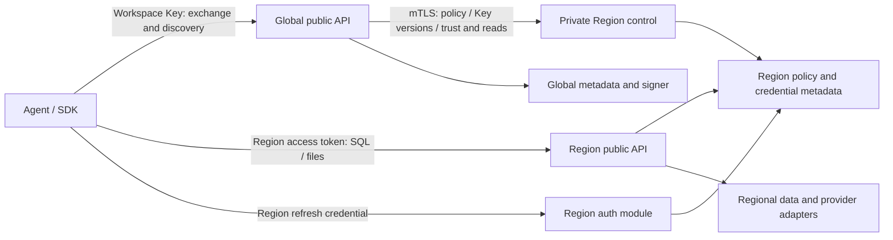

# Global and regional OpenAPI security design

- Status: Owner-confirmed direction; protocol, schemas, default durations and migration mechanics
  below are proposed for implementation and verification. They are not deployed capabilities.
- Scope: Workspace Keys, Global/Region discovery and access, token/credential lifecycle,
  authorization, control-channel delivery, storage, recovery and native API acceptance.
- Baseline: `c1abc4be6a5dac5b4c246c8f16f83c5b6d6ae2ab`; implementation task [GH-84](https://github.com/mem9-ai/tidb.ai/issues/84).
- Owners' invariants: one customer-facing Workspace Key; Global-issued access; direct regional
  data calls; Global-initiated control only; established Region service survives Global outage;
  descendants follow their Key's version, permissions, expiry and locally received revocation.
- Existing behavior: the current regional Rust API owns Key creation, SHA-256 digests,
  action/resource grants, revocation and 7/30/90-day expiry; it supports direct Key access.
  Separate Global discovery/token endpoints, delivery and regional token renewal are not shipped.
  Existing resources, Key secrets, grants, expiry and provider bindings must be preserved.

## 1. Trust boundaries and topology

Public Global and public Region APIs have different origins, contracts and audiences; private
Region control has separate service identity and is never callable with a Workspace Key or
customer token. Global initiates policy delivery, status reads and all other cross-plane RPCs.
Region neither calls Global nor another Region, including for token introspection, JWKS,
credential refresh, metadata, policy or telemetry. Response bytes to a Global-initiated request
are allowed; Region-initiated requests, callbacks and unsolicited stream messages are not.
Network egress policy and missing Global client credentials enforce the boundary.

The threat model includes stolen bearer/refresh credentials, forged issuers or Region
descriptors, cross-Workspace/Region access, token substitution and replay, a compromised
unprivileged tenant or regional service, stale policy after partition, lost provider responses,
metadata restore/rollback, and denial of service. Compromise of a Global root signer, KMS or
trusted deployment operator has broader impact and requires incident response and rotation;
the API cannot guarantee containment against a fully compromised authority.

Client data bytes, SQL and query results travel directly to Region. Global discovery returns
only authorized Region descriptors, not provider URLs, connection secrets or private DuckDB
storage. Each descriptor binds `regionId`, HTTPS origin/base path, regional issuer/audience,
environment, capability/contract version and routing generation. SDKs validate descriptors
against deployment-owned trust/allowlists, never forward credentials to redirects or URL fields
from errors, and retain validated known routes for use without Global. A new client without a
valid cached route needs Global or an explicitly configured trusted Region.

Global and every Region use independent Meta authorities, SlateDB roots, IAM/KMS identities and
signing keys. Object storage is the durability authority for acknowledged state; caches and
indexes are rebuildable. Independent availability requires separate failure domains; putting
roles in one binary is composition, not isolation from process/host failure.

## 2. Identities, credentials and permissions

| Object                    | Owner and contents                                                                                                                     | Secret handling / authority                                                                                                       |
| ------------------------- | -------------------------------------------------------------------------------------------------------------------------------------- | --------------------------------------------------------------------------------------------------------------------------------- |
| Principal                 | Global account or service/agent identity; explicit Workspace membership                                                                | Owner/administrator identity is distinct from a Workspace Key.                                                                    |
| Workspace Key             | Global logical `keyId`, principal, Workspace, version, state, scopes, exact resource grants or explicit `*`, permitted Regions, expiry | High-entropy secret is shown once. It is presented to Global over TLS and never in URLs, logs, browser storage or provider calls. |
| Key verifier              | Global secret reference/version and a verifier over the high-entropy Key; not the Key itself                                           | Encrypted record and KMS/secret-manager access; no public API, audit output or regional execution receives a verifier.            |
| Access token              | Short-lived signed Global **or one-Region** credential with an immutable permission ceiling and Key version                            | SDK sends it only to the bound audience; Region cannot mint a Global or another Region token.                                     |
| Regional refresh family   | Region-owned family ID, verifier digest, generation, Key/version, grant ceiling, expiry, replay and revocation state                   | Rotates locally, durably and atomically; plaintext delivered once to the enrolled client over TLS.                                |
| Installed regional policy | Locally durable verified snapshot/delta, Key/grant and deny generations, resource ownership and signer trust                           | Last complete applied policy is authoritative locally; synchronization age alone never disables access.                           |

An owner can create/revoke Keys; a Key does not acquire Key-management or owner rights just
because it can read/write resources. Effective authorization is the intersection of current
local principal/membership, Workspace, Key status/version and expiry, Key action/resource/
Region grants, token ceiling, operation-specific permissions and canonical resource ownership.
Missing or malformed grants fail closed. `*` is explicitly future-inclusive; exact IDs never
expand implicitly. No `files:analyze` is inferred from read or write. Resource existence is not
disclosed to an unauthorized caller. Large resource grants use indexed records and stable
grant references, not unbounded resource arrays inside tokens or a workspace-sized transaction.

Native database users, provider keys, object-storage credentials, Meta tokens and private
filesystem bindings remain service-managed. Customers do not supply or receive them. Isolation
is enforced before provider I/O for every Workspace, Region, action and resource, including all
source and destination resources for import, export and DuckDB file sources.

Generate new Key secrets with a cryptographically secure random generator, targeting at least
256 bits of entropy. Verify without returning whether a Key ID or secret was the failing part;
use constant-time verifier comparisons and bounded per-source/per-Key throttling. Version any
verifier format and keep its server-held pepper in a separately protected secret store, if used.
Random Key secrets do not need a human-password policy; a leaked valid Key still authorizes its
grants until revocation is applied, so rate limits do not replace Key isolation and rotation.

## 3. Key, token and enrollment flow

The following paths and schemas are a proposed v1 contract; do not add them to the generated
OpenAPI until the corresponding native behavior and tests exist. Use resource creation semantics,
structured errors and a versioned authenticated product API. Do not claim OAuth conformance
solely because a flow resembles OAuth.

1. Owner `POST /api/v1/workspaces/{workspaceId}/keys` on Global creates a Key record and secret.
   Require owner authorization, explicit scopes/resource grants/Region grants and expiry. Return
   201, Location and secret once, `Cache-Control: no-store`; never recover plaintext later.
   Idempotent replay must not create a second secret; a lost secret response requires an explicit
   new Key rather than exposing or silently rotating the original.
2. Client `POST /api/v1/token-issuances` to Global authenticates the Workspace Key in an
   Authorization header and requests `audience: global` or a specific canonical `regionId` and
   optional narrower scopes. Global validates current Key/version/state/expiry, Workspace,
   Region assignment and grants before issuance. Return a short-lived access token, `expiresAt`,
   actual granted scope and authorized descriptor for Region. No Key in JSON, URL or Location.
   Global and Region audiences use separate tokens; no token grants both management and data.
3. For independent regional refresh, Global also supplies a short-lived, one-use, Region- and
   client-bound enrollment ticket **only after** that Region durably applied the matching grant
   and trust generation. Client calls the specified Region directly to create a refresh family.
   Region verifies ticket signature, audience, expiry, nonce, identity, local applied policy,
   resource ceiling and replay record; it atomically consumes the ticket and persists the family
   before returning the refresh credential. Lost enrollment response is an explicit uncertain
   outcome unless the declared, client-bound idempotent retry protocol safely returns the same
   sealed result. No second family or Region-to-Global call is allowed.
4. Client calls Region to create a token issuance using its refresh credential. Region checks
   possession, family generation, replay, Key state/version/actual expiry and current policy;
   it atomically rotates the credential and issues a Region-audience access token. A signed
   global access token remains usable only under the local Key/version/policy floor. Regional
   signing keys are regional; the Region cannot obtain Global's private key.
5. The SDK persists the regional refresh credential in OS/application secret storage and caches
   access tokens in memory, keyed by Workspace, principal, Key/version, Region, audience and
   client binding. Browser sessions use regional Secure, HttpOnly, host-only cookies with
   explicit Origin/CORS/CSRF/SameSite policy; credentials never enter web storage or URLs.

SDKs enroll automatically when the owner-authorized Key is permitted for that Region; this is
not a second provider Key or a separate customer setup workflow. Newly created/rotated Keys
cannot be used in a Region until its corresponding grant is applied. Existing locally valid
families remain usable during an outage within their last installed Key version and hard expiry.

Global owner login must use a trusted, configured identity provider and a verified authorization
code + PKCE flow with one-use state and nonce, exact issuer/audience/redirect checks, validated
signature and expiration, and session fixation/replay protection. Do not use an unverified
email or customer-controlled issuer as Workspace ownership evidence. Owner sessions, Global
Key-derived access tokens and Region tokens have distinct validation rules; neither a Region
token nor a Key with data scopes grants owner-only Key management. Add step-up authentication
for sensitive owner operations when the deployed identity provider supports it, and test the
declared profile rather than assuming MFA from an unverified claim.

### Proposed operation surface

These paths are design inputs, not current endpoints; the Global and Region operations below
may share a path only because their contracts, origins, token types and security schemes differ.
All Workspace-scoped paths are relative to `/api/v1/workspaces/{workspaceId}`.

| Authority / operation                         | Authentication and effect                                                            | Success and notable failures                                                                                                                                                                 |
| --------------------------------------------- | ------------------------------------------------------------------------------------ | -------------------------------------------------------------------------------------------------------------------------------------------------------------------------------------------- |
| Global `POST /keys`                           | Owner; create an explicitly scoped Key                                               | 201 + Key Location and one-time secret; 400 invalid grants, 403 non-owner, 409 idempotency conflict                                                                                          |
| Global `GET /keys` and `GET /keys/{keyId}`    | Owner; paginated list or inspect Key state and grants                                | 200 with non-secret metadata; exact grants are separately paginated where necessary; never return a verifier or secret                                                                       |
| Global `POST /keys/{keyId}/versions`          | Owner; explicit version rotation                                                     | 201 + version Location and one-time new secret; old descendants denied as each authority applies the floor                                                                                   |
| Global `GET /keys/{keyId}/versions/{version}` | Owner; inspect a Key version                                                         | 200 with version status and expiry, never a Key secret or verifier                                                                                                                           |
| Global `PATCH /keys/{keyId}`                  | Owner; conditional grant/expiry update using an ETag                                 | 200/202 with version/delivery status; 412 stale If-Match; broadening never changes an existing token ceiling                                                                                 |
| Global `DELETE /keys/{keyId}`                 | Owner; durable revoke intent                                                         | 202 + revocation status Location while targets are pending; GET status separately reports per-Region applied evidence                                                                        |
| Global `GET /key-revocations/{revocationId}`  | Owner; observe propagation without triggering delivery                               | 200 with bounded per-Region applied/pending state and pagination; unknown or foreign operation is 404                                                                                        |
| Global `GET /regions`                         | Global-audience access token; list authorized Region descriptors with bounded cursor | 200 with filtered descriptors; no native storage/credentials; 401 invalid token and 403 insufficient grant                                                                                   |
| Global `POST /token-issuances`                | Workspace Key; request Global or exact Region audience and narrower scopes           | 201 + no-store access token and, when explicitly enrolled and locally installed, one-use Region ticket; 401 invalid/expired/revoked Key, 403 outside grants, 409 Region policy not installed |
| Region `POST /refresh-families`               | Valid Region-bound ticket and proof; create an enrolled family                       | 201 + family Location and no-store one-time refresh credential; replay/unknown outcome follows the pinned retry contract                                                                     |
| Region `POST /token-issuances`                | Region refresh credential and proof; atomic rotation                                 | 201 + no-store Region access and rotated refresh credential; 401 invalid/expired/revoked proof, 409 replay or conflicting attempt, 503 durability unavailable                                |
| Region `DELETE /refresh-families/{familyId}`  | Owner of that family or an authorized regional administrator                         | 204 after local durable revocation; does not imply all other families or the Global Key were revoked                                                                                         |
| Region `DELETE /access-tokens/{tokenId}`      | Authorized token owner or regional administrator; locally deny an identified token   | 204 after durable scoped denial or for an already denied token; knowing an ID alone is not authorization; denial expires only after the token's original expiry                              |

In both Global and Region contracts, `GET /token-issuances/{issuanceId}` lets the authorized
issuance owner or administrator inspect bounded non-secret status until retention expires;
it never returns a bearer or refresh credential. Region also exposes
`GET /refresh-families/{familyId}` for an authorized family owner or regional administrator;
unknown or foreign families return 404 and verifier material is never exposed.

Token and refresh credentials are never placed in Locations, query strings or event bodies.
Where an issuance returns 201, its Location identifies bounded, authorization-protected issuance
metadata, not a bearer secret or a URL from which the secret can be retrieved. Credential-bearing
responses are `no-store`; idempotent retry of a secret-producing operation follows its specific
sealed-response protocol, otherwise an ambiguous result is reported and reconciled explicitly.
Authenticated invalid credentials return 401 with a stable code such as `INVALID_CREDENTIAL`,
`CREDENTIAL_EXPIRED` or `CREDENTIAL_REVOKED`; authorization failures return 403 or a documented
404 when necessary to avoid resource enumeration. A pending policy application is not represented
as an active Region grant. Use bounded errors and request IDs without echoing secrets. Unsupported
methods, malformed payloads, duplicate headers and incorrect media types have deterministic
documented 4xx responses; use `WWW-Authenticate` for applicable bearer authentication failures
and bounded `Retry-After` for throttling. Do not redirect authenticated cross-origin requests.
An unknown Key ID or incorrect secret receives the same generic failure. Return a more specific
expired/revoked reason only after verifying possession of the credential, without revealing
whether a guessed Key, Workspace or family exists.

Default access-token TTL of 15 minutes is a proposed operational setting, not a shipped value.
`token.exp <= min(Key.expiresAt, explicit grant end, issuer policy maximum)`; refresh and every
descendant are bounded by the original active Key expiry, not by synchronization age. Clock
skew is bounded and tested; excessive skew fails closed with an actionable regional error.
Region depends on its own trusted time source, not a Global time lookup. Detect backward clock
movement across restart using a durable regional time floor and trusted regional clock monitoring;
if time validity cannot be established, reject affected credentials rather than revive an
expired token. This is a regional dependency failure, not a policy-synchronization timeout.
Global availability, policy age or an enrollment ticket's delivery deadline never becomes an
implicit expiry of an already enrolled, otherwise valid regional family. The Key's actual expiry,
local deny, family revocation and an explicitly configured idle/absolute credential limit still
apply. A long Global outage cannot extend an expired Key or recover a lost client proof.

For public clients use sender-constrained credentials or rotation with replay detection; the
recommended agent profile uses DPoP-bound refresh and access tokens where supported, while a
separately documented short-lived bearer profile may be offered. DPoP validation includes
method, exact URI, signature, public-key binding, token hash, time/nonce and replay store; it
does not make a leaked private key safe. Implement and test the claimed profile before calling it
DPoP/OAuth compliant. References: [RFC 9700](https://www.rfc-editor.org/rfc/rfc9700.html),
[RFC 9449](https://www.rfc-editor.org/rfc/rfc9449.html).

## 4. Token validation and regional enforcement

If JWT is selected, use a vetted library with pinned asymmetric algorithms and explicit token
type. Validate bounded size, signature, issuer, exact audience, environment, Region, subject,
Workspace, Key ID/version, grant/policy generation, `iat`, `nbf`, `exp` and token ID before any
protected data/provider operation. Global and Region validators use mutually exclusive types,
audiences and issuer/key sets. Reject `none`, algorithm confusion, invalid signatures, wrong
issuer/audience/Region, duplicate or malformed claims, unknown/retired `kid`, and untrusted
token-provided key URLs. Trust material comes from locally installed authenticated policy;
unknown keys fail closed locally rather than fetching Global JWKS. [RFC 8725](https://www.rfc-editor.org/rfc/rfc8725.html)
is the JWT validation reference, not proof of an implementation.

A Key version, access-token version and refresh-family generation are distinct. A token's
claims are a ceiling, never a substitute for current local policy. Immediately before admission,
pin and validate the local Key/policy generation and exact resource ownership; for multi-stage
or streaming operations define rechecks at each effect boundary. After an admitted write loses
its response, preserve its unknown outcome and do not automatically replay it during refresh.
An expired token rejected before provider I/O can be refreshed; an ambiguous timeout cannot.
Cancellation/revocation stops future admission; already admitted bounded operations and streams
follow documented completion/cancellation behavior and do not claim retroactive rollback.

Region-issued access tokens obtained from a refresh family also bind that family ID and a
family security epoch. Each admission checks the locally durable family state/epoch: family
revocation denies its already issued access tokens as well as future refreshes without revoking
other families under the same Key. Normal credential rotation increments the refresh generation,
not the security epoch, so it does not unexpectedly cancel concurrent valid access tokens.
Global-issued initial Region tokens that predate enrollment remain Key-bound; a Region can
apply an authorized, scoped token-ID denial until that token's original expiry without
modifying the parent Key. Such denials are regional state, subject to the same durability,
authorization, no-callback and rollback safeguards as other local policy. Never treat merely
guessing a token or family ID as authority to revoke it.
For a multi-node Region, a revocation/apply acknowledgement is valid only after every node that
can admit the affected request observes the new floor, or stale nodes are fenced out of serving.
Returning/recovered nodes load the durable floor before admission. Caches may accelerate checks
only with this invalidation/fencing guarantee; a process-local flag alone cannot establish it.

## 5. Key lifecycle and distributed revocation

Each Key has a stable `keyId`, monotonically increasing `version`, explicit expiry and independent
policy generation. Every access token and refresh family carries its originating Key/version.
Key create, rotation, expiry, permission edits and revoke are durable, audited Global operations.
Rotation creates a fresh secret and version; old-version Global tokens, Regional tokens and
refresh families are denied once the relevant authority applies the new floor. Key expiration is
checked locally even during Global outage; no access or refresh token can extend past it.
Renewing expiry is an owner-authorized versioned transition and can retain the same Key secret;
it does not return or regenerate that secret. Explicit rotation creates a new secret. In either
case, clients obtain new-version tokens after each authority applies the transition. Extending
Key expiry or changing grants is an owner-authorized, versioned policy transition;
old tokens do not silently inherit additional authority. Narrowed permissions apply immediately
on local activation; expansion requires a new issuance after local policy installation.

Global durably records a generation and per-target delivery state before it initiates signed,
idempotent mTLS updates. Region validates environment, installation, audience, monotonic epoch,
signature, predecessor/completeness and integrity; it durably stages the update, then atomically
activates the new grant/deny floor before acknowledging `applied`. Duplicate updates return the
same result; stale, gapped, altered or wrong-Region updates do not activate. Global pulls status
and records each Region's actual applied generation. Payloads, authentication material and
provider secrets do not appear in control-channel audit logs.

Regional restart/restore must recover the latest acknowledged policy and denial floor from
object-durable records, with writer fencing and verifiable generation/epoch history. A backup
or restore procedure must not silently roll the active floor back to an earlier valid signature:
use a separately protected regional anti-rollback checkpoint and retained verifiable history,
and verify their consistency before serving affected grants. If the latest floor cannot be
proven after local storage loss or rollback, fail closed for the affected scope and require
regional recovery; do not ask Global on the request path or silently reinstate an older grant.
The exact checkpoint mechanism and recovery guarantees are implementation gates, not shipped
capabilities. A Global outage alone does not constitute missing regional recovery evidence.

| Event                    | Global behavior                                                                    | Region that applied the event                                                     | Disconnected Region                                                                                                         |
| ------------------------ | ---------------------------------------------------------------------------------- | --------------------------------------------------------------------------------- | --------------------------------------------------------------------------------------------------------------------------- |
| Revoke / compromised Key | Mark revoked; deny new Global issuance and track each target                       | Deny old Key/version, access tokens and refresh families                          | Last applied state remains; mark revocation pending, with no promised time bound                                            |
| Rotate Key               | Advance version and issue a new secret once; old Global descendants denied         | Deny old-version descendants; allow new version only after installation           | Can continue old version only within last installed permission and original expiry; new version cannot be assumed installed |
| Renew Key expiry         | Advance version; keep the existing secret unless rotation was explicitly requested | Deny old-version descendants and issue new ones within the newly installed expiry | Old version remains bounded by its previously installed expiry until the update arrives                                     |
| Change grants            | Version the grant; no token can widen by itself                                    | Re-evaluate against applied policy; issue new tokens for authorized ceiling       | Continue last applied ceiling; Global reports pending, not globally effective                                               |
| Key expiry               | Global rejects at actual expiry                                                    | Region checks same actual expiry locally, including refresh                       | Same local expiry; Global availability cannot extend it                                                                     |

`revoked` at Global means Global has committed intent, not that every Region has applied it.
Expose a separate `fullyApplied`/per-target state and applied-generation evidence. A strict
all-Regions-effective operation can remain pending until each target acknowledges; declaring
success must not hide an unreachable Region. If the product requires immediate revocation even
for a partitioned Region, that Region must fail closed, which conflicts with the selected
availability guarantee. Do not imply both are simultaneously guaranteed.

## 6. Regional continuity, compromise and key rotation

With an installed policy and enrolled client, stop Global and its metadata: a known Region
continues reads, writes, access-token replacement, and recovery after Region restart using only
regional state/signers and regional dependencies. Failed control synchronization or stale age is
not an access-expiry lease. A client that never enrolled or lost its local credential needs a
valid independent regional proof; Global-only SSO cannot magically restore it while Global is
down. Optional direct regional Key verification requires an explicit delegated profile and local
verifier lifecycle, and must not silently upgrade an old expiring Key to a continuity grant.

Refresh families retain consumed-generation evidence. A replay of an authenticated prior token
outside the precise retry window revokes that family; unauthenticated guesses cannot revoke it.
Use single-flight client refresh and a bounded, client/proof/attempt-bound sealed response if the
protocol supports retry after a lost rotation response. Prevent a delayed response from replacing
a newer credential; no retry may mint extra families. Define the retry window and storage cost
before release. Store digests or keyed verifiers, never plaintext refresh tokens or DPoP keys.

Signer rotation stages the new public key to target Regions before use, publishes a generation,
and retains old verification keys until their tokens' maximum legal expiry or local denial. A
compromised signer uses an emergency deny generation and affected-family revocation; disconnected
Regions retain the unavoidable pending status. No verifier auto-trusts a token-provided key or
falls back to Global. Region signing material is confined to Region KMS/Vault with regional
recovery; Global cannot use it to mint regional tokens. Alerts and break-glass recovery must not
introduce an implicit Region -> Global dependency.

## 7. Transport, API and data safety

Public API/issuer/discovery endpoints require HTTPS with verified server identity; plaintext is
allowed only for explicitly configured loopback tests. Global -> Region control requires TLS 1.3
mutual authentication, pinned environment/authority identity, least-privilege service roles,
request/response size limits, deadlines and no redirects. TLS termination, trusted forwarded
headers, CORS/Origin/Host and CSRF must be explicit; never trust user-controlled forwarded host
to construct a credentialed redirect. Authentication failures use uniform bounded errors and no
secret details; response headers include `Cache-Control: no-store` for credentials and tokens.

Validate content types, UTF-8, payload/decompression size, pagination, file paths, version
conditions, SQL/time/result budgets and provider arguments. Recheck authorization on all
resource/source/destination boundaries. Preserve existing conditional updates, bounded read-only
SQL, query-scoped file snapshots and disposable Execute isolation; no internal credential may
enter SQL, Bash, downloads, logs, OpenAPI examples or errors. Per-principal/Key, per-Workspace,
per-IP and per-Region admission/rate limits must prevent a noisy tenant from consuming shared
control, auth, execution or object-store capacity; document thresholds and backpressure.

Audit safe IDs, action, decision, Region, Key/version, policy generation, issuer, operation ID,
time and result. Do not record bearer tokens, raw Keys, verifier digests, SQL/file content or
provider credentials. Region keeps durable local audit; Global only pulls permitted summaries.
Metrics distinguish denied, expired, stale/pending propagation, unknown outcomes and dependency
failures without leaking tenant secrets. Use bounded retention, access control and trace IDs.

## 8. Metadata layout and scale

Illustrative logical KV records, each independently addressable and encrypted; final scopes,
transaction boundaries and indexes require the [metadata scale design](metadata-scale.md):

| Authority | Key pattern                                      | Value / constraint                                                                              |
| --------- | ------------------------------------------------ | ----------------------------------------------------------------------------------------------- |
| Global    | `workspaces/{ws}/keys/{keyId}`                   | Principal, version, state, expiresAt, grant reference, verifier secret reference; never raw Key |
| Global    | `workspaces/{ws}/key-versions/{keyId}/{version}` | Version lifecycle, rotation/revocation and immutable audit reference                            |
| Global    | `workspaces/{ws}/grants/{grantId}/...`           | Partitioned action/resource/Region grant edges and policy generation                            |
| Global    | `policy-delivery/{region}/{ws}/{generation}`     | Desired generation, idempotent command and per-target applied/pending status                    |
| Region    | `workspaces/{ws}/policy/{generation}`            | Signed complete policy chunks, immutable provenance and monotonic active/deny floor             |
| Region    | `workspaces/{ws}/refresh-families/{familyId}`    | Key/version, client binding, verifier digest, generation, replay and revocation state           |
| Region    | `trust/{issuer}/{kid}`                           | Locally installed issuer, audience, public key and retirement/deny generation                   |

These are logical patterns, not existing physical keys or a mandate to scan millions of records.
Workspace ownership is separate from shard/group boundaries. Use direct Key/family/Workspace
lookup, bounded prefix indexes and paginated operations; do not hold all resources, sessions or
tenants in one document, lock or transaction. Refresh rotation introduces durable writes and
must be load-tested at expected active-agent count, token TTL, fan-out, object-store latency,
recovery and per-cell cost before committing production defaults. Signing, cache hits or slow
control-plane writes do not by themselves prove capacity.

## 9. Existing resources and credentials: non-destructive migration

1. Inventory current regional Workspace/resource IDs, region/authority, Key IDs, SHA-256
   verifier records, exact scopes/resource IDs, wildcard semantics, creation/expiry/revocation,
   and encrypted provider-binding/credential references. Snapshot only to approved encrypted
   backups; never export raw provider secrets. Verify backup restoration separately.
2. Add versioned Global and regional policy/credential records alongside existing records.
   Reuse the exact Key secret, ID, grants and hard expiry: the existing SHA-256 digest is a
   verifier, so Global can support a versioned legacy verifier without recovering plaintext.
   It may be encrypted or wrapped with a server-held pepper, with a deterministic verification
   path explicitly specified and tested; do not hash the digest as if it were the original Key.
   Existing restricted grants never become wildcard and legacy Keys do not acquire continuity
   authority or longer expiry by exchange.
3. Global initiates a bounded, authenticated Region export of **only the minimum verifier and
   grant metadata needed** under a dedicated migration identity; native provider passwords and
   tokens stay in Region. Encrypt transport and target metadata, prohibit logs, require Region
   authorization and an auditable record. Match Workspace/Key identity and version; never scan
   another tenant or forward an agent's Key as an operator credential.
4. Until cutover, preserve the existing regional Key writer as authority; snapshot plus bounded
   change reconciliation must cover create/revoke/expiry during transfer. Fence the old writer
   for the exact Key scope, reconcile expected versions and counts/digests securely, atomically
   publish the new authority epoch, then install/ack regional policy. No simultaneous writers,
   silent rollback of revocations, Region-to-Global callback or reconstructed plaintext.
   Resolve unknown commits from durable receipts. A conflict or mismatch blocks that Key's
   cutover and retains the existing authority; do not reset, rotate or re-provision it.
5. Verify old Key still authenticates with identical rights and expiry, denied access remains
   denied, resource IDs and provider credential references match, and Region restart preserves
   data. Keep a read-only encrypted rollback record and clear authority/fencing procedure;
   rollback must preserve post-cutover revocations and cannot replay an obsolete Key policy.
   Retire regional direct-Key support only after a separately reviewed client migration and
   parity evidence. This design authorizes no live migration or credential rotation.

## 10. OpenAPI and acceptance gates

Generate distinct Global and Region public OpenAPI artifacts from shared schemas/permission
definitions, with unique operation IDs, explicit audience/auth scheme, response headers, errors,
retry behavior and route ownership. Global contract includes Key management, authorized Region
discovery, issuance and per-Region propagation state. Region contract includes local enrollment,
refresh/revocation, SQL/files/import/export and existing resource operations. A private control
contract is not bundled with the customer SDK. An illustrative path in this design is not an
implemented promise; update runtime, generator, types, clients, docs and tests together.

| ID     | Required native acceptance evidence                                                                                                                                                                                                                                                                                                                                                                        |
| ------ | ---------------------------------------------------------------------------------------------------------------------------------------------------------------------------------------------------------------------------------------------------------------------------------------------------------------------------------------------------------------------------------------------------------- |
| SEC-01 | Owner versus Key creation/management; correct and wrong Workspace, Region, audience, issuer, scope, resource, expiry and revoked Key; no provider I/O on denial.                                                                                                                                                                                                                                           |
| SEC-02 | Signed token type/algorithm/claims/key rotation, wrong environment or Region, unknown key, malformed/oversized and cross-audience substitution. No Global introspection or redirect-based credential forwarding.                                                                                                                                                                                           |
| SEC-03 | Issuance/enrollment/refresh, lost response, simultaneous requests and replay; local family revocation denies its issued access tokens without affecting another family; authorized token-ID denial is scoped and expires safely; restart preserves verifier/generation and emits no duplicate credentials.                                                                                                 |
| SEC-04 | Rotate/revoke/narrow grants: Global and each Region report pending versus applied; old Key-version tokens/families fail after local apply; expiry remains a hard local bound.                                                                                                                                                                                                                              |
| SEC-05 | Independent Global and Region processes: discover/enroll, stop or partition Global and its Meta, advance an injected clock past the access-token expiry while the Key remains valid, then locally renew, perform Region SQL and file writes/readback, restart Region and renew/read/write again; observe no Region-to-Global connection. Test fixed-Key-expiry denial and missing client proof separately. |
| SEC-06 | Compromised or old signer, overlapping rotation, unknown `kid`, delayed/stale/gapped/corrupt policy, mTLS identity and TLS downgrade; no stale policy rollback or accidental fail-open.                                                                                                                                                                                                                    |
| SEC-07 | S3 recovery, Key/refresh receipt and policy-floor durability, crash at every migration/fence stage, exact resource/grant/expiry/credential-reference parity; no replacement provisioning or secret exposure.                                                                                                                                                                                               |
| SEC-08 | API and SDK hostile origins/redirects, Workspace collision, replay, logs/redaction, bounded requests, quotas, cross-resource import/export authorization and unknown write outcome.                                                                                                                                                                                                                        |
| SEC-09 | Owner OIDC issuer/audience/signature/state/nonce/PKCE and callback replay; Key tokens and Region tokens cannot impersonate an owner or manage Keys.                                                                                                                                                                                                                                                        |

No existing single-origin test, mocked SQL provider, cached route or successful metadata startup
alone proves SEC-05 or real cloud compatibility. CI must use isolated temporary S3-compatible
storage and credentials; any live provider verification is separate and explicitly authorized.
Complete implementation and measured capacity evidence precede production/security claims.

## 11. Release sequencing and unresolved implementation decisions

1. Freeze the reviewed API/authorization and transition contract, including the precise
   Key-rotation cutover/retry algorithm and whether the agent DPoP profile is mandatory.
2. Implement Global identity/Key authority, discovery and versioned delivery, plus Region policy
   storage and acknowledgements; keep current API and Key writer authoritative until cutover.
3. Implement Region enrollment/signing/refresh, complete SDK/Console origin selection and
   generate the separate contracts. Exercise SEC-01 through SEC-08 before enabling traffic.
4. Run the non-destructive migration per Workspace/cohort with reconciliation, rollback and
   per-Region evidence. Move authority only after parity; preserve existing client behavior
   until a separately reviewed migration retires it.

Choose the exact KMS, client proof method, cross-site browser profile, rotation retry window,
policy batching and regional shard placement only with explicit integration/security evidence.
Arbitrary-duration service and instantaneous remote revocation are not both available during a
partition; policy defaults must retain the owner-selected regional availability invariant.
